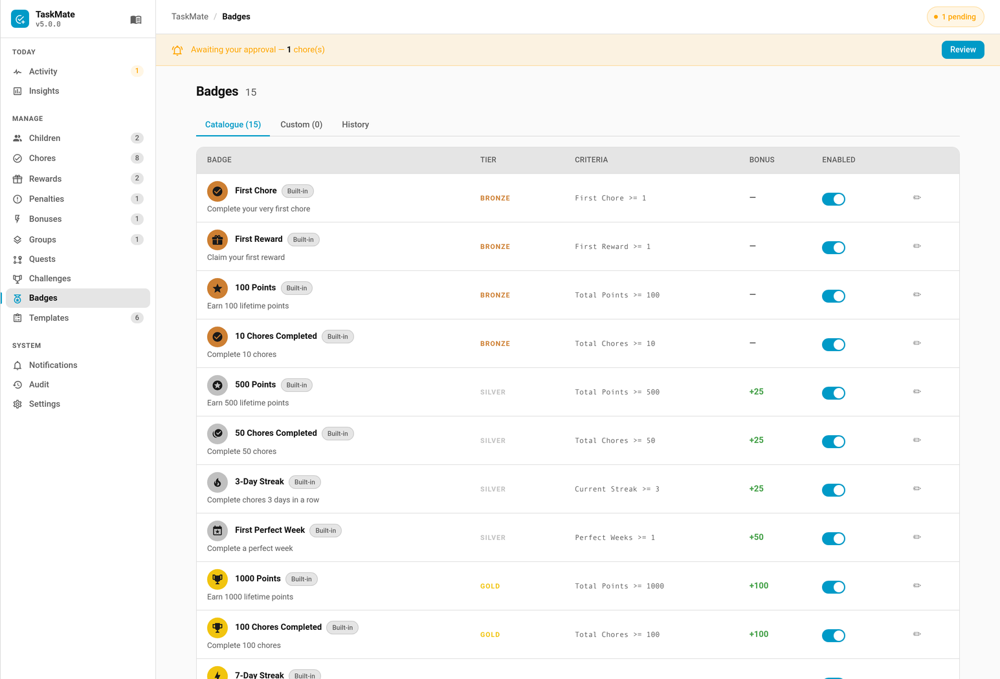

# Achievement Badges

Milestone-based recognition layered on top of the existing chores, streaks, and rewards systems. 15 built-in badges across four tiers (Bronze, Silver, Gold, Platinum), plus full support for parent-created custom badges with multi-criterion rules combined with AND or OR logic.




---

## How It Works

```
Child reaches milestone → Badge auto-awarded → Optional point bonus + notification
```

Badges are evaluated automatically whenever a child's stats change (chore completion, streak update, perfect week, etc.). When all criteria for a badge are met, it is awarded instantly. Parents can also award badges manually for anything that doesn't fit a metric.

---

## Tiers

Each badge belongs to a tier that determines its visual styling and prestige:

| Tier | Colour | Description |
|------|--------|-------------|
| **Bronze** | `#e08a3c` | Entry-level achievements |
| **Silver** | `#a8b8c8` | Intermediate milestones |
| **Gold** | `#ffc107` | Significant accomplishments |
| **Platinum** | `#4dd9e8` | Elite achievements |

---

## Built-in Catalogue

15 built-in badges ship with TaskMate. Their criteria, name, description, and icon are frozen so installs stay consistent — but you can toggle them on/off and edit their `point_bonus`, tier, assignment, and notify-on-earn settings.

| Tier | Badge | Criteria |
|------|-------|----------|
| Bronze | First Chore | Complete 1 chore |
| Bronze | First Reward | Claim 1 reward |
| Bronze | 100 Points | Earn 100 total points |
| Bronze | 10 Chores Completed | Complete 10 chores |
| Silver | 500 Points | Earn 500 total points |
| Silver | 50 Chores | Complete 50 chores |
| Silver | 3-Day Streak | Reach a 3-day streak |
| Silver | First Perfect Week | Earn 1 perfect week |
| Gold | 1000 Points | Earn 1000 total points |
| Gold | 100 Chores | Complete 100 chores |
| Gold | 7-Day Streak | Reach a 7-day streak |
| Gold | 5 Perfect Weeks | Earn 5 perfect weeks |
| Platinum | 5000 Points | Earn 5000 total points |
| Platinum | 30-Day Streak | Reach a 30-day streak |
| Platinum | 10 Perfect Weeks | Earn 10 perfect weeks |

---

## Custom Badges

Create your own badges via the Admin Panel or services. Custom badges support any combination of metric criteria, each with its own comparison operator, combined with either **AND** or **OR** logic.

- **AND** (default) — every criterion must pass for the badge to auto-award.
- **OR** — the badge auto-awards as soon as *any one* criterion passes.

The combinator is set per badge with the `combinator` field (`AND` or `OR`).

### Operators

Each criterion is a `{ metric, operator, value }` object. The `operator` controls how the child's current metric value is compared against `value`:

| Operator | Meaning |
|----------|---------|
| `>=` | Greater than or equal (default) |
| `>` | Strictly greater than |
| `<=` | Less than or equal |
| `<` | Strictly less than |
| `==` | Exactly equal |
| `!=` | Not equal |

If `operator` is omitted or unrecognised, TaskMate falls back to `>=`.

### Available Metrics

| Metric | Description | Example |
|--------|-------------|---------|
| `total_points` | Lifetime points earned | `total_points >= 2000` |
| `total_chores` | Lifetime chores completed | `total_chores >= 50` |
| `total_rewards` | Lifetime rewards claimed | `total_rewards >= 5` |
| `current_streak` | Current consecutive-day streak | `current_streak >= 14` |
| `best_streak` | Best streak ever achieved | `best_streak >= 30` |
| `perfect_weeks` | Total perfect weeks earned | `perfect_weeks >= 3` |
| `first_chore` | First chore completed (use value `1`) | `first_chore >= 1` |
| `first_reward` | First reward claimed (use value `1`) | `first_reward >= 1` |

### Empty Criteria = Manual Award Only

A badge with no criteria can only be awarded by a parent pressing "Award to…" in the admin panel or calling `taskmate.award_badge_manually`. Use this for subjective achievements like "Best Helper This Week" or "Great Attitude".

### Multi-Criterion Example (AND)

```yaml
service: taskmate.add_badge
data:
  name: "Holiday Helper"
  description: "Earned for big effort during school holidays"
  icon: mdi:beach
  tier: silver
  point_bonus: 30
  criteria:
    - { metric: total_chores, operator: ">=", value: 20 }
    - { metric: current_streak, operator: ">=", value: 3 }
  combinator: AND
  assigned_to: [child_id_1, child_id_2]
  notify_on_earn: true
```

With `combinator: AND` (the default), both criteria must be true at the same time for the badge to auto-award.

### Multi-Criterion Example (OR)

```yaml
service: taskmate.add_badge
data:
  name: "All-Rounder"
  description: "Hit any one of these big targets"
  icon: mdi:star-shooting
  tier: gold
  point_bonus: 50
  criteria:
    - { metric: total_points, operator: ">=", value: 1000 }
    - { metric: best_streak, operator: ">=", value: 14 }
    - { metric: perfect_weeks, operator: ">=", value: 5 }
  combinator: OR
  notify_on_earn: true
```

With `combinator: OR`, the badge auto-awards as soon as the child meets *any one* of the three targets.

### Using Other Operators

Operators other than `>=` let you target exact or upper-bound values:

```yaml
service: taskmate.add_badge
data:
  name: "Comeback Kid"
  description: "Back on track after a slip"
  icon: mdi:restart
  tier: bronze
  point_bonus: 10
  criteria:
    - { metric: current_streak, operator: "==", value: 1 }
    - { metric: total_chores, operator: ">", value: 50 }
  combinator: AND
```

---

## Point Bonuses

Each badge can award optional bonus points when earned. The bonus is a one-time credit applied at the moment the badge is awarded.

- Set `point_bonus` when creating or editing a badge (default: 0)
- The bonus is credited to the child's balance and logged as a transaction
- If a badge is **revoked**, the bonus is automatically reversed (deducted from the child's balance)
- Silent backfill (see below) never credits point bonuses — only live awards do

---

## Retroactive Backfill

When TaskMate is first updated to a version with badges (v3.8.0+), or when a previously-disabled built-in badge is re-enabled, badges are silently awarded for milestones children have already passed.

- A child with 200 lifetime points instantly receives the "100 Points" badge
- Silent backfill **never fires notifications** and **never credits point bonuses**
- The feature works on day one without causing point inflation

Use `taskmate.rebuild_badges` to manually re-run the backfill sweep (e.g. after enabling a previously-disabled built-in or tweaking custom badge criteria).

---

## Display

### Badges Card

The dedicated `taskmate-badges-card` shows a full grid view of all badges for one or all children.

```yaml
type: custom:taskmate-badges-card
entity: sensor.taskmate_overview
child_id: a8c8376a            # optional — filter to one child
header_color: "#764ba2"
```

**Features:**
- Earned badges show in full tier colour with icon, name, earned date, and point bonus badge
- Locked badges show greyed out with a progress bar and the closest-criterion completion percentage. *(Those bars only started drawing in v5.1.1 — they read a `closest_criterion` field that nothing had ever published.)*
- Tier filter dropdown (All / Bronze / Silver / Gold / Platinum)
- Newly-earned badges animate with a pop + shimmer effect
- Detects a new badge from the badges sensor, so the highlight works for every user. Before v5.0.4 the card subscribed to the `taskmate_badge_earned` bus event, which Home Assistant refuses for non-admin users — that logged an error on every dashboard load and the highlight never fired

### Child Card Badge Strip

The child card shows an inline strip of up to 5 most-recently-earned badges below the points readout. Auto-hidden when the child has zero earned badges.

- Tap the strip to open the admin panel's badges section
- Disable with `show_badges: false` on the child card

### Child Card — Next Badge Progress (v5.1.1+)

Under the earned strip, the child card shows a compact **Next up** line for the closest unearned badge: tier-coloured icon, badge name, a thin progress bar and a `845 / 1000` count taken from the badge's closest criterion.

Before v5.1.1 the child card only ever showed badges already won, so a child working toward a long badge got no feedback until it popped — that progress lived only in the Badges card.

- Auto-hidden when there is nothing left to earn, or when every remaining badge is still at 0%
- Tap it to open the admin panel's badges section, same as the earned strip
- Rendered on all six [design styles](Card-Design-Styles.md)
- Disable with `show_next_badge: false` on the child card

#### "One more and it's yours!" (v5.8.0+)

When that badge is **one unit short** of its target, a short line of encouragement appears under the bar (#893).

Distance is measured in the criterion's own units rather than a percentage, because 90% of a ten-week badge is a week away while 90% of a hundred-point badge is ten points away. It is deliberately rare — a line that shows for half the climb has stopped meaning anything by the time it matters.

- Badges you award by hand carry no criterion, so they never nudge
- Disable with `show_badge_nudge: false` on the child card

### Admin Panel — Badges Section

Three tabs in the admin panel's Badges area:

| Tab | Content |
|-----|---------|
| **Catalogue** | Built-in badges with enable/disable toggles and editable settings |
| **Custom** | Create, edit, and delete custom badges |
| **Award History** | All awarded badges with AUTO / MANUAL / SILENT source pills and one-click revoke |

Revoking a badge from the Award History tab automatically reverses any point bonus that was credited.

---

## Sensor

Each child gets a dedicated badge sensor:

**Entity:** `sensor.taskmate_<child_slug>_badges`

| Field | Description |
|-------|-------------|
| **State** | Count of earned badges |
| **`earned`** | Array of earned badge objects with `badge_id`, `name`, `tier`, `icon`, `earned_at`, `source` (auto/manual/silent), `point_bonus` |
| **`available`** | Array of all available badges with `badge_id`, `name`, `tier`, `progress_pct`, `criteria`, and (v5.1.1+) `closest_criterion` — `{metric, current, target}` for the criterion nearest completion |
| **`total_badges`** | Total number of badges in the system |

---

## Notifications

When a badge auto-earns, TaskMate sends:

1. A **persistent HA notification** (in the notification bell)
2. An optional **mobile push notification** (if notification routing is configured for badge_earned — see [Notifications](Notifications.md))
3. A **`taskmate_badge_earned`** bus event for power users

Per-badge `notify_on_earn` toggle controls whether notifications fire (default: `true`).

When 3 or more badges earn in a single evaluation cycle, notifications are batched into a single combined message instead of firing separately.

Streaks themselves can also fire a separate **streak milestone** notification when a child reaches a streak milestone. It is off by default — opt in on the Notifications tab. See [Notifications](Notifications.md).

---

## Services

### `taskmate.add_badge`

Create a custom badge.

| Field | Required | Default | Description |
|-------|----------|---------|-------------|
| `name` | Yes | — | Badge display name |
| `description` | No | `""` | Description text |
| `icon` | No | `mdi:medal` | MDI icon |
| `tier` | No | `bronze` | `bronze`, `silver`, `gold`, or `platinum` |
| `point_bonus` | No | `0` | Bonus points awarded on earn |
| `criteria` | No | `[]` | List of `{metric, operator, value}` objects. `operator` is one of `>=`, `>`, `<=`, `<`, `==`, `!=` (defaults to `>=`). Empty = manual-award only |
| `combinator` | No | `AND` | How criteria combine: `AND` (all must pass) or `OR` (any) |
| `assigned_to` | No | all children | List of child IDs — empty = all children |
| `notify_on_earn` | No | `true` | Fire notifications when earned |

### `taskmate.update_badge`

Update an existing badge. Only supplied fields are changed. Built-in badges allow editing `point_bonus`, `tier`, `assigned_to`, `notify_on_earn`, and `enabled` only — criteria, name, description, and icon are frozen.

| Field | Required | Description |
|-------|----------|-------------|
| `badge_id` | Yes | ID of the badge to update |
| `name` | No | New name (custom only) |
| `description` | No | New description (custom only) |
| `icon` | No | New icon (custom only) |
| `tier` | No | New tier |
| `point_bonus` | No | New point bonus |
| `criteria` | No | New criteria list (custom only) — same `{metric, operator, value}` shape as `add_badge` |
| `combinator` | No | New combinator (custom only) — `AND` or `OR` |
| `assigned_to` | No | New child ID list |
| `notify_on_earn` | No | New notification setting |

### `taskmate.remove_badge`

Delete a custom badge. Built-in badges cannot be removed — disable them instead via `update_badge`.

| Field | Required | Description |
|-------|----------|-------------|
| `badge_id` | Yes | ID of the badge to remove |

### `taskmate.award_badge_manually`

Manually award a badge to a child, bypassing criteria evaluation.

| Field | Required | Description |
|-------|----------|-------------|
| `badge_id` | Yes | ID of the badge to award |
| `child_id` | Yes | ID of the child |

Point bonus is credited. Notification fires if `notify_on_earn` is true. The award is recorded with source `MANUAL`.

### `taskmate.revoke_badge`

Revoke a previously awarded badge. Automatically reverses any point bonus that was credited.

| Field | Required | Description |
|-------|----------|-------------|
| `awarded_badge_id` | Yes | ID of the awarded badge record (from the Award History in the admin panel or the sensor's `earned` array) |

### `taskmate.rebuild_badges`

Re-evaluate all badges across all children silently. Awards any newly-qualifying badges without firing notifications or crediting point bonuses. Useful after:

- Enabling a previously-disabled built-in badge
- Changing custom badge criteria
- Fixing data inconsistencies

No parameters required.

---

## Automation Examples

### Announce badge on a smart speaker

```yaml
alias: Announce badge earned
triggers:
  - trigger: event
    event_type: taskmate_badge_earned
actions:
  - action: tts.google_translate_say
    data:
      entity_id: media_player.kitchen_speaker
      message: >
        Congratulations {{ trigger.event.data.child_name }}!
        You earned the {{ trigger.event.data.badge_name }} badge!
```

### Flash lights on platinum badge

```yaml
alias: Platinum badge celebration
triggers:
  - trigger: event
    event_type: taskmate_badge_earned
conditions:
  - condition: template
    value_template: "{{ trigger.event.data.tier == 'platinum' }}"
actions:
  - action: light.turn_on
    target:
      entity_id: light.living_room
    data:
      flash: long
      color_name: cyan
```

---

## Related

- [Bonus Points](Bonus-Points.md) — streak milestones and perfect weeks (badge criteria sources)
- [Dashboard Cards](Dashboard-Cards.md) — badges card and child card badge strip
- [Notifications](Notifications.md) — notification routing for badge_earned events
- [Services](Services.md) — full service reference
