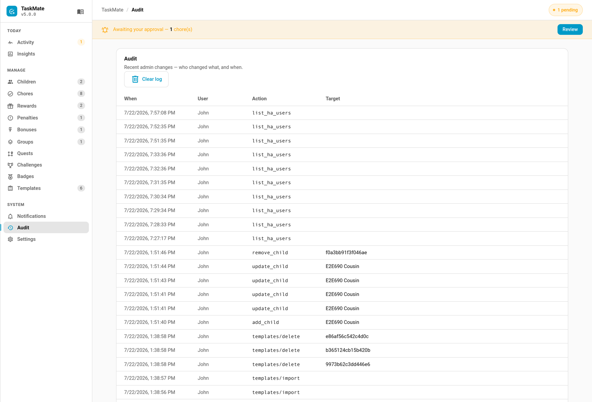

# Admin Audit Log

The admin audit log records every change made through the TaskMate admin panel — who made it, what it was, and when. It gives parents a simple history of administrative actions on the family's TaskMate setup.

Added in v4.0.0.

---

## What Is Logged

Every **successful, state-changing** admin command issued through the panel is recorded. Each entry captures:

| Field | Description |
|-------|-------------|
| **When** | Timestamp of the action (ISO 8601, shown in your local format) |
| **User** | The Home Assistant user who made the change — display name, falling back to user id |
| **Action** | The command name, e.g. `add_chore`, `update_reward`, `remove_child`, `apply_penalty` |
| **Target** | A best-effort, human-readable subject of the action |

### How the target is resolved

TaskMate fills the **Target** field on a best-effort basis, in this order:

1. The `name` in the request payload, if present (e.g. the name of a chore being created).
2. The resolved name of the referenced chore, child, or reward (`chore_id` / `child_id` / `reward_id`).
3. The raw id of another referenced object (`penalty_id`, `bonus_id`, `badge_id`, `group_id`, `template_id`, `completion_id`, `claim_id`, `parent_id`, `custom_id`, `awarded_badge_id`, `type_id`).

If none of these apply, the target is left blank.

### What is NOT logged

Read-only and audit-management commands do not create entries — fetching panel state, listing notify services, listing/getting templates, reading the notification config, and listing or clearing the audit log itself. Only commands that mutate data are recorded.

> Actions taken outside the panel (TaskMate **services** called from automations or scripts) are not captured by the panel audit log. Use the relevant [bus events](Automations.md#bus-events-reference) to track those.

---

## Where to View It

Open the **Admin Panel** and select the **Audit** tab. It shows a table of recent admin changes (When · User · Action · Target), newest first. The panel loads the newest 100 entries with the rest of its state.

See [Admin Panel](Admin-Panel.md) for how to open the panel.

---

## Retention & Limits

- The log is capped at **500 entries**. When full, the oldest entry is dropped as new ones are added.
- Entries are stored in TaskMate's own Store and persist across restarts.
- Entries are included in a [backup export](Backup-and-Restore.md).

---

## Clearing the Log

A **Clear log** button on the Audit tab removes all entries after a confirmation prompt. This cannot be undone. Clearing the log is itself not recorded as an entry.

---

## Related

- [Admin Panel](Admin-Panel.md) — where the Audit tab lives
- [Backup and Restore](Backup-and-Restore.md) — the log is included in exports
- [Automations](Automations.md) — bus events for tracking actions taken outside the panel
