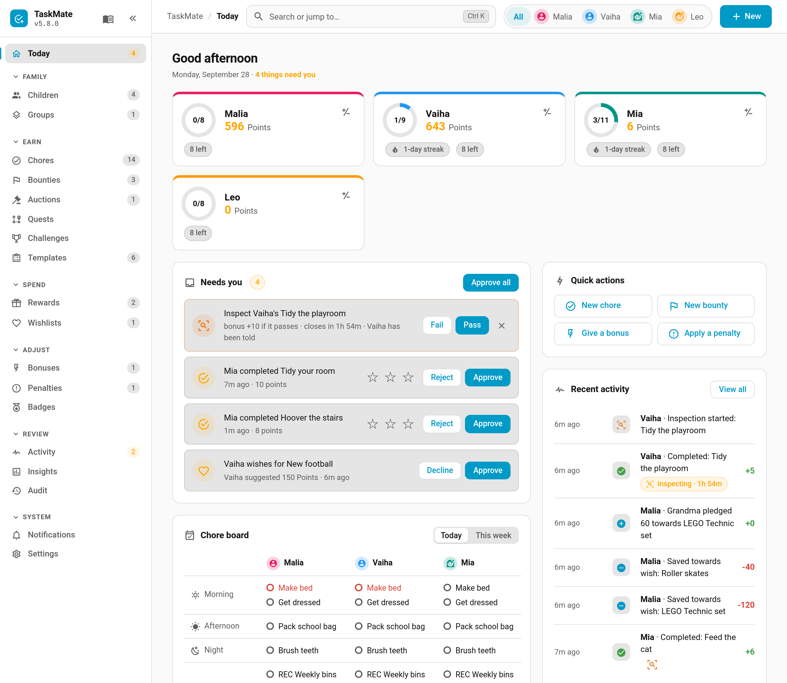
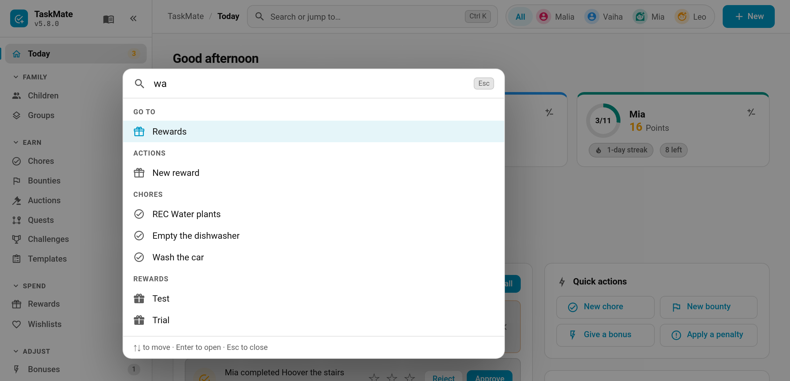
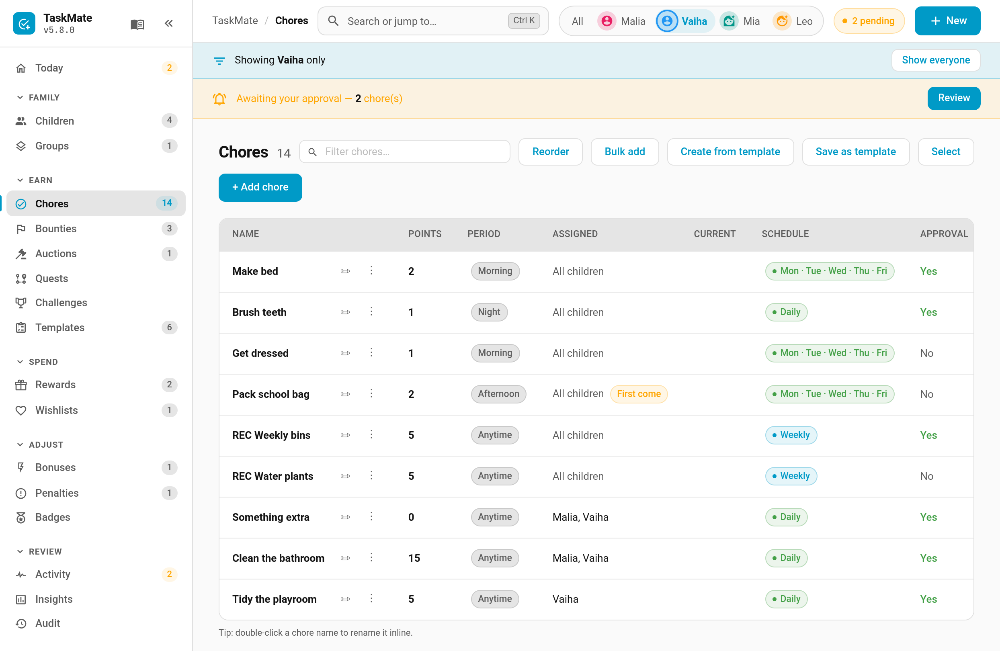
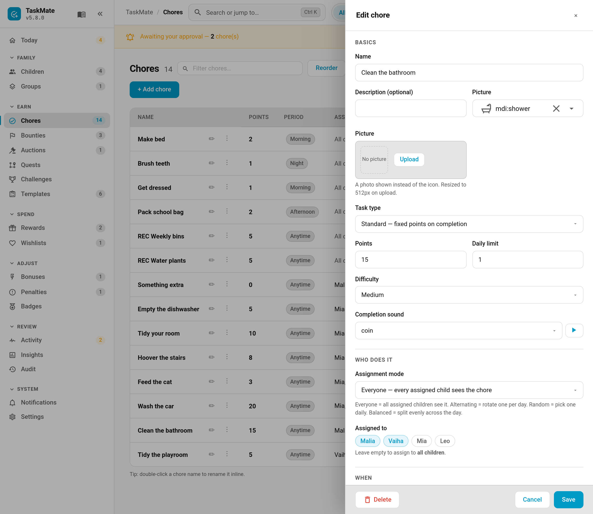
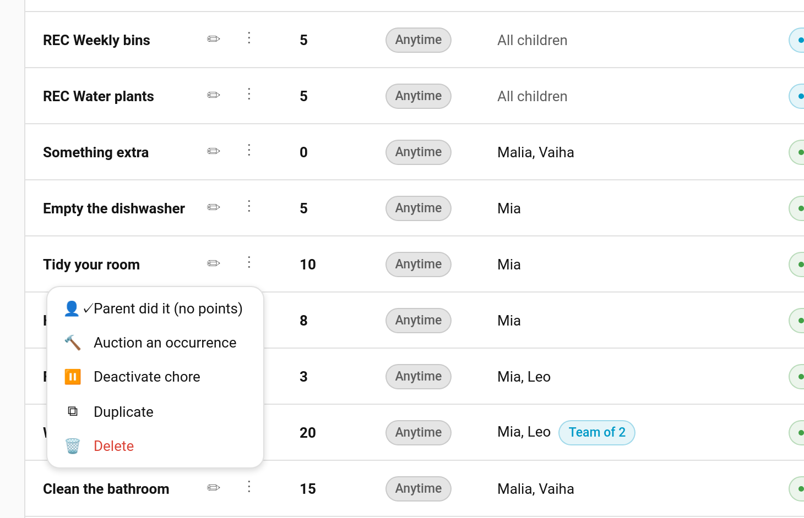

# Admin Panel

The Admin Panel is a web-based management dashboard accessible from the Home Assistant sidebar. It provides a single interface for managing all TaskMate configuration without navigating through the standard HA integration settings.

---

## Accessing the Panel

After installing TaskMate, a **TaskMate** entry appears in the HA sidebar with the icon `mdi:checkbox-marked-circle-plus-outline`.

Click it to open the panel at `/taskmate-admin`.

> **Note:** The panel requires an **admin** HA user. Non-admin users will not see the sidebar entry.

---

## Today (v6.0.0+)

The panel opens on **Today**, a single page that shows how the day is going and everything that needs you.

- **A card per child** with today's done/total ring, their points and streak, and a **±** button to give or take points. Click a child's card to filter the whole panel to them.
- **Needs you** gathers everything waiting on a parent in one list: chore and bounty approvals, reward claims, swap requests, new wishes and open [surprise inspections](Surprise-Inspections.md). **Approve all** clears the chore approvals in one go.
- **Chore board** shows each child's chores for today, grouped by time of day and marked done, awaiting approval, to do or missed. Click a chore to open its editor. The **This week** tab shows each day's done/total.
- **Quick actions** (new chore, new bounty, give a bonus, apply a penalty) and **Recent activity**.
- **Asked for help** *(v7.0.0)* lists each open "I'm stuck" request: who, which chore, their message and when. **On my way** marks it answered, so the child's card stops saying help is on its way. See [Help Requests](Help-Requests.md).
- **Sick day** *(v7.0.0)* — the 🤒 button on each child's card gives them a sick day today (chores hidden, streak safe, no mandatory chore missed); tap it again to take it back. The card shows a **Sick day** pill, and a **Mood** pill with today's face once the child has done the [mood check-in](Mood-Check-In.md). See [Sick Days](Sick-Days.md).

When there are no children yet, Today offers **Start setup** (the [Setup Wizard](Setup-Wizard.md)) or **Add a child myself** instead.

---

## Navigation

On the **desktop**, the sidebar groups sections by what you're doing, each with a live count badge:

| Group | Sections |
|-------|----------|
| **Family** | Children, Groups |
| **Earn** | Chores, Bounties, Auctions, Quests, Challenges, Templates |
| **Spend** | Rewards, Wishlists, Raffles (v7.0.0) |
| **Adjust** | Bonuses, Penalties, Badges |
| **Review** | Activity, Insights, Audit |
| **System** | Notifications, Settings, [Help & feedback](Help-and-Feedback.md) (v7.2.0) |

Click a group heading to collapse it, and use **«** at the top to shrink the sidebar to icons. Both are remembered in your browser.

On a **phone**, a bottom bar gives one-tap access to **Today**, **Chores**, **Rewards** and **Children**, with **More** for everything else. The section picker at the top (added in v4.5.1) still lists every section, grouped the same way.

### Command search (Ctrl K)

Press **Ctrl K** (**⌘ K** on a Mac), or **/**, or click **Search or jump to…** in the top bar. Start typing to jump straight to any section, chore, reward, quest, challenge or child, or to run an action such as *Approve all*, *Give points*, *New chore* or *Run setup wizard*. Use the arrow keys and **Enter** to pick, **Esc** to close.

### Child filter

The row of faces in the top bar filters the panel to one child. With a child picked, Today, Children, Chores, Rewards, Quests, Challenges, Bonuses, Penalties, Activity and Wishlists show only what concerns them. A banner reminds you the filter is on; **Show everyone** (or **All**) clears it.

### New menu

The **+ New** button in the top bar creates a chore, bounty, reward, quest, challenge, child or auction from anywhere in the panel.

---

## What You Can Do

The admin panel provides full management for every aspect of TaskMate:

### Child Management
- Add new children with name and avatar
- Edit existing children (name, avatar, availability entities)
- Show a child's **photo** from their person entity instead of an icon (v6.4.0+, see [Children](Children.md#child-photos))
- Mark a profile as an **adult** with the **Adult profile** switch (v6.4.0+, see [Adult Profiles](Adult-Profiles.md))
- **Log a past job** for a job done on an earlier day that nobody ticked (v6.4.0+, see [Logging Past Jobs](Logging-Past-Jobs.md))
- Pick each child's **Colour** (v7.0.0+), which marks their avatar and name around the panel; *Automatic* picks one from their place in the list
- Remove children
- Set a **Kiosk PIN** for the shared wall tablet (v6.0.0+, see [Kiosk Mode](Kiosk-Mode.md))
- View child stats (points, streaks, completions)
- **Adjust points inline (v5.1.0+)** — each child card carries a row of quick buttons, **−20 −10 −5** and **+5 +10 +20** by default, plus **⋯** for a custom amount with an optional reason. Change the amounts in **Settings → Quick point amounts** (a comma-separated list, e.g. `5, 10, 20`). Every adjustment lands in the activity feed and can be undone from there.

### Chore Management
- Create chores with all configuration options
- Edit any chore field including assignment mode, scheduling, visibility, and bonus subtasks
- Configure timed task settings (rate, cap)
- Delete chores
- Reorder chores per child

#### The chore editor (v6.0.0+)

Adding or editing a chore opens the editor as a **side panel** on the right, so the list stays visible behind it. On a phone it fills the screen. The same editor opens from the Chores list, the Today chore board, command search and the **New** menu.

Its fields are grouped under five headings: **Basics**, **Who does it**, **When**, **Checking** and **More options**. More options holds the less-used sections: teamwork, bonus sub-tasks, NFC / QR tags, visibility and calendar, scheduled changes and weather. **Delete** sits in the footer when you're editing an existing chore, and **Esc** closes the panel. Nothing was removed from the old dialog; the fields are just grouped differently.

#### Chore row actions — kebab menu (v4.2.0+)

The **Chores** table collapses each row's per-row actions into a **⋮ kebab menu**. **Edit** stays inline; everything else lives in the menu:

- *Parent did it (no points)*: marks the chore done with no points awarded. On a chore shared by several children (everyone mode), the menu shows *Parent did it for everyone* and a *Parent did it for <child>* entry for each child, so you can clear it for one child and leave it open for the others.
- *Auction an occurrence* (v6.0.0+, see [Chore Auctions](Chore-Auctions.md))
- *Deactivate / Activate chore*
- *Skip* (rotation modes)
- *Swap* (rotation / first-come)
- *Duplicate*
- *Delete*

This also fixed the wide-screen horizontal scrolling the old inline button row caused.

**v4.3.0:** the **Edit** and **⋮** controls now sit inside the pinned task-name column, so they stay reachable next to each chore's title even when a wide table scrolls horizontally — no more scrolling to the far right to reach a row's actions. In bulk-select mode the name column un-pins and the actions scroll with it.

### Reward Management
- Create rewards with cost, icon, and assignment
- Toggle pool mode (savings jar) per reward
- Configure jackpot rewards
- Set quantity limits and expiration dates
- Delete rewards

### Bounties, Wishlists and Auctions (v6.0.0+)
- **Bounties** — post one-off jobs any eligible child can claim, and follow them through Active, Waiting approval and History. See [Bounty Board](Bounty-Board.md)
- **Wishlists** — approve or decline children's wishes, record family pledges and fulfil funded wishes. See [Wishlist](Wishlist.md)
- **Auctions** — put one day of an unpopular chore up for sealed bids. See [Chore Auctions](Chore-Auctions.md)

### Raffles (v7.0.0+)
The **Raffles** tab, under **Spend**, lists every raffle with its ticket price, tickets bought per child and the result.
- **New raffle** — name, prize, a fixed ticket price, the most tickets per child (0 = no limit), when it is drawn, and which children may take part (empty = everyone). Once anyone has bought a ticket the price can't change
- **Draw now** picks the winner straight away instead of waiting for the draw time
- **Call off** cancels an open raffle and refunds every ticket
- Children buy tickets on the [Raffle card](Dashboard-Cards.md#raffle-card). See [Raffles](Raffles.md)

### Penalty & Bonus Management
- Create, edit, and delete penalty/bonus definitions
- *(v7.0.0)* Give a penalty a **Make it right** chore, so the child can earn some or all of it back. See [Make-It-Right Penalties](Make-It-Right-Penalties.md)
- Apply penalties and bonuses to children directly

### Task Group Management
- Create task groups with sticky or spread policy
- Select which chores belong to each group
- Edit and delete groups

### Settings
- Configure all global settings:
  - Points currency name and icon
  - Weekend multiplier
  - Streak reset mode and milestones
  - Perfect week bonus
  - Notification service
  - Calendar projection days
  - History retention
  - Time-of-day boundaries (morning/afternoon/evening/night windows)
  - Default card design selector (see [Card Design Styles](Card-Design-Styles.md))
  - Show IDs toggle (see below)
  - **Setup wizard** (v6.0.0+) — run the guided setup again to add more. See [Setup Wizard](Setup-Wizard.md)
  - **Ready-made dashboards** (v6.3.0+) — create a Kids, Parents or Wall tablet dashboard filled in with your family. See [Ready-Made Dashboards](Ready-Made-Dashboards.md)
  - **Recaps** (v6.0.0+) — how often each child gets a Wrapped-style recap. See [Recaps](Recaps.md)
  - **Surprise inspections** (v6.0.0+) — the bonus, window and random daily pick. See [Surprise Inspections](Surprise-Inspections.md)
  - **Auto-approve after (hours)** (v7.0.0+) — approve chores nobody reviewed in time. See [Auto-Approve](Auto-Approve.md)
  - **Virtual pets** (v7.0.0+) — switch pets on and tune how they grow. See [Virtual Pets](Virtual-Pets.md)
  - **Personal weekly goals** (v7.0.0+) — let children set their own weekly target, and the bonus for reaching it. See [Weekly Goals](Weekly-Goals.md)

### Badge Management
- View built-in badge catalogue with enable/disable toggles
- Edit built-in badge settings (tier, point bonus, assignment, notify-on-earn)
- Create, edit, and delete custom badges with multi-criterion rules
- View award history with AUTO / MANUAL / SILENT source indicators
- Revoke awarded badges with automatic point bonus reversal

### Insights (v5.0.0+)
- **Fairness** — each child's share of the work over 7 / 14 / 30 days, flagged when someone is more than 15 percentage points off an even split
- **Friction** — which chores actually get done versus how often they come up, with a suggested action per chore
- **Week ahead** — chores and points projected across the next 7 / 14 / 28 days, including rotation
- **Health** — configuration problems (broken dependencies, deleted children, missing entities) with a **Show me** jump to each
- **Moods** (v7.0.0) — each child's end-of-day mood check-ins, with a count of tough days. The fairness view also shows [estimated minutes](Estimated-Minutes.md) when chores have them
- See [Insights](Insights.md)

### Templates (v4.0.0+)
- Browse built-in chore template packs and create chores from them
- Save your own chores as a custom template
- Export custom templates as a shareable pack, and import one somebody else made
- See [Template Packs](Template-Packs.md)

### Notification Management (v3.9.0+)
- Configure per-child notify services
- Add, edit, and delete parent recipients
- Configure the recipient routing matrix (which recipients get which notification types)
- Set per-recipient bedtime times for bedtime reminders
- Set global streak-at-risk cutoff time
- Create, edit, and delete custom scheduled notifications with day masks and recipient selection
- Send a test notification per type to verify routing (see [Notifications](Notifications.md#testing-a-notification))
- Choose how parent approvals are routed — everyone, whoever is home, or round-robin (see [Multi-Parent Approval Routing](Multi-Parent-Approval-Routing.md))

### Audit Log (v4.0.0+)
- View a record of every admin change made through the panel (who, what, when)
- See [Admin Audit Log](Admin-Audit-Log.md)

### Approval Workflows
- Approve or reject pending chore completions
- Approve or reject pending reward claims

---

## Configuration Lives in the Panel (v4.0.0+)

The deprecated **options / configure flow** (Settings → Devices & Services → TaskMate → Configure) was retired in v4.0.0. The admin panel at `/taskmate-admin` is now the sole configuration UI for day-to-day management — children, chores, rewards, task groups, settings, notifications, badges, and templates. Only the **initial setup** (points name and icon) still happens through a config flow when you first add the integration.

No data migration is needed: all TaskMate data lives in the integration's own Store, not in the config entry's options.

---

## Backup & Restore (v4.0.0+)

The **Settings** tab includes a **Backup & restore** section:

- **Export backup** downloads a full JSON snapshot of your TaskMate setup (`taskmate-backup.json`).
- **Restore backup** uploads a backup file and, after a confirmation prompt, **replaces all current data**.

Restoring is destructive and cannot be undone — reload the integration afterwards so per-child entities refresh. See [Backup and Restore](Backup-and-Restore.md) for full details and cautions.

---

## Custom Time-of-Day Periods (v4.0.0+)

The **Settings → Time-of-day boundaries** section lets you define your own day-part periods instead of the fixed four. You can rename the built-in periods, change their hours and icons, add as many of your own as you like (school run, bedtime, …), or reset to defaults.

- Each period needs a **name**, a **start** and **end** time, and an **icon**.
- Periods cannot **overlap**; a start must come before its end.
- A period that is still used by one or more chores **cannot be deleted** until those chores are reassigned — the panel names them.
- **Anytime** is built-in, all-day, and cannot be removed. Gaps between periods fall back to Anytime.
- Up to 24 periods are supported. The default four are Morning (06:00–12:00), Afternoon (12:00–17:00), Evening (17:00–21:00), and Night (21:00–23:59).

The label and time inputs render as native fields (v4.0.0, #397) so they work reliably across all Home Assistant versions. A chore's (or card's) `time_category` accepts any period id, plus `anytime` / `all`.

---

## Show IDs (v3.7.0+)

A toggle in the **Settings** tab that displays internal hex IDs on every entity card and row throughout the admin panel. These IDs are needed when writing automations or service calls (e.g. `taskmate.complete_chore` requires a `chore_id`).

### How to use

1. Go to the **Settings** tab in the admin panel
2. Flip the **Show IDs** toggle
3. ID badges appear immediately on all entity types:

| Tab | Where |
|-----|-------|
| Children | Below child name in card |
| Chores | Below chore name in row |
| Rewards | Below reward name in card |
| Penalties | Below penalty name in card |
| Bonuses | Below bonus name in card |
| Groups | Below group name in card |

Each badge shows the full 16-character hex ID with a copy button. Click the copy icon to copy the ID to your clipboard — a "Copied!" toast confirms.

The toggle is stored in your browser's `localStorage` — it's a per-browser preference with no backend change or restart required.

> **Tip:** You may not need to find IDs at all. Since v3.7.0, the HA automation editor shows entity names in dropdown selectors instead of blank text fields for all TaskMate service calls. See [Services — Dynamic Selectors](Services.md#dynamic-selectors-v370).

---

## Real-Time Updates

The admin panel communicates via WebSocket, so changes are reflected immediately without page refreshes. Any changes made in the panel are instantly visible on dashboard cards.

---

## Internationalisation

The admin panel is fully translated in all supported languages:

| Language | Code |
|----------|------|
| Danish | `da` |
| Dutch | `nl` |
| English | `en` |
| English (GB) | `en-GB` |
| French | `fr` |
| German | `de` |
| Norwegian Bokmål | `nb` |
| Norwegian Nynorsk | `nn` |
| Portuguese | `pt` |
| Portuguese (Brazil) | `pt-BR` |

The panel follows your Home Assistant language setting automatically.

---

## Panel vs Config Flow

> **Changed in v4.0.0:** The options / configure flow has been retired. The admin panel is now the only place to manage TaskMate; only the one-time initial setup uses a config flow. See [Configuration Lives in the Panel](#configuration-lives-in-the-panel-v400) above.

All management — children, chores, rewards, penalties/bonuses, task groups, settings, approvals, timed task config, badge management, notification routing, custom notifications, time-of-day boundaries, audit log, and backup & restore — happens in the admin panel.

---

## Related

- [Getting Started](Getting-Started.md) — initial setup
- [Setup Wizard](Setup-Wizard.md) — the guided setup with chores suggested by age
- [Settings](Settings.md) — all configurable settings
- [Insights](Insights.md) — fairness, friction, week-ahead, health and mood reports
- [Raffles](Raffles.md), [Help Requests](Help-Requests.md), [Sick Days](Sick-Days.md), [Make-It-Right Penalties](Make-It-Right-Penalties.md) — v7.0.0 features run from the panel
- [Repairs & Diagnostics](Repairs-and-Diagnostics.md) — setup problems raised in Home Assistant's Settings → Repairs
- [Printable Weekly Chart](Printable-Weekly-Chart.md) — a fridge-ready A4 chore chart
- [Template Packs](Template-Packs.md) — export and import shareable chore-template packs
- [Admin Audit Log](Admin-Audit-Log.md) — who changed what, and when
- [Backup and Restore](Backup-and-Restore.md) — export / import your setup
- [Services](Services.md) — the WebSocket API the panel uses internally
