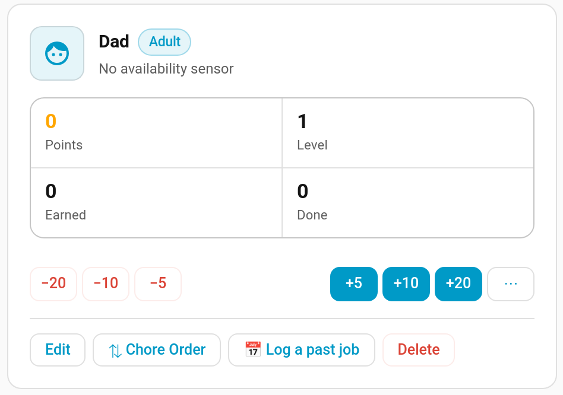
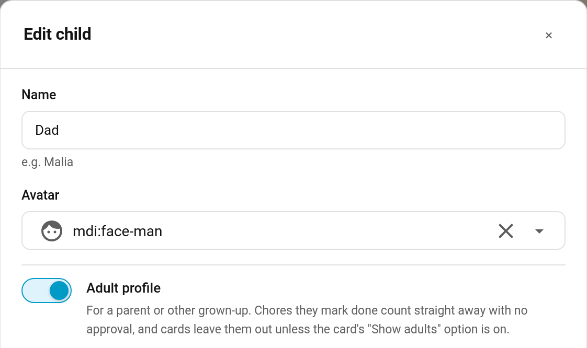

# Adult Profiles

Plenty of parents want to track their own chores too, to set an example or just to keep the house fair. An **adult profile** is a TaskMate profile for a grown-up: their jobs count straight away with no approval, and they stay off the kids' dashboards unless you ask for them.



> **New in v6.4.0**

---

## Making a Profile an Adult

**TaskMate panel → Children → + Add child** (or **Edit** on an existing profile) → switch on **Adult profile**



The profile card then carries an **Adult** tag. Everything else about the profile works as it does for a child: chores are assigned the same way, points, levels, streaks and badges all build up, and rewards can be claimed.

You can switch a profile between adult and child at any time.

---

## Chores Count Straight Away

When an adult marks one of their own chores done, it is approved at once and the points are paid, even on a chore that needs approval. Nobody has to sign off a grown-up's washing-up.

- **Photos and notes are still asked for.** If a chore needs [photo proof](Photo-Proof.md), or is [open-ended](Open-Ended-Chores.md) and needs a description, the adult still provides it. It's then approved straight away rather than waiting for review.
- **Bonus sub-tasks and [timed tasks](Timed-Tasks.md)** are approved straight away too, including a timer that's closed off overnight.
- **[Teamwork chores](Teamwork-Chores.md) and [bounties](Bounty-Board.md) keep their usual rules.** A team still has to fill up, and a finished bounty still goes to the approval queue.
- **Children are unchanged.** Their completions still wait for a parent wherever the chore asks for approval.

---

## Adults on the Cards

Kids' dashboards are about the kids, so cards that show the whole family leave adult profiles out by default. A child doesn't need to see Dad at the top of the [leaderboard](Leaderboard-Seasons.md), or Mum's balance in the points list.

To include them, turn on **Show adults** in the card editor, or set it in YAML:

```yaml
type: custom:taskmate-leaderboard-card
entity: sensor.taskmate_overview
show_adults: true
```

Adults are then listed after the children. The **Show adults** switch only appears in a card's editor once your family has an adult profile, so nothing changes for families without one. On the Chore Board, set it in YAML.

**A card set to one `child_id` is never filtered.** Give an adult a card of their own by pointing it at their profile, exactly as you would for a child.

### Which cards

| Card | Without `show_adults` |
|------|-----------------------|
| [Leaderboard](Dashboard-Cards.md#leaderboard-card) | Adults aren't ranked |
| [Overview](Dashboard-Cards.md#overview-card) | No tile for adults |
| [Points](Dashboard-Cards.md#points-card) | Adults aren't in the list |
| [Points Display](Dashboard-Cards.md#points-display-card) | Adults aren't shown |
| [Points Graph](Dashboard-Cards.md#points-graph-card) | No line for adults |
| [Streak](Dashboard-Cards.md#streak-card) | Adults aren't shown |
| [Weekly](Dashboard-Cards.md#weekly-card) | Adults aren't shown |
| [Calendar](Dashboard-Cards.md#calendar-card) | Adults aren't shown |
| [Sticker Chart](Sticker-Chart-Card.md) | No chart for adults |
| [Reward Progress](Dashboard-Cards.md#reward-progress-card) | Adults aren't counted |
| [Parent Dashboard](Dashboard-Cards.md#parent-dashboard-card) | Adults are left out of the overview and points sections. Approvals and rotation still name everyone |
| [Kiosk](Kiosk-Mode.md) | Adults aren't on the picker |
| [Chore Board](Dashboard-Cards.md#chore-board-card) | No column for adults |
| [Rewards](Dashboard-Cards.md#rewards-card) | No tab for adults, and they're left off a reward's list of children. A [jackpot](Rewards.md) still shows an adult who has put points into it, so the total adds up |
| [Bonuses](Dashboard-Cards.md#bonuses-card) / [Penalties](Dashboard-Cards.md#penalties-card) | Adults aren't offered when applying one |
| [Bounty](Dashboard-Cards.md#bounty-card) | Adults aren't shown among who can claim an open bounty |

The **Kiosk** and **Chore Board** cards can also be given a list of children. An adult you pick in that list is always shown; the filter only applies when the card shows everyone.

Cards that belong to one child (the child card, routine, badges, wishlist, recap and auction cards) and the [Approvals card](Approvals-Card.md) aren't affected. The admin panel always shows everyone.

---

## In the Sensors

An adult's entry in `sensor.taskmate_overview`'s `children` list carries `is_adult: true`. The field is left out for children. See [Sensor Attributes](Sensor-Attributes.md#children-entries).

---

## Related

- [Children](Children.md) — adding and managing profiles
- [Parent Access](Parent-Access.md) — letting a second parent approve and manage day to day
- [Guest Child Profiles](Guest-Child-Profiles.md) — temporary profiles for visiting children
- [Dashboard Cards](Dashboard-Cards.md) — every card's options
