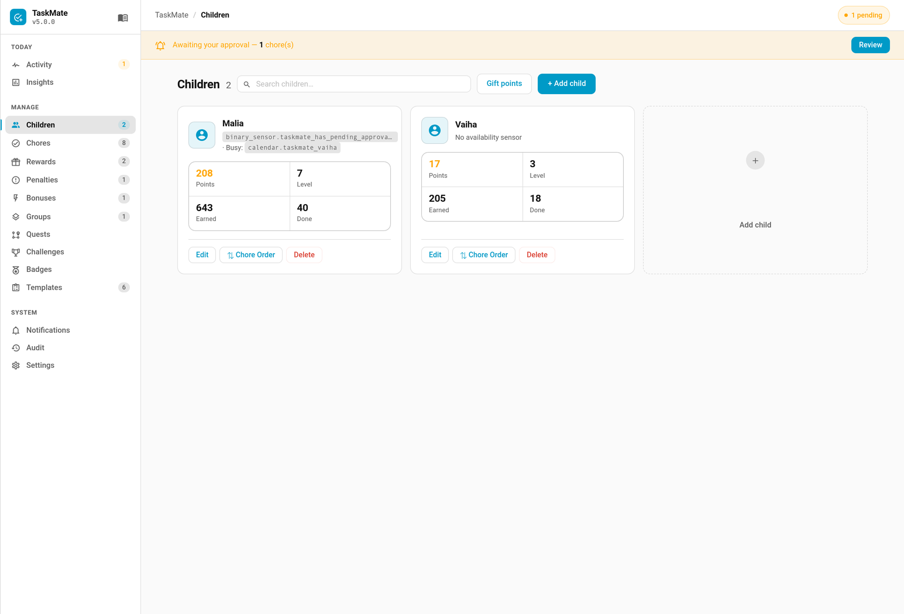

# Allowance

Allowance turns saved-up points into a real-money pocket-money payout. When a child cashes in their points, you record the payout: TaskMate deducts the points and writes a cash entry — in your currency — into a payout ledger you can review later. It is **parent-controlled** and uses a **fixed conversion rate** (no variable or "smart" pricing): a point is always worth the same amount.



Allowance is **opt-in** and configured in the **TaskMate** panel → **Settings**, in the **Allowance** section of the Admin Panel.

---

## Settings

| Setting | Key | Default | Description |
|---------|-----|---------|-------------|
| **Enable allowance payouts** | `allowance_enabled` | `off` | Master toggle. While off, the payout service is rejected |
| **Points per unit** | `allowance_rate` | `10` | How many points equal one unit of currency. With `10`, 50 points pays out 5 units (e.g. £5.00) |
| **Currency symbol** | `allowance_currency` | *(blank)* | A short symbol shown against the cash amount, e.g. `£` or `$` (up to 8 characters) |

The rate is a whole number from 1 to 100,000. Leave the toggle off and no payouts can be recorded.

---

## Setting it up

1. Open the **Admin Panel** and scroll to the **Allowance** section
2. Switch **Enable allowance payouts** on
3. Set **Points per unit** — the conversion rate. For example, `10` means every 10 points is worth one unit of your currency
4. Type a **Currency symbol** such as `£` or `$`

The rate is fixed: 50 points is always the same payout. TaskMate never adjusts the conversion based on demand, timing, or balance.

---

## Recording a payout

### From the admin panel

The quickest way: hand the money over, then record it in the **TaskMate** panel.

1. Open a child's drawer (tap their name in the child chips at the top of the panel) and press **Pay out**, or press **Record a payout** in **Settings** → **Allowance**
2. Pick the child if asked. **Points to pay out** starts at their whole balance — lower it for a part payout
3. Check the cash line underneath (for example `50 points = £5`) and press **Record payout**

The buttons only appear once **Enable allowance payouts** is switched on and saved.

### From an automation or a dashboard button

When a child wants to cash in points — say a weekly Friday pocket-money — record the payout from an automation or a dashboard button using the `record_allowance_payout` service.

```yaml
# Pay out 50 points as allowance for one child
service: taskmate.record_allowance_payout
data:
  child_id: <child id>
  points: 50
```

| Parameter | Required | Description |
|-----------|----------|-------------|
| `child_id` | ✅ | ID of the child being paid |
| `points` | ✅ | Points to convert to cash and deduct (1–100,000) |

What happens when it runs:

- The points are **deducted** from the child's balance (logged as `Allowance payout`)
- A cash amount of `points ÷ rate` (rounded to 2 decimal places) is recorded in the configured currency. With a rate of `10`, paying out `50` points records a payout of `5.00`
- A ledger entry is stored capturing the child, the points, the cash amount, the currency, and the date
- A `taskmate_allowance_paid` event is fired — handy for triggering a notification or logging the cash you handed over

The service is **admin-gated** and recorded in the [Admin Audit Log](Admin-Audit-Log.md). It is rejected if allowance is disabled, the child is unknown, `points` is below 1, or `points` is more than the child's balance.

### Paying out the whole balance from a button

A dashboard button's `tap_action` does **not** render templates: a `points:` template there reaches TaskMate as text and fails with `expected int at 'points'`. Put the template in a script, which does render it, and point the button at the script:

```yaml
script:
  emily_allowance_payout:
    alias: Emily allowance payout
    sequence:
      - condition: template
        value_template: "{{ states('sensor.taskmate_emily_points') | int(0) > 0 }}"
      - action: taskmate.record_allowance_payout
        data:
          child_id: <child id>
          points: "{{ states('sensor.taskmate_emily_points') | int(0) }}"
```

```yaml
type: button
entity: sensor.taskmate_emily_points
tap_action:
  action: perform-action
  perform_action: script.emily_allowance_payout
```

Your points sensor's entity id may carry an area prefix (for example `sensor.office_taskmate_emily_points`) — use the id shown in Home Assistant.

### A weekly payout

To pay out a fixed allowance every Friday, trigger the service on a schedule:

```yaml
alias: Friday allowance
triggers:
  - trigger: time
    at: "17:00:00"
    # add a weekday condition for Fridays
actions:
  - service: taskmate.record_allowance_payout
    data:
      child_id: <child id>
      points: 50
```

---

## The payout ledger

Every recorded payout is appended to a ledger stored as `allowance_payouts` (capped at the most recent 500 entries). The **Allowance** section of the Admin Panel lists the most recent payouts — child, cash amount, and date — so you have a running record of what has been paid out. There is no separate ledger sensor; the history is surfaced in the panel.

---

## Related

- [Points Economy](Points-Economy.md) — interest, decay, and the negative-balance policy
- [Rewards](Rewards.md) — spending points on in-app rewards instead of cash
- [Admin Audit Log](Admin-Audit-Log.md) — who recorded which payout
- [Services](Services.md) — full service-call reference
