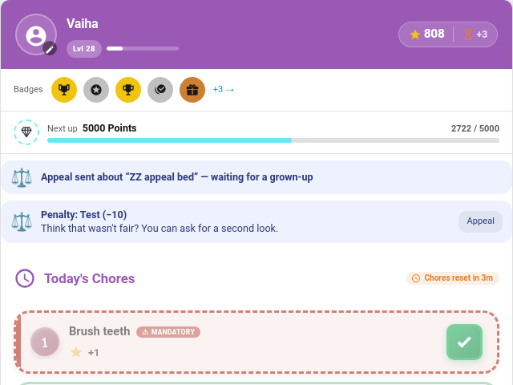

# Appeals

Sometimes a parent gets it wrong: the bed *was* made, the door slammed in the wind. **Appeals** let a child ask for a second look at a rejected chore, a rejected reward claim or a penalty, with a few words saying why. A parent then overturns the decision or lets it stand, and the child sees the answer.

> **New in v7.1.0**

---

## Turning It On

**TaskMate panel → Settings → Appeals → Let children appeal** (`appeals_enabled`, off by default).

---

## What Can Be Appealed

For 48 hours afterwards, a child can appeal:

| Item | Overturning it |
|------|----------------|
| A **chore** a parent rejected | Pays the points the chore would have paid, as an *Appeal: …* transaction |
| A **reward claim** a parent rejected | Approves the claim there and then, deducting the cost as a normal approval would |
| A **penalty** applied to them | Undoes the penalty and closes any open [make-it-right](Make-It-Right-Penalties.md) offer for it |

Each item can be appealed once. A penalty the child has already earned back with its make-it-right chore can't be appealed, because it has been put right already. [Wishlist](Wishlist.md) redemptions keep their own decline flow and aren't appealable.

While appeals are on, TaskMate keeps every rejection for the appeal window, including ones without a [reason](Reject-Reasons.md). Rejections without a reason still never show on the card or in the activity feed.

---

## The Child's Side

The child card lists what can be appealed, for example *"Make bed" was sent back (5)*, with an **Appeal** button. The child can add a message, then taps **Send appeal**. The card then shows *Appeal sent, waiting for a grown-up*, and for a day after the decision, whether it was accepted or turned down, with the parent's note.

Hide all of this on one card with `show_appeals: false`.

---

## The Parent's Side

Parents get the **Appeal submitted** push, which is on by default like a help request. It only ever fires once appeals are switched on. The appeal also waits on **TaskMate panel → Today → Appeals**:

- **Uphold:** nothing changes. You can add a note the child will see.
- **Overturn and pay / approve / refund:** puts it right as in the table above, with an optional note.

---

## Notifications

| Type | Audience | Default |
|------|----------|---------|
| **Appeal submitted** `appeal_submitted` | Parents | **On** |
| **Appeal decided** `appeal_decided` | The child | Off |

---

## Events

| Event | Payload |
|-------|---------|
| `taskmate_appeal_submitted` | `appeal_id`, `child_id`, `child_name`, `kind` (`chore` / `reward` / `penalty`), `item_name`, `points`, `message`, `timestamp` |
| `taskmate_appeal_decided` | `appeal_id`, `child_id`, `child_name`, `kind`, `item_name`, `points`, `overturned`, `note`, `timestamp` |

Both show on the child's [event entity](Event-Entities.md) as **Appeal submitted** and **Appeal decided**.

---

## Services

| Service | Fields | Description |
|---------|--------|-------------|
| `taskmate.appeal` | `child_id`, `kind`, `target_id`, `message` (optional) | A child appeals one item from their `appealable` list. Goes through the same linked-child check as `complete_chore` |
| `taskmate.decide_appeal` | `appeal_id`, `overturn` (true / false), `note` (optional) | A parent decides it. Parent action |

---

## Sensor

Each child's entry in `sensor.taskmate_overview`'s `children` attribute carries, while appeals are on:

- `appealable`: what the child may appeal (`kind`, `target_id`, `name`, `points`).
- `appeals`: their open appeals and the ones decided in the last day (`id`, `kind`, `item_name`, `points`, `status` of `open` / `upheld` / `overturned`, and `note`).

---

## Related

- [Reject Reasons](Reject-Reasons.md)
- [Penalties](Penalties.md) and [Make-It-Right Penalties](Make-It-Right-Penalties.md)
- [Help Requests](Help-Requests.md)
