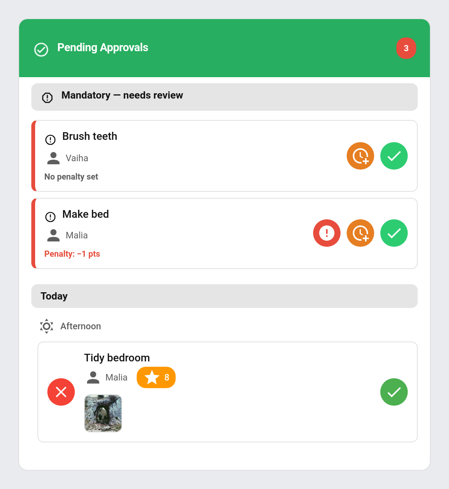

# Approvals Card

The TaskMate Approvals Card shows every pending action that needs a parent's sign-off — completed chores waiting for approval and, from v3.0, reward claims waiting for approval.

## Adding the card

**Edit dashboard → + Add Card → Custom: TaskMate Approvals Card**

Or via YAML:

```yaml
type: custom:taskmate-approvals-card
entity: sensor.taskmate_overview
```

The card works with either:
- `sensor.taskmate_overview` (reads `todays_completions` filtered to unapproved + `pending_reward_claims`)
- `sensor.taskmate_pending_approvals` (reads `chore_completions` + `reward_claims`)

## Configuration

| Option | Type | Default | Description |
| --- | --- | --- | --- |
| `entity` | string | **required** | TaskMate overview or pending_approvals sensor |
| `title` | string | `"Pending Approvals"` | Card header title |
| `child_id` | string | _none_ | If set, filter approvals to this child only |
| `header_color` | string | `#27ae60` | Card header background colour |

## Display

### Header
- Title on the left
- Combined **pending count** badge on the right (chores + reward claims)

### Mandatory — needs review (v4.1+)
If any mandatory chores were missed, they appear at the very top of the content — above pending completions — under a header labelled **"Mandatory — needs review"**. A mandatory chore is missed when it isn't completed before its time-of-day period ends; **points are never auto-deducted**, the parent decides what to do. Each row offers three actions:

- **Apply Penalty** — calls `taskmate.apply_mandatory_penalty`, deducting the chore's configured penalty points. The Apply-penalty button only appears when those points are greater than 0.
- **Postpone** — calls `taskmate.postpone_mandatory_chore`, giving the chore the next period today (rolling to tomorrow after the last period). Repeatable, no penalty.
- **Dismiss** — calls `taskmate.dismiss_mandatory_chore`, clearing the review item with no penalty.

Each service takes a single `miss_id` parameter. See [Mandatory Chores](Mandatory-Chores.md) for the full feature.



### Reward claims section (v3.0+)
If any reward claims are pending, they appear at the top of the content, under a header labelled **"Reward claims"**. Each row shows:
- Red ✗ button (reject) on the left
- Reward icon + name
- Child name
- Points cost
- Green ✓ button (approve) on the right

Tapping ✓ calls `taskmate.approve_reward`. Tapping ✗ calls `taskmate.reject_reward`.

### Chore approvals section
Chores awaiting approval appear below, grouped by **day** (Today, Yesterday, or the date) and by **time category** within each day. Each row has the same approve / reject UX.

Tapping ✓ calls `taskmate.approve_chore`. Tapping ✗ calls `taskmate.reject_chore`.

Completions that require photo proof show an **evidence-photo thumbnail** on the row; tapping it opens the full image.

### Reference photo compare (v7.0.0)
When the chore has a [reference photo](Reference-Photos.md) (a picture of the job done well), the row also shows it as a thumbnail with a ★ badge. Tapping either picture opens them side by side, **What good looks like** next to **What was done**, so you can compare before approving. If the child sent no photo, the reference shows on its own with a reminder to compare it with the real thing. The review sheet shows the same side-by-side view. The [Parent Dashboard card](Dashboard-Cards.md#parent-dashboard-card) shows the reference thumbnail too.

### Quantity chores (v7.0.0)
A [quantity chore](Quantity-Chores.md) shows how many units the child said they did (e.g. "🔢 12 pages") on the row's details and in the review sheet, so you can see what is being paid for. Chores still waiting after the [auto-approve](Auto-Approve.md) timeout approve themselves and leave the queue.

### Review and award (v5.7.0+)
Every chore row carries a second control beside Approve — **✍️** when the child left a description, **✎** otherwise. It opens a review sheet with the child's words, the evidence photo if there is one, and an **Award** box you can edit before approving.

The award replaces the chore's *base* points, so streaks and level multipliers still apply on top exactly as they would for a normal approval. Tapping Approve on the row itself is unchanged — still one tap, still the chore's own points.

This is how an [open-ended chore](Open-Ended-Chores.md) gets priced, but it works on any pending completion.

The sheet also has a **Praise note** box with quick chips (*👏 Well done!*, *🌟 Super effort*, …). Whatever is in it when you approve goes to the child's card. See [Praise Notes](Praise-Notes.md).

### Approve All (v4.4.3+)
When two or more chore completions are pending, an **Approve All** button appears in the chore-approvals section so you can clear the whole queue in one tap instead of approving each row. It calls the `taskmate/approve_all_chores` WebSocket command, which approves every currently-pending completion and runs the full award/badge/quest/streak/celebration side-effects on each — identical to approving them one by one. The same button is also available on the TaskMate panel's pending-approvals view. Reward claims and mandatory-review items are unaffected; you still action those individually.

While the batch runs, the button is disabled and shows a spinner with **Approving…**, on both the card and the panel. A second tap is ignored, so you cannot queue the same sweep twice.

### Empty state
When nothing is pending, the card shows *"All caught up!"* with a check icon.

## Notifications (v3.0+)

When a child completes a chore or claims/redeems a reward, TaskMate fires:

- A `persistent_notification` with a descriptive message — *"{child} claimed '{reward}' ({cost} {points_name}) and is waiting for your approval."*
- The configured `notify.*` service, if one is set in TaskMate settings (e.g. a mobile notification)

This applies to both wallet-mode claims and pool-mode Redeems, putting them on parity with chore approvals.

## Examples

### Show approvals for everybody

```yaml
type: custom:taskmate-approvals-card
entity: sensor.taskmate_overview
```

### Filter to one child

```yaml
type: custom:taskmate-approvals-card
entity: sensor.taskmate_overview
child_id: 8a3b2c1d4e5f6789
title: "Alice's Approvals"
```

### Custom header colour

```yaml
type: custom:taskmate-approvals-card
entity: sensor.taskmate_overview
header_color: "#3498db"
```

## Related

- [Services](Services.md) — `approve_chore`, `approve_all_chores`, `reject_chore`, `approve_reward`, `reject_reward`, `apply_mandatory_penalty`, `postpone_mandatory_chore`, `dismiss_mandatory_chore`
- [Mandatory Chores](Mandatory-Chores.md) — the "Mandatory — needs review" section explained
- [Quality Ratings](Quality-Ratings.md) — rate approved chores 1–3 stars and scale the points
- [Pool Mode (Savings Jars)](Pool-Mode-(Savings-Jars).md) — context for pool-mode Redeem claims
