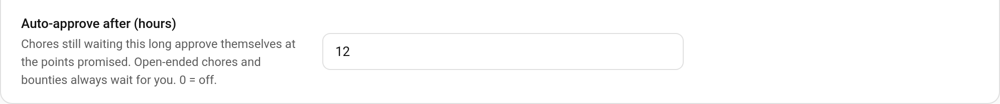

# Auto Approve

A parent on a 12-hour shift can't approve "Make bed" before the child wants to know whether it counted. With **auto-approve**, a chore that has waited for approval longer than a set number of hours approves itself at the points the child was promised, exactly as if you had tapped Approve.



> **New in v7.0.0**

---

## Turning It On

**TaskMate panel → Settings → Auto-approve after (hours)** (with the other parent approval settings)

| Setting | Key | Default | Description |
|---------|-----|---------|-------------|
| **Auto-approve after (hours)** | `auto_approve_hours` | `0` | Chores still waiting this long approve themselves. Whole hours, 1–168 (a week). 0 = off |

TaskMate checks once a minute, so a completion approves itself within a minute of reaching the limit. The clock starts when the child completed the chore.

---

## What Gets Approved

Any chore completion still waiting for approval, once it's older than the limit. It's approved exactly as a parent's tap would: the promised points are paid, and streaks, badges, challenges, quests, [weekly goals](Weekly-Goals.md) and a waiting [make-it-right](Make-It-Right-Penalties.md) refund all follow as normal.

Two kinds always wait for you, however long it takes:

| Never auto-approved | Why |
|---------------------|-----|
| [Open-ended chores](Open-Ended-Chores.md) | The child only suggested a price; a parent has to set the real one |
| [Bounty](Bounty-Board.md) work | A bounty pays its own posted reward and has its own claim rules |

Reward claims are not affected: only chore completions auto-approve.

If an approval fails for some reason (for example the chore has since been deleted), that completion is skipped and stays waiting.

---

## Knowing It Happened

Each auto-approval:

- marks the completion with `auto_approved: true`, so it can be told apart from one a parent approved
- fires the `taskmate_chore_auto_approved` event, with `child_id`, `child_name`, `chore_id`, `chore_name`, `points` and `hours` (the setting at the time)
- shows as **Chore auto-approved** on the child's [event entity](Event-Entities.md)

A notification for it is easy to build from the event:

```yaml
triggers:
  - trigger: event
    event_type: taskmate_chore_auto_approved
actions:
  - action: notify.mobile_app_parent_phone
    data:
      message: >-
        {{ trigger.event.data.chore_name }} for {{ trigger.event.data.child_name }}
        was approved automatically after {{ trigger.event.data.hours }} hours.
```

You can still undo an auto-approved chore from the activity list, as with any approval.

---

## Related

- [Approvals Card](Approvals-Card.md) — approving chores yourself
- [Multi-Parent Approval Routing](Multi-Parent-Approval-Routing.md) — sending approvals to the right parent
- [Parent Access](Parent-Access.md) — letting other adults approve
- [Automations](Automations.md) — every TaskMate event
