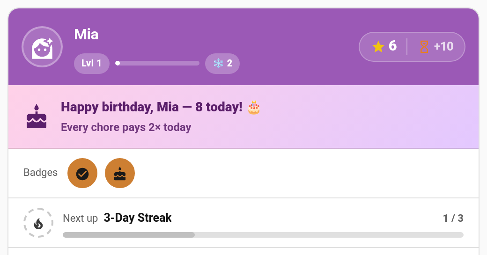

# Birthday Mode

Give each child a birthday and TaskMate makes the day feel special: every chore pays extra, there's a birthday banner with confetti on their card, they earn a **Birthday** badge, and if you like, they get the day off chores altogether.

> **New in v6.0.0**

---

## Setting a Birthday

**TaskMate panel → Children → Edit → Birthday**

| Format | Example | Result |
|--------|---------|--------|
| `YYYY-MM-DD` | `2018-09-28` | Birthday on 28 September, and the banner shows their age ("8 today!") |
| `MM-DD` | `09-28` | Birthday on 28 September, with no age shown |

Leave it empty and birthday mode is simply off for that child. Impossible dates and dates in the future are refused.

The [setup wizard](Getting-Started.md) can also take a birthday when you add children.

### 29 February

A leap-day birthday is celebrated on **28 February** in years that don't have a 29th.

---

## What Happens on the Day

| | What the child gets |
|---|---|
| **Bonus points** | Every chore pays the birthday multiplier (**2×** by default). |
| **Banner** | A "Happy birthday, Mia — 8 today!" banner on the child card and the points display card, showing the multiplier. |
| **Confetti** | The child card plays confetti the first time it's opened that day. |
| **Badge** | The built-in **Birthday** badge is awarded. |
| **Day off** *(optional)* | Non-mandatory chores are hidden for the day. |
| **Notification** *(optional)* | A "Happy birthday!" message in the morning. |

---

## Settings

**TaskMate panel → Settings → History & streaks**

| Setting | Default | Description |
|---------|---------|-------------|
| **Birthday points multiplier** | `2` | Chore points on a child's birthday, from `1` to `5`. `1` turns the bonus off. |
| **Birthday day off** | Off | Hide non-mandatory chores on a child's birthday. |

These apply to every child. The birthday itself is set per child.

---

## Bonus Points

The multiplier is applied on top of whatever the chore would normally pay that day. [Difficulty tiers](Difficulty-Tiers.md), [Chore Roulette](Chore-Roulette.md) and the weekend bonus all still apply, and the birthday multiplier rides on top of them.

The bonus follows the day the chore was **done**, not the day it was approved. A chore done on the birthday and approved the next morning still pays double.

If a birthday completion is undone or rejected, the full amount, including the birthday bonus, is taken back.

---

## The Day Off

With **Birthday day off** switched on:

- **Non-mandatory chores** are hidden for that child for the day.
- **[Mandatory chores](Mandatory-Chores.md)** stay. Medicine and teeth still matter on a birthday.
- The day **never breaks their streak**, and it isn't counted as a required day for a perfect week.
- Streak-at-risk and bedtime reminders aren't sent for the hidden chores.
- It never uses up a [streak freeze](Streak-Freezes.md).

---

## The Birthday Badge

**Birthday** is a built-in bronze badge. Like every built-in badge, a child earns it once. You can also use the *Birthday today* metric when you create your own badges. See [Achievement Badges](Achievement-Badges.md).

---

## Birthday Notification

Turn on the **Birthday** notification type under **TaskMate panel → Notifications** to send the child a message on the morning of their birthday:

> Happy birthday, Mia! Every chore pays 2× today.

It goes out at the child's notification time, or **08:00** if they don't have one. It's off by default. See [Notifications](Notifications.md).

---

## For Automations

On the day, TaskMate fires a `taskmate_celebration` event with `kind: birthday`, plus the `multiplier` and, when the birth year is known, the child's `age`. Use it to play a song on the speakers or change the lights.

---

## Related

- [Children](Children.md) — adding and editing children
- [Celebrations](Celebrations.md) — the confetti and celebration events
- [Achievement Badges](Achievement-Badges.md) — the Birthday badge
- [Streak Freezes](Streak-Freezes.md) — other ways a streak is protected
