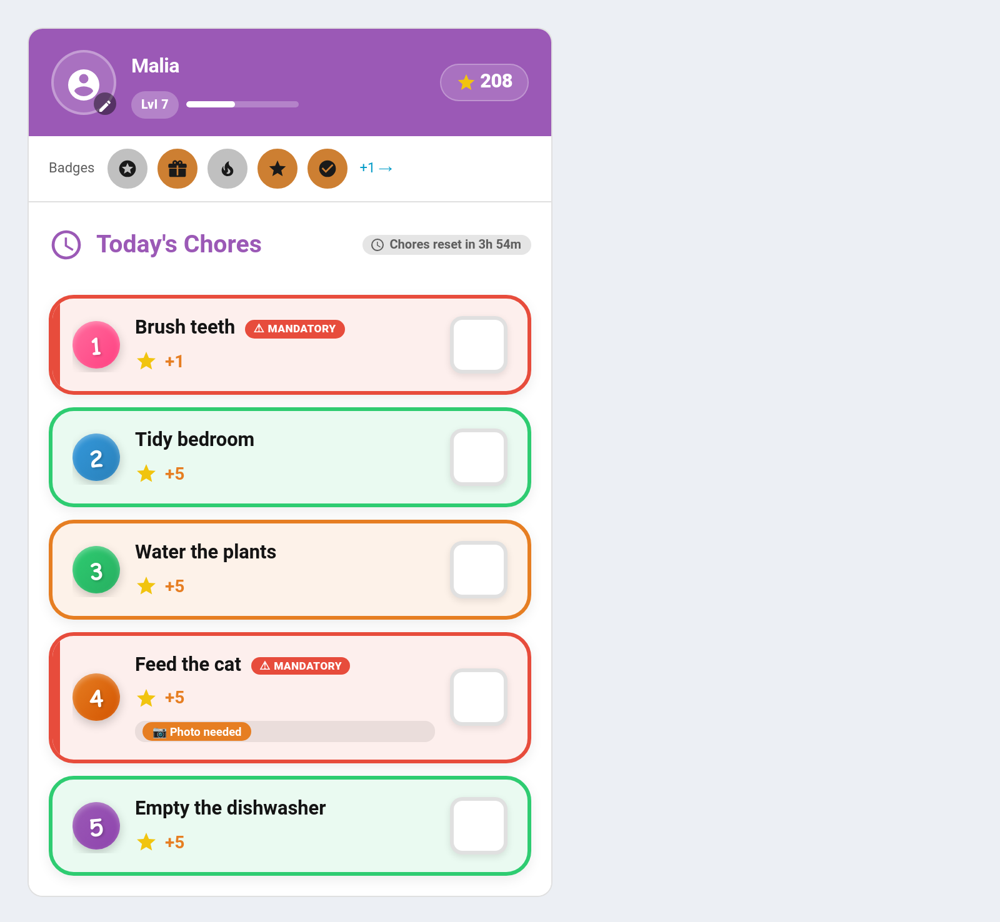

# Bonus Subtasks

Bonus Subtasks are optional extra-credit tasks embedded within a parent chore. They let children earn additional points by going above and beyond the base chore.



---

## How It Works

```
Child completes parent chore → Bonus subtasks unlock → Child completes subtask → Extra points awarded
```

A "Clean Bedroom" chore worth 10 points might have bonus subtasks like "Organise bookshelf (+5)" and "Vacuum under bed (+5)". The child earns the base 10 for cleaning, plus up to 10 more if they tackle the extras.

---

## Configuring Bonus Subtasks

Bonus subtasks are configured as part of a chore's settings. Each subtask has:

| Field | Required | Default | Description |
|-------|----------|---------|-------------|
| **Name** | Yes | — | Subtask display name |
| **Points** | No | `5` | Points awarded on completion |
| **Description** | No | `""` | Optional details |

Subtasks are stored as a list on the chore object (`bonus_subtasks`). Each subtask gets an auto-generated unique ID.

### Adding Subtasks

1. Edit a chore via the config flow or admin panel
2. In the bonus subtasks section, add one or more subtasks
3. Save the chore

---

## Completion Flow

1. **Parent chore must be completed first** — bonus subtasks are locked until the parent chore is ticked off by the same child on the same day
2. **Child completes a subtask** — the subtask appears as completable on the child card after the parent chore is done
3. **Approval follows the parent chore's setting** — if the parent requires approval, the subtask completion is also pending until approved
4. **Points are separate** — subtask points are awarded independently from the parent chore's points
5. **Tap again to undo** *(v4.4.4+)* — tapping a completed bonus subtask a second time un-completes it, reversing just that subtask's points and leaving the parent chore done. This mirrors the tap-to-undo behaviour of top-level chores and works on the classic and all designed card styles. As with a chore undo, it removes already-awarded points and so is admin/parent-only.

### Approval Display

When a bonus subtask is pending approval, it appears in the approvals card with the format:

> **Clean Bedroom › Organise Bookshelf** — +5 Stars

### Streak Behaviour

Bonus subtask completions do **not** count toward streak tracking. Only the parent chore completion affects streaks.

---

## Service

### `taskmate.complete_bonus_subtask`

Complete a bonus subtask for a child.

| Field | Required | Description |
|-------|----------|-------------|
| `chore_id` | Yes | ID of the parent chore |
| `bonus_subtask_id` | Yes | ID of the subtask |
| `child_id` | Yes | ID of the child |

```yaml
service: taskmate.complete_bonus_subtask
data:
  chore_id: b3f9a12c
  bonus_subtask_id: sub_abc123
  child_id: a8c8376a
```

**Errors:**
- Parent chore not completed today by this child
- Subtask already completed today by this child
- Invalid chore, subtask, or child ID

---

## Sensor Attributes

Bonus subtask completions appear in `todays_completions` with:

| Field | Value |
|-------|-------|
| `chore_name` | `"Parent Chore › Subtask Name"` |
| `points` | Subtask points (not parent points) |
| `bonus_subtask_id` | The subtask ID |
| `timed_duration_seconds` | `0` |

The chore's `bonus_subtasks` array in the sensor attributes lists each subtask with `id`, `name`, `points`, and `description`.

---

## Tips

- **Keep subtasks genuinely optional** — they should reward extra effort, not become expected
- **Use lower point values** than the parent chore — subtasks are bonuses, not the main reward
- **Good for teaching thoroughness** — "Make Bed" base + "Arrange pillows neatly" bonus + "Tidy nightstand" bonus
- **Works with any chore type** — specific days, recurring, one-shot, and timed chores can all have bonus subtasks

---

## Related

- [Chores](Chores.md) — parent chore configuration
- [Services](Services.md) — full service reference
- [Dashboard Cards](Dashboard-Cards.md) — how subtasks appear on the child card
