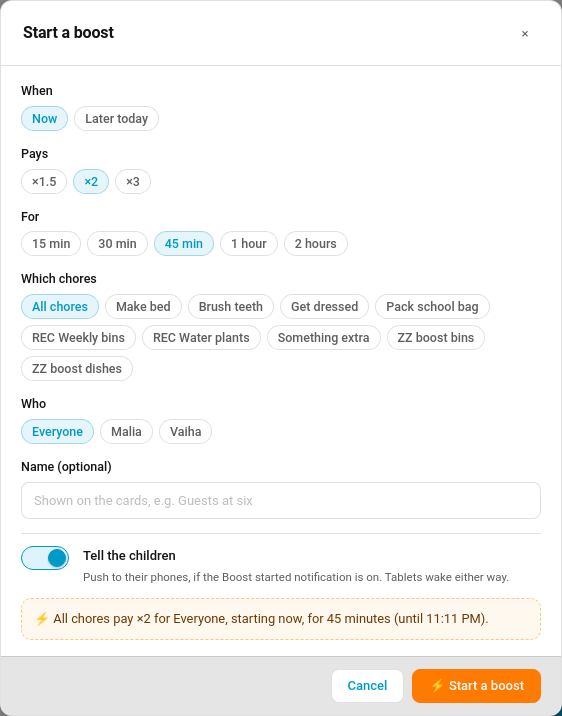
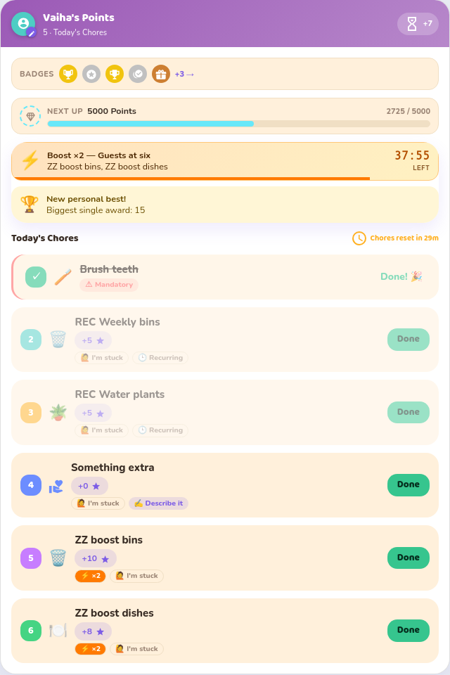
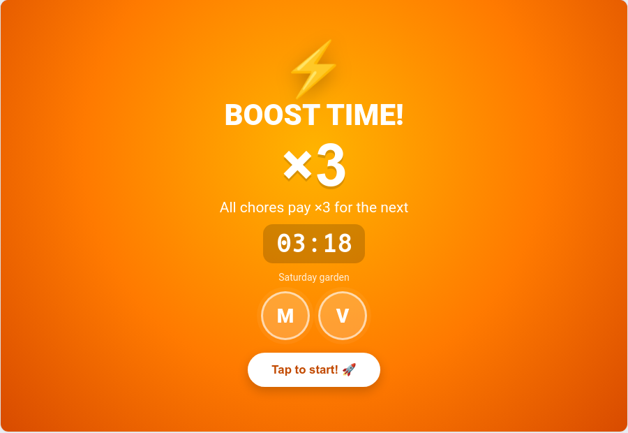

# Boost Windows

A **boost** makes chosen chores pay more for a set time: "the next hour, bins and the dishwasher pay double". Children see it coming. Their cards and the wall tablet fill with an orange **BOOST!** screen when it starts, then show a countdown and a ×2 chip on every boosted chore.

> **New in v7.1.0**

---

## Three Ways to Start One

| Way | Where | Good for |
|-----|-------|----------|
| **On the spot** | **TaskMate panel → Today → Start a boost** | "Guests at six, the kitchen needs clearing" |
| **Recurring** | **TaskMate panel → Settings → Boost windows → Recurring boosts** | "Every Saturday, 09:00 to 11:00, garden jobs pay double" |
| **From an automation** | The `taskmate.start_boost` service | Anything Home Assistant can trigger: a calendar event, the doorbell, a button |

Use whichever suits you. All three produce the same boost, and it looks and pays the same on the cards.

### Start a boost



Pick **Now** or **Later today**, how much it pays (×1.5, ×2 or ×3), how long it lasts, which chores (or all of them) and which children (or everyone). An optional name such as *Guests at six* shows on the cards. **Tell the children** sends the opt-in *Boost started* push to the children it covers.

### Recurring boosts

Each recurring boost has days, a start and end time, a multiplier, chores and children, and an on/off switch. TaskMate starts and ends it by itself. The Today page lists today's recurring boost before it starts, with **Skip this one** to leave it out for today only.

### From an automation

```yaml
action: taskmate.start_boost
data:
  multiplier: 2
  minutes: 60
  chore_ids: [8a3b2c1d4e5f6789]   # leave out for all chores
  child_ids: []                   # leave out for everyone
  name: Guests at six
```

`starts_at` schedules one for later, up to a week ahead. `taskmate.end_boost` with a `boost_id` stops one early. Find the IDs in the `boosts` attribute of `sensor.taskmate_overview`.

---

## What the Children See



- **The moment it starts** the child card is covered by an orange **BOOST! ×2** screen: the chores, a live countdown and a **Let's go!** button. It shows once per device per boost.
- **Afterwards** a banner at the top counts down, and each boosted chore shows its old points crossed out, the boosted points and a **×2** chip.
- **Before a scheduled boost** a line reads *Next boost: 16:00 · Bins ×2*.

This works in every [card design](Card-Design-Styles.md). Switch the full-screen alert off per card with `show_boost_alert: false`; the banner and chips stay.

### On the kiosk tablet



The [kiosk card](Kiosk-Mode.md) leaves ambient mode or the photo slideshow and fills the screen with **BOOST TIME!** until someone taps. After that an orange strip under the top bar counts down. The kiosk card has its own `show_boost_alert` option.

---

## Waking the Wall Tablet

A sleeping screen can't wake itself: once the display is off nothing in the browser runs. Home Assistant has to tell the device, so TaskMate does that when a boost starts.

**TaskMate panel → Settings → Boost windows**

| Device | What TaskMate does |
|--------|--------------------|
| **Fully Kiosk Browser** (Android), through the [Fully Kiosk Browser integration](https://www.home-assistant.io/integrations/fully_kiosk/) | Turns the tablet's **Screen** switch on, turns its **Screensaver** off and presses **Bring to foreground** |
| **Home Assistant Companion app** (Android) | Sends the `command_screen_on` notification command |

Tick the tablets to wake. **Test wake now** sends the wake straight away, using the saved choices. TaskMate only ever calls those two kinds of target, and a tablet that doesn't respond never stops the boost.

iPads and iPhones can't be woken remotely. iOS doesn't allow it, so they show the boost the next time someone touches the screen.

---

## How Boosted Points Are Paid

- A chore **completed** inside the window earns the boosted points, even if a parent approves it after the window has closed. The approvals queue shows the boosted figure.
- When two boosts cover the same chore, the bigger one applies.
- Timed tasks and chores won at [auction](Chore-Auctions.md) are never boosted. An auction pays exactly the winning bid.
- A job [logged for an earlier day](Logging-Past-Jobs.md) is not boosted.

### Weekends and birthdays

Those days already pay a multiplier (see [Bonus Points](Bonus-Points.md) and [Birthday Mode](Birthday-Mode.md)). **On the weekend or a birthday** decides how a boost combines with it:

| Setting | Key value | A ×2 boost on a ×2 Saturday pays |
|---------|-----------|----------------------------------|
| **Highest wins** (default) | `highest` | ×2. The bigger multiplier applies, the other is dropped |
| **Stack them** | `stack` | ×4 |

---

## Settings

| Setting | Key | Default | Description |
|---------|-----|---------|-------------|
| On the weekend or a birthday | `boost_stacking` | `highest` | `highest` or `stack` |
| Wake these tablets | `boost_wake_screens` | none | Fully Kiosk Browser **Screen** switch entities |
| Wake these phones and tablets | `boost_wake_devices` | none | Companion-app notify services (`mobile_app_…`) |

---

## Notification

| Type | Audience | Default |
|------|----------|---------|
| **Boost started** `boost_started` | The children the boost covers | Off |

> ⚡ Boost! Take the bins out pay ×2 for the next 45 minutes.

---

## Events

| Event | Payload |
|-------|---------|
| `taskmate_boost_started` | `id`, `name`, `multiplier`, `chore_ids`, `child_ids`, `starts_at`, `ends_at`, `minutes`, `rule_id` (recurring only), `timestamp` |
| `taskmate_boost_ended` | The same, plus `ended_early` |

Both show on the family [event entity](Event-Entities.md) as **Boost started** and **Boost ended**. The notification's own bus event is `taskmate_boost_started_notification`.

---

## Services

| Service | Fields | Description |
|---------|--------|-------------|
| `taskmate.start_boost` | `multiplier` (1.1–5), `minutes` (1–1440), `chore_ids`, `child_ids`, `starts_at`, `name`, `notify` | Open a boost now or schedule one. Parent action |
| `taskmate.end_boost` | `boost_id` | End one early, call off a scheduled one, or skip today's recurring one. Parent action |

---

## Sensor

`sensor.taskmate_overview` carries `boosts` while any boost is live or coming up today: each has `id`, `name`, `multiplier`, `chore_ids`, `chore_names`, `child_ids`, `starts_at`, `ends_at`, `minutes`, `status` (`active` / `upcoming`) and `rule_id` for a recurring one.

---

## Related

- [Bonus Points](Bonus-Points.md): weekend multiplier and streak bonuses
- [Kiosk Mode](Kiosk-Mode.md)
- [Bonuses](Bonuses.md)
- [Automations](Automations.md)
