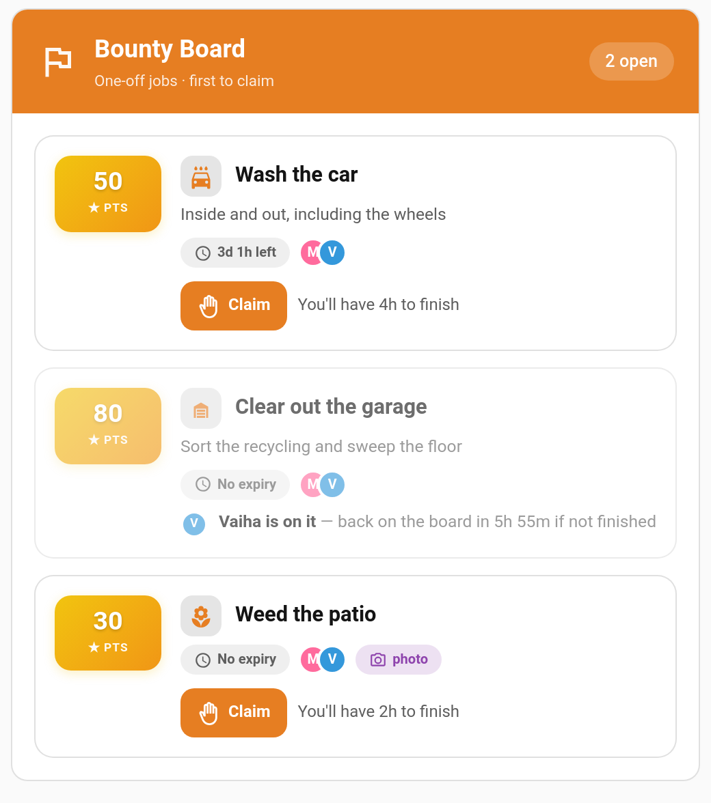
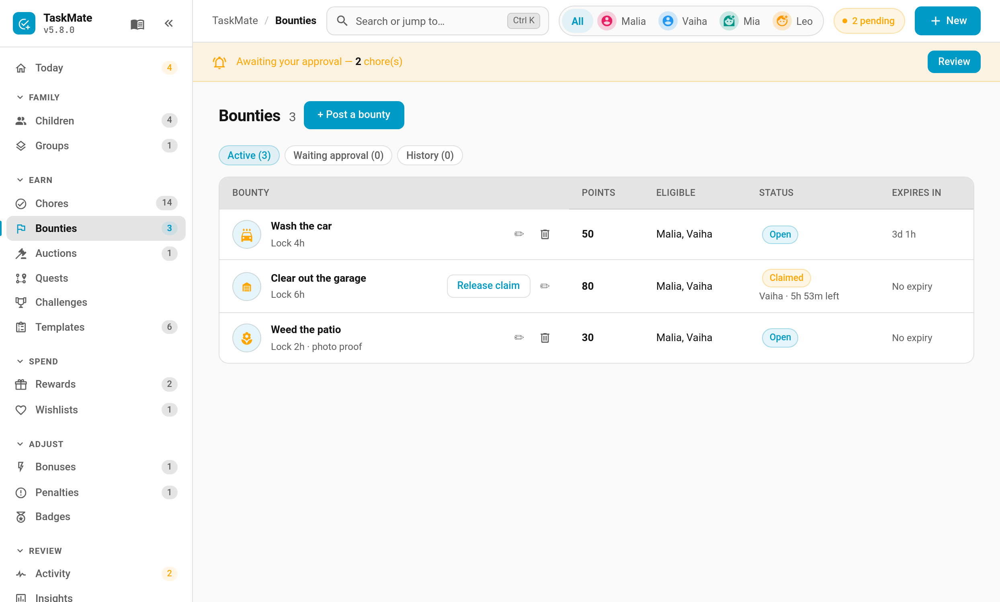

# Bounty Board

Some jobs aren't chores. Nobody washes the car every Tuesday, but when it needs doing you'd happily pay for it. Post it as a **bounty**: a one-off job with a fixed number of points that any eligible child can claim. The first to claim it gets it, finishes it, and it goes through your normal approval queue.



> **New in v6.0.0**

---

## How It Works

1. **You post a bounty** — "Wash the car — 50 points" — from the **Bounties** page in the TaskMate panel.
2. **A child claims it.** It is now locked to them for the claim time (2 hours by default). Their siblings see "Vaiha is on it" with the time left.
3. **They finish and tap Done.** The job lands in your approval queue like any chore completion, with a photo if you asked for one.
4. **You approve**, and the points are paid.

If the claim runs out before the child taps Done, the bounty goes back on the board for anyone to claim. A bounty nobody claims closes when it expires.

---

## Posting a Bounty

**TaskMate panel → Bounties → + Post a bounty** (or **New → Bounty**, or **New bounty** under Quick actions on the Today page)



| Field | Default | Description |
|-------|---------|-------------|
| **Title** | — | What the job is, e.g. "Clear out the garage" |
| **Description** | — | Optional detail: what "done" looks like |
| **Points** | — | What it pays. Quick picks are offered |
| **Icon** | — | Any MDI icon |
| **Claim lock** | 2 hours | How long a child has to finish once they claim it (1–48 hours). Never runs past the expiry |
| **Expires** | never | Quick picks or a date. An unclaimed bounty closes at this time |
| **Who can claim** | everyone | Limit it to particular children |
| **Photo proof** | off | The child must attach a photo when they finish |
| **Notify eligible children** | off | Sends the *Bounty posted* notification |

The page has three tabs: **Active**, **Waiting approval** and **History**. From Active you can edit a bounty, remove it, or **Release claim** to hand a claimed bounty back to the board.

---

## The Rules

- **One claim at a time.** A child can only hold one bounty at once, so nobody hoards the good ones.
- **Rejecting gives it back to the same child** with a fresh claim lock, even if the bounty has since expired. They have work to redo, so it stays theirs.
- **Claims that run out return to the board.** There's no cool-down; the same child can claim it again.
- **Editing.** While a bounty is open you can change anything. Once it's claimed, only the points and expiry can change. Raising the points while it waits for approval changes what the approval pays.
- **Removing.** A bounty can't be removed while a finished job is waiting for your approval. Approve or reject it first.
- **Children who can't claim don't see it.** A bounty limited to one child doesn't appear on the other children's cards.
- **It counts like a chore.** An approved bounty counts toward streaks, badges, challenges and [recaps](Recaps.md).

---

## The Card

Each child gets their own view of the board. The card shows:

- **Open** bounties they can claim, with points, expiry, who else can claim it and a **Claim** button
- **Their claimed bounty**, with a countdown bar and **Done** / **Give back** buttons
- Bounties **a sibling is on**, greyed out with the time left on the claim
- Jobs **waiting for approval**, with an undo while the [child undo window](Child-Undo-Window.md) allows
- **Recently completed** bounties from the last 24 hours

Children can also claim and finish bounties on the shared wall tablet: switch on **Bounty Board** in the [kiosk card](Kiosk-Mode.md#bounties) *(v6.3.0)*.

### Adding the card

```yaml
type: custom:taskmate-bounty-card
entity: sensor.taskmate_overview
child_id: b803da068e6a4b21
```

| Option | Type | Default | Description |
|--------|------|---------|-------------|
| `entity` | string | **required** | The TaskMate overview sensor |
| `child_id` | string | **required** | Whose board this is. Find IDs in the panel with **Show IDs** switched on |
| `title` | string | `Bounty Board` | Card header title |
| `card_design` | string | global default | `classic`, `playroom`, `console`, `cleanpro`, `accessible` or `graphite` |
| `header_color` | string | `#e67e22` | Header banner colour |

---

## Notifications

Both are off until you switch them on under **Notifications**:

| Type | Sent to | When |
|------|---------|------|
| **Bounty posted** | Eligible children | You post a bounty with *Notify eligible children* on |
| **Claim about to lapse** | The child holding the claim | 15 minutes before their claim runs out |

---

## Services

| Service | Who | Description |
|---------|-----|-------------|
| `taskmate.post_bounty` | Parent | Post a bounty. `title` and `points` are required; `description`, `icon`, `expires_at`, `eligible_child_ids`, `claim_hours`, `require_photo` and `notify_children` are optional |
| `taskmate.update_bounty` | Parent | Change a bounty by `bounty_id`, same fields as above |
| `taskmate.remove_bounty` | Parent | Remove a bounty |
| `taskmate.claim_bounty` | Child | Claim a bounty (`bounty_id`, `child_id`) |
| `taskmate.give_back_bounty` | Child | Hand a claim back to the board |
| `taskmate.complete_bounty` | Child | Mark it done. `photo_url` is required when the bounty asks for photo proof |

The new `sensor.taskmate_bounties` sensor's state is the number of open bounties.

### Events

Every step fires a `taskmate_bounty_*` event you can automate on: `posted`, `updated`, `removed`, `claimed`, `given_back`, `claim_lapsed`, `completed`, `approved`, `rejected`, `released`, `withdrawn` and `expired`.

---

## Ideas

| Bounty | Points | Claim lock |
|--------|--------|-----------|
| Wash the car | 50 | 4 hours |
| Clear out the garage | 80 | 6 hours |
| Weed the patio (photo proof) | 30 | 2 hours |
| Help carry the shopping in | 10 | 1 hour |

---

## Related

- [Chore Auctions](Chore-Auctions.md) — the other way to shift a job nobody wants
- [Chores](Chores.md) — regular, recurring jobs
- [Photo Proof](Photo-Proof.md) — how evidence photos work
- [Kiosk Mode](Kiosk-Mode.md#bounties) — bounties on the shared wall tablet
- [Managing Rewards](Managing-Rewards.md) — the approval queue
- [Automations](Automations.md) — every TaskMate bus event
