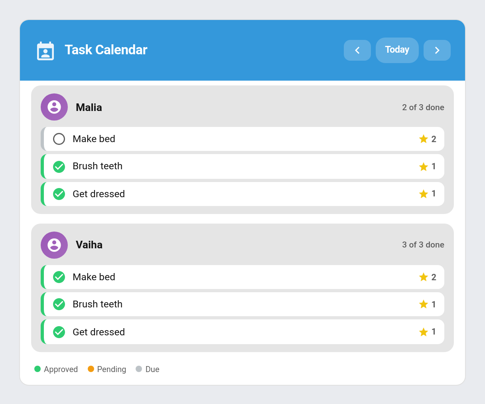

# Calendar

From v4.1.0 TaskMate exposes a native **calendar entity per child** — a read-only Home Assistant calendar that publishes that child's chore occurrences and away periods as events. The events are derived live from TaskMate's own schedule and assignment engine, so there is no second store to keep in sync, and the calendar shows exactly who would see each chore on each day.

---

## Per-Child Calendar Entities

TaskMate creates one calendar entity for every child, named `TaskMate <child>`, with the entity id `calendar.taskmate_<child>` (for example, a child called Malia gets `calendar.taskmate_malia`). New entities appear automatically as children are added.

Each calendar publishes that child's upcoming chores as events:

- **Timed chores** — a chore in a time-of-day period (morning / afternoon / evening / night) becomes a **timed event** inside that period's window. The window comes from the same time-of-day boundaries used everywhere else (see [Settings](Settings.md)).
- **Anytime chores** — chores with no time category become **all-day events** for the day they fall on.
- **Away days** — when a child is on vacation or otherwise away, those days are coalesced into multi-day **all-day "Away" events**, and chores are hidden on those days (matching the rest of the integration). See [Vacation Mode](Vacation-Mode.md).

Each chore event's description carries a compact summary — `TaskMate chore · N pts` (plus the time category for timed chores).

The calendar projects the **schedule**, not today's done/not-done state: it shows the chores a child would be assigned, regardless of whether they have already been completed.

---

## How Far Ahead It Projects

How many days of chore events each calendar publishes is controlled by the **Calendar projection** setting — *"Days ahead each chore publishes to calendars"* (`calendar_projection_days`, default `14`, range 1–90). Raise it for more planning visibility, lower it for fewer entries. See [Settings](Settings.md).

---

## Using the Calendar Entities

Because these are standard Home Assistant calendar entities, they work anywhere HA calendars do:

- The built-in **Calendar** dashboard panel
- Lovelace **calendar cards**
- **Automations** that trigger on calendar events (for example, a reminder when a morning chore is due)

The entities are **read-only** — completing a chore from the calendar is intentionally not supported. Use the [Approvals Card](Approvals-Card.md) or a child card for that.

---

## The TaskMate Calendar Card

TaskMate also ships a dedicated Lovelace **`taskmate-calendar-card`** — a one-day, per-child view that steps through days with **Prev / Today / Next** navigation and colour-codes each chore by state.



The card's legend marks each chore as:

| State | Colour |
|-------|--------|
| **Approved** | Green |
| **Pending** | Amber |
| **Due** | Grey |

```yaml
type: custom:taskmate-calendar-card
entity: sensor.taskmate_overview
child_id: a8c8376a              # optional — filter to one child
title: Task Calendar
header_color: "#3498db"
```

See [Dashboard Cards](Dashboard-Cards.md) for the full card reference.

---

## Calendar Subscription (ICS Feed)

As well as the per-child HA calendar entities above, TaskMate can publish your upcoming chores as a single subscribable **ICS feed** you can add to Google Calendar, Apple Calendar, Outlook, or any app that accepts a calendar URL. Unlike the HA entities — which live inside Home Assistant — this feed is an external link, so a parent (or child) can see upcoming chores in their everyday calendar app without opening HA.

The feed is served read-only at:

```
/api/taskmate/calendar.ics?token=<token>
```

It covers the same horizon as the calendar entities, controlled by the **Calendar projection** setting.

### Finding the Subscribe URL

The subscribe link lives in the **Admin Panel → Settings**, in the **Calendar subscription** section.

1. Open the **TaskMate** panel in the HA sidebar and go to **Settings**.
2. Scroll to **Calendar subscription** and click **Show subscribe link**.
3. The full URL (including its token) appears in a read-only box. Use **Copy** to put it on the clipboard.

### Subscribing in a Calendar App

Add the copied URL as a **subscribed / internet calendar** in your app:

- **Google Calendar** — *Other calendars → + → From URL → paste the link*
- **Apple Calendar** — *File → New Calendar Subscription… → paste the link* (iOS: *Settings → Calendar → Accounts → Add Account → Other → Add Subscribed Calendar*)
- **Outlook** — *Add calendar → Subscribe from web → paste the link*

The feed is **read-only**: chores appear as events, but you can't complete or change anything from the calendar app. Use a child card or the [Approvals Card](Approvals-Card.md) for that.

### The Token, and Regenerating It

The URL is **token-protected** — it's public-by-link (a calendar app can't sign in to Home Assistant), so anyone with the full link can read the feed. Treat it like a private link and share it carefully.

If a link is ever shared too widely, click **Regenerate link** in the same Settings section. This issues a **new token and a new URL, and immediately invalidates the old one** — any app still subscribed to the previous link stops receiving the feed and must be re-subscribed with the new URL.

> **Per-child HA calendars vs. the ICS feed:** the [per-child calendar entities](#per-child-calendar-entities) are separate Home Assistant calendars used *inside* HA (dashboards, automations, the calendar card). The ICS subscription is a single external feed you add to an *outside* calendar app. They're independent — using one doesn't require the other.

---

## Related

- [Dashboard Cards](Dashboard-Cards.md) — the `taskmate-calendar-card` and other cards
- [Vacation Mode](Vacation-Mode.md) — how "Away" events are produced
- [Two-Way Calendar](Two-Way-Calendar.md) — add, move and skip chores from Home Assistant's calendar
- [Chores](Chores.md) — chore scheduling, time categories, and assignment
- [Settings](Settings.md) — the Calendar projection setting and time-of-day boundaries
