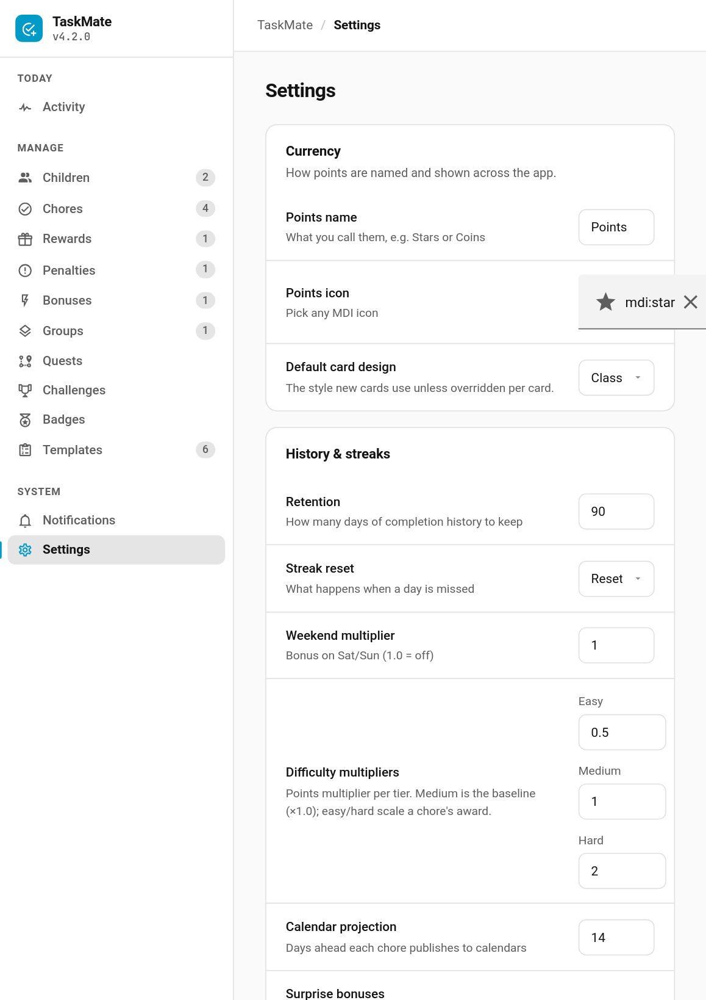

# Card Design Styles

Every TaskMate card can be themed independently, with a global default that any card can inherit. Pick a single look for your whole dashboard, or give each card its own style — completion sounds, layout, and behaviour are unchanged; only the visual skin differs.


> **New in v4.2.0** (#539)

---

## The Six Styles

| Style | Feel | Accent | Fonts |
|-------|------|--------|-------|
| **Classic** | The original TaskMate look — the default, unchanged | Per-card `header_color` / HA theme | HA theme fonts |
| **Playroom** | Warm, rounded, picture-book — soft cream backgrounds | Purple | Baloo 2 / Nunito |
| **Console** | Dark, neon-accented game-HUD with glow effects | Cyan | Space Grotesk / Inter / JetBrains Mono |
| **Clean Pro** | Minimal, flat, professional SaaS with low-contrast shadows | Blue | Manrope / Inter |
| **Accessible** | High contrast, colour-blind safe, dyslexia-friendly type | Okabe-Ito blue | Atkinson Hyperlegible |
| **Graphite** | Clean and corporate — a quiet, system-looking dashboard | Neutral slate | Inter |

**Classic** is the default and is left exactly as it was — existing dashboards look identical until you opt in to another style.

---

## Graphite

> **New in v5.8.0** (#906)

Graphite is for households that would rather the dashboard didn't shout: flat surfaces, a single hairline border instead of shadows, restrained type and a neutral palette. It reuses Clean Pro's layout and changes everything else, so the two share a shape but read very differently.

Like every other style it keeps each card's `header_color`, so the family's colour coding survives the switch.

---

## Setting a Style Per Card

Each card's visual (GUI) editor has a **Card design** dropdown with options:

- *Use global default*
- *Classic*
- *Playroom*
- *Console*
- *Clean Pro*
- *Accessible*
- *Graphite*

Or set it in YAML with the `card_design` config key:

```yaml
type: custom:taskmate-activity-card
entity: sensor.taskmate_overview
card_design: playroom
```

**Accepted values:** `classic | playroom | console | cleanpro | accessible | global`. An absent value (or `global`) means the card follows the global default.

---

## Global Default

Set the default for every card from the [Admin Panel](Admin-Panel.md) → **Settings** → **Default card design** selector.



Every card left on *Use global default* updates together when you change this selector. If the global default has never been set, it falls back to **Classic**.

**Precedence:** a card's own `card_design` (when not `global`) wins; otherwise the card follows the global default; if neither is set, **Classic**.

---

## Scope & Safety

- The styles apply to **all 21 TaskMate cards**.
- Design tokens are **scoped per card** (shadow-DOM scoped), so mixing styles across a single dashboard is safe — a Console child card next to a Clean Pro rewards card both render correctly.
- Styling never leaks into the rest of Home Assistant; only TaskMate cards are affected.
- Each style has light and dark variants that follow your Home Assistant light/dark setting automatically.

---

## Accessible

> **New in v5.0.0** (#704)

A fifth style built for readability rather than personality. Pick it per card or as the global default, exactly like the others.

- **Colour-blind safe.** Uses the Okabe-Ito palette, which stays distinguishable under protanopia, deuteranopia and tritanopia.
- **High contrast.** Near-black on white — roughly 19:1, comfortably past WCAG AAA — with heavy borders so meaning never rests on hue alone.
- **Dyslexia-friendly type.** Atkinson Hyperlegible, drawn for low vision: its letterforms stay distinct where similar glyphs (I/l/1, O/0) usually collapse into each other.
- **Dark variant included.** `#0A0A0A` rather than pure black, which blooms on OLED and is harsh with astigmatism.

It applies to every card, including [Routine Mode](Routine-Mode.md) and [Pre-Reader Mode](Pre-Reader-Mode.md) — the two most likely to be used by a child who needs it.

---

## Related

- [Dashboard Cards](Dashboard-Cards.md) — all 21 cards and their config options
- [Settings](Settings.md) — the global **Default card design** selector
