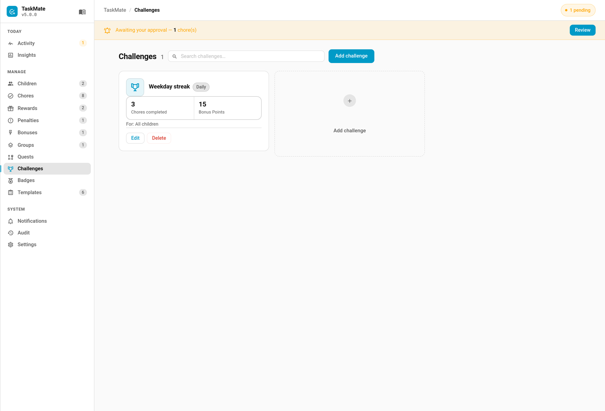

# Challenges

A challenge sets a recurring target — complete a number of chores today, or earn a number of points this week — and awards a one-off bonus when a child hits it. Progress and the award reset automatically each period, so challenges give kids a fresh goal every day or every week.



---

## How It Works

Each challenge tracks a **metric** toward a **target** within a **period**:

```
Approved chores / points within the period → reaches target → bonus awarded once → resets next period
```

- Challenges count **approved** chore completions (bonus sub-task completions are excluded)
- The `chores` metric counts completions; the `points` metric sums the points awarded by those completions within the period
- A challenge is awarded **once per period** — the same challenge can be earned again after the period rolls over
- Hitting the target awards the **bonus points**, fires a `taskmate_challenge_completed` event, and triggers a medium [celebration](Celebrations.md)

---

## Reset Cadence

| Scope | Period | Resets |
|-------|--------|--------|
| `daily` | The current calendar day | At midnight, each new day |
| `weekly` | Monday-anchored week | The start of each Monday |

The reset is automatic — there's no scheduled job to configure. When a new period begins, progress starts from zero and the award becomes available again.

---

## Creating a Challenge

Challenges are managed in the **Admin Panel → Challenges** tab (TaskMate's sidebar panel). There's no Settings config flow — add, edit, and delete them from the panel.

| Field | Default | Description |
|-------|---------|-------------|
| **Name** | — | Display name of the challenge (required) |
| **Description** | `""` | Optional description |
| **Icon** | `mdi:trophy-outline` | MDI icon |
| **Refreshes** (`scope`) | `daily` | `daily` or `weekly` |
| **Goal type** (`metric`) | `chores` | `chores` (completions) or `points` (points earned) |
| **Target** | `3` | How many to reach within the period (must be at least 1) |
| **Bonus points** | `15` | Points awarded once the target is met |
| **Assign to** | all children | Which children the challenge applies to — leave empty for all |
| **Active** | `true` | Inactive challenges don't track progress or award bonuses |

---

## Sensor Attributes

Each child's entry in the `sensor.taskmate_overview` `children` attribute carries a `challenges` array. Each item describes that child's progress through one active challenge assigned to them for the current period:

| Field | Description |
|-------|-------------|
| `challenge_id` | The challenge's ID |
| `name` | Challenge name |
| `icon` | Challenge icon |
| `scope` | `daily` or `weekly` |
| `metric` | `chores` or `points` |
| `target` | The goal value |
| `progress` | Current value, capped at `target` (good for progress bars) |
| `value` | The raw current value (may exceed `target`) |
| `bonus_points` | The bonus awarded on completion |
| `complete` | `true` when `value >= target` |
| `awarded` | `true` if the bonus has already been credited this period |

Only **active** challenges assigned to the child appear in the array.

---

## Completion & Rewards

When a child meets a challenge target:

- The **bonus points** are credited and logged as a `Challenge complete: <name>` transaction
- The bonus counts as earned points, so it also feeds the child's [XP and level](Levels-and-XP.md)
- A `taskmate_challenge_completed` event fires with `child_id`, `child_name`, `challenge_id`, `challenge_name`, `scope`, `bonus`, and `timestamp`
- A medium [celebration](Celebrations.md) is triggered

---

## Automation Example

### Announce a completed challenge

```yaml
alias: Announce challenge completed
triggers:
  - trigger: event
    event_type: taskmate_challenge_completed
actions:
  - action: notify.family
    data:
      message: >
        {{ trigger.event.data.child_name }} smashed the
        {{ trigger.event.data.scope }} challenge
        "{{ trigger.event.data.challenge_name }}" (+{{ trigger.event.data.bonus }})!
```

---

## Related

- [Quests](Quests.md) — ordered chore chains that award a bonus on completion
- [Chores](Chores.md) — completions are what challenges count
- [Levels and XP](Levels-and-XP.md) — challenge bonuses feed XP
- [Celebrations](Celebrations.md) — the moment fired on challenge completion
- [Admin Panel](Admin-Panel.md) — where challenges are created and managed
