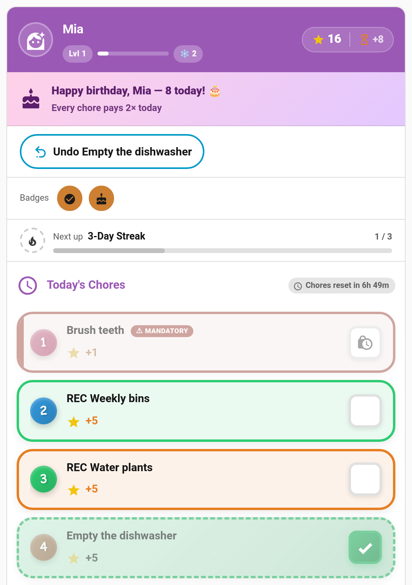

# Child Undo Window

Children tap the wrong chore. Before, only a parent could undo it. With the **child undo window** switched on, a child can take back their own mistake: an **Undo** button appears on their card for a short while after they tick something off.



> **New in v6.0.0**. Off by default.

---

## Turning It On

**TaskMate panel → Settings → Parents (no admin rights) → Child undo window (seconds)**

| Setting | Default | Description |
|---------|---------|-------------|
| **Child undo window (seconds)** | `0` | How long a child can undo an automatically approved chore, from `0` to `3600` (one hour). `0` turns child undo off. Only parents can undo. |

A value between 60 and 300 seconds covers most "oops, wrong one" taps.

---

## What a Child Can Undo

| The chore is… | The child can undo it… |
|---------------|------------------------|
| **Waiting for approval** | Any time until a parent reviews it. This withdraws the submission. |
| **Approved automatically** (the chore doesn't need approval) | Within the undo window, counted from when they ticked it off. |
| **Reviewed by a parent** (approved, or its approval undone) | Never. Only a parent can undo it. |

Some completions always stay parent-only:

- Chores completed while the window was `0`, including everything from before v6.0.0
- Chores a parent completed on the child's behalf
- Bonus ticks added from the admin panel

Turning the window on later doesn't open up older completions.

---

## On the Child Card

While a completion can be undone, the card shows an **Undo *chore name*** button near the top. It disappears on its own as soon as the window closes; the child doesn't need to refresh anything. Tapping the done chore itself (or its chip, or a done bonus sub-task) does the same thing.

Once the window has passed, tapping a done chore shows the usual "Only a parent can undo a completed chore." message instead.

This works in every card design, in pre-reader (picture) mode, and on the [routine card](Routine-Mode.md), where a step you've just finished shows **Undo** while the window allows it.

Parents tapping a done chore still reject it as before.

---

## What Undo Reverses

A child's undo reverses the completion completely: the points, the chore count, the streak and the leaderboard score all go back to how they were. Bonus sub-tasks completed on that chore are undone with it.

---

## Who Can Undo Whose Chore

The new `taskmate.undo_chore` service works out the child from the completion itself, not from the caller. Then it applies the usual linked-account rule for that child:

- A child can't undo a sibling's chore.
- With **Require a linked account per child** switched on, only the child's own Home Assistant user (or an admin) can undo it.
- The window applies to everyone using this route, admins included. Parents keep their own undo and reject buttons for anything outside the window.

```yaml
action: taskmate.undo_chore
data:
  completion_id: f5548687
```

| Field | Required | Description |
|-------|----------|-------------|
| `completion_id` | Yes | The completion to undo |

A child's undo fires `taskmate_chore_undone` rather than `taskmate_chore_rejected`, so your automations can tell the two apart.

---

## Related

- [Parent Access](Parent-Access.md) — what parents and children can each do
- [Approvals Card](Approvals-Card.md) — how parents review and undo chores
- [Reject Reasons](Reject-Reasons.md) — sending a chore back with an explanation
- [Services](Services.md) — full service reference
