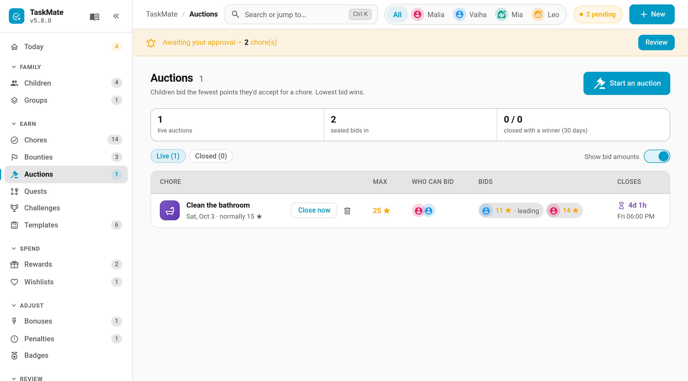

# Chore Auctions

Nobody wants to clean the bathroom. So let the children bid for it. A **chore auction** puts one day's occurrence of a chore up for sealed bids, where each child names the *fewest* points they'd do it for. The lowest bid wins the job at their price. The unpopular chore gets done, and the child who minds it least is the one who does it.


> **New in v6.0.0**

---

## How It Works

1. **You open an auction** on one occurrence of an existing chore, for example "Clean the bathroom, Saturday 3 October". You set a maximum price, when bidding closes, and which children can bid.
2. **Children place sealed bids** on their Auction card: the fewest points they'd accept, up to your maximum. They can change or withdraw their bid until it closes.
3. **Bidding closes.** The lowest bid wins. If two children bid the same amount, the earlier bid wins.
4. **The winner gets that day's chore at their price.** It appears on their card with a **Won at auction** tag and their winning price as its points, and goes through the normal completion and approval flow.

If nobody bids, the chore simply stays on its normal assignment for that day, and you can re-open the auction with a higher maximum.

---

## Keeping Bids Secret

Children only ever see how many bids are in, never anyone else's amount. After closing they see the winner and the winning price, and a child who lost on a tie is told that's why.

Changing a bid moves it to the back of the queue for tie-breaks, so there's no advantage in bidding high early and then undercutting at the last second. Re-entering the same number keeps its place.

Parents can see every bid on the **Auctions** page (turn off **Show bid amounts** if you'd rather not see them). Notifications and automation events never include bid amounts.

---

## Starting an Auction

**TaskMate panel → Auctions → Start an auction**. Or use **New → Auction**, or **Auction an occurrence** in a chore's ⋮ menu on the Chores page.



| Field | Description |
|-------|-------------|
| **Chore** and **Which one** | The chore, and which of its upcoming days (up to 60 days ahead) to auction. Only that day is auctioned; the rest of the schedule is unchanged |
| **Maximum bid** | The most anyone can bid. The chore's normal points are shown alongside for reference |
| **Minimum bid** | Off by default, so any bid from 1 counts. Turn it on to stop a race to the bottom |
| **Closes** | Quick picks (tonight 19:00, tomorrow 08:00, the day before at 18:00) or a time you choose. Bidding must close before the chore's day |
| **Who can bid** | Which of the chore's children may bid |
| **Tell children it's open** | Sends the *Auction opened* notification |

The page lists **Live** and **Closed** auctions, with **Close now**, cancel and delete on each row, and **Re-open with a higher max** on one that closed without bids. The row menu entry lives with the other chore actions:


### What can't be auctioned

- Teamwork, timed, open-ended and unassigned chores
- A day that already has a live (or won) auction
- A day that has already started

Auctions are one-offs: there are no repeating auctions.

---

## After the Auction

- **The price.** The winner's completion that day pays their winning bid instead of the chore's usual points. Streak and weekend multipliers still apply on top, as they would to any chore.
- **Everyone else.** The chore is hidden from every other child that day, even on an "everyone" chore, and rotation and reminders follow the winner.
- **If the winner doesn't do it**, it's an ordinary missed chore. There's no extra penalty.
- **Calendar.** The won day shows on the winner in the Home Assistant calendar, the calendar card and the ICS feed, with the winning price, ahead of the day.
- **Moving the day** on the calendar takes the win with it. Cancelling the auction, deleting the chore or removing the winner puts the chore back to normal.
- **Clean-up.** Finished auctions can be deleted from the Closed list, are tidied away with the rest of the history, and are removed when their chore is deleted.

---

## The Card

Each child has their own view: a gauge of the maximum price, a sealed-bid box with their current bid, a bid sheet with a slider and a keypad, the closing countdown and the number of other bids. Results stay on the card for 24 hours.

```yaml
type: custom:taskmate-auction-card
entity: sensor.taskmate_overview
child_id: b803da068e6a4b21
```

| Option | Type | Default | Description |
|--------|------|---------|-------------|
| `entity` | string | **required** | The TaskMate overview sensor |
| `child_id` | string | **required** | Whose auctions and bids the card shows. Find IDs in the panel with **Show IDs** switched on |
| `title` | string | `Chore Auction` | Card header title |
| `card_design` | string | global default | `classic`, `playroom`, `console`, `cleanpro`, `accessible` or `graphite` |
| `header_color` | string | `#5e35b1` | Header banner colour |

---

## Notifications

All three are off until you switch them on under **Notifications**:

| Type | Sent to | When |
|------|---------|------|
| **Auction opened** | The children who can bid | An auction starts with *Tell children it's open* on |
| **Closing within the hour** | The children who can bid | One hour before bidding closes |
| **Result** | The children who could bid, and parents | Bidding closes, or a live auction with bids is cancelled |

---

## Sensor and Events

`sensor.taskmate_auctions` carries a digest of live and recent auctions: counts, and the winner and price once closed. It never includes bid amounts.

Events: `taskmate_auction_opened`, `_bid`, `_bid_withdrawn`, `_closed` and `_cancelled`. None of them carry a bid amount.

---

## Related

- [Bounty Board](Bounty-Board.md) — one-off jobs at a fixed price, first to claim
- [Chore Scheduling](Chore-Scheduling.md) — how a chore's normal assignment works
- [Chore Swaps](Chore-Swaps.md) — children trading a chore between themselves
- [Calendar](Calendar.md) — where won days show up
