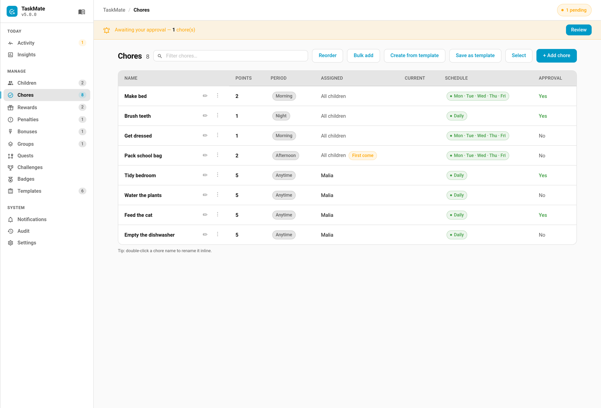
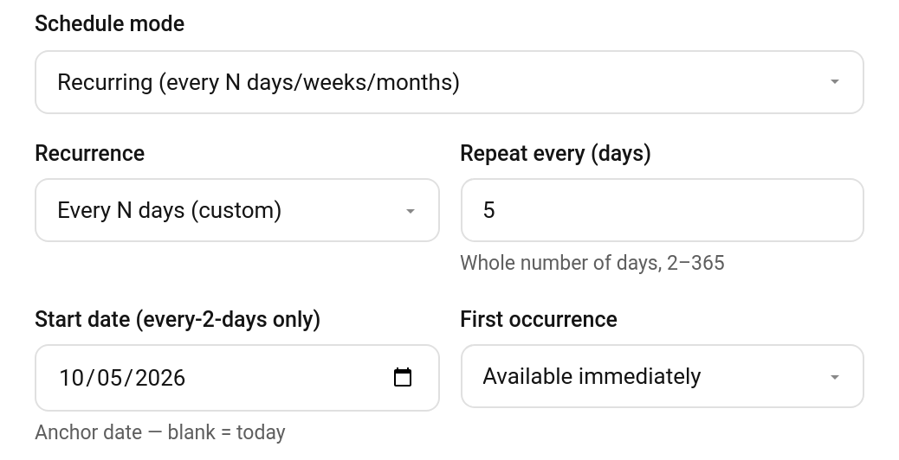

# Chore Scheduling

TaskMate supports three scheduling modes for chores — specific days, recurring, and one-shot — set in the chore dialog. A separate **assignment** mode decides *who* gets a chore; see [Assignment Modes](Chores.md#assignment-modes).



> **Note:** Whatever the schedule, a chore's availability can additionally be gated by [Chore Dependencies](Chore-Dependencies.md). A chore that is scheduled and due today may still stay locked until its prerequisite chores are completed and approved for that child today.

---

## Mode A — Specific Days

The chore appears on selected days of the week. This is the default mode and matches the existing behaviour.

**Setup:** In the chore dialog, select which days the chore should appear. Leave empty to show every day.

**Child card behaviour:** Use `due_days_mode` on the child card:
- `hide` — chores not due today are hidden entirely
- `dim` — chores not due today are shown greyed out and non-interactive
- `show` — all chores shown regardless of day

**Progress counting:** The Overview card and Parent Dashboard count only chores due today in the progress bar denominator — a chore scheduled Mon/Wed/Fri doesn't inflate Saturday's total.

---

## Mode B — Recurring

The chore has a rolling recurrence window. Once completed, it cannot be done again until the window expires.

**Setup:** Select **Recurring** as the schedule mode, then configure:

| Field | Applies To | Description |
|---|---|---|
| **Recurrence** | All | How often the chore can be completed |
| **Repeat every (days)** | Every N days (custom) | *(v6.2.0)* The interval, a whole number of days from 2 to 365. Replaces the Day of Week field when this option is picked. |
| **Day of Week** | Weekly, Every 2 Weeks | Pin to a specific day. Leave empty for any day. |
| **Start Date** | Every 2 Days, Every N days | Anchor date for the rhythm. See [Every N Days](#every-n-days-custom) for how it works. |
| **First Occurrence** | All | Available immediately or wait for first scheduled occurrence |

### Recurrence Windows

| Option | Window |
|---|---|
| Every 2 days | 2 days from last completion date |
| Every N days (custom) | N days from last completion date, N from 2 to 365 (v6.2.0) |
| Weekly | 7 days from last completion date |
| Every 2 weeks | 14 days from last completion date |
| Monthly | 30 days from last completion date |
| Every 3 months | 90 days from last completion date |
| Every 6 months | 180 days from last completion date |

### Every N Days (custom)

> **New in v6.2.0**

When none of the fixed options fit, pick **Every N days (custom)** and set **Repeat every (days)** to any whole number from **2 to 365**: towels every 3 days, plants every 5, a deep clean every 10.



**TaskMate panel → Chores → edit a chore → Schedule mode: Recurring → Recurrence: Every N days (custom) → Repeat every (days)**

- **No start date:** the chore opens again N days after it was last done, so the rhythm moves with the child.
- **With a start date:** the chore is pinned to fixed days, the start date and every N days after it (5 Oct, 10 Oct, 15 Oct, …). Before the start date it stays locked. Once it has been done, it only opens again on one of those days, and can be done once that day.

The panel won't save a number outside 2–365 and shows a message instead. *Every 2 days* is the same thing as *Every N days* with N = 2. The Chores list shows the schedule as "Every 5 days", and so does the child card.

> The Start date field is still labelled *(every-2-days only)* in the editor. It applies to Every N days too.

Windows are **midnight-rounded** — if completed at 7pm Wednesday, the window starts from Wednesday midnight. A weekly chore completed Wednesday is available again the following Wednesday from midnight.

### First Occurrence Mode

When a recurring chore is first created (no completions yet):

| Setting | Behaviour |
|---|---|
| **Available Immediately** (default) | Child can complete it straight away |
| **Wait for First Scheduled Occurrence** | Chore is locked until the first scheduled day/date arrives |

For **Weekly/Every 2 Weeks** with a Day of Week set — "wait" means locked until that day of the week arrives.

For **Every 2 Days** or **Every N days** with a Start Date, the chore is locked until the start date (whatever this setting says).

For **Monthly and longer** — "wait" means locked for the full window from creation date before first use.

### Child Card Display

Use `recurrence_done_mode` on the child card to control what happens when a recurring chore is completed and waiting to reset:

| Value | Behaviour |
|---|---|
| `dim` | Shown greyed out, non-interactive (default) |
| `hide` | Hidden entirely until available again |
| `show` | Shown normally — child can see it's done but can't complete again |

### Undo Behaviour

If a child undoes a recurring chore completion, the **previous** completion becomes the window anchor — the chore does not immediately become available again (unless there was no previous completion). This prevents gaming the system by repeatedly completing and undoing to reset the window.

### Last Completed Store

Recurrence windows are tracked in a dedicated store separate from the prunable completion history. This means:
- The `history_days` setting does not affect recurrence — a 6-month chore will still be correctly locked even if history is set to 90 days
- The store keeps only the two most recent completions per chore per child — current and previous (for undo)

---

## Mode C — One-Shot (Non-Recurring)

A one-shot chore is a single-use task that is valid only for the day it is created. Once completed and approved (or once midnight passes), the chore soft-disables itself. This is ideal for non-routine tasks that deserve a reward but don't happen on a schedule.

**Use cases:**
- "Help wash the car" — sunny Saturday task
- "Big bedroom declutter" — one-time project
- "Help with groceries" — spontaneous reward opportunity

### Setup

1. Open the **TaskMate** panel → **Chores** → **+ Add chore**
2. Fill in the chore details (name, points, etc.)
3. For **Schedule Mode**, select **"One-time task (single day)"**
4. The chore is created immediately — no second scheduling step is needed

> **Note:** `daily_limit` is automatically forced to `1` for one-shot chores.

### Lifecycle

```
Creation (today)
  │
  ├─ Child completes it
  │   ├─ requires_approval = off → points awarded, chore disables for this child
  │   └─ requires_approval = on  → pending approval
  │       ├─ Parent approves → points awarded, chore disables for this child
  │       └─ Parent rejects  → chore re-enables for this child (they get another shot)
  │
  └─ Midnight arrives (00:00:05)
      └─ Chore auto-disables if still enabled (not completed)
```


### Soft-Disable Behaviour

One-shot chores use **soft-disabling** rather than deletion:

| Field | Purpose |
|-------|---------|
| `enabled` | `false` when the chore is globally disabled (all children done or expired) |
| `disabled_for` | List of child IDs for whom this chore is individually disabled |
| `created_date` | ISO date (e.g. `2026-04-16`) — the chore is only available on this date |

Disabled chores remain in storage for history and audit purposes. Points and completion records are preserved.

### Multi-Child Behaviour

When a one-shot chore is assigned to multiple children:

- Each child gets their **own independent shot** at completing it
- When child A completes and gets approved, the chore disables **only for child A**
- Child B can still see and complete the chore
- The chore becomes **globally disabled** (`enabled = false`) only when **all** assigned children have completed it
- If `assigned_to` is empty (all children), the system checks against all children in the system

### Re-Enabling a One-Shot Chore

Parents can re-use a one-shot chore at a later date:

1. Open the **TaskMate** panel → **Chores** — disabled chores show **(disabled)** next to their name
2. Open the disabled chore's **⋮** menu
3. Choose **Activate chore**
4. The chore re-enables with today's date as the new `created_date`

This effectively gives the chore a fresh 1-day window. The same chore definition (name, points, assignment) is reused without creating a duplicate.

### Midnight Expiry

One-shot chores that are not completed by end of day are automatically soft-disabled at **00:00:05** by the same midnight callback that handles streak checks. This ensures the active chore list stays clean without manual intervention.

- Already-disabled chores are skipped (no double-processing)
- Non-one-shot chores are unaffected
- A log entry is written: `One-shot chore '<name>' expired (created <date>, today <date>)`

### Rejection Handling

When a parent rejects a one-shot completion:

1. The child is removed from `disabled_for`
2. The chore's `enabled` flag is set back to `true`
3. Points are reversed (same as any other rejection)
4. The chore reappears on the child's card — they can try again (as long as it's still the same day)

### Child Card Display

One-shot chores follow the same filtering as other chores:

- If `enabled = false` → hidden for all children
- If child's ID is in `disabled_for` → hidden for that child
- If `created_date ≠ today` → hidden (expired)
- Otherwise → shown normally

The parent dashboard applies the same filters.


---

## First Come First Served

`first_come` is a competitive assignment mode: instead of giving today's turn to one child, the chore is shown to the **whole pool** and the first child to complete it wins. Set it in the **Assignment Mode** selector on the chore (see [Assignment Modes](Chores.md#assignment-modes)).

### How It Works

- **Shown to everyone in the pool** — every assigned child (or all children, if `assigned_to` is empty) sees the chore until it is claimed. With **Require Availability** on, only currently-available children see it.
- **Single winner by default** — with a daily limit of `1` the first completion **locks the chore for the whole pool** for the rest of the day.
- **Shared daily limit** — from **v7.6.0** a first-come chore's daily limit is shared by the whole pool. A limit of `2` means two completions in total today, whoever makes them: one each, or both by the same child. Every completion pays the child who made it, and once the limit is used up the chore locks for everyone. A pool-wide **Parent did it** from the admin panel uses one of the slots.
- **Race losers** — if another child tries to complete it after the limit is used up, the attempt is rejected with *"Chore '…' was already completed by another child."* No points are awarded to the loser.
- **Daily reset** — the lock is per-day; the chore opens up to the pool again the next day.

For example, to have the dishwasher emptied twice a day by whichever child gets there first, set the chore up in the admin panel's chore dialog like this:

| Setting | Value |
|---------|-------|
| Assigned to | Both children |
| Assignment mode | First come |
| How often in a day | Up to N times |
| Daily limit | `2` |
| Points | `3` |

If one child does it twice they get 6 points and the other gets none. If they do it once each, they get 3 points each. Either way it then locks until tomorrow.

> **Upgrading to v7.6.0:** first-come chores used to ignore their daily limit, and the panel hid the field, so an old value could be sitting on a chore unseen. To stop those chores suddenly allowing several completions, every first-come chore is reset to a limit of `1` once, on the first start after the upgrade. Set a higher limit afterwards and it is kept.

### Panel Behaviour

- In the chore dialog, pick **Up to N times** under **How often in a day**, then set the **Daily Limit**. For a first-come chore the field explains that the limit is shared by the group.
- First-come chores carry a gold **First come** badge in the chore list.
- First-come chores are **excluded from [Task Groups](Task-Groups.md)** — the group dialog won't list them — and from per-child rotation bookkeeping, because there is no single assignee to coordinate.

### Card Behaviour

By default a claimed first-come chore vanishes from every card in the pool — **including the winner's**, so there is no confirmation it was done and no way to see who got there first.

From **v5.4.0** the child card's `first_come_claimed_mode` option changes that:

| Value | Behaviour |
|-------|-----------|
| `hide` | **Default.** The row disappears for everyone once claimed (behaviour before v5.4.0) |
| `dim` | The row stays, greyed out and not tappable |
| `show` | The row stays at full opacity, still not tappable |

Under `dim` and `show`, the winner keeps their normal completed row with undo, and everyone else sees a locked row reading *"Already done by {name}"*. With a shared limit every child who took part gets the completed row, and the locked row names them all (*"Already done by Ava, Ben"*).

While a shared limit still has slots left, every child in the pool sees the chore with the pool's progress — `(1/2)` on the classic row, a `👥 1/2` tag on the other designs. A pool-wide dismissal from the admin panel has no single winner, so every child sees *"Already claimed today"* rather than it appearing as done for all of them.

Set it in the card editor under **First-Come Chores — When Claimed**, or in YAML — see [Dashboard Cards](Dashboard-Cards.md#child-card).

> **Not covered:** timed-task cards and pre-reader tiles don't check this lock, so a claimed first-come chore stays live and tappable in those two views. A tap there is still rejected by the backend as a race loser.

> The badge/short label shown in the panel is "First come"; the full mode description reads *"First come — first child to finish wins; it hides for the rest."*

---

## Sensor Attributes

Each chore in `sensor.taskmate_overview` → `chores` exposes:

| Attribute | Description |
|-----------|-------------|
| `schedule_mode` | `specific_days`, `recurring`, or `one_shot` |
| `recurrence` | e.g. `weekly`, `every_2_weeks`, or `every_5_days` for a custom Every N days chore (v6.2.0) |
| `recurrence_day` | e.g. `tuesday` (if pinned) |
| `recurrence_start` | ISO date anchor (Every 2 Days / Every N days) |
| `first_occurrence_mode` | `available_immediately` or `wait_for_first_occurrence` |
| `enabled` | `true` / `false` — whether the chore is active (one-shot soft-disable) |
| `disabled_for` | List of child IDs this chore is individually disabled for |
| `created_date` | ISO date — creation date used for one-shot expiry |
| `is_available` | `{ child_id: bool }` — pre-calculated availability per child |
| `last_completed_at` | `{ child_id: ISO datetime }` — most recent completion per child |

The `is_available` attribute is pre-calculated by the backend so cards don't need to implement window logic themselves. For one-shot chores, `is_available` accounts for `enabled`, `disabled_for`, and `created_date`.

---

## Configurable Time-of-Day Boundaries

> **Available in:** v3.6.0+

The time windows for morning, afternoon, evening, and night are configurable via the admin panel under **Settings**. These boundaries affect calendar event windows when chores are published to HA calendar entities.

### Defaults

| Category | Start | End |
|----------|-------|-----|
| Morning | 06:00 | 12:00 |
| Afternoon | 12:00 | 17:00 |
| Evening | 17:00 | 21:00 |
| Night | 21:00 | 23:59 |
| Anytime | — | — (all-day event) |

### Settings

| Setting | Format | Description |
|---------|--------|-------------|
| `time_morning_start` / `time_morning_end` | `HH:MM` | Morning window boundaries |
| `time_afternoon_start` / `time_afternoon_end` | `HH:MM` | Afternoon window boundaries |
| `time_evening_start` / `time_evening_end` | `HH:MM` | Evening window boundaries |
| `time_night_start` / `time_night_end` | `HH:MM` | Night window boundaries |

Invalid values fall back to the defaults. Configure these in the [Admin Panel](Admin-Panel.md) under Settings.

See also [Teamwork Chores](Teamwork-Chores.md) — chores that need two or more children to join before they count.
