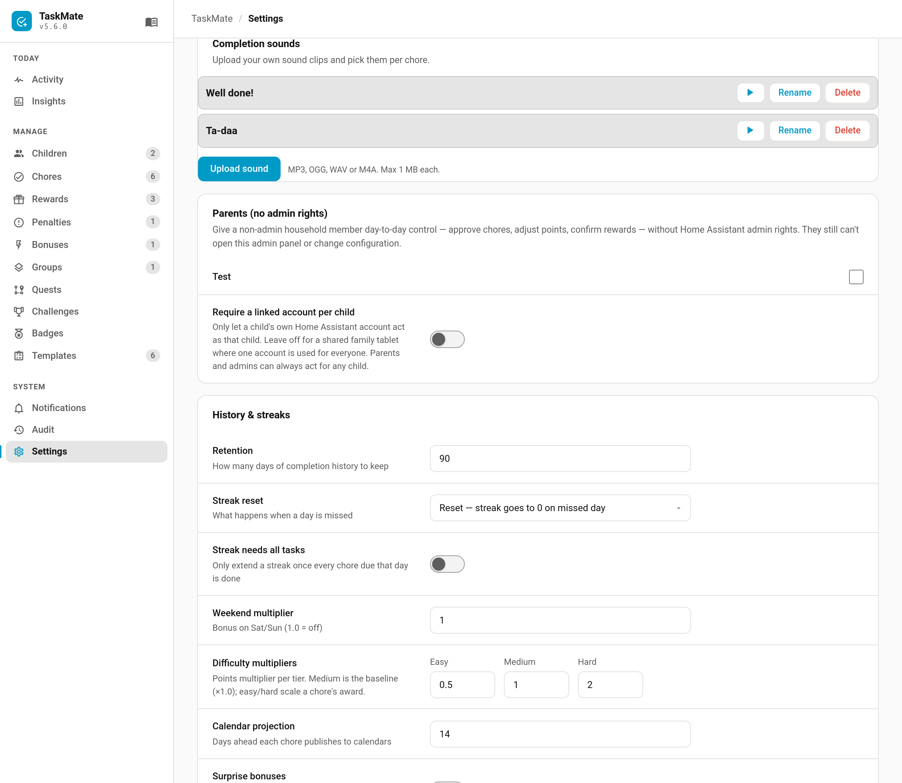

# Completion Sounds

Ticking off a chore plays a sound. TaskMate ships a set of built-in effects, and from v5.6.0 you can upload your own clips and choose one per chore — a recorded "well done", a favourite game noise, whatever gets a five-year-old to do the bins.



---

## Built-In Sounds

Every chore has a **Completion sound** in its editor. Six of the built-ins — coin, level-up, fanfare, chime, power-up and undo — are synthesised in the browser, so they involve no files at all. The joke sounds are short clips shipped with the integration. `none` plays nothing. None of them need an upload.

---

## Uploading Your Own

**Admin panel → Settings → Completion sounds → Upload sound.**

| | |
|---|---|
| Formats | MP3, OGG, WAV, M4A |
| Maximum size | 1 MB per clip |

The format list is deliberately short: these are the ones every browser Home Assistant runs in can decode. A clip that stored fine but silently failed to play would be worse than a refused upload.

The 1 MB cap is about purpose rather than disk space. A completion sound is instant feedback on a tap — anything approaching a song would delay the very thing it is meant to reward.

Once uploaded, a sound can be **played**, **renamed** or **deleted** from the same screen.

---

## Using One On A Chore

Open any chore and pick your sound from **Completion sound**. Uploaded sounds appear in the same dropdown as the built-ins, under the name you gave them.

---

## Key Points

- **Uploads are admin-only.** Children can play sounds, not add them.
- **The file type is checked by reading the file, not by trusting its name.** Renaming a document to `.mp3` will not get it in.
- **Deleting a sound resets the chores using it.** Any chore pointing at a deleted sound goes back to the default rather than falling silent, and the panel tells you how many were changed.
- **Sounds are configuration, not history.** Unlike chore evidence photos they are never swept automatically; they stay until you delete them.
- **Browsers block audio until the page has been interacted with.** The first sound after a fresh page load may not play; any tap on the dashboard is enough to release it.

---

## Previewing From A Script

The `taskmate.preview_sound` service plays a sound in open dashboards, which is handy when picking one:

```yaml
action: taskmate.preview_sound
data:
  sound: fanfare
```

An uploaded sound is referenced by its stored value, which the panel shows for you; built-ins use their plain name.

---

## See Also

- [Celebrations](Celebrations.md) — the bigger moments: level-ups, streak milestones, perfect weeks
- [Dashboard Cards](Dashboard-Cards.md) — which cards play completion sounds
- [Admin Panel](Admin-Panel.md) — where the Settings screens live
