# Dashboard Cards

TaskMate includes 32 Lovelace cards. They are automatically registered as resources when the integration loads.

All cards support a `header_color` config option — a hex colour for the card header background. Each card has its own vibrant default.

---

## Card design

Every card accepts an optional `card_design` config key — `classic` / `playroom` / `console` / `cleanpro` / `accessible` / `global` — and exposes a **Card design** dropdown in its GUI editor. Leave it on *Use global default* (or omit the key) to follow the dashboard-wide default; set it to any single style to skin that one card. See [Card Design Styles](Card-Design-Styles.md).

```yaml
card_design: playroom   # classic | playroom | console | cleanpro | accessible | global
```

---

## Which Cards Do I Need?

For a first-time setup, you only need **three cards**:

| Card | Who sees it | Purpose |
|------|-------------|---------|
| **Child Card** | Kids | Complete chores, hear sounds, see celebrations |
| **Rewards Card** | Kids | Browse and claim rewards |
| **Parent Dashboard Card** | Parents | Approve chores, manage points, see overview |

Everything else is optional and can be added later as you explore:

| Card | Best for |
|------|----------|
| Routine Card | Walking a young child through a morning or bedtime sequence, one task at a time |
| Badges Card | Showing earned and locked achievement badges with tier filtering |
| Approvals Card | Dedicated approval screen (instead of the tab in Parent Dashboard) |
| Points Card | Quick +/- point adjustments with custom amounts |
| Penalties / Bonuses Cards | Reusable named deductions and awards |
| Streak Card | Motivating kids with streak history and badges |
| Leaderboard Card | Competitive households with multiple children |
| Weekly Card | Reviewing the week's activity |
| Points Graph Card | Tracking points trends over time |
| Points Display Card | Wall-mounted tablet showing points |
| Reward Progress Card | Wall-mounted tablet showing progress toward a single reward |
| Calendar Card | Day-by-day view of chore assignments |
| Overview Card | At-a-glance summary for parents |
| Reorder Card | Customising chore display order per child |
| Family Goal Card | Tracking progress toward a shared co-op family goal |
| Photo Gallery Card | Browsing submitted chore-proof photos |
| Kiosk Card | A shared wall tablet where each child taps their face to see their own chores |
| Bounty Card | Letting a child claim and finish one-off jobs from the bounty board |
| Wishlist Card | Letting a child save towards things they want |
| Recap Card | A "Wrapped"-style story of a child's week, month or year |
| Auction Card | Letting a child bid on auctioned chores |
| Sticker Chart Card | A young child's whole day as stickers to tap, with stars filling towards a reward |
| Pet Card | A virtual pet that hatches and grows as the child does chores |
| Raffle Card | Children buy raffle tickets with points, and watch the draw |
| Personal Bests Card | A child's own records — longest streak, best day, best week, biggest award — with today's new ones marked |
| Heatmap Card | A calendar of the last six weeks for each child — darker green for busier days |

---

## Adding Cards

1. Edit your dashboard → **+ Add Card**
2. Search "taskmate" or scroll to Custom
3. Select a card and configure via the visual editor, or use YAML

All cards default to `entity: sensor.taskmate_overview` — leave it as-is unless you have renamed the entity.

### Shared kids' dashboards: `show_parent_actions` (v6.2.0)

On a tablet or shared screen the children use, a parent account often stays signed in. Normally the cards then offer that parent's controls to whoever taps them, so a child could, say, undo a finished chore long after their own [undo window](Child-Undo-Window.md) has closed.

Set `show_parent_actions: false` on a card and it behaves exactly as it would for a child, whoever is signed in. It defaults to `true`, and the switch is also in each card's visual editor as **Show parent actions**.

| Card | With `show_parent_actions: false` |
|------|-----------------------------------|
| [Child](#child-card) | Tapping a done chore (or a done bonus sub-task) uses the child's own undo window. Outside it, the card says "Only a parent can undo a completed chore." |
| [Chore Board](#chore-board-card) | The same: **Undo** follows the child's undo window |
| [Overview](#overview-card) | Child tiles don't expand to offer completing chores on the child's behalf |
| [Bonuses](#bonuses-card) / [Penalties](#penalties-card) | No Apply buttons and no edit or manage controls |

```yaml
type: custom:taskmate-child-card
child_id: a8c8376a
show_parent_actions: false
```

This only changes what the card shows. Every action still goes through TaskMate's normal permission checks. The Approvals, Points and Parent Dashboard cards are for parents only, so they have no such option; leave them off a kids' dashboard. The Activity card has its own `show_undo` option.

### Adult profiles: `show_adults` (v6.4.0)

Cards that list the whole family leave [adult profiles](Adult-Profiles.md) out by default. Set `show_adults: true` to include them, listed after the children. The **Show adults** switch appears in the card editor once your family has an adult profile (on the Chore Board, set it in YAML).

```yaml
type: custom:taskmate-leaderboard-card
entity: sensor.taskmate_overview
show_adults: true
```

It applies to the Leaderboard, Overview, Points, Points Display, Points Graph, Streak, Weekly, Calendar, Sticker Chart, Reward Progress, Parent Dashboard, Kiosk, Chore Board, Rewards, Bonuses, Penalties and Bounty cards. A card set to one `child_id` always shows that profile, adult or not. See [Adult Profiles](Adult-Profiles.md#which-cards) for what each card leaves out.

### Child photos (v6.4.0)

When a child has a [photo](Children.md#child-photos), every card shows it in place of their avatar icon. There is nothing to configure on the card.

---

## Child Card


**Purpose:** The primary card for kids — displays their chores with big colourful buttons, completion sounds, and celebrations.

**Default header colour:** Purple `#9b59b6`

```yaml
type: custom:taskmate-child-card
entity: sensor.taskmate_overview
child_id: a8c8376a            # required
time_category: anytime        # current | morning | afternoon | evening | night | anytime | all
include_anytime_chores: true  # false hides Anytime chores from every time_category
due_days_mode: hide           # hide | dim | show — for specific-day chores not due today
recurrence_done_mode: dim     # dim | hide | show — for recurring chores already completed
dependency_mode: hide         # hide | dim | show — chores waiting on another to be approved
first_come_claimed_mode: hide # hide | dim | show — first-come chores claimed by another child
show_countdown: true          # show midnight reset countdown
show_minutes_left: true       # (v7.0.0) "About 25 min left" from the chores' estimated minutes
show_help_button: true        # (v7.0.0) the "I'm stuck" button on each outstanding chore
show_mood: true               # (v7.0.0) end-of-day mood check-in once the day's chores are done
show_weekly_goal: true        # (v7.0.0) the child's own weekly goal (needs the global setting)
show_boost_alert: true        # (v7.1.0) the full-card BOOST! alert when a boost starts
show_appeals: true            # (v7.1.0) what the child can appeal, and how it went
show_tomorrow: true           # the Today / Tomorrow switch, when something is due tomorrow
show_reminders: true          # the 🔔 Remind me tag (needs the global setting)
show_praise: true             # praise notes sent with today's approvals
elapsed_time_mode: dim        # dim | hide | show — time-of-day chores whose window has passed
show_description: false       # show chore description below name
show_badges: true             # show earned badge strip below points
show_next_badge: true         # show progress toward the closest unearned badge
show_due_days_only: false     # only show chores due today (ignore time_category filter)
show_swaps: true              # show the "Take over a chore" swap section
show_roulette: false          # show the chore-roulette spin button (also needs the global setting)
pre_reader: false             # picture-only mode for children who can't read yet
pre_reader_labels: false      # in pre-reader mode, put the chore name back under each tile
pre_reader_points: false      # in pre-reader mode, show the point value instead of stars
default_sound: coin           # default completion sound
undo_sound: undo              # sound when undoing
show_parent_actions: true     # (v6.2.0) false = act as the child even when a parent is signed in
density: normal               # normal | compact — one line per chore, see Card Looks
seasonal: true                # false = ignore the seasonal themes on this card
header_color: "#9b59b6"       # leave unset to use the child's own colour
```

**Behaviour:**
- Tap a chore row to complete it (the whole row is a button — no small target)
- Tap a completed chore to undo it
- Chores requiring approval show as ticked but pending until approved
- If `daily_limit > 1`, a counter `(0/3)` appears beside the points
- When all chores are done, an animated "All Done!" state is shown
- A confetti and celebration popup appears on completion — or the child's own [done animation](Card-Looks.md#done-animation-per-child) (stamp, fireworks or sticker)
- **Card looks** — a [compact layout](Card-Looks.md#compact-child-card), [seasonal themes](Card-Looks.md#seasonal-themes), dark care strips in dark mode, and the [child's own colour](Card-Looks.md#the-childs-colour-on-their-cards) for the header when the card sets no `header_color`
- **Timed tasks** show Start/Pause/Stop buttons with a live elapsed timer instead of a checkbox — see [Timed Tasks](Timed-Tasks.md)
- **Bonus subtasks** appear as completable items below the parent chore after it's ticked off — see [Bonus Subtasks](Bonus-Subtasks.md)
- **Badge strip** shows up to 5 most-recently-earned badges below the points readout — tap to open the admin panel's badges section. Disable with `show_badges: false`. See [Achievement Badges](Achievement-Badges.md)
- **Next badge progress (v5.1.1+)** — a compact **Next up** line under the badge strip showing the closest unearned badge: tier-coloured icon, badge name, a thin bar and a `845 / 1000` count. Hidden when there is nothing left to earn or every remaining badge is still at 0%. Tap it to open the badges section. Disable with `show_next_badge: false`. See [Achievement Badges](Achievement-Badges.md)
- **Level badge + XP bar** — when the child has a level, a `Lvl N` pill and a thin XP progress bar appear under the child's name in the header, filling toward the next level. The progress is driven by the child's `level`, `level_progress`, and `level_target` values. Nothing to configure — it appears automatically once levels are active. See [Levels and XP](Levels-and-XP.md)
- **Avatar picker** — tap the child's avatar to open a picker of available avatars. Locked avatars are greyed out and show their unlock requirement on hover; tapping an unlocked one calls `taskmate.choose_avatar` to switch. See [Avatars](Avatars.md)
- **`elapsed_time_mode`** controls morning/afternoon/evening/night chores once their time window has passed: `dim` (default) greys them out, `hide` removes them, `show` leaves them active. Chores set to `Anytime` are never affected. Already-completed chores still show their green done style regardless
- **`time_category: current` (v5.5.0+)** shows only the chores for whichever period is active at that moment, and re-titles the card to match ("Afternoon Chores"). Unlike a fixed period, **future chores are not shown at all** — no dimmed previews — which is what makes it suitable for a wall dashboard or kiosk where upcoming work would confuse a child. It follows your own [custom time periods](Settings.md#custom-time-of-day-periods-v400), not just the built-in four, so a `School run` period works the same way. Chores still inside their post-period claim grace stay tappable, and past periods are governed by `elapsed_time_mode` as usual
- **`include_anytime_chores` (v5.5.0+)** — Anytime chores normally appear under *every* `time_category`. Set this to `false` to hide them, leaving only the chores belonging to the selected period. Defaults to `true`, so existing cards are unaffected. Pairs well with `time_category: current` for a strict "what's due right now" view
- **Difficulty badge** — each chore shows a small badge for its difficulty tier (easy / medium / hard). See [Difficulty Tiers](Difficulty-Tiers.md)
- **Mandatory badge** — chores marked mandatory show a **⚠ Mandatory** badge
- **Take over a chore** — an optional swap section lets a child take over a chore assigned to someone else. Controlled by `show_swaps` (default on). See [Chore Swaps](Chore-Swaps.md)
- **Chore roulette** — an optional spin button that picks a random outstanding chore for a multiplier. Needs both `show_roulette: true` here **and** the global roulette setting. See [Chore Roulette](Chore-Roulette.md)
- **Pre-reader mode** — `pre_reader: true` replaces names and numbers with a big picture and a row of stars, for children who can't read yet. `pre_reader_labels: true` puts the names back underneath. See [Pre-Reader Mode](Pre-Reader-Mode.md)
- **Teamwork chores (v6.0.0)** — a [teamwork chore](Teamwork-Chores.md) shows "2 / 3 joined" with the joined children's avatars and a **Join** / **Leave** button instead of a plain tick
- **Birthday banner (v6.0.0)** — on the child's [birthday](Birthday-Mode.md) the card shows a birthday banner with confetti
- **Streak freezes (v6.0.0)** — the child's ❄️ token count shows on the card while [streak freezes](Streak-Freezes.md) are on
- **Sent back (v6.0.0)** — a chore or reward claim rejected with a [reason](Reject-Reasons.md) shows "Sent back: …" for 24 hours, or until the child tries again
- **Inspections (v6.0.0)** — an "Inspection coming" banner (unless it's a secret check), then the result, for [surprise inspections](Surprise-Inspections.md). A pass plays a celebration
- **Child undo (v6.0.0)** — with the [child undo window](Child-Undo-Window.md) on, a child can take back a chore they just did, without a parent
- **Auction wins (v6.0.0)** — a chore won at [auction](Chore-Auctions.md) shows only on the winner's card that day, at the winning price
- **Minutes left (v7.0.0)** — chores with [estimated minutes](Estimated-Minutes.md) show a `~10 mins` tag, and the card adds up what's still to do into "About 25 min left" beside the countdown. Hide the total with `show_minutes_left: false`
- **I'm stuck (v7.0.0)** — each outstanding chore has an "I'm stuck" button that asks a parent for help without completing or skipping anything; the chore then shows "Help is on its way". Hidden with `show_help_button: false`, and always hidden in pre-reader mode. See [Help Requests](Help-Requests.md)
- **Mood check-in (v7.0.0)** — once the day's chores are done, the card asks "How was your day?" with five faces. One answer per day. Hide it with `show_mood: false`. See [Mood Check-In](Mood-Check-In.md)
- **Boosts (v7.1.0)** — a live [boost](Boost-Windows.md) shows a countdown banner and ×2 chips with the boosted points; when it starts the card is covered by a BOOST! alert once per device. Hide the alert with `show_boost_alert: false`
- **Weekly goal (v7.0.0)** — while weekly goals are on in Settings, the child sets their own points target for the week and sees a progress bar towards it. Hide it with `show_weekly_goal: false`. See [Weekly Goals](Weekly-Goals.md)
- **Sick day (v7.0.0)** — on a [sick day](Sick-Days.md) the card says "Rest up and get better" and shows no chores due; anything already ticked stays listed so it can still be undone
- **Make it right (v7.0.0)** — after a penalty with a [make-it-right](Make-It-Right-Penalties.md) chore, the card says which chore to do and by when to earn points back, and that chore appears on the list even if it isn't normally due
- **Per-chore streaks** — a chore done on two or more of its due days in a row shows **🔥 N days**. See [Per-Chore Streaks](Per-Chore-Streaks.md)
- **Tomorrow** — a **Today / Tomorrow** switch lists tomorrow's chores, read-only with a 🔒. Only shown when something is due tomorrow; hide it with `show_tomorrow: false`. See [Tomorrow Preview](Tomorrow-Preview.md)
- **Reminders** — while [child-chosen reminders](Child-Chosen-Reminders.md) are on, each chore still to do has a **🔔 Remind me** tag that becomes **🔔 17:30** once set. Hide it with `show_reminders: false`
- **Praise notes** — today's [praise notes](Praise-Notes.md) show as strips: *"💬 Dad: Great job!"*. Hide them with `show_praise: false`
- **Penalty warnings** — a [warn-first penalty](Penalty-Warnings.md) shows *"🟨 Warning: … — next time it's −10"* until it's spent or resets
- **Sibling checks** — a child allowed to [check a sibling](Sibling-Checks.md) sees their waiting chores with **Looks done (+1)** and **Not yet**
- **Quantity chores (v7.0.0)** — tapping a [quantity chore](Quantity-Chores.md) asks "How many pages?" with − / + buttons and shows what it's worth before it is sent
- **`first_come_claimed_mode` (v5.4.0+)** controls what the rest of the pool sees once a [first-come](Chore-Scheduling.md#first-come-first-served) chore has been claimed: `hide` (default — the row disappears for everyone, matching pre-5.4.0 behaviour), `dim` (greyed out) or `show` (full opacity). Under `dim` and `show` the winner keeps their normal completed row with undo, and every other child gets a locked row reading *"Already done by {name}"*. Not tappable in either case

**`time_category` values:**

| Value | Shows |
|-------|-------|
| `current` | **(v5.5.0+)** Chores in whichever period is active right now, plus anytime |
| `morning` | Chores with time_category = morning or anytime |
| `afternoon` | Chores with time_category = afternoon or anytime |
| `evening` | Chores with time_category = evening or anytime |
| `night` | Chores with time_category = night or anytime |
| `anytime` | Chores with time_category = anytime only |
| `all` | All chores regardless of time_category |

**`due_days_mode` values** (Mode A — Specific Days chores):

| Value | Behaviour |
|-------|-----------|
| `hide` | Chores not due today are hidden |
| `dim` | Chores not due today shown greyed out, non-interactive |
| `show` | All chores shown regardless of schedule |

**`first_come_claimed_mode` values** (first-come chores already claimed by someone):

| Value | Behaviour |
|-------|-----------|
| `hide` | **Default.** The row is removed from every card in the pool once claimed |
| `dim` | The row stays, greyed out and not tappable, labelled with who claimed it |
| `show` | The row stays at full opacity, still not tappable, labelled with who claimed it |

A pool-wide dismissal from the admin panel has no specific winner, so every child sees *"Already claimed today"* instead of a name. Honoured by the standard chore row and all six [design styles](Card-Design-Styles.md) — but **not** by timed-task cards or pre-reader tiles, which stay live and tappable regardless (the same gap applies to `recurrence_done_mode`).

---

## Routine Card


**Purpose:** A guided, one-task-at-a-time flow for morning and bedtime routines — a single task with a big **Done** button, a progress bar and a celebration at the end. See [Routine Mode](Routine-Mode.md).

**Default header colour:** Purple `#7c3aed`

```yaml
type: custom:taskmate-routine-card
entity: sensor.taskmate_overview
child_id: a8c8376a            # required
time_category: morning        # morning | afternoon | evening | night | anytime | all
title: Morning routine        # optional
card_design: global           # optional
```

| Control | Effect |
|---------|--------|
| **Done** | Completes the chore and moves to the next one |
| **Skip for now** | Moves on without completing — the task stays outstanding |
| **Back** | Returns to the previous task, so a mis-tap is recoverable |

**`time_category` is exact** — a `morning` routine shows only morning chores, not `anytime` ones. Use `all` for everything.

---

## Rewards Card


**Purpose:** Shows available rewards with progress bars. Children can claim rewards from this card.

**Default header colour:** Orange `#e67e22`

```yaml
type: custom:taskmate-rewards-card
entity: sensor.taskmate_overview
child_id: a8c8376a            # optional — filter to one child
show_child_badges: true       # show assigned children on each reward
enable_pool_mode: false       # force all rewards on this card into pool/savings-jar mode
deposit_amounts: [1, 5, 10]   # quick-deposit button amounts for pool/jackpot rewards
header_color: "#e67e22"
```

**Behaviour:**
- Progress bar shows current points vs reward cost
- Jackpot rewards show a colour-coded multi-segment bar with each child's contribution
- Claim button appears when the child can afford the reward
- After claiming: shows "Awaiting parent approval" until approved
- If no `child_id` set, a **Viewing as** dropdown appears below the header — select a child to activate claim buttons for them
- **Pool / jackpot rewards** show quick-deposit buttons (set by `deposit_amounts`, default `[1, 5, 10]`) plus an **Amount** field for any custom value — see [Pool Mode](Pool-Mode-(Savings-Jars).md)

---

## Approvals Card

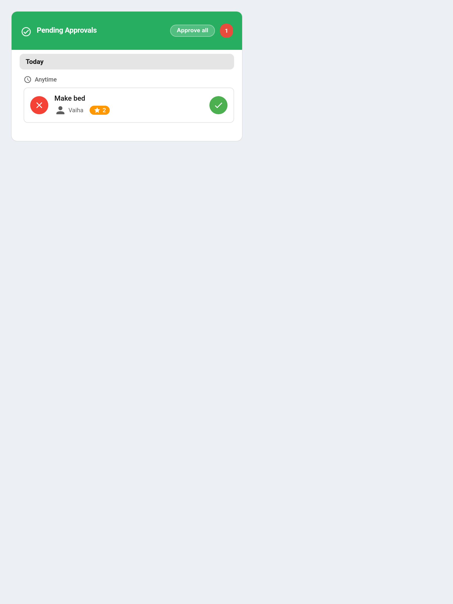

**Purpose:** Review and approve or reject pending chore completions.

**Default header colour:** Green `#27ae60`

```yaml
type: custom:taskmate-approvals-card
entity: sensor.taskmate_overview
title: Pending Approvals
child_id: a8c8376a            # optional — filter to one child
header_color: "#27ae60"
```

**Behaviour:**
- Items grouped by date (Today / Yesterday / date) and time of day
- ✗ button on the left to reject, ✓ button on the right to approve
- Pulsing red badge in header shows count when items are pending
- Evidence-photo thumbnails render inline for completions that include a proof photo — see [Photo Proof](Photo-Proof.md)
- **Star ratings (v6.0.0)** — with [quality ratings](Quality-Ratings.md) on, approving shows a ★ / ★★ / ★★★ picker that scales the points
- **Reject with a reason (v6.0.0)** — rejecting a chore or reward claim offers a reason box with quick chips ("Not finished", "Needs redoing", "Not today"). See [Reject Reasons](Reject-Reasons.md)
- **Bounties and wishes (v6.0.0)** — finished [bounties](Bounty-Board.md) and [wish](Wishlist.md) redemptions appear alongside chores and reward claims

---

## Points Card

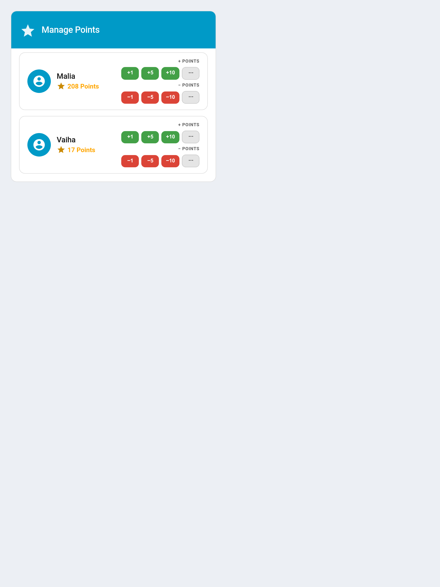

**Purpose:** Manually add or remove points from a child.

**Default header colour:** Blue `#2980b9`

```yaml
type: custom:taskmate-points-card
entity: sensor.taskmate_overview
title: Manage Points
quick_add_amounts: [1, 5, 10]      # configurable add buttons
quick_remove_amounts: [1, 5, 10]   # configurable remove buttons
show_dialog: true                  # show ⋯ button for custom amount + reason
header_color: "#2980b9"
```

**Behaviour:**
- Each child shows two rows of quick-tap buttons — add row and remove row
- Tapping a button applies immediately with no confirmation dialog
- The `⋯` button at the end of each row opens the full dialog for a custom amount with an optional reason
- `show_dialog: false` hides the `⋯` buttons entirely if you only want fixed amounts
- All amounts are configurable in the card editor — enter comma-separated values e.g. `1, 2, 5, 10, 25`
- Quick buttons fire without a reason — use `⋯` when you want to log a reason

---

## Reorder Card

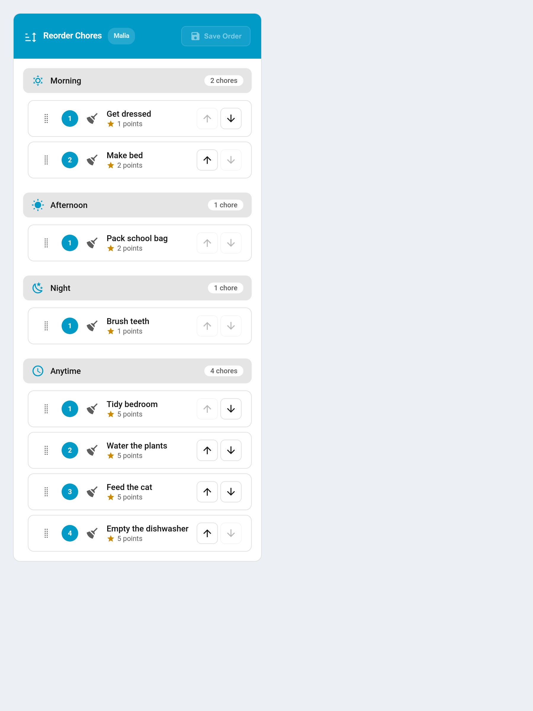

**Purpose:** Drag-and-drop interface to set the display order of chores for each child.

**Default header colour:** Teal `#16a085`

```yaml
type: custom:taskmate-reorder-card
entity: sensor.taskmate_overview
child_id: a8c8376a
title: Reorder Chores
header_color: "#16a085"
```

**Behaviour:**
- Drag chore rows up and down within each time category group
- Click **Save Order** to apply — the order is stored per-child
- Shows unsaved changes indicator when you have moved items

---

## Parent Dashboard Card


**Purpose:** All-in-one parent control centre with four tabs.

**Default header colour:** Crimson `#c0392b`

```yaml
type: custom:taskmate-parent-dashboard-card
entity: sensor.taskmate_overview
title: Parent Dashboard
quick_points_amount: 5        # points per +/- button press
show_claims: true             # show the Claims tab
header_color: "#c0392b"
```

**Tabs:**

| Tab | Content |
|-----|---------|
| **Overview** | All children's today progress bars and points |
| **Approvals** | Pending chore completions with approve/reject — evidence-photo thumbnails render inline (see [Photo Proof](Photo-Proof.md)); with [quality ratings](Quality-Ratings.md) on, a ★ / ★★ / ★★★ picker under each chore rates it as you approve |
| **Claims** | Pending reward claims with approve/reject |
| **Points** | Quick +/- buttons per child |

---

## Overview Card

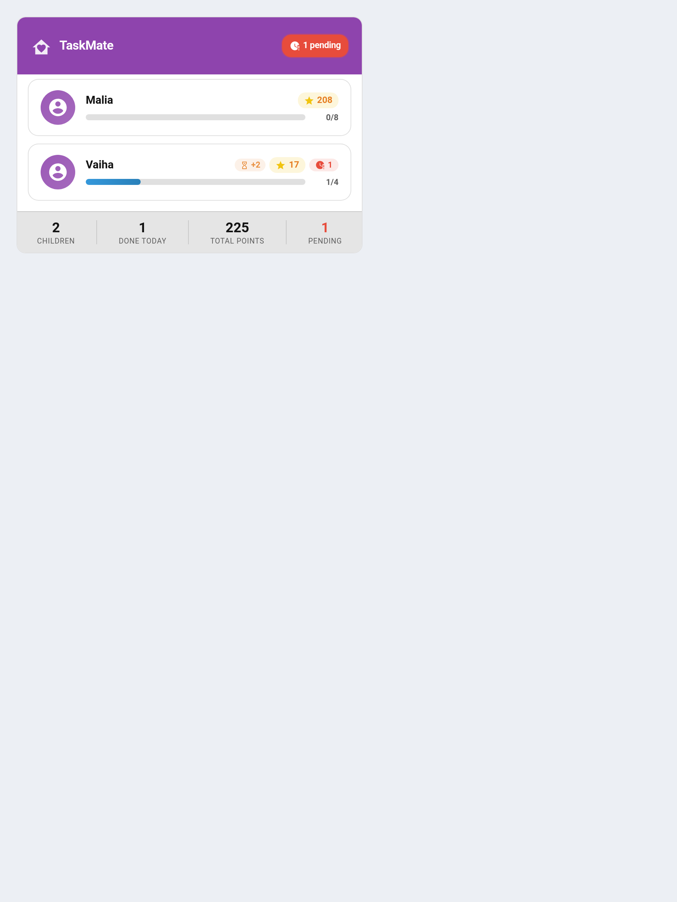

**Purpose:** At-a-glance parent summary of all children.

**Default header colour:** Violet `#8e44ad`

```yaml
type: custom:taskmate-overview-card
entity: sensor.taskmate_overview
title: TaskMate
approvals_entity: sensor.taskmate_pending_approvals  # optional — override for pending approvals count
show_parent_actions: true     # (v6.2.0) false = tiles don't expand to complete on a child's behalf
header_color: "#8e44ad"
```

**Shows per child:**
- Today's chore progress bar (approved completions / chores due today)
- Current points balance
- Pending approval chip (if any)
- Footer totals: children count, done today, total points

> **Note:** Progress counts only chores due today. Chores with `due_days` set are excluded from the denominator on days they are not scheduled. Chores with no `due_days` set are always included.

---

## Activity Card

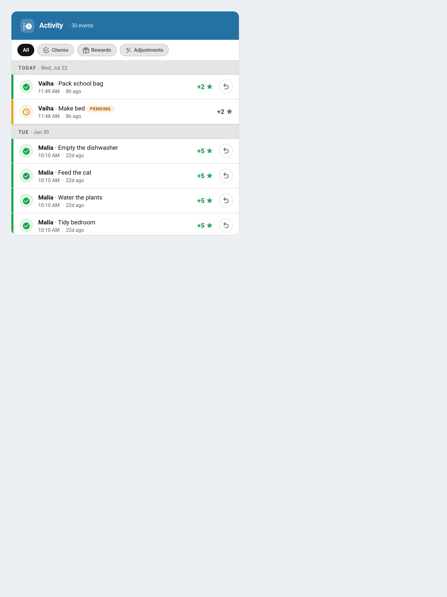

**Purpose:** Scrollable timeline of all activity.

**Default header colour:** Steel Blue `#2471a3`

```yaml
type: custom:taskmate-activity-card
entity: sensor.taskmate_overview
child_id: a8c8376a            # optional — filter to one child
max_items: 30
show_filter_chips: true       # All / Chores / Rewards / Adjustments chip bar
accent_stripes: true          # coloured left stripe per row
show_relative_time: true      # "5m ago" / "2h ago" labels
show_undo: true               # set false to hide undo buttons (kid-friendly dashboards)
header_color: "#2471a3"
```

**Shows:**
- Chore completions (approved and pending)
- Manual point adjustments (add/remove)
- Bonus point events (weekend multiplier, streak milestones, perfect week)
- Reward claim events

Grouped by Today / Yesterday / date.

Reversible events show a per-action **Undo (↩)** button that rolls the event back. Set `show_undo: false` to hide these buttons — ideal for a children's dashboard where kids should see what they earned but not be able to reverse their own activity.

**Redesign options:**

The card was redesigned for clearer visual hierarchy, in-card filtering, and accessibility. Three per-card switches let each instance opt in or out of those changes independently. All three default to on, so existing cards keep the redesigned look.

| Option | Default | Effect |
|--------|---------|--------|
| `show_filter_chips` | `true` | Shows the **All / Chores / Rewards / Adjustments** chip bar below the header for filtering the timeline in place |
| `accent_stripes` | `true` | Adds a coloured left stripe to each row encoding approved / pending / penalty / reward by colour |
| `show_relative_time` | `true` | Shows a relative `5m ago` / `2h ago` label alongside the absolute time |
| `show_undo` | `true` | Shows the per-row **Undo (↩)** button. Set `false` for a kid-friendly dashboard so children can't reverse their own activity |

All four are available in the visual card editor.

---

## Streak Card

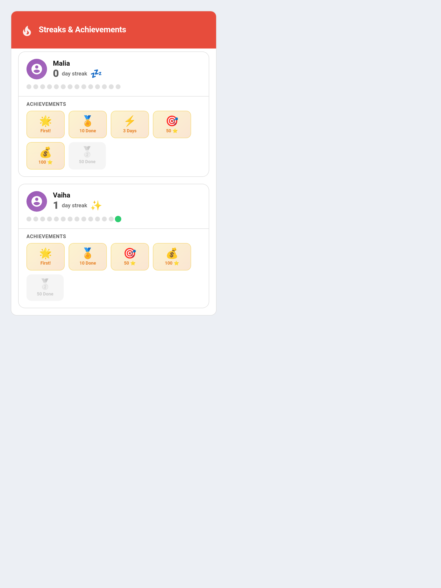

**Purpose:** Shows streak history and achievement badges.

**Default header colour:** Red `#e74c3c`

```yaml
type: custom:taskmate-streak-card
entity: sensor.taskmate_overview
child_id: a8c8376a            # optional — filter to one child
streak_days_shown: 14         # dot history length
header_color: "#e74c3c"
```

**Shows:**
- Current and best streak numbers
- Dot history grid (green = completed, grey = missed)
- Achievement badges for milestones (First!, 3 days, 7 days, 14 days, 30 days, etc.)
- **(v6.0.0)** The ❄️ [streak freeze](Streak-Freezes.md) tokens each child holds, while streak freezes are on

---

## Weekly Card

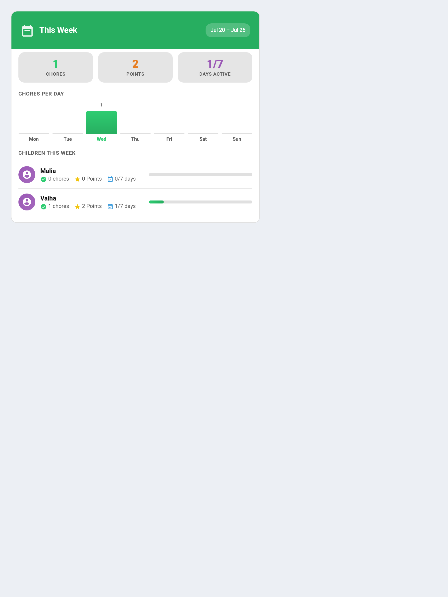

**Purpose:** Monday–Sunday view with bar chart.

**Default header colour:** Green `#27ae60`

```yaml
type: custom:taskmate-weekly-card
entity: sensor.taskmate_overview
child_id: a8c8376a            # optional — filter to one child
header_color: "#27ae60"
```

**Shows:**
- Daily bar chart (approved completions only)
- Headline stats: chores, points, days active
- Per-child breakdown
- Week date range

---

## Points Graph Card

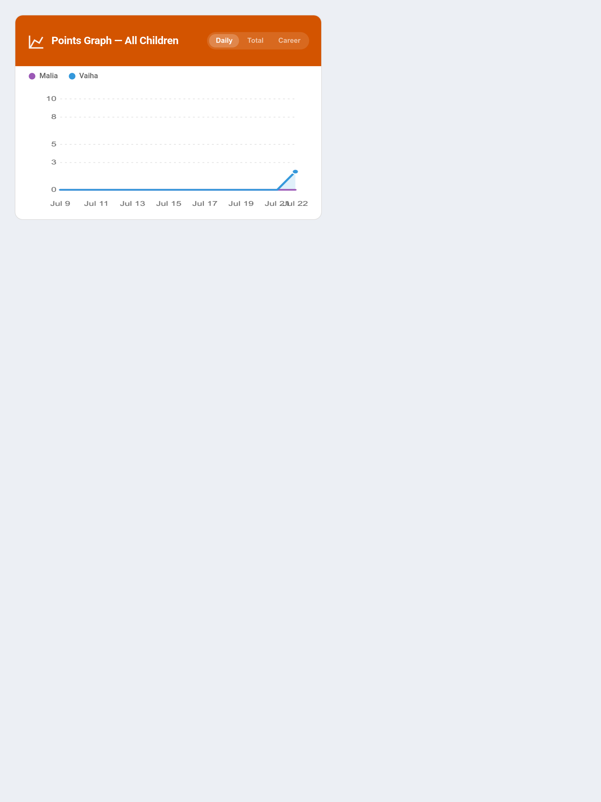

**Purpose:** Line graph of points over time.

**Default header colour:** Burnt Orange `#d35400`

```yaml
type: custom:taskmate-graph-card
entity: sensor.taskmate_overview
child_id: a8c8376a            # optional — filter to one child
days: 14                      # date range: 3–90
header_color: "#d35400"
```

**Features:**
- Canvas-based (works on mobile HA app)
- Multiple children shown as colour-coded lines
- Hover/touch tooltip showing values per day

---

## Reward Progress Card

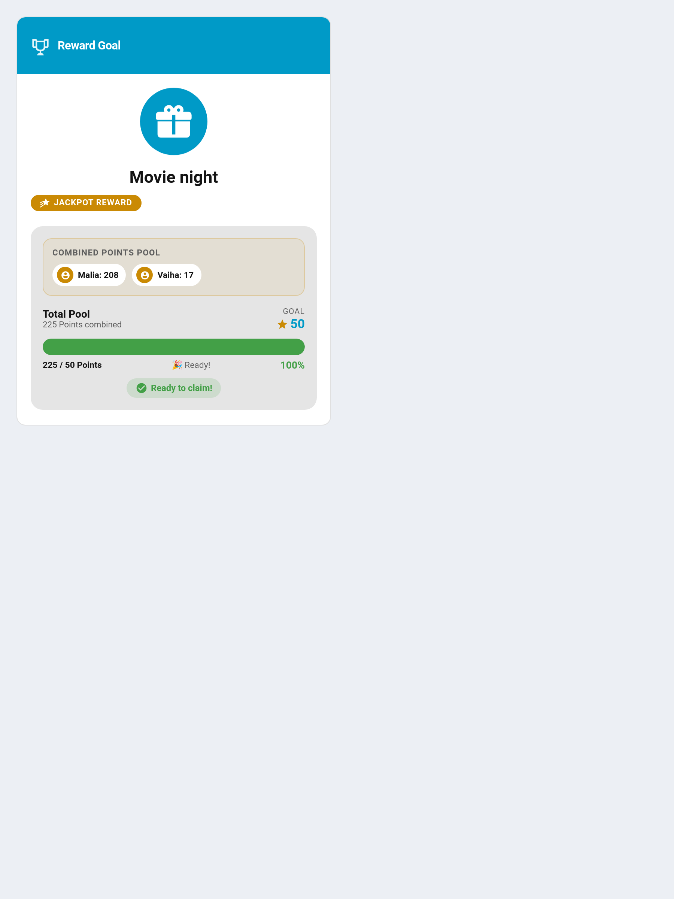

**Purpose:** Full-screen motivational display for a single reward. Designed for wall-mounted tablets.

**Default header colour:** Deep Purple `#7d3c98`

```yaml
type: custom:taskmate-reward-progress-card
entity: sensor.taskmate_overview
reward_id: abc123             # required — see Finding IDs in Getting Started
child_id: a8c8376a            # optional
title: Reward Goal
header_color: "#7d3c98"
```

**Shows:**
- Large reward icon with animated progress bar
- Points progress and percentage
- Pulsing "Ready to claim!" badge when affordable

---

## Leaderboard Card


**Purpose:** Competitive ranking of all children.

**Default header colour:** Gold `#b7950b`

```yaml
type: custom:taskmate-leaderboard-card
entity: sensor.taskmate_overview
sort_by: points               # points | streak | weekly | career | season
show_streak: true
show_weekly: true
header_color: "#b7950b"
```

**Behaviour:**
- Top 3 get gold/silver/bronze styling
- For single-child households: automatically shows personal bests (best streak, total chores, weekly points, total earned) instead of a ranking
- **`sort_by: season`** ranks children by their points earned in the current calendar month and shows a champion banner naming the latest monthly winner. The leaderboard becomes a fresh contest that resets on the 1st of each month — see [Leaderboard Seasons](Leaderboard-Seasons.md)

---

## Penalties Card

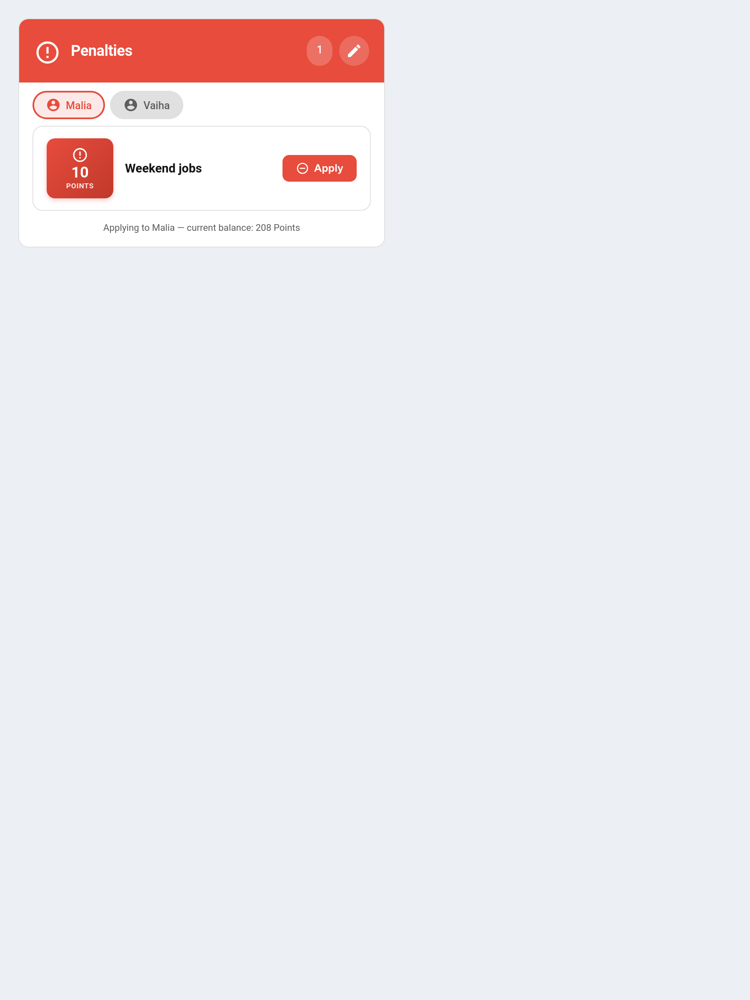

**Purpose:** Create, manage, and apply point penalties to children.

**Default header colour:** Red `#e74c3c`

```yaml
type: custom:taskmate-penalties-card
entity: sensor.taskmate_overview
title: Penalties                # optional — custom card title
show_parent_actions: true       # (v6.2.0) false = no Apply or edit controls
header_color: "#e74c3c"
```

**Behaviour:**
- View all defined penalties with name, points, icon, and assigned children
- Toggle **Edit Mode** to add, edit, or delete penalty definitions
- Apply a penalty to a child with one tap — points are deducted immediately
- Penalties appear in the Activity Card timeline

See [Penalties](Penalties.md) for service call details and automation examples.

---

## Bonuses Card

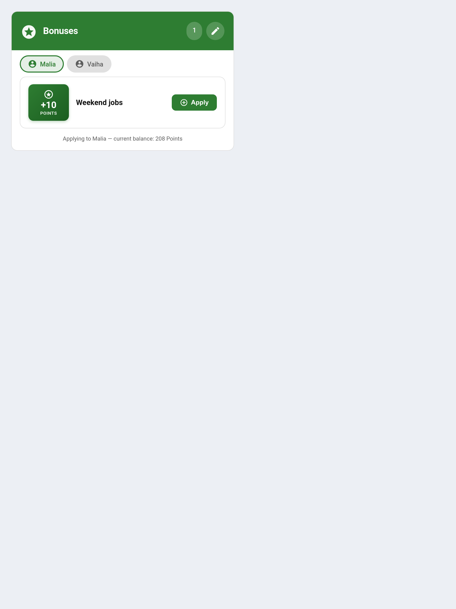

**Purpose:** Create, manage, and apply point bonuses to children.

**Default header colour:** Green `#2e7d32`

```yaml
type: custom:taskmate-bonuses-card
entity: sensor.taskmate_overview
title: Bonuses                  # optional — custom card title
show_parent_actions: true       # (v6.2.0) false = no Apply or edit controls
header_color: "#2e7d32"
```

**Behaviour:**
- View all defined bonuses with name, points, icon, and assigned children
- Toggle **Edit Mode** to add, edit, or delete bonus definitions
- Apply a bonus to a child with one tap — points are awarded immediately
- Bonuses appear in the Activity Card timeline

See [Bonuses](Bonuses.md) for service call details and use cases.

---

## Points Display Card

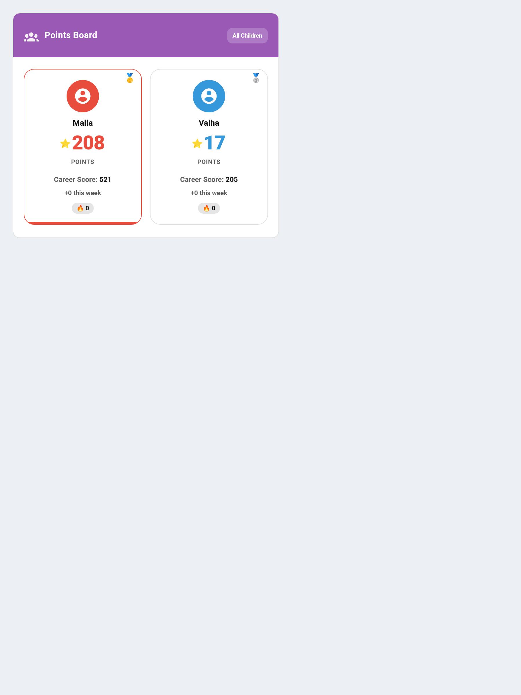

**Purpose:** Visual points display with three display modes — single child, multi-child grid, or cumulative family total.

**Default header colour:** Purple `#9b59b6`

```yaml
type: custom:taskmate-points-display-card
entity: sensor.taskmate_overview
mode: single                    # single | multi | cumulative
child_id: a8c8376a              # required for single mode
show_streak: true               # show streak info
show_weekly: true               # show weekly stats
show_rank: true                 # show rank medal in multi/cumulative modes
header_color: "#9b59b6"
```

**Modes:**

| Mode | Description |
|------|-------------|
| `single` | Large display for one child — shows avatar, points balance, streak, and weekly stats |
| `multi` | Grid of all children with points and optional rank medals |
| `cumulative` | Family total — combined points across all children |

---

## Calendar Card

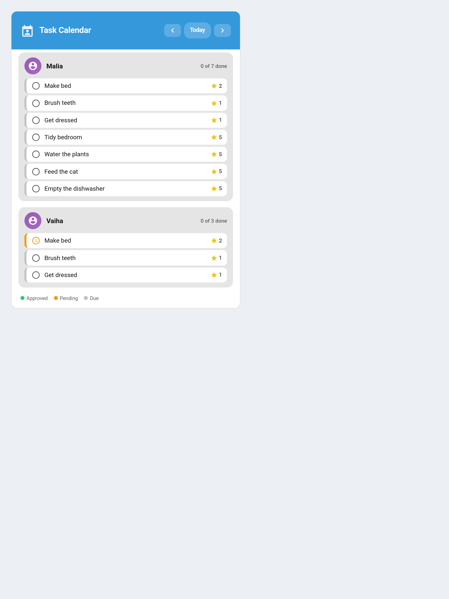

**Purpose:** Calendar view showing chore assignments and completions across days. Navigate with Prev/Next/Today buttons.

**Default header colour:** Blue `#3498db`

```yaml
type: custom:taskmate-calendar-card
entity: sensor.taskmate_overview
child_id: a8c8376a              # optional — filter to one child
title: Task Calendar
header_color: "#3498db"
```

**Behaviour:**
- Shows a day-by-day view of chore assignments based on scheduling rules
- Colour-codes chores by completion state (done / pending / not yet)
- Respects all schedule modes: specific days, recurring, and one-shot
- Handles assignment modes (alternating/random/balanced) — only shows the assigned child for that day
- Navigate between days with Prev / Next / Today buttons

---

## Badges Card

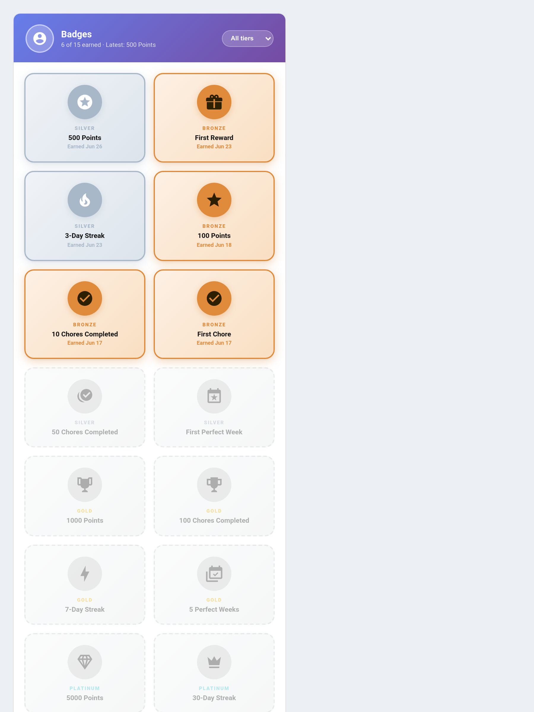

**Purpose:** Grid display of all achievement badges for a child — earned badges in full tier colour, locked badges greyed with progress bars.

**Default header colour:** Purple `#764ba2`

```yaml
type: custom:taskmate-badges-card
entity: sensor.taskmate_overview
child_id: a8c8376a              # optional — filter to one child
header_color: "#764ba2"
```

**Features:**
- Earned badges show icon, name, earned date, and point bonus in tier-specific colour
- Locked badges show greyed out with dashed border and a progress bar showing closest-criterion completion percentage
- Tier filter dropdown: All / Bronze / Silver / Gold / Platinum
- Newly-earned badges animate with a pop + shimmer effect
- Listens for `taskmate_badge_earned` bus events for real-time highlighting

See [Achievement Badges](Achievement-Badges.md) for full details on tiers, criteria, and services.

---

## Family Goal Card


**Purpose:** Shows the household's progress toward the shared co-op family goal — everyone's combined points measured against a single target, with the reward shown beneath.

**Default header colour:** Teal `#16a085`

```yaml
type: custom:taskmate-family-goal-card
entity: sensor.taskmate_overview
title: Family Goal             # optional — custom card title
header_color: "#16a085"
```

**Behaviour:**
- Displays a progress bar from the combined family balance toward the goal target, with a percentage
- Shows the goal's reward, and a celebration state once the target is reached
- If no family goal is enabled, the card shows a friendly "no goal set" placeholder

The goal itself is enabled and configured in [Settings](Settings.md). See [Family Goals](Family-Goals.md) for the full feature.

---

## Photo Gallery Card


**Purpose:** A history grid of submitted chore-evidence photos, captioned with the child, chore, and date.

**Default header colour:** Slate `#5d6d7e`

```yaml
type: custom:taskmate-photo-gallery-card
entity: sensor.taskmate_activity
title: Proof Photos            # optional — custom card title
max: 40                        # optional — limit the number of photos shown
header_color: "#5d6d7e"
```

**Behaviour:**
- Renders a thumbnail grid of completions that carried a proof photo
- Tap a thumbnail to open the full image in a new tab
- Completions still awaiting approval are flagged **pending** in their caption
- Note this card reads the **activity** sensor (`sensor.taskmate_activity`), not the overview sensor

See [Photo Proof](Photo-Proof.md) for how proof photos are captured and reviewed.

---

## Kiosk Card


**(v6.0.0)** **Purpose:** A full-screen card for a shared wall tablet. Each child taps their face, types their PIN if they have one, and sees only their own chores with big **Done** buttons, plus their points, streak and next-reward progress. See [Kiosk Mode](Kiosk-Mode.md).

**Default header colour:** Purple `#9b59b6`

```yaml
type: custom:taskmate-kiosk-card
entity: sensor.taskmate_overview
title: The Smiths                 # optional — shown in the top bar
timeout: 60                       # seconds without a tap before returning to the picker (15–600)
warn_before_return: true          # full-screen "Still there?" countdown for the last 10 seconds
show_points: true                 # points and level
show_streak: true
show_reward_progress: true        # next reward progress
show_picker_progress: true        # "3 of 6 done" under each face
play_sounds: true                 # (v6.2.0) completion and undo sounds
show_confetti: true               # (v6.2.0) confetti on Done
show_completion_popup: true       # (v6.2.0) "AWESOME! You did it!" popup with the points
show_bounties: false              # (v6.3.0) Bounty Board section: claim, finish and give back bounties
completed_mode: show              # (v7.0.0) show | hide — done and waiting-for-approval chores
elapsed_time_mode: show           # (v7.0.0) show | dim | hide — time-of-day chores whose part of the day has passed
ambient_mode: "off"               # (v7.0.0) off | progress | photos — what the picker turns into when nobody's using it
ambient_after: 120                # (v7.0.0) seconds untouched before ambient mode starts (30–1800)
show_raffle_draws: true           # (v7.0.0) spin the names and land on the winner when a raffle is drawn
show_boost_alert: true            # (v7.1.0) fill the screen when a boost starts
show_pet: true                    # (v7.1.0) the child's virtual pet beside their chores
children:                         # optional — order and PINs; omit to show every child
  - child_id: a8c8376a
    require_pin: true
  - child_id: ef19c561
    require_pin: false
header_color: "#9b59b6"
```

**Behaviour:**
- The card goes back to the picker after the timeout, or straight after the all-done celebration
- **Celebrations (v6.2.0)** — tapping **Done** plays the chore's completion sound, drops confetti and shows the "AWESOME! You did it!" popup with the points, the same as the child card. `default_sound` and `undo_sound` work as on the child card (YAML only). See [Kiosk Mode](Kiosk-Mode.md#celebrations)
- **PINs** are 4 digits, set per child by a parent under **Children → Edit** in the admin panel. They are stored hashed and never appear in the card's YAML. Five wrong tries lock the keypad, for longer after each lockout. A child with no PIN goes straight in
- Photo, timed and open-ended chores are shown greyed out under "Do these on your phone" and don't stop "all done"
- **Bounties (v6.3.0)** — with `show_bounties: true` a child can claim, finish (with a photo from the tablet if one is needed) and give back bounties. Off by default. See [Kiosk Mode](Kiosk-Mode.md#bounties)
- **Hide completed (v7.0.0)** — `completed_mode: hide` drops done and waiting chores from the list. They still count towards the "3 of 6 done" total, but can't be undone from the kiosk
- **Missed chores (v7.0.0)** — `elapsed_time_mode: dim` greys out a morning/afternoon/evening/night chore once its part of the day has passed, and `hide` removes it. Either way it can't be ticked off and leaves the day's total. `show` (default) keeps it tappable
- **Ambient mode (v7.0.0)** — with `ambient_mode: progress` the picker turns into a clock with every child's progress and any open raffles after `ambient_after` seconds untouched; `photos` shows a slideshow of chore photos instead. The first tap only wakes it. See [Kiosk Mode](Kiosk-Mode.md#ambient-mode)
- **Offline taps (v7.0.0)** — a **Done** tapped while Home Assistant can't be reached is kept as "Waiting to send" and sent when the connection is back. See [Kiosk Mode](Kiosk-Mode.md#offline-taps)
- **Raffle draws (v7.0.0)** — when a [raffle](Raffles.md) is drawn the tablet spins the names and lands on the winner, once per draw. Turn off with `show_raffle_draws: false`
- Quantity chores join photo, timed and open-ended chores under "Do these on your phone"
- There are no parent controls and no reward claiming on the kiosk
- If "Require a linked account per child" is on, the tablet shows "Ask a grown-up" rather than getting around it

---

## Bounty Card


**(v6.0.0)** **Purpose:** One child's view of the [Bounty Board](Bounty-Board.md): the one-off jobs they can claim, their current claim, and recently finished jobs.

**Default header colour:** Orange `#e67e22`

```yaml
type: custom:taskmate-bounty-card
entity: sensor.taskmate_overview
child_id: a8c8376a            # required — whose bounty board this is
title: Bounties               # optional
header_color: "#e67e22"
```

**Behaviour:**
- **Claim** locks a bounty to the child for its claim time; a child can hold one claim at a time
- **Give back** returns it to the board; **Done** sends it for approval (with a photo when the bounty asks for one)
- A countdown shows how long the claim has left. If it runs out the bounty goes back on the board
- Bounties are posted and managed by parents on the admin panel's **Bounties** page

---

## Wishlist Card

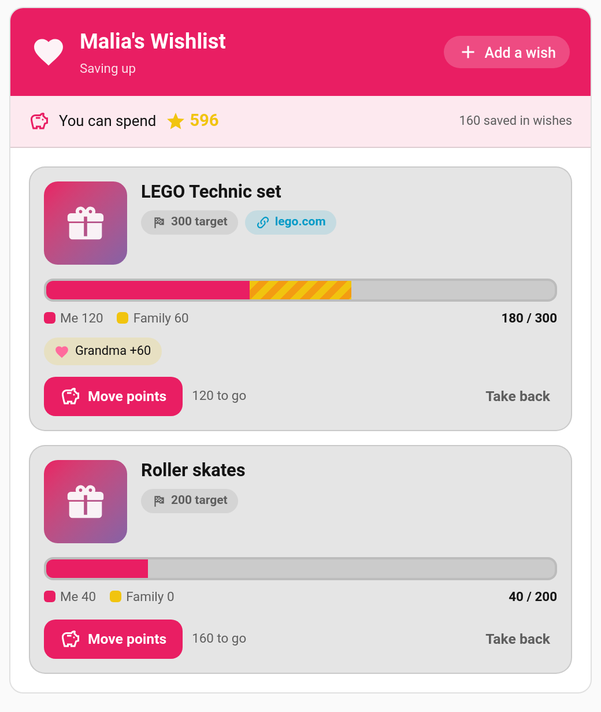

**(v6.0.0)** **Purpose:** One child's [Wishlist](Wishlist.md): the things they want, how much they've saved, and pledges from family.

**Default header colour:** Pink `#e91e63`

```yaml
type: custom:taskmate-wishlist-card
entity: sensor.taskmate_overview
child_id: a8c8376a            # required — whose wishlist this card shows
title: Mia's wishes           # optional — leave out for "<name>'s Wishlist"
header_color: "#e91e63"
```

**Behaviour:**
- The child adds a wish (name, suggested target, link, picture); it waits for a parent to approve it on the admin panel's **Wishlists** page
- The child moves points into an approved wish, and can take their own savings back out (never pledged points)
- Pledges show as a separate stripe on the progress bar, with a chip per person
- Once a wish is fully funded, **Ask to redeem** turns it into a normal reward claim
- Up to 5 wishes per child at once

---

## Recap Card


**(v6.0.0)** **Purpose:** Plays a child's [Recaps](Recaps.md) as a "Wrapped"-style story: chores done, points earned, top chore, longest streak, best day, badges and rewards, and how it compares with the previous period.

**Default header colour:** Purple `#9b59b6`

```yaml
type: custom:taskmate-recap-card
entity: sensor.taskmate_overview
child_id: a8c8376a            # required — whose recaps this card shows
title: My recap               # optional
default_frequency: monthly    # optional — which recap to open when there's nothing new (weekly | monthly | every_3_months | every_6_months | every_9_months | yearly)
autoplay: false               # true = move to the next slide every few seconds
header_color: "#9b59b6"
```

**Behaviour:**
- A new recap opens first; older ones are one tap away
- **Save as image** lets the child keep or share a slide
- Nothing shows until a parent turns recaps on in **Settings → Recaps**

---

## Auction Card

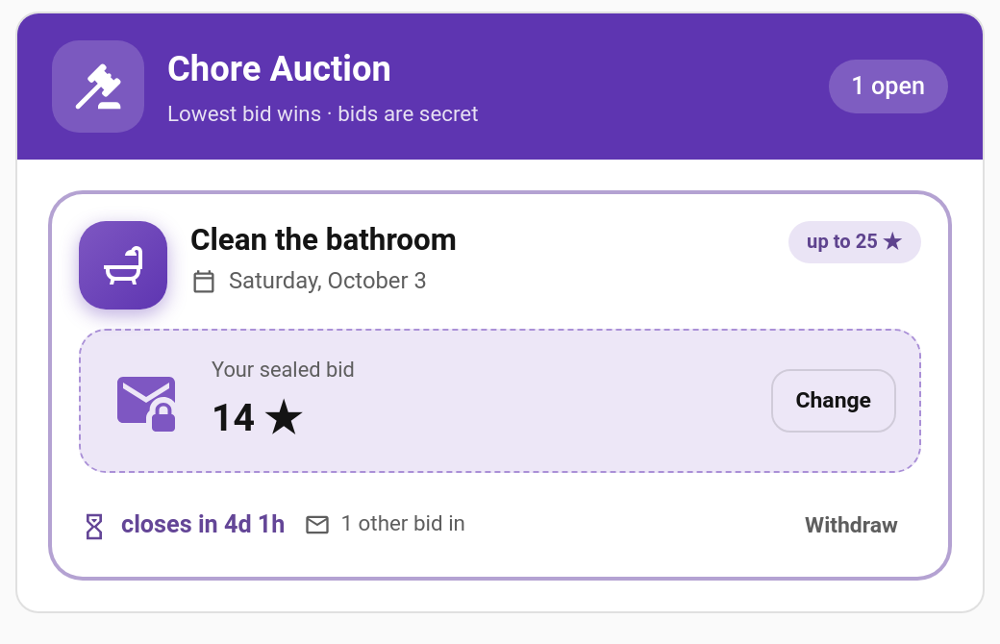

**(v6.0.0)** **Purpose:** One child's view of [Chore Auctions](Chore-Auctions.md): the auctions they may bid on, their own bid, and recent results.

**Default header colour:** Deep purple `#5e35b1`

```yaml
type: custom:taskmate-auction-card
entity: sensor.taskmate_overview
child_id: a8c8376a            # required — whose auctions and bids this card shows
title: Auctions               # optional
header_color: "#5e35b1"
```

**Behaviour:**
- The child bids the fewest points they would do the chore for. **The lowest bid wins**; ties go to the earliest bid
- The child only ever sees their own bid, how many bids are in, and the winning price once bidding closes
- Changing a bid is allowed until it closes, but moves it to the back of the queue for tie-breaks
- Auctions are opened by parents on the admin panel's **Auctions** page

---

## Chore Board Card

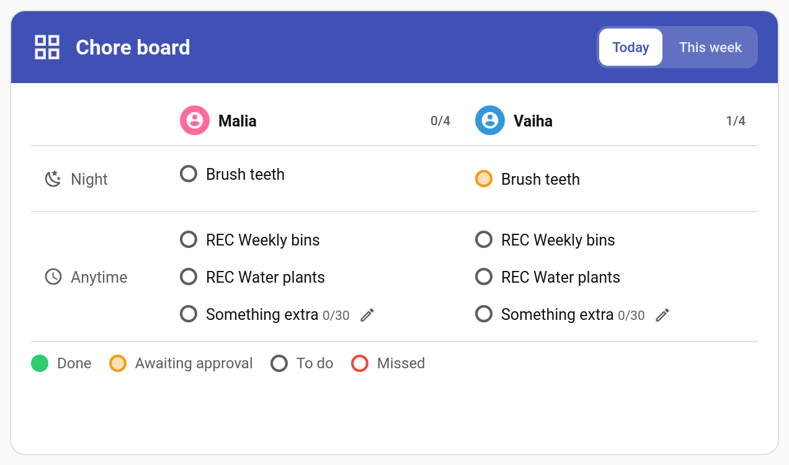

**(v6.1.0)** **Purpose:** The admin panel's **Today** board on a dashboard. Every child's chores for today in one grid, with time periods down the side and children across the top. Good on a shared kitchen tablet.

**Default header colour:** Indigo `#3f51b5`

```yaml
type: custom:taskmate-chore-board-card
entity: sensor.taskmate_overview
children:                     # optional — child IDs to show (default: all)
  - a8c8376a
default_view: today           # optional — today | week
show_week: true               # optional — show the "This week" tab
tap_to_complete: true         # optional — false gives a view-only board
show_legend: true             # optional — status key under the board
hide_done_periods: false      # optional — hide a time period once all its chores are done
title: Chore board            # optional
show_parent_actions: true     # optional (v6.2.0) — false = Undo follows the child's undo window
header_color: "#3f51b5"
```

**Behaviour:**
- Each child's column header shows done/total for today. Each chore shows its status: **done** (green), **awaiting approval** (amber), **to do** or **missed** (red). Chores with a daily limit show progress like `1/3`
- **Tap a to-do or missed chore** to complete it for that child. If the chore has a button entity the card presses it, so automations on the button fire; otherwise it calls `taskmate.complete_chore`. The chore's completion sound plays and a toast offers **Undo** (a parent's Undo rejects the completion; a child can undo inside their [undo window](Child-Undo-Window.md))
- Done and awaiting-approval chips can't be tapped, so a passing tap can't undo anyone's chore
- Photo, timed, open-ended, teamwork and (v7.0.0) quantity chores carry a small icon and can't be finished from the board. Tapping one says to finish it on the child's card
- **This week** shows each child's done/total for the last 7 days. Days before TaskMate started recording show as grey
- With a single child in `children`, the card becomes a simple list grouped by time of day with a progress bar
- Reads `sensor.taskmate_chore_board`, so it works on a non-admin login such as a wall tablet

---

## Sticker Chart Card

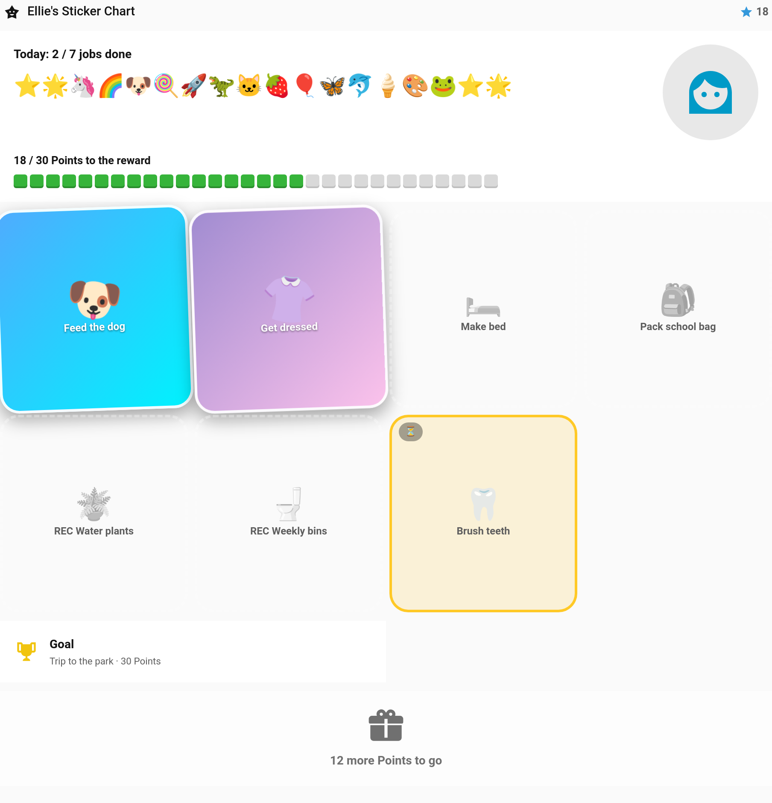

**(v6.4.0)** **Purpose:** A young child's whole day as stickers to tap. Every job due today is a big tile, the points they've saved show as a row of stickers, and blocks fill towards the reward they're saving for. Made for a wall tablet. See [Sticker Chart Card](Sticker-Chart-Card.md) for the full guide.

```yaml
type: custom:taskmate-sticker-chart-card
entity: sensor.taskmate_overview
child_id: a8c8376a            # optional — leave out for every child, side by side
reward_id: abc123             # optional — default: the cheapest reward not yet affordable
goal: reward                  # optional — reward | week
title: Ellie's chart          # optional — default "{name}'s Sticker Chart"
columns: 4                    # optional — job tiles per row, 2–6
show_today: true              # optional — the "Today: x / y jobs done" line
show_claim: true              # optional — the Claim button
allow_undo: true              # optional — press and hold to take a sticker back (parents only)
sound: true                   # optional — play the chore's completion sound
show_adults: false            # optional (v6.4.0) — include adult profiles
```

**Behaviour:**
- **Tap** a job to mark it done, through the chore's button entity if it has one. A celebration pops up, and a bigger one when the day is finished
- **Press and hold** a done job to undo it. Only a parent can
- Jobs waiting for approval show amber with ⏳. Photo-proof jobs show 📷 and are finished on the child card; open-ended and (v7.0.0) quantity chores aren't shown
- **Claim** needs two taps, and the claim goes to a parent for approval
- `goal: week` makes the stickers and blocks count this week's points against everything the week's jobs could pay, instead of the reward
- The same chart powers the admin panel's [Log a past job](Logging-Past-Jobs.md) dialog

---

## Pet Card


**(v7.0.0)** **Purpose:** A child's [virtual pet](Virtual-Pets.md). Before adoption the card is the adoption form: pick a dragon, cat, dog, bunny, dino or unicorn and give it a name. After that the pet hatches from an egg and grows as the child does chores.

**Default header colour:** Teal `#16a085`

```yaml
type: custom:taskmate-pet-card
entity: sensor.taskmate_overview
child_id: a8c8376a            # required — whose pet this is
title: Sparky                 # optional — default: the pet's name
header_color: "#16a085"
```

**Behaviour:**
- The pet grows from egg to baby, little, big and fully grown. A bar shows how far it is to the next step
- It is happy on days the child does a chore, proud of a streak, and sleepy after a missed day or two. Nothing is ever lost: a sleepy pet perks up with the next chore
- Accessories (bow, top hat, scarf, crown) unlock as the child goes up [levels](Levels-and-XP.md)
- After fully grown, whatever the parents switched on in Settings: its home fills up, it turns legendary gold, it lays an egg the child hatches into a new pet (earlier pets stay in the pet family row), and it gains pet levels
- A short "evolving" moment plays the first time each device sees the pet grow
- Shows "Pets are switched off" until a parent turns pets on in **Settings → Virtual pets**

---

## Raffle Card

**(v7.0.0)** **Purpose:** [Raffles](Raffles.md): children spend points on tickets, one ticket is one chance, and one winner is drawn at the time the parent picked. With a `child_id` it is that child's card, for buying tickets and seeing their chance. Without one it is a family view for a wall tablet: everyone's tickets, no buying.

**Default header colour:** Purple `#8e44ad`

```yaml
type: custom:taskmate-raffle-card
entity: sensor.taskmate_overview
child_id: a8c8376a            # optional — leave out for the family view (no buying)
title: Raffles                # optional
show_reveal: true             # optional — spin the names and land on the winner when a raffle is drawn
header_color: "#8e44ad"
```

**Behaviour:**
- Each open raffle shows its prize, ticket price, per-child limit, how many tickets are in and a countdown to the draw
- On a child's card, **Buy** spends points through `taskmate.buy_raffle_tickets` and shows "You have 3 tickets · 25% chance"
- A drawn raffle stays on the card for a day with its winner; a called-off one says the tickets were refunded
- The draw animation plays once per browser, when a raffle is drawn while the card is on screen or within the last ten minutes
- Raffles are set up by parents on the admin panel's **Raffles** tab. A raffle limited to some children is only shown on their cards

---

## Personal Bests Card

**(v7.1.0)** **Purpose:** A child's [personal bests](Personal-Bests.md): longest streak, most points in a day and in a week, most chores in a day and the biggest single award, each with the day it was set. A record beaten today is marked **New** and shows what it beat. Without a `child_id` every child gets a block.

**Default header colour:** Burnt orange `#d35400`

```yaml
type: custom:taskmate-personal-bests-card
entity: sensor.taskmate_overview
child_id: a8c8376a            # optional — leave out to show every child
title: My records             # optional — default: Personal Bests
header_color: "#d35400"
```

**Behaviour:**
- One tile per record; a child with none yet reads *No records yet — the first chores set the bar*
- The header counts how many records were beaten today
- Available in every [design style](Card-Design-Styles.md)

---

## Heatmap Card

**Purpose:** A calendar grid of the last six weeks for each child: one square a day, darker green for busier days, today outlined. Without a `child_id` every child gets a grid. See [Completion Heatmap](Completion-Heatmap.md).

**Default header colour:** Green `#2e7d32`

```yaml
type: custom:taskmate-heatmap-card
entity: sensor.taskmate_overview
child_id: a8c8376a            # optional — leave out to show every child
title: My chore calendar      # optional — default: Chore calendar
header_color: "#2e7d32"
```

**Behaviour:**
- Hover a square for the date and how many chores were done
- Each grid says how many chores and on how many of the 42 days
- Available in every [design style](Card-Design-Styles.md)

---

## Completion Sounds

The child card plays a sound when a chore is ticked off. All synth sounds use the Web Audio API — no external files needed.

| Sound | Type | Description |
|-------|------|-------------|
| `coin` | Synth | Classic video game coin collect |
| `levelup` | Synth | Triumphant ascending arpeggio |
| `fanfare` | Synth | Celebratory trumpet fanfare |
| `chime` | Synth | Pleasant bell chime |
| `powerup` | Synth | Ascending sweep with sparkle |
| `undo` | Synth | Sad descending "womp womp" (played on undo) |
| `fart1`–`fart10` | Audio file | Real fart sounds (CC0, BigSoundBank.com) |
| `fart_random` | Audio file | Random fart sound 1–10 |
| `none` | — | No sound |

**Fart sounds** require audio files at `/config/www/taskmate/fart1.mp3` through `fart10.mp3`.

**Priority:** chore-level `completion_sound` → card `default_sound` → `coin`

You can preview sounds using the `taskmate.preview_sound` service from Developer Tools.
