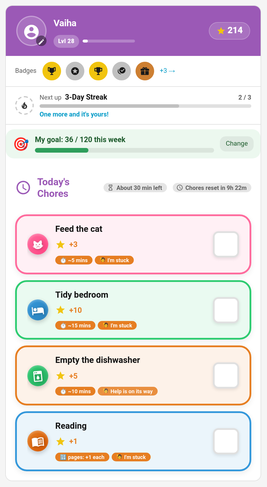
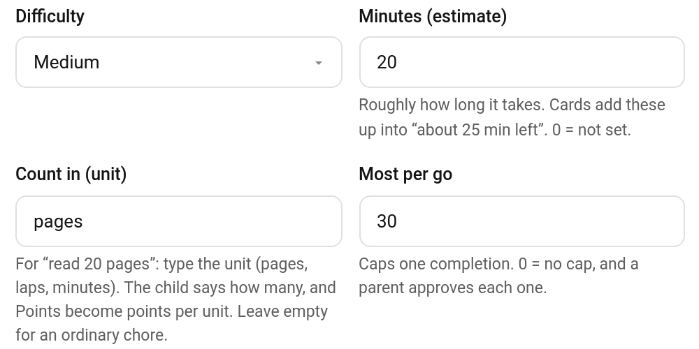
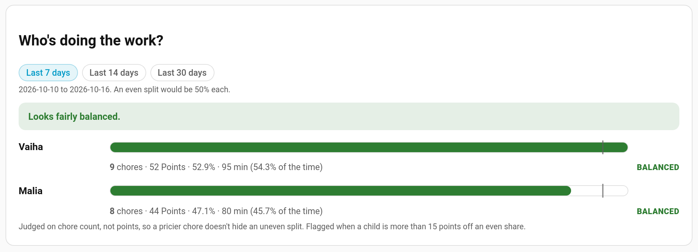

# Estimated Minutes

Give a chore a rough time ("about 10 minutes") and the child card shows it beside the chore and adds the day up: **About 30 min left**. Children find "half an hour of jobs" much easier to face than a list of seven things, and you get a fairer view of who's doing the work, because a 30-minute job and a 2-minute one no longer both count as "one chore".



> **New in v7.0.0**

---

## Setting the Estimate

**TaskMate panel → Chores → edit a chore → Minutes (estimate)**



Whole minutes, 0–600. 0 (the default) means not set: the chore shows no time and doesn't add to the total.

The estimate is set in the panel's chore editor (it's stored as the chore's `estimated_minutes`); the `add_chore` and `update_chore` services don't take it.

---

## On the Child Card

- Every outstanding chore with an estimate shows a **⏱ ~10 mins** tag. It disappears once the chore is done.
- The **Today's Chores** header shows **⏳ About 30 min left**: the estimates of everything still to do today, multiplied by how many times each is still owed (a chore done twice a day counts twice until the first is done). Chores not due today, still locked behind another chore, or already taken by someone else don't count.

Both appear in every card design. To hide the total on a card:

```yaml
type: custom:taskmate-child-card
entity: sensor.taskmate_overview
child_id: 8e16ad66b23f404e
show_minutes_left: false
```

In the editor it's **Show minutes of jobs left**. The per-chore tags stay.

---

## In the Fairness Report

**TaskMate panel → Insights → Fairness** adds the minutes to each child's line: "9 chores · 52 Points · 53% · 95 min (54.3% of the time)".



The minutes come from each approved chore's current estimate, so they only appear once some chores have one. The verdict (balanced or not) is still judged on the chore count; the minutes are a third way to look at it.

---

## Related

- [Chores](Chores.md) — every chore field
- [Insights](Insights.md) — the fairness report and the others
- [Timed Tasks](Timed-Tasks.md) — chores that run a real timer
- [Quantity Chores](Quantity-Chores.md) — "read 20 pages"
