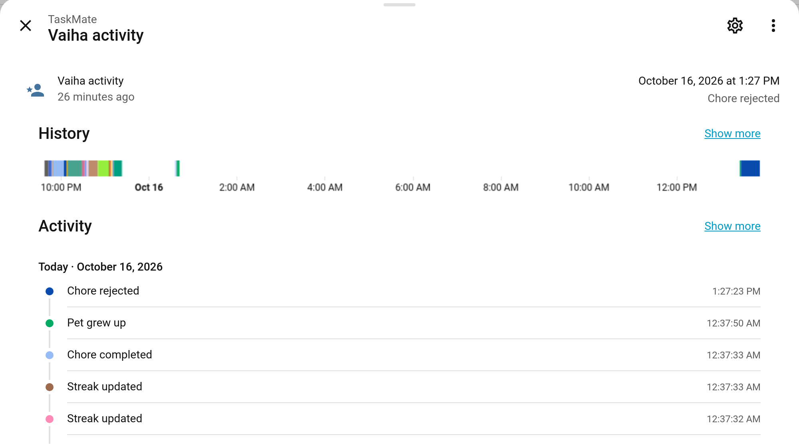
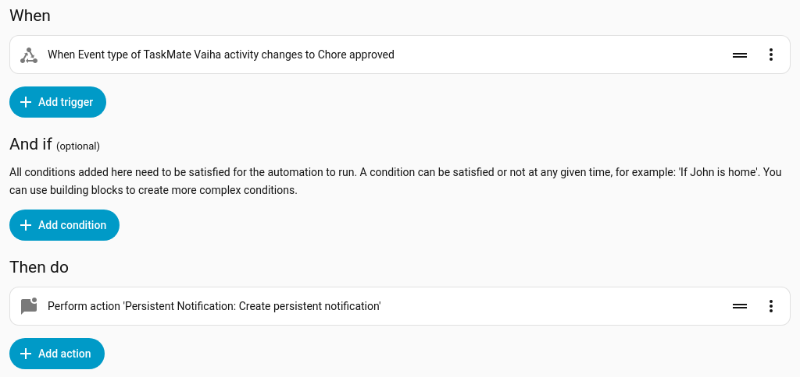

# Event Entities

TaskMate has always fired `taskmate_*` events on Home Assistant's event bus for YAML automations. **Event entities** put the same moments where the UI can see them: one entity per child, plus one for the family. In the automation editor you can now pick "When Vaiha's activity has event type *Chore approved*" from a list, without writing any YAML or looking up event names. On a dashboard, the entity shows the latest thing that happened.



> **New in v7.0.0**

---

## The Entities

They're created automatically, on the TaskMate device:

| Entity | Example ID | Covers |
|--------|-----------|--------|
| **{Child} activity** | `event.taskmate_vaiha_activity` | Everything about that one child |
| **Family activity** | `event.taskmate_family_activity` | Family-wide moments |

A new child gets their entity as soon as they're added. On Home Assistant 2026.6 and later, a new entity on a device that has an area gets the area in front of its ID (for example `event.kitchen_taskmate_vaiha_activity`), so check the real ID in **Settings → Entities**.

The entity's state is the time of the latest event. Its `event_type` attribute says what happened, and the other attributes carry that event's details (child, chore, points and so on: the same data as the bus event, minus the timestamp).

---

## Event Types

### On each child's entity

| Event type | Shown as | Event type | Shown as |
|-----------|----------|-----------|----------|
| `chore_completed` | Chore completed | `challenge_completed` | Challenge completed |
| `chore_approved` | Chore approved | `bonus_applied` | Bonus applied |
| `chore_rejected` | Chore rejected | `penalty_applied` | Penalty applied |
| `chore_approval_undone` | Chore approval undone | `surprise_bonus` | Surprise bonus |
| `chore_auto_approved` | Chore auto-approved | `mandatory_missed` | Mandatory chore missed |
| `reward_claimed` | Reward claimed | `team_chore_completed` | Team chore completed |
| `reward_approved` | Reward approved | `points_gifted` | Points gifted |
| `reward_rejected` | Reward rejected | `help_requested` | Help requested |
| `badge_earned` | Badge earned | `mood_logged` | Mood logged |
| `level_up` | Level up | `weekly_goal_reached` | Weekly goal reached |
| `streak_updated` | Streak updated | `sick_day` | Sick day |
| `streak_freeze_used` | Streak freeze used | `penalty_redeemed` | Penalty earned back |
| `perfect_week` | Perfect week | `raffle_won` | Raffle won |
| `weekly_target_reached` | Weekly target reached | `pet_evolved` | Pet grew up |
| `quest_completed` | Quest completed | `reward_delivered` | Reward handed over |
| `personal_best` | Personal best | `appeal_submitted` | Appeal submitted |
| `appeal_decided` | Appeal decided | `screen_time_low` | Screen time running low |
| `screen_time_out` | Screen time ran out | `screen_time_changed` | Screen time changed |
| `screen_time_saved` | Screen time saved | `screen_time_jar_opened` | Screen-time jar opened |
| `points_expired` | Points expired | `points_expiring` | Points about to expire |
| `reward_rated` | Reward rated | | |
| `penalty_warning` | Penalty warning | `sibling_check` | Sibling check |

An event about more than one child lands on each of their entities: a [gift of points](Gifting-Points.md) on both the giver's and the receiver's, a [teamwork chore](Teamwork-Chores.md) on everyone in the team.

### On the family entity

| Event type | Shown as |
|-----------|----------|
| `family_goal_reached` | Family goal reached |
| `season_champion` | Season champion |
| `bounty_posted` | Bounty posted |
| `scheduled_change_applied` | Scheduled change applied |
| `raffle_drawn` | Raffle drawn |
| `boost_started` | Boost started |
| `boost_ended` | Boost ended |
| `bin_day` | Bin-day chore |
| `shopping_job` | Shopping-list job |

Events tied to a notification (help requested, weekly goal reached, penalty earned back, pet grew up, raffle drawn) reach the entities whether or not that notification is switched on.

---

## Using Them in the Automation Editor

**Settings → Automations & scenes → Create automation**, then **Add trigger → Entity → State**. Pick the child's activity entity, set **Attribute** to *Event type* and **To** to the event you want. The editor offers the event types by name.



The same automation in YAML:

```yaml
alias: Vaiha's chore approved
triggers:
  - trigger: state
    entity_id: event.taskmate_vaiha_activity
    attribute: event_type
    to: chore_approved
actions:
  - action: persistent_notification.create
    data:
      title: Chore approved
      message: >-
        {{ state_attr('event.taskmate_vaiha_activity', 'chore_name') }}
        is approved: +{{ state_attr('event.taskmate_vaiha_activity', 'points') }}
```

A trigger on the *Event type* attribute only fires when the type **changes**. To catch every occurrence, even two approvals in a row, trigger on the entity's state (it changes with every event) and check the type in a condition:

```yaml
triggers:
  - trigger: state
    entity_id: event.taskmate_vaiha_activity
    not_from: unavailable
conditions:
  - condition: state
    entity_id: event.taskmate_vaiha_activity
    attribute: event_type
    state: chore_approved
```

### Ideas

| When | Then |
|------|------|
| `help_requested` on any child | Flash the kitchen light |
| `level_up` | Play a fanfare on the living-room speaker |
| `raffle_drawn` on the family entity | Announce the winner on the kiosk speaker |
| `sick_day` | Skip the morning chore announcement for that child |

---

## Bus Events Still Work

Nothing changes for existing automations: every `taskmate_*` bus event still fires, with the same data. The event entities are an extra way in. See [Automations](Automations.md) for the full list of bus events.

---

## Related

- [Automations](Automations.md) — every TaskMate bus event and YAML examples
- [Notifications](Notifications.md) — TaskMate's own pushes
- [Sensor Reference](Sensor-Reference.md) — the other TaskMate entities
