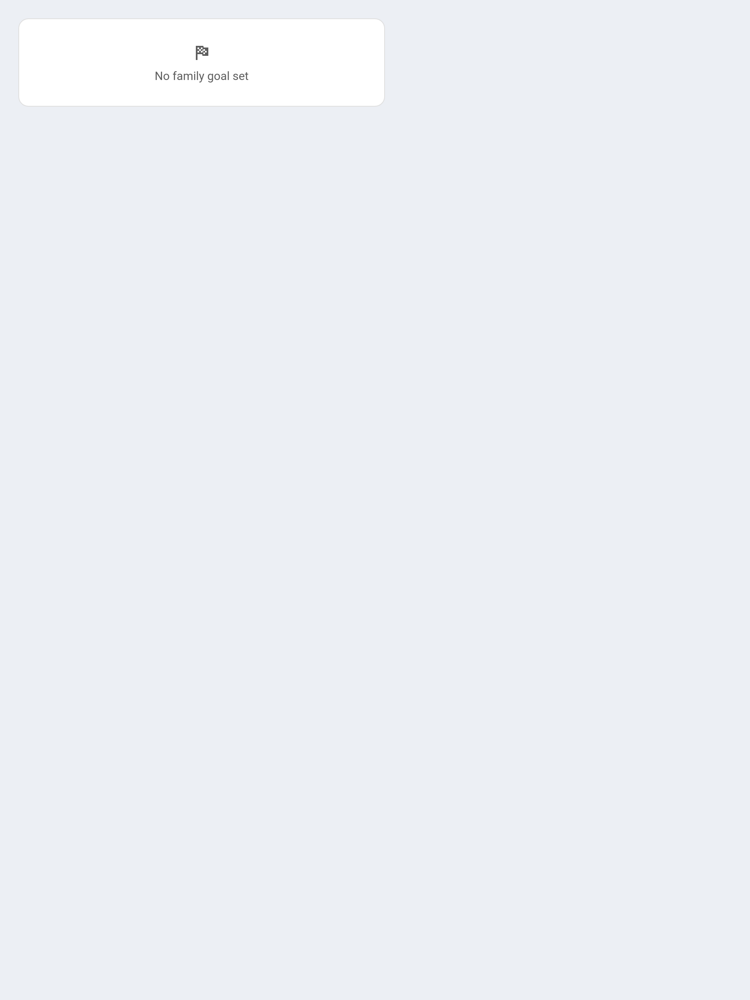

# Family Goals

A Family Goal is a single shared target the whole family works toward together. Instead of each child chasing their own rewards, the points the children earn are added up against one combined target — *"when we earn 500 points between us, we have a movie night"*. It is co-operative rather than competitive, and it is **parent-controlled**.



Where [Pool Mode](Pool-Mode-(Savings-Jars).md) lets a group of children save toward one reward jar, a Family Goal counts **the points the children earn together** since the goal started, with no deposits to make. Each child keeps their own points to spend as usual.

Family Goals are **opt-in** and configured in the **TaskMate** panel → **Settings**, in the **Family goal** section of the Admin Panel.

---

## Settings

| Setting | Key | Default | Description |
|---------|-----|---------|-------------|
| **Enable family goal** | `family_goal_enabled` | `off` | Master toggle |
| **Goal name** | `family_goal_name` | *(blank)* | A friendly name, e.g. *Movie night fund* (up to 120 characters) |
| **Target (combined points)** | `family_goal_target` | `500` | Points the children need to earn between them, counted from when the goal started (1–10,000,000) |
| **Reward** | `family_goal_reward` | *(blank)* | What the family gets, e.g. *a family movie night* (up to 200 characters) |

---

## Setting it up

1. Open the **Admin Panel** and scroll to the **Family goal** section
2. Switch **Enable family goal** on
3. Give it a **Goal name** — this is the headline shown on the card
4. Set a **Target** — the combined point total to aim for
5. Describe the **Reward** the family earns when the goal is reached

### How progress is counted

The goal counts the **points the children have earned since it started**:

- Every point a child earns counts: chores, bonuses, quests, challenges and points a parent adds.
- **Spending or redeeming points never takes the goal back.** A child can buy a reward without pulling the family total down.
- Penalties don't lower it either, so one child's penalty doesn't set the others back.
- Undoing an approval takes those points back off the goal.
- Adult profiles aren't counted; it's the children's goal.
- A child added after the goal started counts from 0.

Switching the goal **on** starts it at 0. Changing the **target** keeps the progress so far, so you can raise the bar part-way through. Either way the "reached" state resets so the goal can be celebrated afresh.

> **Upgrading from 7.12 or earlier:** the goal used to show the children's combined *balances*. On the first start after the upgrade, a goal that's already running keeps the number it showed, and from then on only new earnings count. Use **Start again** below if you'd rather begin from 0.

### Starting again

When the family reaches a goal (or you want a fresh one), start it again at 0:

- On the **Family Goal card**, a parent taps **Start again**, or
- In the admin panel's **Family goal** settings, press **Start again at 0**, or
- Call the [`taskmate.reset_family_goal`](Services.md) service from an automation.

Each asks for confirmation first. The children's own points don't change, only the goal does. The celebration re-arms, so the new goal gets its own notification when it's reached.

---

## Reaching the goal

When the children's earnings first reach the target, TaskMate fires a one-time **Family goal reached** notification announcing the goal name and its reward. The notification fires **once** per goal — it won't nag every time the total wobbles back above the line. (See [Notifications](Notifications.md) to control where it is delivered.)

A `taskmate_family_goal_reached` event is also fired with the goal name, reward, and target, so you can trigger your own celebration automation.

---

## The Family Goal card

Add the **Family Goal card** to a dashboard to show live progress toward the target — a progress bar, the points earned so far against the target, the percentage, and the reward. When the goal is reached the card switches to a trophy and a celebration message. Parents also see a **Start again** button.

Pick **TaskMate Family Goal** in the dashboard's card picker and set it up in the visual editor, or write the YAML:

```yaml
type: custom:taskmate-family-goal-card
entity: sensor.taskmate_overview
title: Movie Night Fund
header_color: "#16a085"
```

| Option | Required | Description |
|--------|----------|-------------|
| `entity` | ✅ | The TaskMate overview sensor (`sensor.taskmate_overview`) |
| `title` | — | Overrides the heading; defaults to the goal name |
| `show_parent_actions` | — | `false` hides the **Start again** button even when a parent is signed in, for a shared kids' dashboard (default `true`). Children never see it |
| `card_design` | — | The [design style](Card-Design-Styles.md); defaults to the global one |
| `header_color` | — | Accent colour for the icon and progress bar (default `#16a085`) |

If no family goal is enabled, the card keeps its title and shows a quiet "No family goal set" placeholder beneath it. The card reads the overview sensor's `family_goal` attribute, which exposes `enabled`, `name`, `target`, `reward`, `progress`, and `achieved`.

See [Dashboard Cards](Dashboard-Cards.md) for the full set of cards.

---

## Related

- [Pool Mode (Savings Jars)](Pool-Mode-(Savings-Jars).md) — per-reward shared savings jars
- [Dashboard Cards](Dashboard-Cards.md) — adding the Family Goal card
- [Notifications](Notifications.md) — controlling the goal-reached notification
- [Sensor Attributes](Sensor-Attributes.md) — the `family_goal` overview attribute
