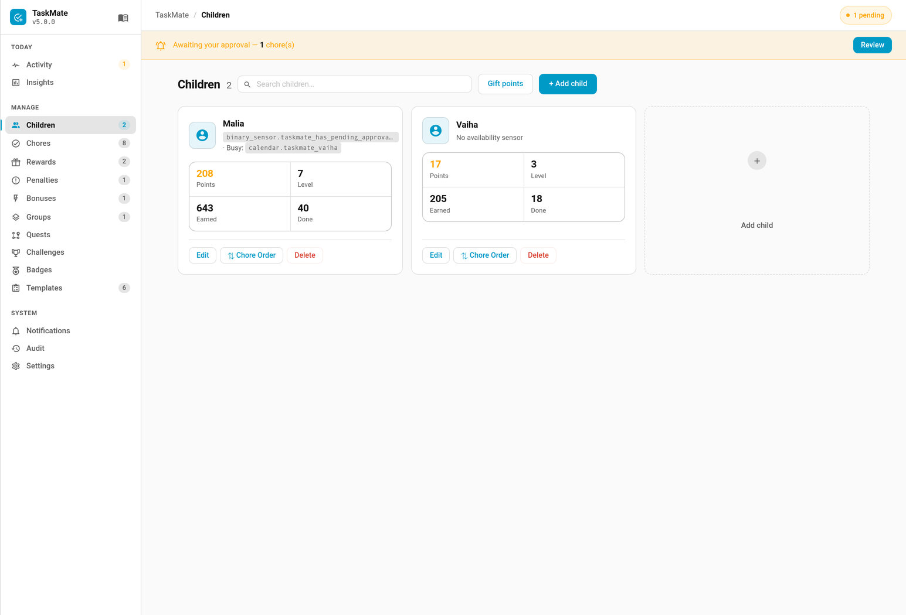

# Gifting Points

Gifting lets one child hand some of their saved points to a sibling — a birthday treat, a thank-you, or chipping in toward a shared goal. It is **parent-controlled**: gifts are made by an admin from the Admin Panel, not by the children themselves.



Configured and used from the **Children** tab of the Admin Panel (the **Gift points** button appears once you have at least two children).

---

## How it works

1. Open the **Children** tab and click **Gift points**
2. Pick the **From** child (the sender) and the **To** child (the recipient)
3. Enter an **Amount** and send the gift

The amount moves from the sender's spendable balance to the recipient's spendable balance immediately. Both children see an entry in their activity feed.

### What a gift does and doesn't touch

- **Spendable balance only.** The sender's balance drops and the recipient's rises by the same amount.
- **Earned totals and career score are untouched on both sides.** The recipient didn't earn the points, so their `total_points_earned` and career score do not change — gifting cannot be used to climb the leaderboard or unlock level/XP rewards.
- Both sides are logged: the sender gets a `Gift to <name>` transaction, the recipient a `Gift from <name>` transaction.

---

## Limits and rules

| Rule | Behaviour |
|------|-----------|
| **Minimum amount** | 1 point (must be positive) |
| **Maximum amount** | 10,000 per gift |
| **Same child** | A child cannot gift to themselves — the gift is rejected |
| **Insufficient balance** | If the sender doesn't have enough spendable points, the gift is rejected with an error |

---

## Service

Gifting is also available as a service for automations. It is **admin-gated**.

```yaml
service: taskmate.gift_points
data:
  from_child_id: <sender child id>
  to_child_id: <recipient child id>
  points: 25
```

| Parameter | Required | Description |
|-----------|----------|-------------|
| `from_child_id` | ✅ | ID of the child sending points |
| `to_child_id` | ✅ | ID of the child receiving points |
| `points` | ✅ | Amount to transfer (1–10000) |

On success a `taskmate_points_gifted` event is fired with `from_child_id`, `from_child_name`, `to_child_id`, `to_child_name`, `points`, and `timestamp` — useful for triggering a notification or celebration automation.

---

## Related

- [Points Economy](Points-Economy.md) — automatic point mechanics
- [Children](Children.md) — managing children and their balances
- [Services](Services.md) — full service-call reference
