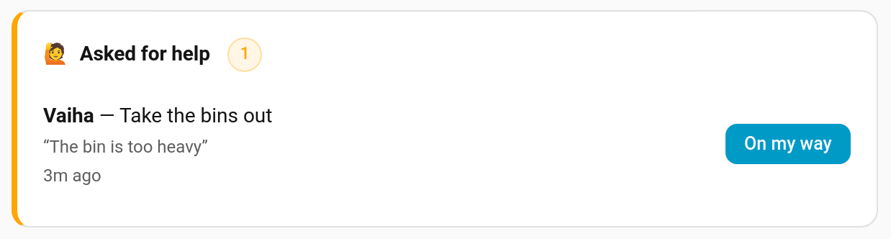

# Help Requests

Sometimes a child can't finish a job: the bin is too heavy, the hoover won't start, they can't reach the shelf. Rather than giving up or leaving it, they tap **I'm stuck** on the chore. You get a push on your phone, and their card tells them help is on its way. Nothing is completed or skipped; the chore just waits until you've helped.


> **New in v7.0.0**

---

## On the Child Card

Every chore the child still has to do today shows a small **🙋 I'm stuck** button. Tapping it:

1. sends the parents the *Asked for help* notification: "🙋 Vaiha needs help with 'Empty the dishwasher'"
2. changes the button to **🙋 Help is on its way**

The request stays open until a parent marks it answered, or for two hours, whichever comes first. A second tap on the same chore within ten minutes doesn't buzz you again, and nor does another request within a minute of an open one, whatever the chore. Only a chore that is the child's to do today can be asked about.

The button is hidden on chores that are already done, and on cards in [pre-reader mode](Pre-Reader-Mode.md). To hide it on a card:

```yaml
type: custom:taskmate-child-card
entity: sensor.taskmate_overview
child_id: 8e16ad66b23f404e
show_help_button: false
```

In the editor it's **Show the "I'm stuck" button**.

---

## Answering on the Today Page

Open requests appear at the top of the panel's **Today** page under **Asked for help**, with the child, the chore, any message and how long ago they asked.



Tap **On my way** to mark the request answered, so the child's card stops saying help is on its way.

---

## The Notification

**Asked for help** is **on by default**, for new installs and upgrades alike: a help button that reaches nobody is worse than no button. It goes to parents; change who gets it, or switch it off, under **Notifications**.

> 🙋 Vaiha needs help with 'Take the bins out' — “The bin is too heavy”

The message part only appears when the request includes one (the `message` field of the service; the card button sends none).

The notification fires the `taskmate_help_requested` event whether or not it's switched on, with `child_id`, `child_name`, `chore_id`, `chore_name`, `message` and `request_id`. On the child's [event entity](Event-Entities.md) it shows as **Help requested**, which makes it easy to, say, flash a light in the kitchen when someone's stuck.

---

## Services

| Service | Fields | Description |
|---------|--------|-------------|
| `taskmate.request_help` | `child_id`, `chore_id`, `message` (optional, up to 120 characters) | Ask for help with a chore. Refused with "Help is already on its way" if the same child asked about the same chore in the last ten minutes, with "Give it a minute" if they have another open request less than a minute old, and if the chore isn't theirs to do today |
| `taskmate.answer_help` | `request_id` | Mark a request answered |

Each child's entry in `sensor.taskmate_overview`'s `children` attribute lists the chores with an open request under `help`.

---

## Related

- [Mood Check-In](Mood-Check-In.md) — how the day felt
- [Notifications](Notifications.md) — routing the Asked for help push
- [Admin Panel](Admin-Panel.md) — the Today page
- [Event Entities](Event-Entities.md) — automating on a help request
