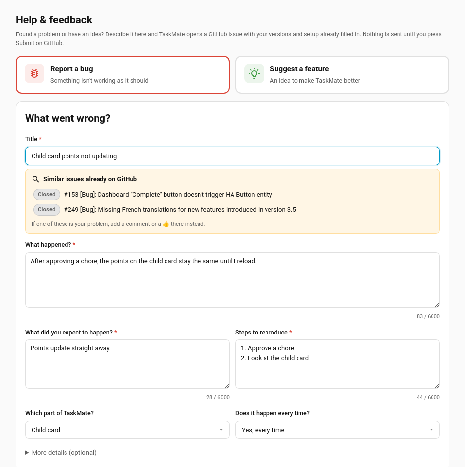
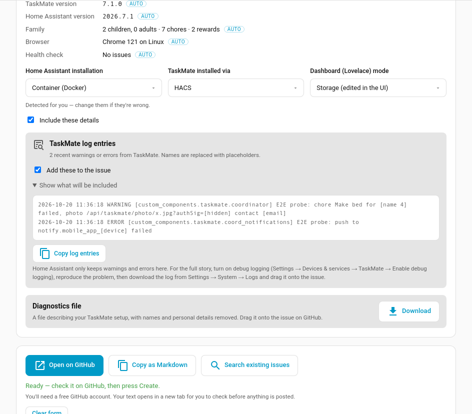
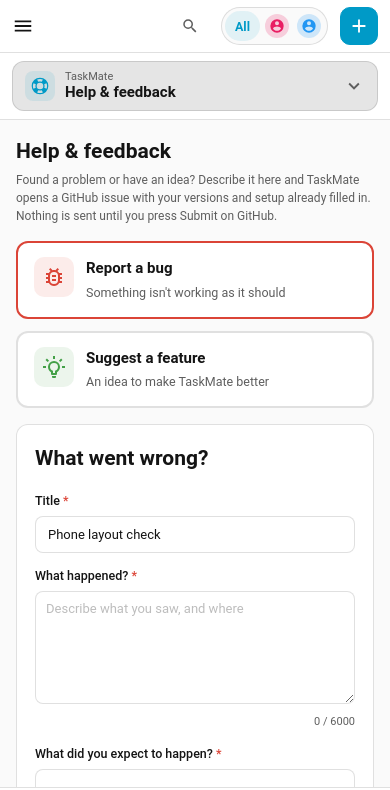

# Help & Feedback

Report a bug or suggest a feature from inside Home Assistant. The **Help & feedback** page in the TaskMate panel fills in a GitHub issue for you, with your TaskMate and Home Assistant versions, how everything is installed and any recent TaskMate errors already in it, then opens it on GitHub for you to check and submit.

> **New in v7.2.0**

---

## Opening it

**TaskMate panel → Settings (the gear) → Help & feedback.** On a phone, it's under **More**. It's also in the command search (**Ctrl K** or **/**).

Like the rest of the panel, it's for Home Assistant admins.

---

## How it works

1. Pick **Report a bug** or **Suggest a feature**.
2. Fill in the boxes marked **\***. As you type the title, TaskMate searches GitHub for **similar issues**. If one of them is your problem, add a comment or a 👍 there instead of opening a new one.
3. Check the **Included automatically** details (see below).
4. Press **Open on GitHub**. GitHub opens in a new tab with every required box filled in. Tick the **Before Submitting** checkboxes, read it over, add any screenshots, and press **Create**.

**Nothing is sent from Home Assistant.** The page only builds a link; the issue is created only if you submit it on GitHub. You'll need a free GitHub account.

Until the required boxes are filled the button stays greyed out and the page lists what's still needed. What you've typed is kept in your browser, so it survives a refresh or a trip to another page. Once GitHub has opened, **Clear form** starts afresh.

### Bug reports

| Box | Required | Notes |
|-----|----------|-------|
| Title | ✓ | Becomes `[Bug]: …` on GitHub |
| What happened? | ✓ | |
| What did you expect to happen? | ✓ | |
| Steps to reproduce | ✓ | |
| Which part of TaskMate? | | |
| Does it happen every time? | | |
| Browser console errors | | Under **More details**. For card problems: F12 → Console |
| Card YAML | | Under **More details** |
| Anything else? | | Under **More details** |

### Feature requests

| Box | Required |
|-----|----------|
| Title | ✓ |
| Summary | ✓ |
| What problem would it solve? | ✓ |
| How would you like it to work? | ✓ |
| Which area? / How important is it to you? | |
| Workarounds or alternatives you've tried | |

The number of children you use TaskMate with is filled in for you.

---

## Included automatically

| Detail | Where it comes from |
|--------|---------------------|
| TaskMate and Home Assistant versions | The integration |
| Home Assistant installation | Home Assistant's system info (OS, Supervised, Container or Core) |
| How TaskMate was installed | HACS, if HACS is installed and knows about TaskMate; otherwise manual |
| Dashboard (Lovelace) mode | Storage (edited in the UI) or YAML |
| Family | How many children, adults, chores and rewards. **Counts only** |
| Browser | A summary like "Chrome 141 on Windows", never the full browser string |
| Health check | The issue codes from **Insights → Health**, if it found anything |

The three installation answers are **detected for you**; change any that are wrong. They fill in their own boxes on the GitHub form. The other choices you make (which part of TaskMate, whether it happens every time, how important a feature is) go into the issue's **Additional context**, because GitHub can't pre-select the drop-down lists on its form. Those lists are optional there, so there's nothing to pick again.

Untick **Include these details** to leave all of this out.

If TaskMate itself can't answer (for example it failed to load), the page says so and still lets you report it, using the versions your browser already knows.

### TaskMate log entries

The page reads Home Assistant's log and picks out TaskMate's own warnings and errors (the 20 most recent). Before anything is added to the issue:

- children's and parents' names, and your Home Assistant user name (and each part of it), are replaced with `[name 1]`, `[name 2]`…
- phone and person ids such as `mobile_app_…`, `person.…` and `device_tracker.…` become `[device]`, since they're usually named after someone
- picture links' signatures, tokens and passwords become `[hidden]`
- e-mail addresses become `[email]`

Open **Show what will be included** to see exactly what goes in, or untick **Add these to the issue**.

Home Assistant only keeps warnings and errors in that list. For the full story, turn on **debug logging** (Settings → Devices & services → TaskMate → **Enable debug logging**), reproduce the problem, then download the log from **Settings → System → Logs** and drag it onto the issue.

### Diagnostics file

**Download** saves the same file as Settings → Devices & services → TaskMate → ⋮ → **Download diagnostics**: your TaskMate configuration with names and personal details removed. Drag it onto the issue on GitHub. See [Repairs & Diagnostics](Repairs-and-Diagnostics.md#diagnostics) for what's in it.

---

## Warnings on the page

| Message | What it means |
|---------|---------------|
| **This page is from TaskMate X, but Y is installed** | Your browser is showing an old copy of TaskMate after an update. **Refresh now** (or Ctrl + Shift + R) before reporting a card problem: it's often the cause |
| **The health check found N thing(s) to fix** | **Open health check** goes to **Insights → Health**. Fixing those first may solve the problem |
| **Too long for a link by N characters** | GitHub links have a size limit. Shorten the longest box, or use **Copy as Markdown** and paste the report into a new issue on GitHub |

If the report only just doesn't fit, the **oldest log entries** are left out first, and the page says how many. **Copy as Markdown** always includes everything.

---

## Other buttons

| Button | Does |
|--------|------|
| **Copy as Markdown** | Copies the whole report, laid out like the GitHub form, to paste into a new issue yourself. Works on plain `http://` Home Assistant too |
| **Search existing issues** | Opens GitHub's issue search for your title |
| **Copy log entries** | Copies just the (redacted) log entries |

**Other help** at the bottom links to the [Troubleshooting guide](Troubleshooting.md), the [FAQ](FAQ.md) and [GitHub Discussions](https://github.com/tempus2016/taskmate/discussions) for questions that aren't bugs.

