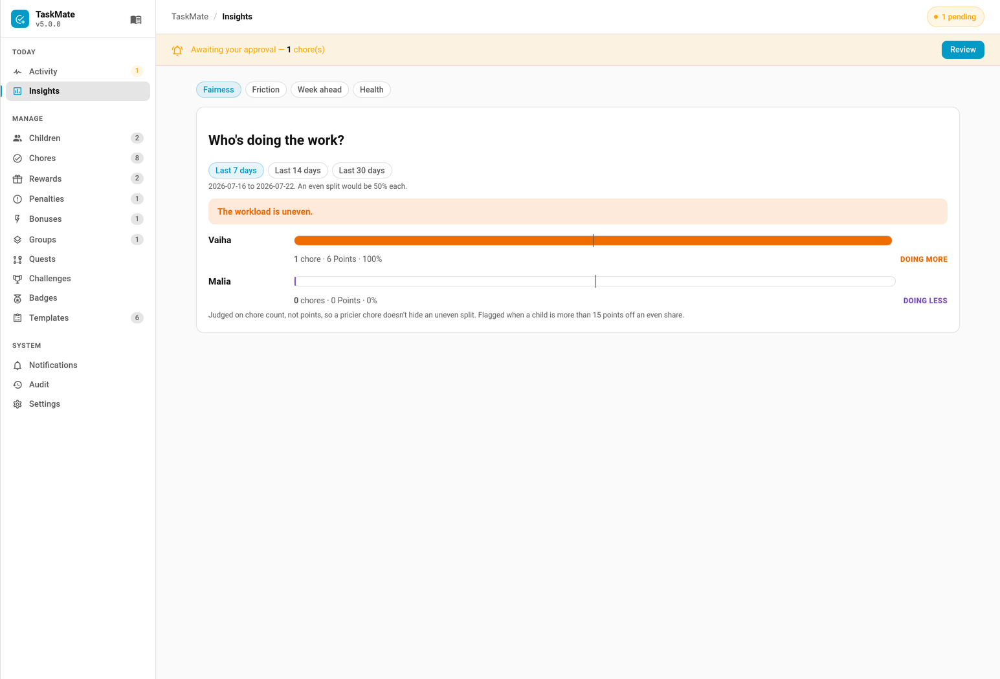
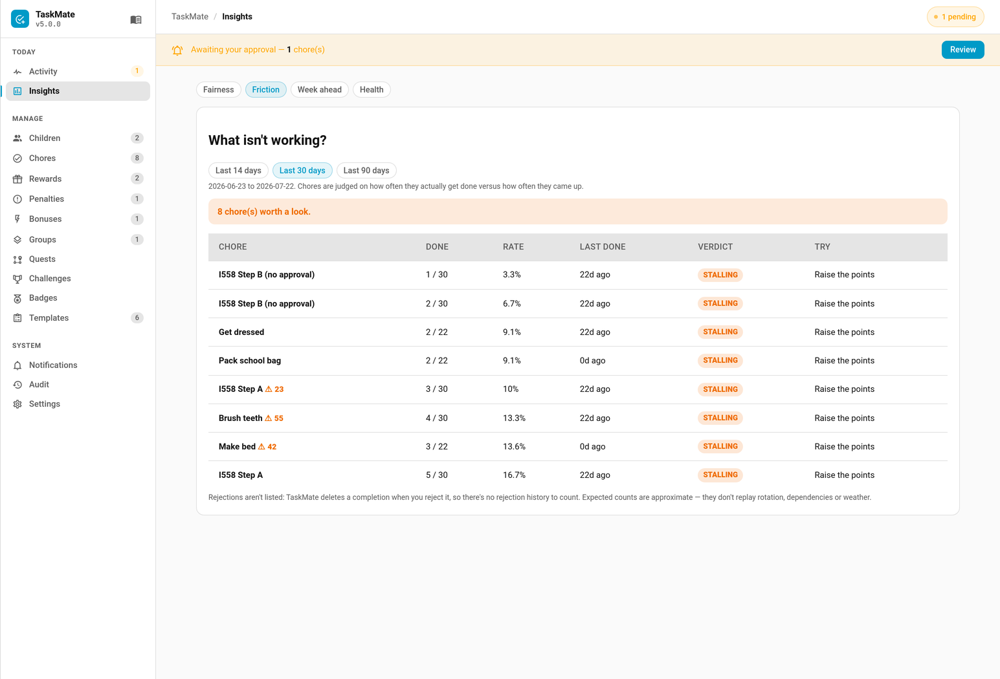
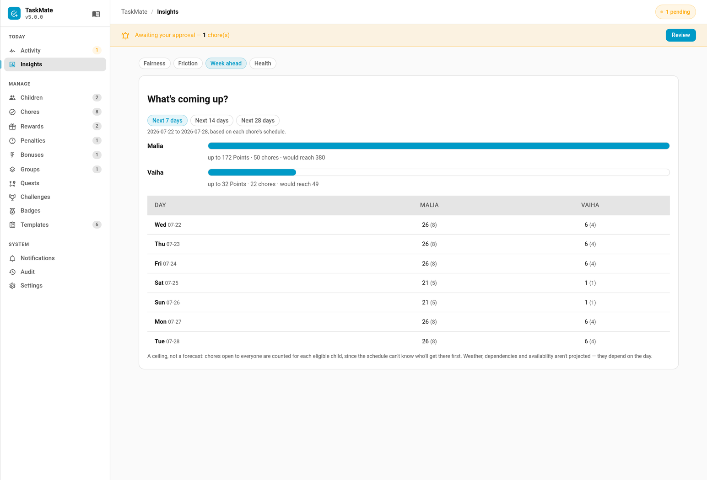
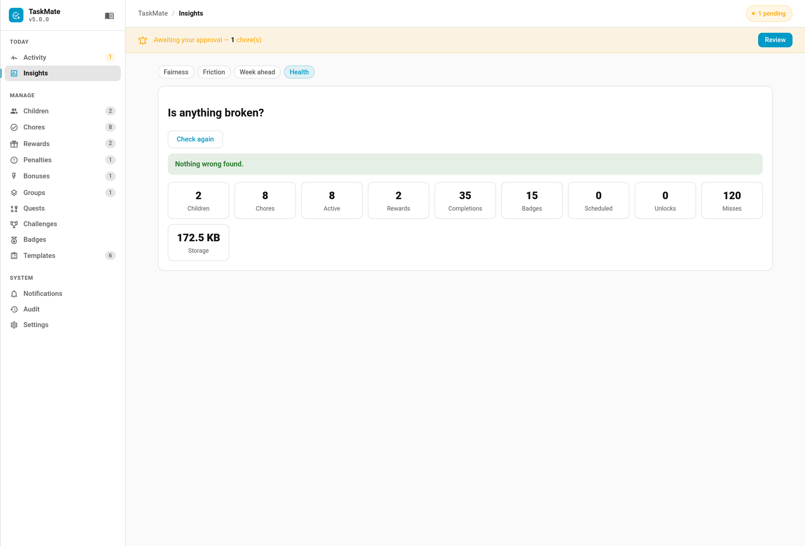

# Insights

**TaskMate panel → Insights.** Reports that answer the questions the raw numbers don't.

| Report | Question it answers |
|--------|--------------------|
| [Fairness](#fairness--who-is-actually-doing-the-work) | Am I dumping everything on the eldest? |
| [Friction](#friction--what-isnt-working) | Which chores are quietly never getting done? |
| [Week ahead](#week-ahead--whats-coming-up) | What points are actually available in the next seven days? |
| [Health](#health--is-anything-broken) | Is anything misconfigured? |
| [Moods](#moods--how-the-days-felt) | *(v7.0.0)* How have the children's days felt lately? |
| [Economy](#economy--are-rewards-too-cheap) | Are points piling up because rewards have got too cheap? |
| [Calendar](#calendar--which-days-got-done) | Which days did each child actually get chores done? |

All of them are computed **on demand and never cached**. A stale report is worse than a slow one.

---

## Fairness — who is actually doing the work

For a chosen window (7, 14 or 30 days) it shows each child's completed chores, points earned, share of the family total, and how many distinct days they were active — with a marker showing where an even split would sit.

**Judged on chore count, not points.** A pricier chore shouldn't be able to hide an uneven split. Points are shown alongside because the two can genuinely disagree: three quick jobs versus one hard one is balanced by points and lopsided by count, and only you can say which you meant.

A child is flagged as **doing more** or **doing less** when they are more than **15 percentage points** off an even share — wide enough that normal week-to-week variation doesn't nag, narrow enough to catch a real imbalance.

**Minutes too (v7.0.0).** When chores have [estimated minutes](Estimated-Minutes.md), each child's row also shows the time their approved chores took and their share of it, e.g. "85 min (40% of the time)". A 30-minute job and a 2-minute one are each "one chore", so time is a third view of effort. Only chores with an estimate count towards it, and the line is hidden when none have one.

**Only approved, non-bonus completions count.** Unapproved work isn't yet work you've agreed happened, and bonus sub-tasks hang off a chore that is already counted.

---

## Friction — what isn't working

The second view judges each **chore** rather than each child: how often it actually gets done versus how often it came up, over 14, 30 or 90 days.

| Verdict | Meaning | Suggestion |
|---------|---------|------------|
| **Never done** | No completion on record, ever | Retire it |
| **Stalling** | Done under 20% of the time it came up | Retire if long dead, otherwise raise the points or reassign |
| **Patchy** | Done 20–60% of the time | Raise the points |
| **Fine** | Done 60%+ of the time | Leave it alone |

Chores with outstanding mandatory misses show a ⚠ count. The report leads with a **suggestion** rather than just a diagnosis — a stalling chore that already pays well doesn't need more points, it needs a different child.

**What it can't tell you.** TaskMate deletes a completion when you reject it, and removes a mandatory miss once you resolve it, so neither rejection counts nor historical miss counts exist to be reported. The report says so rather than quietly omitting them. Expected counts are approximate — they don't replay rotation, dependencies, weather or vacations.

---

## Week ahead — what's coming up

The third view projects the next 7, 14 or 28 days from each chore's schedule: how many chores and points are heading each child's way, what balance they'd reach, and a day-by-day grid.

Rotation is projected using the **same daily-assignment computation the integration itself uses**, so alternating, random and balanced picks match what will really happen rather than an independent guess that could drift.

**It's a ceiling, not a forecast.** A chore open to everyone is counted for *each* eligible child, because the schedule cannot know who will get there first. Weather, dependencies and availability aren't projected either — they depend on the day. Points that aren't assigned to anyone are called out separately.

---

## Health — is anything broken?

The fourth view checks the setup itself and reports storage size and entity counts.

| Check | Severity |
|-------|----------|
| A chore depends on a chore that no longer exists, so it can never unlock | **Error** |
| A chore or reward is assigned to a deleted child | Warning |
| A chore references a visibility or weather entity that doesn't exist | Warning |
| A reward unlocks an entity no longer on the allowlist, so nothing will happen | Warning |
| A child has no chores; completion records for deleted chores; a very large history | Note |

Every issue carries a plain sentence and a **Show me** button that jumps to where it lives — a diagnostic that only says "3 problems" isn't one you can act on.

**Notes alone still count as healthy.**

---

## Moods — how the days felt

> **New in v7.0.0**

Once a child's chores are done for the day, the child card asks "How was your day?" with five faces: great, good, OK, sad and cross. **Insights → Moods** lays out each child's answers day by day, with how many days they logged and how many were tough (sad or cross). A run of tough days is worth a chat.

Moods are kept for 90 days. A sad or cross day can also send you a gentle push (the **Tough day** notification, off by default). See [Mood Check-In](Mood-Check-In.md).

---

## Economy — are rewards too cheap?

**Insights → Economy** draws two lines over the last 8 weeks (each week is 7 days, the latest ending today):

- **Earned** — points from approved chores, plus bonus awards from the points log (gifts between children and refunds are left out: they move points around rather than earn them).
- **Spent** — what approved reward claims cost (the price at the time, where it was recorded).

Adult profiles aren't counted.

**The warning.** When, over the last 4 weeks, the children earned **at least 1.5 times** what they spent on rewards, and at least 50 points in all, balances are piling up faster than they come down. The view then says so, says how much earning has grown on the 4 weeks before, and names the **most-claimed rewards** (up to three) as the first candidates for a price review. Below 50 points it never warns, so a quiet month or a new install stays quiet.

Bonus awards come from the points log, which keeps the latest 200 entries, so on a busy family's install the oldest weeks can under-count them.

---

## Calendar — which days got done

One grid per child, a square a day in Monday-first weeks, darker green for busier days, over the last 4, 6 or 12 weeks. Hover a square for the date and count. The same grid is available as a dashboard card. See [Completion Heatmap](Completion-Heatmap.md).

---

## Related

- [Admin Panel](Admin-Panel.md) — where Insights lives
- [Recaps](Recaps.md) — a Wrapped-style story of each child's week, month or year
- [Chores](Chores.md) — fixing what friction finds
- [Chore Dependencies](Chore-Dependencies.md) — the broken-dependency error
- [Timed Unlock Rewards](Timed-Unlock-Rewards.md) — the allowlist warning
- [Mandatory Chores](Mandatory-Chores.md) — the ⚠ miss counts
- [Mood Check-In](Mood-Check-In.md) — the end-of-day check-in behind the Moods view
- [Estimated Minutes](Estimated-Minutes.md) — the minutes in the fairness report
