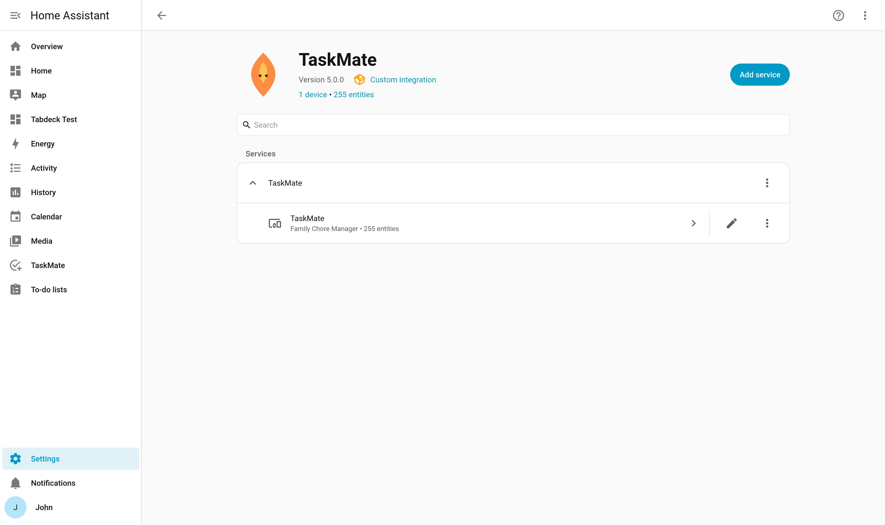

# Installation

## Via HACS (Recommended)



TaskMate is a **default HACS integration** — no custom repository is needed:

1. Open **HACS** in your Home Assistant sidebar
2. Search for **TaskMate**
3. Click **Download**
4. **Restart Home Assistant**

<details>
<summary>Installing as a custom repository (legacy)</summary>

TaskMate was accepted into the HACS default list, so this is no longer required.
It is kept here only for reference — existing custom-repository installs keep
working and keep receiving releases.

1. **HACS** → ⋮ menu → **Custom repositories**
2. Enter `https://github.com/tempus2016/taskmate`
3. Set category to **Integration** → **Add**

</details>

---

## Manual Installation

1. Download the [latest release](https://github.com/tempus2016/taskmate/releases/latest)
2. Extract the archive
3. Copy the `taskmate` folder to `/config/custom_components/taskmate/`

Your file structure should look like:
```
config/
└── custom_components/
    └── taskmate/
        ├── __init__.py
        ├── coordinator.py
        ├── manifest.json
        ├── sensor.py
        ├── www/
        │   ├── taskmate-child-card.js
        │   └── ... (all 21 card files)
        └── ...
```

4. **Restart Home Assistant**

---

## After Installation

After restarting, add the integration:

1. Go to **Settings** → **Devices & Services**
2. Click **Add Integration**
3. Search for **TaskMate**
4. Follow the setup wizard — see [Getting Started](Getting-Started.md)

---

## Lovelace Resources

TaskMate automatically registers all 21 Lovelace card resources when it loads. You do **not** need to add them manually in storage mode.

On every restart, TaskMate will:
- Add any missing card resources
- Update the cache-busting version string (`?v=x.x.x`) so browsers fetch fresh JS

### YAML Mode Users

If your Lovelace is in YAML mode, add these resources to your `configuration.yaml`:

```yaml
lovelace:
  resources:
    - url: /taskmate/taskmate-child-card.js
      type: module
    - url: /taskmate/taskmate-rewards-card.js
      type: module
    - url: /taskmate/taskmate-approvals-card.js
      type: module
    - url: /taskmate/taskmate-points-card.js
      type: module
    - url: /taskmate/taskmate-reorder-card.js
      type: module
    - url: /taskmate/taskmate-overview-card.js
      type: module
    - url: /taskmate/taskmate-activity-card.js
      type: module
    - url: /taskmate/taskmate-streak-card.js
      type: module
    - url: /taskmate/taskmate-weekly-card.js
      type: module
    - url: /taskmate/taskmate-graph-card.js
      type: module
    - url: /taskmate/taskmate-reward-progress-card.js
      type: module
    - url: /taskmate/taskmate-leaderboard-card.js
      type: module
    - url: /taskmate/taskmate-parent-dashboard-card.js
      type: module
    - url: /taskmate/taskmate-penalties-card.js
      type: module
    - url: /taskmate/taskmate-bonuses-card.js
      type: module
    - url: /taskmate/taskmate-points-display-card.js
      type: module
    - url: /taskmate/taskmate-calendar-card.js
      type: module
    - url: /taskmate/taskmate-routine-card.js
      type: module
    - url: /taskmate/taskmate-badges-card.js
      type: module
    - url: /taskmate/taskmate-family-goal-card.js
      type: module
    - url: /taskmate/taskmate-photo-gallery-card.js
      type: module
```

> **Note:** Three global support modules (`taskmate-config-sounds.js`, `taskmate-localize.js`, `taskmate-design.js`) are registered automatically via `add_extra_js_url()` and do not need to be listed as Lovelace resources. `taskmate-attr-resolver.js` is a normal Lovelace resource and is registered with the cards.

---

## Upgrading

### Via HACS

HACS will show a notification when a new version is available. Click **Update** and restart Home Assistant.

### Manual

Replace the contents of `/config/custom_components/taskmate/` with the new release files and restart.

Resource version strings are updated automatically on restart — no manual editing of Lovelace resources is needed.
