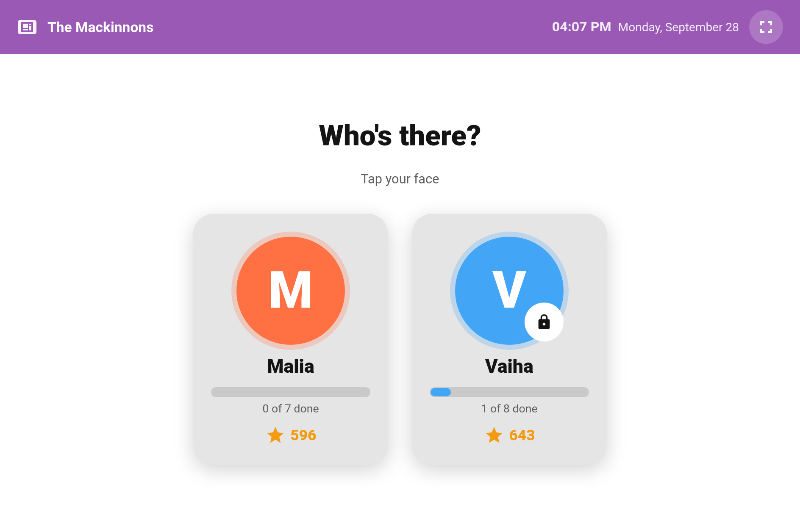
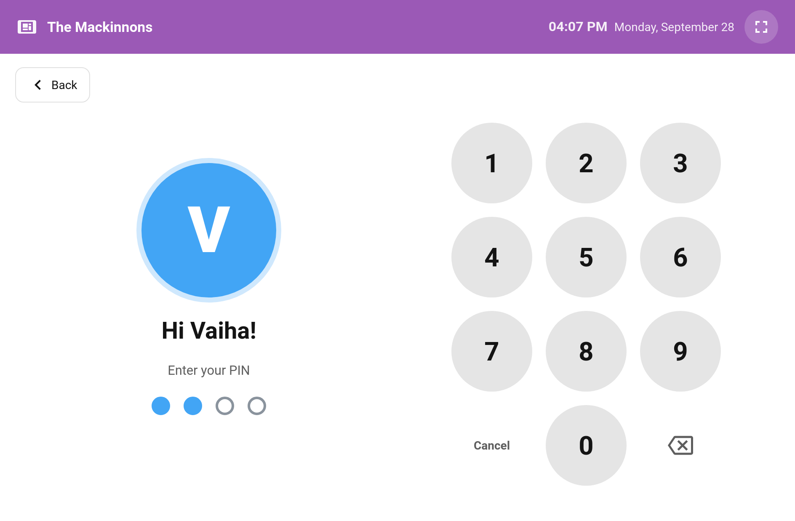
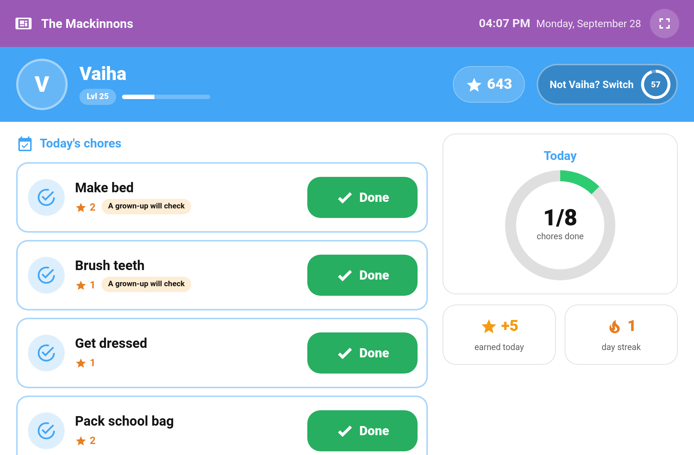
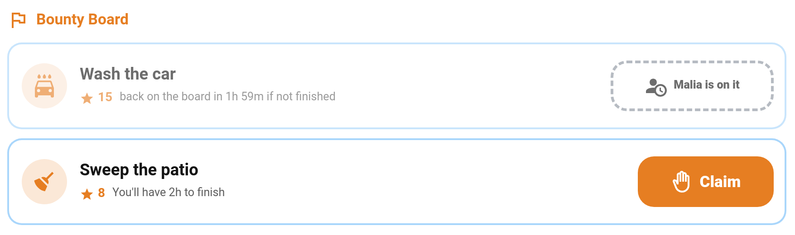
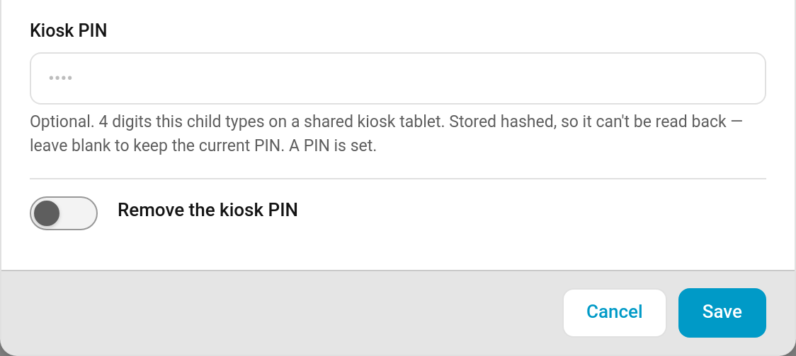

# Kiosk Mode

Turn a spare tablet on the kitchen wall into the family's chore station. The **Kiosk** card shows a picker of your children's faces. A child taps theirs, types a 4-digit PIN if they have one, and sees only their own chores for today with big **Done** buttons, their points, streak and progress towards the next reward. After a spell without a tap, it goes back to the picker, ready for the next child.



> **New in v6.0.0**

---

## How It Works

1. **Pick a face.** The picker shows each child with today's progress ("3 of 6 done") and their points. A padlock marks a child who needs a PIN.
2. **Enter the PIN** (only if one is set). The pad submits on the 4th digit. A wrong PIN shakes and asks them to try again.
3. **Tick things off.** The child sees today's chores with a large **Done** button each, a done/total ring, stars earned today, their streak, and how close they are to the cheapest reward they can't afford yet. Their earned [badges](Achievement-Badges.md) and the next one they're closest to sit in the side column, and when they've unlocked more than one [avatar](Avatars.md) they can tap their face to switch, just as on the Child card.
4. **Back to the picker.** After the idle timeout (60 seconds by default), straight after the "all done" celebration, or when someone taps **Switch** in the child's header ("Not Mia? Switch").

For the last 10 seconds before it returns, a full-screen **Still there?** countdown gives the child a chance to carry on. Leaving the dashboard also locks the kiosk again.





---

## Adding the Card

**Edit dashboard → + Add Card → Custom: TaskMate Kiosk Card**

```yaml
type: custom:taskmate-kiosk-card
entity: sensor.taskmate_overview
title: The Mackinnons
timeout: 90
children:
  - child_id: b803da068e6a4b21
    require_pin: false
  - child_id: 8e16ad66b23f404e
    require_pin: true
```

The card works best in a **Panel** view, so it fills the screen. The full-screen button in its top bar hides the browser's own chrome. To also hide Home Assistant's sidebar and header on the tablet, pair it with the *kiosk-mode* plugin from HACS.

### Configuration

| Option | Type | Default | Description |
|--------|------|---------|-------------|
| `entity` | string | `sensor.taskmate_overview` | The TaskMate overview sensor |
| `title` | string | `TaskMate` | Shown in the top bar, e.g. your family name |
| `card_design` | string | global default | `classic`, `playroom`, `console`, `cleanpro`, `accessible` or `graphite`. See [Card Design Styles](Card-Design-Styles.md) |
| `header_color` | string | `#9b59b6` | Colour of the top bar |
| `timeout` | number | `60` | Seconds without a tap before it returns to the picker (15–600) |
| `warn_before_return` | boolean | `true` | Show the full-screen "Still there?" countdown for the last 10 seconds |
| `show_points` | boolean | `true` | Points and level in the child's view |
| `show_streak` | boolean | `true` | Streak in the child's view |
| `show_reward_progress` | boolean | `true` | Progress towards the next reward |
| `show_picker_progress` | boolean | `true` | "3 of 6 done" under each face on the picker |
| `play_sounds` | boolean | `true` | *(v6.2.0)* Play the chore's completion sound on **Done**, and the undo sound on an undo |
| `show_confetti` | boolean | `true` | *(v6.2.0)* Confetti over the card on **Done** |
| `show_completion_popup` | boolean | `true` | *(v6.2.0)* The "AWESOME! You did it!" popup with the points earned |
| `default_sound` | string | `coin` | *(v6.2.0)* Sound for chores without their own. YAML only, same as the child card |
| `undo_sound` | string | `undo` | *(v6.2.0)* Sound played when a child undoes a chore. YAML only, same as the child card |
| `show_bounties` | boolean | `false` | *(v6.3.0)* A **Bounty Board** section in the child's view, where they can claim and finish bounties. See [Bounties](#bounties) |
| `completed_mode` | string | `show` | *(v7.0.0)* `show` keeps done and waiting chores in the list with their Undo button; `hide` drops them. See [Less clutter](#less-clutter) |
| `elapsed_time_mode` | string | `show` | *(v7.0.0)* What happens to a time-of-day chore once its part of the day has passed: `show`, `dim` or `hide`. See [Less clutter](#less-clutter) |
| `ambient_mode` | string | `off` | *(v7.0.0)* What the picker turns into when nobody's using it: `off`, `progress` (the family's day) or `photos` (a slideshow of chore photos). See [Ambient mode](#ambient-mode) |
| `ambient_after` | number | `120` | *(v7.0.0)* Seconds untouched before ambient mode starts (30–1800) |
| `show_raffle_draws` | boolean | `true` | *(v7.0.0)* Spin the names and land on the winner when a [raffle](Raffles.md) is drawn. See [Raffle draws](#raffle-draws) |
| `show_pet` | boolean | `true` | *(v7.1.0)* Show the child's [virtual pet](Virtual-Pets.md) in the side column of their screen, while pets are switched on |
| `show_badges` | boolean | `true` | *(v7.3.0)* Show the child's earned badges and their next badge's progress in the side column |
| `allow_avatar_change` | boolean | `true` | *(v7.3.0)* Let a child tap their face to switch between the avatars they've unlocked |
| `seasonal` | boolean | `true` | *(v7.3.0)* Dress the child screen for a [seasonal theme](Card-Looks.md#seasonal-themes) while one is on; `false` keeps it plain |
| `show_boost_alert` | boolean | `true` | *(v7.1.0)* Leave ambient mode and fill the screen when a [boost](Boost-Windows.md) starts, until someone taps. The countdown strip shows either way |
| `children` | list | all children | Which children appear on the picker, in order. Each entry is `child_id` plus an optional `require_pin` (default `true`) |

Leave `children` out and every child is shown (guest profiles excepted), with a PIN asked for wherever one is set. The visual editor lists each child with a tick box to show or hide them, up/down arrows to set the order, and a **Require PIN** switch. That switch is greyed out ("No PIN set — goes straight in") until you give the child a PIN.

---

## Celebrations

> **New in v6.2.0**

Tapping **Done** on the kiosk gets the same reward as on the [child card](Dashboard-Cards.md#child-card):

- **Sound.** The chore's own [completion sound](Completion-Sounds.md), built-in or uploaded. Chores without one play `default_sound` (a coin, unless you change it).
- **Confetti** over the card.
- **A popup**: "AWESOME! You did it!" with the points earned. It closes by itself after 2.5 seconds, or on a tap. If that chore was the child's last one, the "all done" celebration takes over instead.
- **Undo** plays the undo sound, but only once the undo has actually gone through.

Nothing celebrates if the tick doesn't go through. On a device set to reduce motion, there is no confetti and the popup appears without animating.

Each of the three can be switched off in the card's visual editor (**Sounds**, **Confetti**, **Celebration popup**) or in YAML. See [Configuration](#configuration).

---

## Bounties

> **New in v6.3.0**

Switch on **Bounty Board** in the card's visual editor (or `show_bounties: true` in YAML) and the [bounty board](Bounty-Board.md) appears in each child's view, under today's chores.



- **Claim.** A child can claim an open bounty they're eligible for. A confirm tells them how long they'll have to finish it. While they hold a claim, the other Claim buttons are greyed out ("Finish your bounty first").
- **Done!** sends the job to your approval queue, with the completion sound, confetti and a "Nice work!" note.
- **Photo bounties.** For a bounty that needs [photo proof](Photo-Proof.md), Done opens "Show us the finished job". The child takes the photo on the tablet and it's attached to the completion. The child chooses the camera, because a wall-mounted tablet's rear camera usually faces the wall.
- **Give back** returns a claimed bounty to the board. **Undo** takes back a finished one within the [child undo window](Child-Undo-Window.md).
- **Siblings.** A bounty a sibling has claimed shows greyed out ("Malia is on it", with the time until it's back on the board). Bounties the child can't claim, and siblings' finished ones, are hidden.

Bounties don't count towards the done/total ring, so the "all done" celebration still happens when today's chores are finished. While the camera is open the idle countdown pauses for up to 2 minutes. A photo that arrives after the kiosk has locked still counts for the child who took it.

---

## Less clutter

> **New in v7.0.0**

Two options keep a child's list short. Both are in the card's visual editor (**Completed chores** and **Missed time-of-day chores**) and default to showing everything, as before.

**Completed chores** (`completed_mode`)

| Value | What the child sees |
|-------|---------------------|
| `show` | **Default.** Done chores stay in the list with their **Undo** button |
| `hide` | Done chores, and chores waiting for a grown-up, drop out of the list |

Hidden chores still count towards the "3 of 6 done" ring and the "all done" celebration. They just can't be undone from the kiosk; a parent can undo them as usual.

**Missed time-of-day chores** (`elapsed_time_mode`)

A morning, afternoon, evening or night chore that wasn't done once that part of the day is over. Anytime chores are never missed, and a chore still inside its claim allowance after the period ends stays live. The same rule the [child card](Dashboard-Cards.md#child-card) uses.

| Value | What the child sees |
|-------|---------------------|
| `show` | **Default.** The chore stays in the list and can still be ticked off |
| `dim` | Greyed out with a **Missed** label. It can't be ticked off |
| `hide` | Not shown |

A dimmed or hidden missed chore leaves the day's total, so a child can still reach "all done".

```yaml
type: custom:taskmate-kiosk-card
entity: sensor.taskmate_overview
completed_mode: hide
elapsed_time_mode: dim
```

---

## Ambient mode

> **New in v7.0.0**

A wall tablet spends most of the day with nobody touching it. With ambient mode on, the picker changes after `ambient_after` seconds untouched (two minutes by default):

- **`progress`** — a large clock and date, every child's face with a ring showing how much of today is done and their points, and any open [raffles](Raffles.md) with their prize and how many tickets are in.
- **`photos`** — a slideshow of recent chore [photos](Photo-Proof.md), a new one every 8 seconds, captioned with the time, the child and the chore. With no photos to show, it falls back to the family's day.

The first tap only wakes the tablet back to the picker, so a child brushing past doesn't open anyone's screen. Pick **When nobody's using it** in the card's visual editor, or in YAML:

```yaml
type: custom:taskmate-kiosk-card
entity: sensor.taskmate_overview
ambient_mode: progress
ambient_after: 300
```

---

## Offline taps

> **New in v7.0.0**

If the tablet loses its connection to Home Assistant (a wobbly Wi-Fi extender, Home Assistant restarting), the top bar says **No connection** and a **Done** still works. The chore is marked **Waiting to send**, the top bar counts how many are waiting, and they are sent in order as soon as the connection is back.

- A chore that is refused when it finally arrives (a parent already did it, it's no longer due) is dropped, and the kiosk says so.
- Waiting taps are kept by the open page, not saved to the tablet. Reloading the page while it's offline loses them.
- Only plain **Done** taps are kept. Undo, bounties and anything else need the connection.

---

## Raffle draws

> **New in v7.0.0**

When a [raffle](Raffles.md) is drawn, the kiosk takes over the screen, spins through the names of the children who bought tickets, slows down and lands on the winner, with the prize. Tap to close it. Each draw is shown once, and only for a draw in the last 15 minutes, so a tablet that was switched off doesn't replay old results.

Turn it off with **Show raffle draws** in the card's visual editor, or `show_raffle_draws: false`.

---

## Setting a PIN

**TaskMate panel → Children → edit a child → Kiosk PIN**



Type four digits and save. Leave the field blank to keep the current PIN, or turn on **Remove the kiosk PIN** to clear it.

**What the PIN is for.** It keeps siblings out of each other's screen on a shared tablet. It is not an account: every tap still goes through the tablet's Home Assistant login, so what the tablet may do for each child is decided by that login and each child's [linked account](Children.md#child-fields), not by the PIN. Five wrong tries lock the pad for that child, longer each time; the lock is per device, so a wrong PIN typed on a phone elsewhere can't lock the tablet.

- **PINs never go in the card's YAML.** They are stored hashed on the server, so they can't be read back, not even by you. If a child forgets theirs, just set a new one.
- **Five wrong tries lock the pad.** The first lock lasts 30 seconds and each one after doubles, up to 15 minutes. A correct PIN clears the count.
- A PIN only decides which sibling is holding the tablet. It is not a permission and unlocks nothing else.

---

## What Kiosk Mode Deliberately Leaves Out

The kiosk is for children. There is no option to add any of these:

- **No parent controls.** No approve or reject, no completing on a child's behalf, no points adjustments, no settings.
- **No reward claiming.** Children see how close they are, but claim on their own device or ask a grown-up.

Some chores need more than a tap, so they are shown greyed out under **Do these on your phone**:

| Chore type | Why |
|------------|-----|
| [Photo proof](Photo-Proof.md) | Needs a camera |
| [Timed tasks](Timed-Tasks.md) | Needs a running timer |
| [Open-ended chores](Open-Ended-Chores.md) | Needs a description |
| [Quantity chores](Quantity-Chores.md) | Needs a number ("how many pages?") |

These don't count against "all done", so a child with one of them still gets the celebration.

Chores that need approval show **A grown-up will check** and change to **Waiting for a grown-up** once ticked. A [teamwork chore](Teamwork-Chores.md) shows **Waiting for your team** after the child joins. If the [child undo window](Child-Undo-Window.md) is switched on, a child can take back a mistaken tap from the kiosk too.

---

## Linked Accounts

Ticking a chore from the kiosk goes through exactly the same checks as ticking it anywhere else, using the tablet's Home Assistant account:

| Setup | What the kiosk can do |
|-------|-----------------------|
| Children not linked to any account (the usual family set-up) | Tick chores for every child |
| A child linked to their own account | Can't tick that child's chores unless the tablet is signed in as an admin |
| **Require a linked account per child** switched on | Can only tick chores if the tablet's account is a TaskMate parent or an admin |

When the kiosk isn't allowed to act for a child, their face shows **Ask a grown-up**, and tapping it explains why. It never shows buttons that would fail. See [Parent Access](Parent-Access.md) for linking accounts.

---

## Related

- [Children](Children.md) — where kiosk PINs are set
- [Routine Mode](Routine-Mode.md) — a guided, one-chore-at-a-time view for a single child
- [Card Design Styles](Card-Design-Styles.md) — the six designs the kiosk follows
- [Celebrations](Celebrations.md) — on-screen celebrations and the celebration event
- [Bounty Board](Bounty-Board.md) — posting bounties and the rules for claiming them
- [Raffles](Raffles.md) — setting up the raffles the kiosk shows and draws
- [Ready-Made Dashboards](Ready-Made-Dashboards.md) — a wall tablet dashboard with the kiosk, built for you
- [Parent Access](Parent-Access.md) — linked accounts and parent permissions
