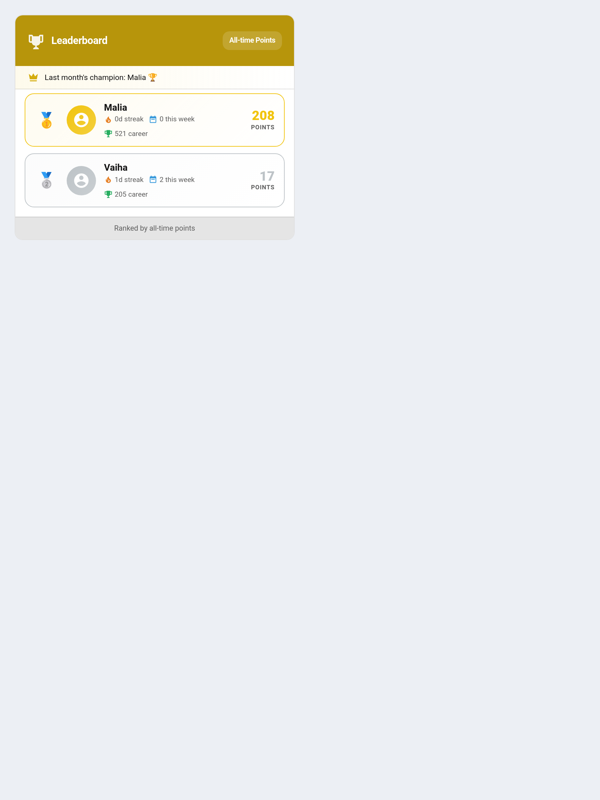

# Leaderboard Seasons

Leaderboard Seasons turn the leaderboard into a fresh monthly contest. Each child builds up **season points** over the current calendar month; on the 1st of the next month the season finalizes, a champion is recorded, and everyone's season total resets to zero. It is a gentle way to keep competition motivating without letting one child run away with it forever.



---

## Why Seasons?

A plain all-time leaderboard rewards whoever started first or earns the most overall. In a household with siblings of different ages, that often means the same child sits at the top month after month — and the others stop trying.

Seasons fix that. Because totals reset on the 1st of every month, **everyone gets a fresh shot each month**. A younger sibling who has a great few weeks can win this month's season even if they're behind on lifetime points, and last month's winner starts level with everyone else. The all-time and career rankings are still there if you want them — seasons just sit alongside as a recurring, winnable contest.

---

## How Season Points Are Earned

Season points accumulate from **positive point gains only** during the current calendar month — approved chores, bonuses, and other awards all count. Penalties and other deductions do not pull a child's season score down; the season total only ever goes up within the month.

Each child's running total for the month is exposed on the **Overview sensor** (`sensor.taskmate_overview`) as a per-child `season_points` value, and the current month is published as the `season_month` attribute (in `YYYY-MM` form).

---

## How Champions Are Recorded

When the calendar month rolls over, TaskMate finalizes the season automatically:

- The child with the most season points for the finished month is recorded as that month's **champion**.
- The champion is appended to a `season_champions` history (also on the Overview sensor), so past winners are kept.
- Every child's `season_points` total resets to zero for the new month.
- A **`season_champion`** notification announces the winner — for example *"🏆 Maya won the 2026-05 leaderboard with 320 Stars!"*. See [Notifications](Notifications.md) for how to route TaskMate notifications.

If no child earned any points during the month, no champion is recorded for that month.

---

## Showing Seasons on the Leaderboard Card

The [Leaderboard Card](Dashboard-Cards.md) can rank children by their season points. Set `sort_by: "season"`:

```yaml
type: custom:taskmate-leaderboard-card
entity: sensor.taskmate_overview
sort_by: season               # points | streak | weekly | career | season
header_color: "#b7950b"
```

`sort_by` can also be set from the card's visual editor via the **Rank by** dropdown.

When `sort_by: "season"` is active, children are ordered by their `season_points` for the current month, and the card shows a **champion banner** naming the most recently recorded season champion. Switching back to any other sort mode (`points`, `streak`, `weekly`, `career`) leaves the season tracking untouched — it keeps running in the background regardless of how the card is sorted.

---

## Guests Don't Compete

Children marked as **guests** are left out of the leaderboard entirely. A cousin staying for a week shouldn't win the month, and their going home shouldn't read as everyone else suddenly gaining ground.

See [Guest Child Profiles](Guest-Child-Profiles.md).

## Related

- [Dashboard Cards](Dashboard-Cards.md) — the Leaderboard Card and its full config
- [Achievement Badges](Achievement-Badges.md) — milestone recognition that pairs well with seasons
- [Points Economy](Points-Economy.md) — how points are earned and spent
