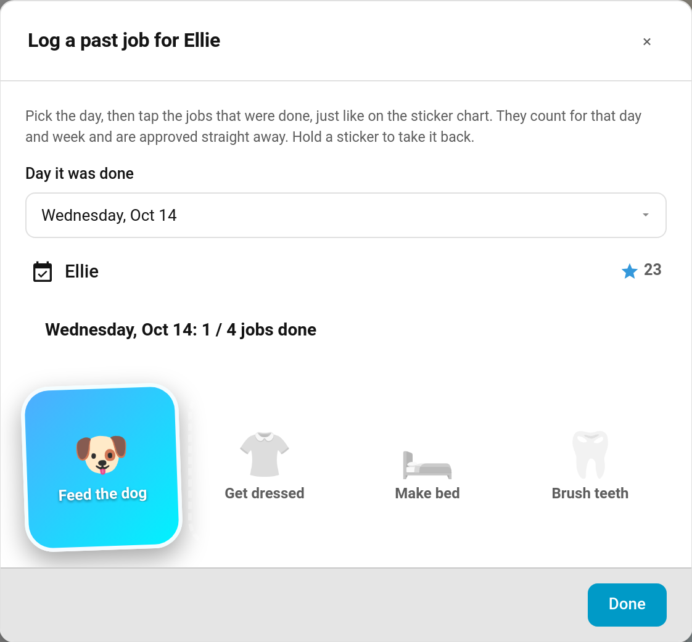

# Logging Past Jobs

Sometimes a job gets done but nobody ticks it. The bed was made on Tuesday, but the tablet was flat. **Log a past job** lets you record it afterwards, on the day it was actually done, so your child still gets the points and the week's totals come out right.



> **New in v6.4.0** — contributed by @cad861

---

## Logging a Job

**TaskMate panel → Children → Log a past job** (on the child's profile card)

1. Pick the **Day it was done**. You can go back up to 7 days; today isn't offered, because today's jobs are ticked the normal way.
2. The day's jobs appear as a [sticker chart](Sticker-Chart-Card.md). **Tap** each job that was done.
3. Made a mistake? **Press and hold** a sticker to take it back.
4. Tap **Done**.

The chart only offers jobs TaskMate would accept for that day, so you won't tap something and then be refused. Jobs already ticked that day show as done.

---

## What a Logged Job Does

| | |
|---|---|
| **Approval** | Approved straight away. You are the one logging it, so there is nothing to review, and no photo is asked for. |
| **Points** | The chore's points (including its [difficulty tier](Difficulty-Tiers.md)), plus the [weekend multiplier](Bonus-Points.md) if the day was a Saturday or Sunday and the [birthday](Birthday-Mode.md) multiplier if it was the child's birthday. Bonuses that depend on a live tap — time of day, speed and [roulette](Chore-Roulette.md) — aren't added. |
| **Which day it counts for** | The day you picked. It counts towards that day's [daily limit](Chores.md#daily-limit), that week's [weekly target](Weekly-Targets.md) and that week's points totals, such as the sticker chart's week goal. |
| **Streak** | Left alone. Rewriting the streak for a past day could break the streak your child is on today. |
| **Everything else** | Counts like any approved job: chores completed, [badges](Achievement-Badges.md), [quest](Quests.md) steps and [challenges](Challenges.md). |
| **Weekly target bonus** | If the job completes that week's [weekly target](Weekly-Targets.md#weekly-target-bonus), the bonus is paid. Undoing the job takes the bonus back. |
| **Undo** | Undoing a logged job takes its points back and, like logging it, leaves the streak alone. |

A logged job never makes a recurring chore come round again sooner. If your child has done the chore since, the later one still decides when it's next due.

---

## Jobs That Can't Be Logged

TaskMate refuses a past job, with a message saying why, when:

- the day is more than 7 days ago, or is today or later
- the chore isn't one of that child's jobs, or is switched off
- it wasn't due that day (a weekly-target chore can be logged on any day, until that week's target is reached)
- the day was a [vacation](Vacation-Mode.md) day, or the child's [birthday day off](Birthday-Mode.md) (mandatory chores can still be logged)
- it was already done as many times as its daily limit allows that day
- it's a **rotation** or **[teamwork](Teamwork-Chores.md)** chore — whose turn it was, or who made up the team, can't be worked out afterwards
- it was won at [auction](Chore-Auctions.md) that day
- it's an [open-ended chore](Open-Ended-Chores.md), which needs the child's description and your price — use the child's card instead

---

## From an Automation or Script

The `taskmate.complete_chore` service takes a `completed_date`:

```yaml
service: taskmate.complete_chore
data:
  chore_id: 8a3b2c1d4e5f6789
  child_id: ef19c56175c14bd9
  completed_date: "2026-10-13"
```

Only a Home Assistant admin or a [TaskMate parent](Parent-Access.md) can use `completed_date`. Automations and scripts are allowed. See [Services](Services.md#taskmatecomplete_chore).

---

## Related

- [Sticker Chart Card](Sticker-Chart-Card.md) — the card the dialog is built from
- [Chores](Chores.md) — daily limits and approvals
- [Weekly Targets](Weekly-Targets.md) — how a logged job counts towards the week
- [Admin Panel](Admin-Panel.md) — where the Children page lives
- [Services](Services.md) — `complete_chore` and its other options
