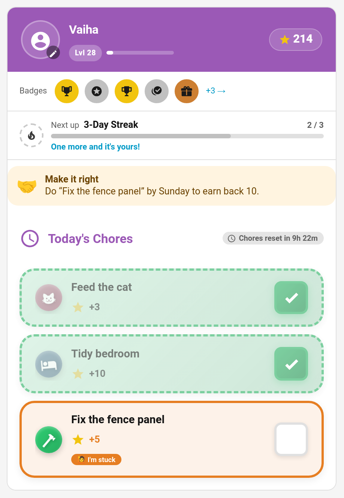
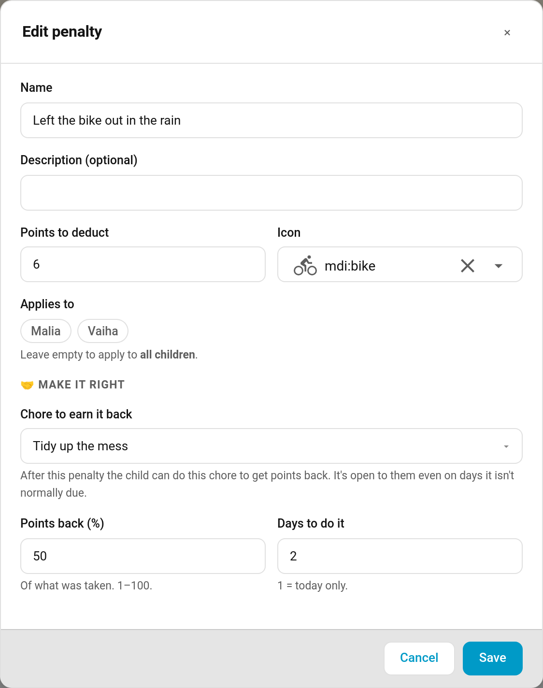

# Make It Right Penalties

Losing points teaches less than putting right whatever went wrong. A **make-it-right** penalty names a chore that repairs the damage. When you apply the penalty, the child gets an offer: do that chore within a few days and earn back some or all of the points. Left the bike out in the rain? Clean and oil it, and get half the points back.

> **New in v7.0.0**

---

## Setting It Up

Make it right is part of the penalty itself, so set it once and it applies every time that penalty is used.

**TaskMate panel → Penalties → edit a penalty (or + Add penalty) → Make it right**

| Field | Default | Description |
|-------|---------|-------------|
| **Chore to earn it back** | None — no way back | Any existing chore. Leave it on *None* for an ordinary penalty |
| **Points back (%)** | `100` | How much of what was taken comes back, 1–100 |
| **Days to do it** | `1` | 1 = today only, up to 7 |

Every penalty created before v7.0.0 stays an ordinary penalty until you pick a chore for it. These fields are set in the panel; the `add_penalty` and `update_penalty` services don't take them.

---

## What the Child Sees

As soon as the penalty is applied, the child's card shows the offer above their chores:

> 🤝 **Make it right**
> Do "Clean and oil the bike" by Sunday to earn back 3.

The deadline is the end of the last day: with **Days to do it** set to 2, a penalty on Friday can be made right until the end of Saturday ("by the end of today" when it's today only).

The refund is the chosen percentage of the points actually deducted, rounded, and at least 1. A 6-point penalty at 50% offers 3 back.

### The chore is open to them

While the offer is open, its chore is available to that child **even on days it isn't normally due**, and outside any rotation, so "tidy the mess you made" can be done straight away. Two exceptions keep things fair: a one-off chore that has already been done stays done, and a chore another child won at [auction](Chore-Auctions.md) stays theirs.

---

## Earning It Back

The child does the chore as usual. Only a completion **after** the penalty counts.

- If the chore needs approval, the points come back when you approve it.
- If it doesn't, they come back straight away.

The refund shows in the child's history as "Made it right: Left the bike out in the rain", and it also comes off their penalty total, so their career score recovers too. The offer is used up.

### If it's undone

Undoing or rejecting the completion that earned the points back takes the refund back again ("Made it right undone: …") and re-opens the offer, so the child can still make it right before the deadline. A child's own undo checks they still have the refunded points in hand first.

If the deadline passes without the chore being done, the offer simply lapses and the penalty stands.

---

## Notification and Event

**Penalty earned back** (off by default; switch it on under **Notifications**) can go to the child, parents or both:

> 🤝 Vaiha made it right with 'Clean and oil the bike' and earned back 3 Points.

It fires the `taskmate_penalty_redeemed` event whether or not the notification is on, with `child_id`, `child_name`, `penalty_name`, `chore_name`, `points` and `points_name`. On the child's [event entity](Event-Entities.md) it shows as **Penalty earned back**.

Open offers are listed under `redemptions` in each child's entry of `sensor.taskmate_overview`'s `children` attribute (chore, penalty, points and the last day).

---

## Ideas

| Penalty | Make it right | Back | Days |
|---------|---------------|------|------|
| Left the bike out in the rain | Clean and oil the bike | 50% | 2 |
| Muddy footprints through the hall | Hoover the hall | 100% | 1 |
| Slammed the door | Write a sorry note | 100% | 1 |
| Broke a sibling's model | Help rebuild it | 75% | 7 |

---

## Related

- [Penalties](Penalties.md) — named point deductions
- [Mandatory Chores](Mandatory-Chores.md) — penalties for missed chores
- [Child Undo Window](Child-Undo-Window.md)
- [Notifications](Notifications.md)
