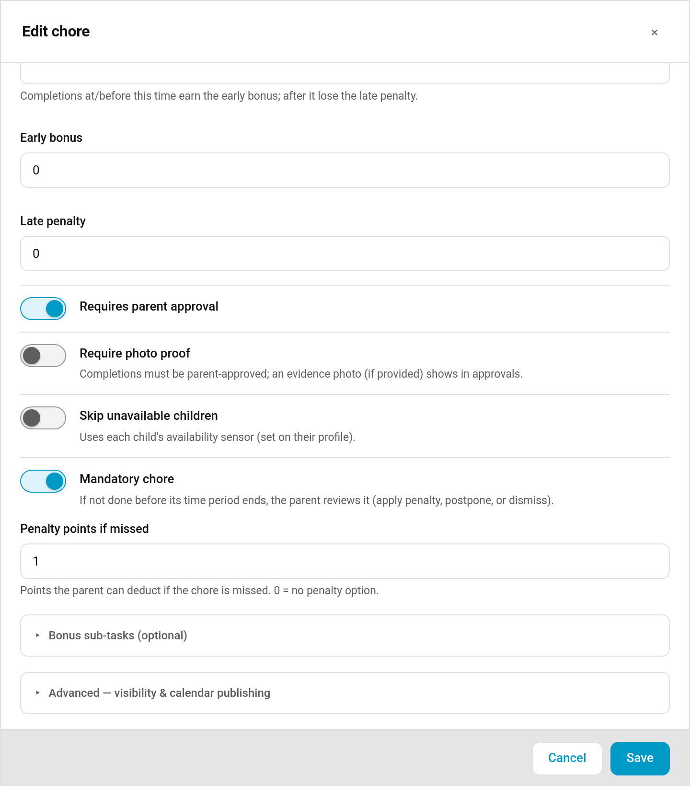
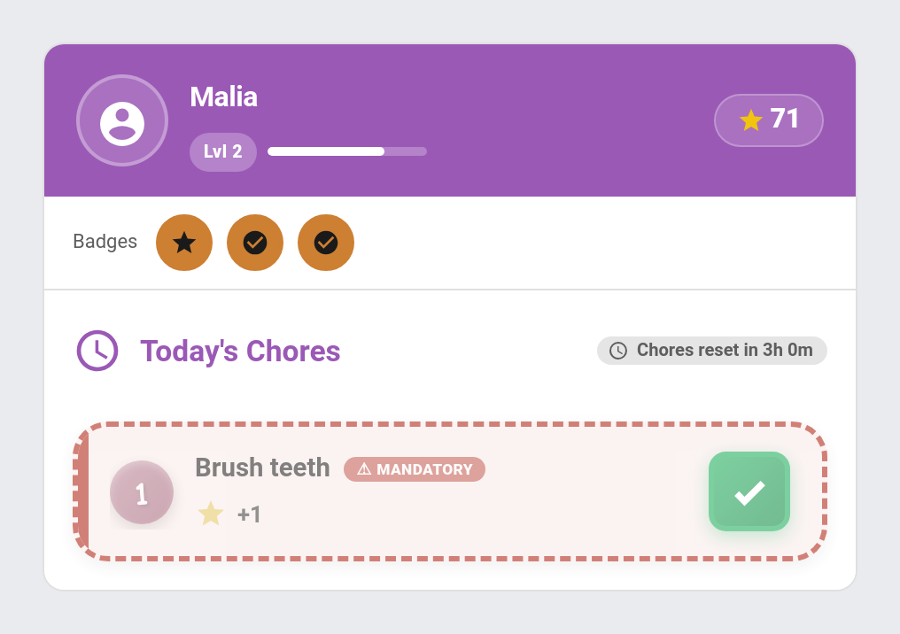

# Mandatory Chores

Mandatory chores are chores a child is expected to do — not optional, not just "nice to have". When a mandatory chore isn't completed in time, TaskMate doesn't silently take points away. Instead it raises a **review item** for the parent, who decides what happens next.

Mandatory is set **per chore** — there is no global on/off switch.

## Marking a chore mandatory

Open the chore editor (**Admin Panel → Chores → Edit chore**). Turn on the **"Mandatory chore"** toggle. A **"Penalty points if missed"** number field appears below it — set the points a parent can choose to deduct if the chore is missed. Leave it at `0` for no penalty option.

In YAML / storage this is two chore fields:

| Field | Type | Description |
| --- | --- | --- |
| `mandatory` | bool | Whether the chore is mandatory |
| `mandatory_penalty_points` | int | Points a parent may deduct if missed (`0` = no penalty option) |

## How a miss is detected

If a mandatory chore isn't completed before its time-of-day period ends, TaskMate records a per-child **miss** and raises a review item for the parent. **Points are never auto-deducted** — the parent always chooses what to do.

Detection runs at the end of each period. A midnight pass handles **Anytime** chores (which have no period boundary during the day), and a catch-up scan runs after Home Assistant restarts — so a restart across a period boundary won't cause a miss to be skipped.

A chore that is hidden by its [visibility entity](Dynamic-Chore-Visibility.md) or weather setting is never recorded as missed while it's hidden, because it isn't on the child's list *(v7.5.0)*.

See [Chore Scheduling](Chore-Scheduling.md) for how time-of-day periods work.

## Escalating a miss

An open miss can also step up its reminders over time so it doesn't sit unnoticed until you review it. The [Reminder Escalation](Reminder-Escalation.md) ladder nudges the child first, reminds them again after a configurable delay, and finally alerts a parent if the chore is still not done. The escalation notifications are off by default — see [Reminder Escalation](Reminder-Escalation.md) to enable and tune them.

## Reviewing a miss

The review item appears on the [Approvals Card](Approvals-Card.md) under a section titled **"Mandatory — needs review"**, at the top of the card.

Each miss offers three parent actions, each backed by a [service](Services.md):

| Action | Service | Effect |
| --- | --- | --- |
| **Apply Penalty** | `taskmate.apply_mandatory_penalty` | Deducts the configured penalty points and clears the review item. The Apply-penalty button only appears when the chore's penalty points are greater than 0. |
| **Postpone** | `taskmate.postpone_mandatory_chore` | Gives the chore the next period today, rolling to tomorrow after the last period. Repeatable, and applies no penalty. |
| **Dismiss** | `taskmate.dismiss_mandatory_chore` | Clears the review item with no penalty. |

Every one of these services takes a single parameter:

| Parameter | Type | Description |
| --- | --- | --- |
| `miss_id` | string | The ID of the mandatory-miss review item |

The penalty deducted by **Apply Penalty** is fixed — see [Penalties](Penalties.md) for how penalties show up in the activity log.

## On the child card

A mandatory chore is shown distinctly on the child card so kids can see at a glance what's non-negotiable: a red left stripe, a light-red tint, and a **"⚠ Mandatory"** badge.

## Sensor exposure

`sensor.taskmate_pending_approvals` carries the open misses:

| Attribute | Type | Description |
| --- | --- | --- |
| `mandatory_misses` | list | Open mandatory-miss review items |
| `pending_mandatory_misses` | int | Count of open misses |

Each entry in `mandatory_misses` has these fields:

| Field | Description |
| --- | --- |
| `id` | Miss ID — pass this as `miss_id` to the services above |
| `chore_id` | ID of the missed chore |
| `child_id` | ID of the child who missed it |
| `chore_name` | Display name of the chore |
| `child_name` | Display name of the child |
| `due_date` | ISO date the chore was missed |
| `period_id` | The time period that closed (`anytime` for all-day chores) |
| `penalty_points` | Points snapshotted at creation (so later chore edits don't change an open miss) |
| `postpone_count` | How many times the miss has been postponed |
| `created_at` | When the miss was raised |

## Related

- [Penalties](Penalties.md) — fixed, named point deductions
- [Reminder Escalation](Reminder-Escalation.md) — nudge → reminder → parent-alert ladder for overdue misses
- [Approvals Card](Approvals-Card.md) — where misses are reviewed
- [Chores](Chores.md) — the chore editor and chore fields
- [Chore Scheduling](Chore-Scheduling.md) — time-of-day periods and recurrence
- [Services](Services.md) — `apply_mandatory_penalty`, `postpone_mandatory_chore`, `dismiss_mandatory_chore`
