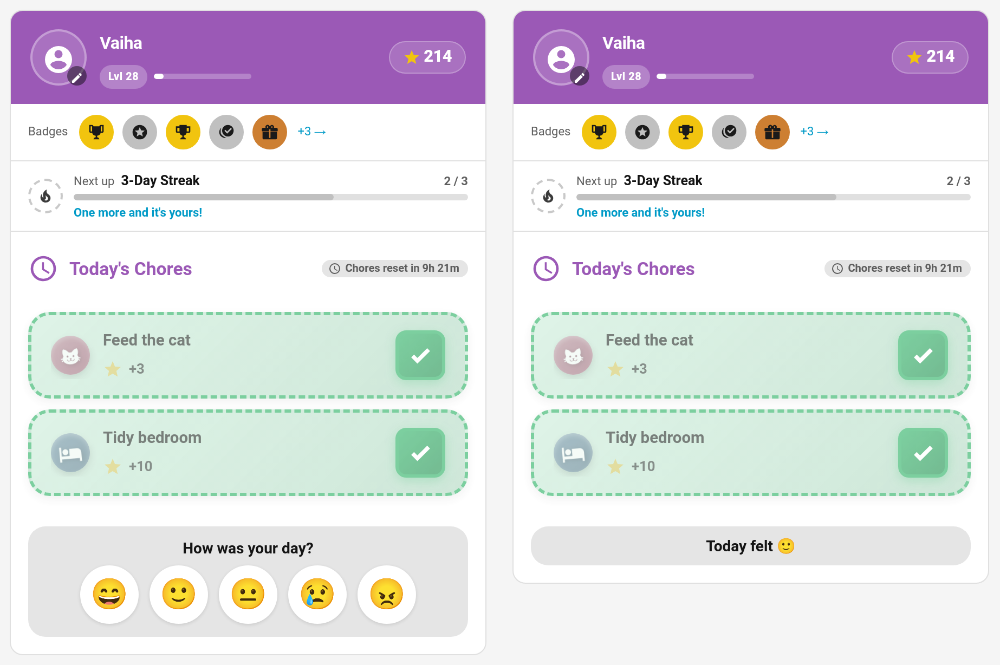
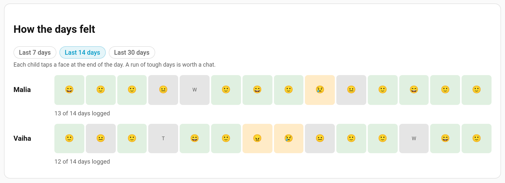

# Mood Check In

At the end of the day, once their chores are done, the child card asks **How was your day?** The child taps one of five faces. It takes a second, and over a few weeks it shows you how the days have felt: a run of tough days is worth a chat. If you like, TaskMate can also send you a gentle push when a child says their day was sad or cross.



> **New in v7.0.0**

---

## On the Child Card

The check-in appears at the bottom of the [child card](Dashboard-Cards.md#child-card) once every chore the child owes today is done. Chores not due today, ones still locked, and open-ended "I did something extra" chores don't hold it back.

| Face | Mood | Stored as |
|------|------|-----------|
| 😄 | Great | `great` |
| 🙂 | Good | `good` |
| 😐 | OK | `ok` |
| 😢 | Sad | `sad` |
| 😠 | Cross | `upset` |

After tapping, the strip reads **Today felt 🙂**. There's one mood per child per day: logging again replaces it.

To hide the check-in on a card:

```yaml
type: custom:taskmate-child-card
entity: sensor.taskmate_overview
child_id: 8e16ad66b23f404e
show_mood: false
```

In the editor it's **Show the end-of-day mood check-in**.

---

## Seeing the Trend

**TaskMate panel → Insights → Moods**



**How the days felt** shows a row of faces per child for the last 7, 14 or 30 days, with tough days (sad or cross) shaded and a count of how many days were logged. Days with no answer show just the weekday letter.

Today's mood also shows as a **Mood** pill on each child's card on the panel's **Today** page.

Moods are kept for 90 days.

---

## The Tough-Day Notification

**Tough day** is **off by default**. Switch it on under **Notifications** and parents get a push when a child picks the sad or cross face:

> 😢 Vaiha had a tough day today. Maybe check in?

Great, good and OK days never send anything.

---

## Events

Every check-in fires `taskmate_mood_logged` with `child_id`, `child_name`, `mood` and `emoji`, and shows as **Mood logged** on the child's [event entity](Event-Entities.md). A sad or cross day also fires `taskmate_mood_low`, whether or not the Tough day notification is on.

---

## Service

| Service | Fields | Description |
|---------|--------|-------------|
| `taskmate.log_mood` | `child_id`, `mood` (`great`, `good`, `ok`, `sad` or `upset`) | Log today's mood. One per day; logging again replaces it |

Each child's entry in `sensor.taskmate_overview`'s `children` attribute carries `mood_today` once they've answered.

---

## Related

- [Help Requests](Help-Requests.md) — the "I'm stuck" button
- [Sick Days](Sick-Days.md) — a day off when a child is unwell
- [Insights](Insights.md) — the other reports
- [Notifications](Notifications.md)
