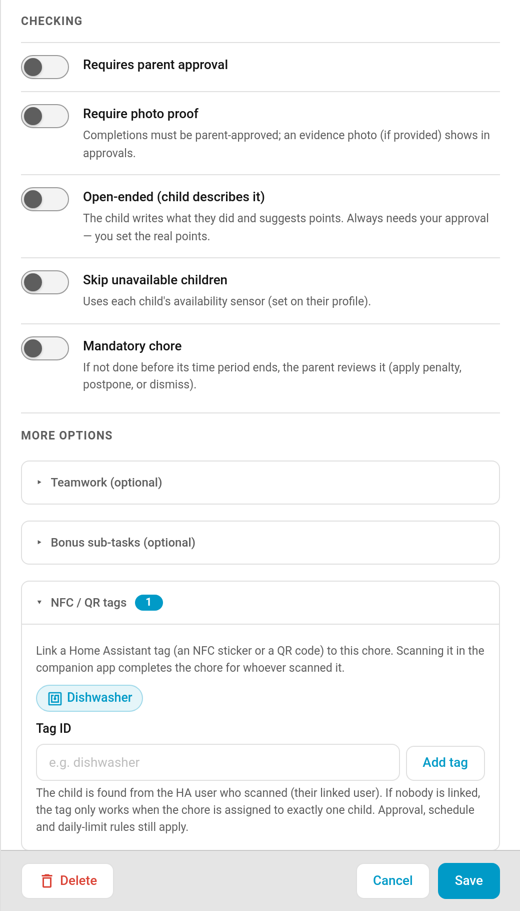

# NFC Tag Completion

Stick an NFC tag (or print a QR code) where a chore actually happens: on the dishwasher, by the cat's bowl, on the back door where the bins go out. When a child scans it with the Home Assistant companion app, the chore is ticked off for them. No dashboard, no hunting for the right button.



> **New in v6.0.0**

---

## How It Works

```
Child scans the tag with the HA companion app → TaskMate finds the chore(s) linked to that tag → the chore is completed for that child
```

Home Assistant already has **tags**: NFC stickers and QR codes that the companion app can scan. TaskMate listens for those scans. Every chore linked to the scanned tag is considered, and the completion goes through exactly the same path as tapping **Done** on the child card.

That means all the usual rules still apply:

- A chore that **needs approval** goes into the approval queue as normal.
- **Schedules, availability, daily limits, weekly targets, dependencies and rotation** are all respected. A tag can't complete a chore that isn't due for that child today.
- Once today's occurrence is used up, scanning again does nothing.

---

## Setting It Up

### 1. Create the tag in Home Assistant

Write an NFC sticker with the companion app, or create a tag under **Settings → Tags** in Home Assistant and print its QR code. Give it a friendly name, like *Dishwasher*.

### 2. Link it to the chore

**TaskMate panel → Chores → edit a chore → More options → NFC / QR tags**

| Field | Description |
|-------|-------------|
| **Tag chips** | Every tag Home Assistant knows about is listed as a chip. Tap one to link it to this chore, tap again to unlink it. |
| **Tag ID** | Type a tag ID and press **Add tag** if the tag isn't in Home Assistant's list yet. Typed IDs show as chips too, so you can remove them later. |

A chore can have up to **10** tags. The section header shows how many are linked.

---

## Who Gets the Credit?

TaskMate works out which child scanned from the Home Assistant user who did the scanning:

| Situation | Result |
|-----------|--------|
| The scanning user is **linked to a child** (Children → Edit → *Link to Home Assistant user*) | That child gets the completion. |
| The scanning user **isn't linked** to any child, and the chore is assigned to **exactly one** child | That child gets the completion. |
| The scanning user isn't linked, and the chore is shared by several children | Nothing happens. TaskMate can't tell who it was, so it doesn't guess. |

If you use **Require a linked account per child**, that rule still holds: a tag can't be used to get around it.

### One tag, several children

One tag can serve several chores. A common pattern is a separate "Empty the dishwasher" chore per child, all linked to the same dishwasher tag. Whoever scans gets their own chore ticked off.

---

## Chores a Tag Can't Complete

A tap carries no photo, note or timer, so these chore types are skipped when their tag is scanned:

- **[Photo proof](Photo-Proof.md)** chores
- **[Open-ended](Open-Ended-Chores.md)** chores (the child has to describe what they did)
- **[Timed](Timed-Tasks.md)** chores

The chore editor shows a warning in the NFC / QR tags section if you link a tag to one of these.

---

## Double Scans

Phones often read a single NFC tap twice. A repeat scan by the same child within **60 seconds** of a completion is ignored, even if the chore's daily limit would allow another one.

---

## For Automations

Each successful tag completion fires the `taskmate_tag_completion` event (as well as the usual `taskmate_chore_completed`):

| Field | Description |
|-------|-------------|
| `tag_id` | The tag that was scanned |
| `device_id` | The phone that scanned it |
| `child_id` / `child_name` | Who got the credit |
| `chore_id` / `chore_name` | The chore that was completed |
| `completion_id` | The new completion |
| `pending_approval` | `true` if it's waiting for a parent |

Every tag completion is also written to the [Admin Audit Log](Admin-Audit-Log.md).

---

## Good Candidates

- **Emptying the dishwasher**: tag on the dishwasher door
- **Feeding pets**: tag by the food bowl
- **Putting the bins out**: tag on the back door or the bin store
- **Watering plants**: tag on the watering can

Anything with a clear "I'm standing where the job is" moment.

---

## Related

- [Chores](Chores.md) — creating and configuring chores
- [Children](Children.md) — linking a child to a Home Assistant user
- [Automations](Automations.md) — reacting to TaskMate events
