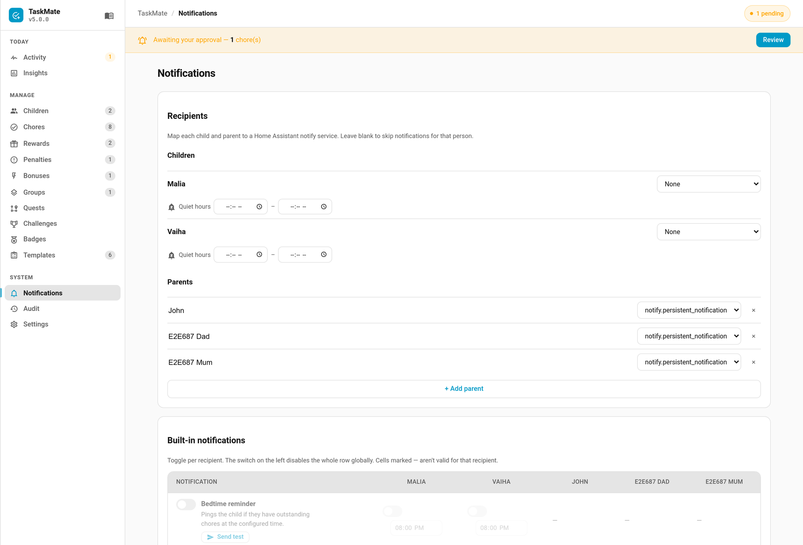

# Notifications

TaskMate has a full notification system with built-in notification types, per-recipient routing, custom scheduled notifications, actionable mobile callbacks, and bus events for power users.



---

## Overview

```
Event occurs (chore completed, streak at risk, bedtime, badge earned)
    │
    ├─ Check notification type is enabled (master toggle)
    ├─ Check recipient routing matrix
    ├─ Check time gate (if applicable)
    │
    ├─ Send persistent HA notification
    ├─ Send push notification (per recipient's notify service)
    ├─ Fire bus event (taskmate_* event)
    │
    └─ Actionable notifications include Approve/Reject buttons (mobile)
```

---

## Built-in Notification Types

TaskMate ships with these built-in notification types:

| Type | ID | Audience | Time-Gated | Actionable | Default |
|------|-----|----------|-----------|------------|---------|
| **Bedtime Reminder** | `bedtime_reminder` | Children | Yes (per-recipient time) | No | Off |
| **Streak at Risk** | `streak_at_risk` | Children | Yes (global cutoff) | No | Off |
| **All Chores Done** | `all_chores_done` | Both | No | No | Off |
| **Badge Earned** | `badge_earned` | Both | No | No | On |
| **Pending Chore Approval** | `pending_chore_approval` | Parents | No | Yes | On |
| **Pending Reward Claim** | `pending_reward_claim` | Parents | No | Yes | On |
| **Streak Milestone** | `streak_milestone` | Both | No | No | Off |
| **Level Up** | `level_up` | Both | No | No | Off |
| **Celebration** | `celebration` | Both | No | No | Off |
| **Weekly Digest** | `weekly_digest` | Parents | No | No | Off |
| **Mandatory Reminder** | `mandatory_reminder` | Children | No | No | Off |
| **Mandatory Parent Alert** | `mandatory_parent_alert` | Parents | No | No | Off |
| **Monthly Report** | `monthly_report` | Parents | No | No | Off |
| **Season Champion** | `season_champion` | Both | No | No | Off |
| **Family Goal Reached** | `family_goal_reached` | Both | No | No | Off |
| **Birthday** | `birthday` | Children | Yes (per-recipient time, 08:00 if unset) | No | Off |
| **Streak Freeze Used** | `streak_freeze_used` | Both | No | No | Off |
| **Arrived Home** | `presence_arrival` | Children | No | No | Off |
| **Item Rejected** | `item_rejected` | Children | No | No | Off |
| **Recap Ready** | `recap_ready` | Both | Yes (recap send time) | No | Off |
| **Bounty Posted** | `bounty_posted` | Children | No | No | Off |
| **Bounty Claim Lapsing** | `bounty_claim_lapsing` | Children | No | No | Off |
| **Wish Requested** | `wish_requested` | Parents | No | No | Off |
| **Wish Pledged** | `wish_pledged` | Children | No | No | Off |
| **Inspection Started** | `inspection_started` | Children | No | No | Off |
| **Inspection Passed** | `inspection_passed` | Children | No | No | Off |
| **Inspection Reminder** | `inspection_reminder` | Parents | No | No | **On** |
| **Auction Opened** | `auction_opened` | Children | No | No | Off |
| **Auction Closing** | `auction_closing` | Children | No | No | Off |
| **Auction Result** | `auction_result` | Both | No | No | Off |
| **Asked for help** | `help_requested` | Parents | No | No | **On** |
| **Tough day** | `mood_low` | Parents | No | No | Off |
| **Weekly goal reached** | `weekly_goal_reached` | Both | No | No | Off |
| **Penalty earned back** | `penalty_redeemed` | Both | No | No | Off |
| **Raffle drawn** | `raffle_drawn` | Both | No | No | Off |
| **Pet grew up** | `pet_evolved` | Both | No | No | Off |

The 15 rows from **Birthday** to **Auction Result** were added in v6.0.0. All of them start **switched off**, apart from the parent **Inspection Reminder**, which only ever fires for an inspection a parent started. Turn on the ones you want on the Notifications tab.

The last 6 rows were added in v7.0.0. **Asked for help** starts **switched on**, because an "I'm stuck" button that reaches nobody is worse than no button; the rest start off.

> **Upgrading to v7.0.0.** A notification type your install has never seen before now starts in its default state, exactly as on a fresh install, and is routed to every parent. So **Asked for help** is switched on for you when you upgrade; the other new types arrive switched off. Types you had already configured are left alone.

### Bedtime Reminder

Sends a reminder to children who still have incomplete chores. Each recipient can have their own bedtime — e.g. 19:30 for younger children, 20:30 for older ones.

### Streak at Risk

Alerts children who haven't completed a chore today and are at risk of losing their streak. Uses a global cutoff time (configurable in the recipient matrix).

### All Chores Done

Fires immediately when a child finishes every chore assigned to them for the day.

### Badge Earned

Fires when a child earns a new achievement badge (auto or manual). See [Achievement Badges](Achievement-Badges.md).

### Pending Chore Approval

Sent to parent recipients when a child completes a chore that requires approval. Includes **Approve** and **Reject** action buttons on mobile.

### Pending Reward Claim

Sent to parent recipients when a child claims a reward. Includes **Approve** and **Reject** action buttons on mobile.

### Streak Milestone

Fires when a child reaches a streak milestone (e.g. a 3-, 7-, 14-day streak) and is awarded the milestone bonus. The bonus itself has always been granted; this type announces it. **Off by default** — enable it on the Notifications tab. One notification fires per newly reached milestone. Milestone days/bonuses come from the **Streak Milestones** setting (see [Bonus Points](Bonus-Points.md)).

### Level Up

Fires when a child gains an XP level. **Off by default.** See [Levels and XP](Levels-and-XP.md).

### Celebration

A single, tier-scaled notification for notable moments (level-ups, completed quests/challenges, and similar). It is opt-in and only sent when the moment meets a minimum tier:

- Enable the `celebration_notify` setting to turn it on.
- `celebration_notify_min_tier` (default `2`) sets the smallest tier that notifies (1 = small, 2 = medium, 3 = epic).

The matching `taskmate_celebration` bus event always fires regardless of this notification (see [Celebrations](Celebrations.md)).

### Weekly Digest

A Sunday-evening recap sent to parents summarising each child's week. **Off by default.** See [Weekly Digest](Weekly-Digest.md) for the schedule, contents and configuration.

### Mandatory Reminder

Nudges a child whose [mandatory chore](Mandatory-Chores.md) is overdue, then reminds them again after the escalation delay. Sent only to the affected child, and held back during that child's [quiet hours](Quiet-Hours.md). **Off by default.** This is the child-facing half of the [Reminder Escalation](Reminder-Escalation.md) ladder.

### Mandatory Parent Alert

Alerts a parent when a child's [mandatory chore](Mandatory-Chores.md) is still incomplete after the parent escalation delay. **Off by default.** This is the top rung of the [Reminder Escalation](Reminder-Escalation.md) ladder.

### Monthly Report

A per-child recap of the previous calendar month — chores completed, points earned, level and best streak — sent to parents on the **1st of each month**. It is the longer-period sibling of the weekly digest. **Off by default.** See [Weekly Digest](Weekly-Digest.md).

### Season Champion

Announces the winner of the previous month's leaderboard at the start of a new month. **Off by default.**

### Family Goal Reached

Fires when the family hits a shared points goal. **Off by default.**

### Birthday *(v6.0.0)*

A morning "happy birthday" to the child on their [birthday](Birthday-Mode.md), telling them how much every chore pays today. Sent at each recipient's own time, or 08:00 when none is set.

### Streak Freeze Used *(v6.0.0)*

Sent when a [streak freeze](Streak-Freezes.md) token saves a child's streak on a missed day, with how many tokens are left.

### Arrived Home *(v6.0.0)*

Part of [Presence-Aware Reminders](Presence-Aware-Reminders.md). While a child is away, their bedtime, streak-at-risk, mandatory and custom reminders are held back. When they get home, this sends one "🏠 You're home — 3 chores left today" message instead of a backlog. Only sent if the child was away for at least **Only after being away for** minutes (default 30, set on this type's row), and never during quiet hours.

### Item Rejected *(v6.0.0)*

Tells the child a chore or reward claim was sent back, including the parent's [reason](Reject-Reasons.md) when one was given.

### Recap Ready *(v6.0.0)*

Announces a new [recap](Recaps.md): one message per child, plus one grouped message for parents. Recaps are built at midnight, and this waits for the **Send at** time in **Settings → Recaps** (default 08:00). It is switched on for you the first time you turn recaps on; the per-audience switches live in **Settings → Recaps**.

### Bounty Posted / Bounty Claim Lapsing *(v6.0.0)*

For the [Bounty Board](Bounty-Board.md). **Bounty Posted** goes to the children a new bounty is open to, when the parent leaves **Notify children** ticked. **Bounty Claim Lapsing** warns the child holding a claim 15 minutes before it runs out and the bounty goes back on the board.

### Wish Requested / Wish Pledged *(v6.0.0)*

For the [Wishlist](Wishlist.md). **Wish Requested** tells parents a child has added a wish waiting for approval. **Wish Pledged** tells the child someone has pledged points towards one of their wishes.

### Inspection Started / Inspection Passed / Inspection Reminder *(v6.0.0)*

For [Surprise Inspections](Surprise-Inspections.md). **Inspection Started** tells the child one is coming (not sent for a secret check). **Inspection Passed** tells them it passed and what bonus they got. **Inspection Reminder** reminds the parent 30 minutes before an undecided inspection closes; this one is **on** by default.

### Auction Opened / Auction Closing / Auction Result *(v6.0.0)*

For [Chore Auctions](Chore-Auctions.md). **Auction Opened** and **Auction Closing** (bidding closes within the hour) go to the children who may bid, when the parent ticks "tell children". **Auction Result** goes to them and to parents. No notification ever reveals another child's bid.

### Asked for help / Tough day *(v7.0.0)*

**Asked for help** tells parents a child tapped "I'm stuck" on a chore, with their message if they wrote one. Answer it from the admin panel's **Today** page (or with `taskmate.answer_help`) so the child's card stops saying help is on its way. See [Help Requests](Help-Requests.md). **Tough day** tells parents a child picked the sad or cross face in the end-of-day [mood check-in](Mood-Check-In.md).

### Weekly goal reached / Penalty earned back *(v7.0.0)*

**Weekly goal reached** goes to the child and parents when a child reaches the [weekly goal](Weekly-Goals.md) they set themselves. **Penalty earned back** goes out when a child does a penalty's [make-it-right](Make-It-Right-Penalties.md) chore and gets points back.

### Raffle drawn / Pet grew up *(v7.0.0)*

**Raffle drawn** announces a [raffle](Raffles.md)'s winner and how many tickets were in the draw. **Pet grew up** tells the child and parents a [virtual pet](Virtual-Pets.md) reached a new stage, turned legendary, laid an egg or reached a new pet level.

---

## Notification Messages

Each built-in type has a fixed message template. The English wording is shown below.

**Your language (v6.2.0).** Push notifications follow Home Assistant's language, set under **Settings → System → General**, the same as the cards and the admin panel. That covers every built-in message, the **Approve** / **Reject** buttons and the reject reason box, the "Open the TaskMate panel…" hint for non-mobile backends, celebration and recap messages, auction results, the weekly digest and monthly report lines, and month and weekday names in dates. A German household gets, for example:

> Alex hat „Spülmaschine ausräumen“ erledigt (+5 Punkte) – wartet auf Freigabe.
> Buttons: **Genehmigen / Ablehnen**

Changing Home Assistant's language takes effect straight away, with no restart. Where a language has no translation for a message, it goes out in English. Your own [custom notifications](#custom-notifications) are sent exactly as you wrote them. See [Localization](Localization.md#push-notifications) for the list of languages.

| Type | Message |
|------|---------|
| Bedtime Reminder | `"{child_name}, you still have chores to do before bedtime."` |
| Streak at Risk | `"{child_name}, complete a chore today to keep your {streak}-day streak!"` |
| All Chores Done | `"{child_name} finished every chore today!"` |
| Badge Earned | `"{child_name} earned the {badge_name} badge!"` |
| Pending Chore Approval | `"{child_name} completed '{chore_name}' (+{points} {points_name}) — awaiting approval."` |
| Pending Reward Claim | `"{child_name} claimed '{reward_name}' ({cost} {points_name}) — awaiting approval."` |
| Streak Milestone | `"{child_name} hit a {days}-day streak — +{points} {points_name}!"` |
| Level Up | `"{child_name} reached level {level}! 🎉"` |
| Celebration | `"🎉 {message}"` |
| Weekly Digest | `"TaskMate weekly digest:\n{summary}"` |
| Mandatory Reminder | `"{child_name}, you still need to do '{chore_name}'."` |
| Mandatory Parent Alert | `"{child_name} still hasn't done the mandatory chore '{chore_name}'."` |
| Monthly Report | `"TaskMate {month} report:\n{summary}"` |
| Season Champion | `"🏆 {child_name} won the {month} leaderboard with {points} {points_name}!"` |
| Family Goal Reached | `"🎉 Family goal reached: {goal_name}! Time for {goal_reward}."` |
| Birthday | `"🎂 Happy birthday, {child_name}! Every chore pays {multiplier}× today."` |
| Streak Freeze Used | `"❄️ A streak freeze saved {child_name}'s {streak}-day streak ({freezes_left} left)."` |
| Arrived Home | `"🏠 You're home, {child_name} — {count} chores left today."` |
| Item Rejected | `"↩️ {child_name}, '{item_name}' was sent back{reason_text}"` |
| Recap Ready | `"✨ Your {period} recap is ready, {child_name}! Tap to watch it."` |
| Bounty Posted | `"🏁 New bounty: {bounty_name} — {points} {points_name}. First to claim it gets it!"` |
| Bounty Claim Lapsing | `"⏳ {child_name}, {minutes} minutes left to finish '{bounty_name}' before it goes back on the board."` |
| Wish Requested | `"{child_name} wished for '{wish_name}' ({target} {points_name}) — waiting for your approval."` |
| Wish Pledged | `"💝 {pledger} added {points} {points_name} to your wish '{wish_name}'!"` |
| Inspection Started | `"🔍 {child_name}, a grown-up is coming to inspect '{chore_name}' before {until}. Keep it looking great for +{bonus} {points_name}!"` |
| Inspection Passed | `"🌟 Inspection passed, {child_name}! '{chore_name}' looked great: +{bonus} {points_name}{note_text}"` |
| Inspection Reminder | `"🔍 {child_name}'s '{chore_name}' inspection closes in {minutes} minutes — pass or fail it before {until}."` |
| Auction Opened | `"🔨 New auction: {chore_name} on {date}, up to {max_points} {points_name}. Lowest bid wins!"` |
| Auction Closing | `"⏳ {child_name}, bidding on '{chore_name}' closes in {minutes} minutes."` |
| Auction Result | `"🔨 Auction closed: {result_text}"` |
| Asked for help | `"🙋 {child_name} needs help with '{chore_name}'{message_text}"` |
| Tough day | `"{emoji} {child_name} had a tough day today. Maybe check in?"` |
| Weekly goal reached | `"🎯 {child_name} reached their weekly goal of {target} {points_name} — +{bonus} bonus!"` |
| Penalty earned back | `"🤝 {child_name} made it right with '{chore_name}' and earned back {points} {points_name}."` |
| Raffle drawn | `"🎟️ {raffle_name}: {winner_name} won! ({tickets} tickets in the draw)"` |
| Pet grew up | `"{news}"` — one of: `"🐣 {pet_name} just grew up! Have a look at {child_name}'s pet."`, `"✨ {pet_name} turned legendary! {child_name}'s pet is shining gold."`, `"🥚 {pet_name} laid an egg! {child_name} can hatch a new pet."`, `"💖 {pet_name} reached pet level {pet_level}!"` |

---

## Testing a Notification

To confirm that a notification type is routed correctly without waiting for the real trigger, use the **test notification** feature. It sends a sample message to that type's enabled recipients **ignoring the master on/off toggle**, so you can verify routing before you switch the type on. The sample message is prefixed with `[TEST] ` and filled with placeholder data (child "Alex", chore "Tidy room", and so on). Since v6.2.0 the sample names are in your language too. A test send does **not** fire a bus event.

Each notification type row in the **Admin Panel → Notifications** tab has a **Send test** button. You can also call the service directly:

```yaml
action: taskmate.test_notification
data:
  type_id: streak_milestone
```

| Field | Required | Description |
|-------|----------|-------------|
| `type_id` | Yes | Notification type id, e.g. `pending_chore_approval`, `badge_earned`, `streak_milestone` |

A persistent notification is also created for the test, the same as a real send.

---

## Actionable Notifications (Mobile)

The `pending_chore_approval` and `pending_reward_claim` types send actionable notifications via the HA Companion app. The notification includes two tap actions:

- **Approve** — approve the pending item directly from the notification
- **Reject** — reject the pending item

Action identifiers follow the format `TASKMATE_APPROVE_{entry_id}` and `TASKMATE_REJECT_{entry_id}`. Since v6.2.0 the button labels follow Home Assistant's language; the identifiers don't change, so automations that listen for them keep working.

**Reject with a reason (v6.0.0).** Tapping **Reject** opens a text box on the phone ("Reason (optional)"). Whatever you type is saved as the [reject reason](Reject-Reasons.md) and shown to the child; sending it empty is a plain reject.

**Star ratings (v6.0.0).** With [quality ratings](Quality-Ratings.md) switched on, a chore approval push shows **★**, **★★** and **★★★** buttons instead of **Approve**, so you can rate from the lock screen (action IDs `TASKMATE_RATE_{n}_{entry_id}`). Android shows at most three buttons, so there the stars take priority and Reject is done from the panel or the approvals card. Reward claims always keep Approve / Reject.

> **Requirement:** The HA Companion app must be installed on the parent's device and the notify service must be a `mobile_app` service.

### Auto-clearing when reviewed *(v4.4.4+)*

Once a pending chore or reward is reviewed — approved **or** rejected, individually or via **Approve All** — TaskMate automatically dismisses its push from the Companion app, so a big approval sweep no longer leaves a pile of stale notifications on the phone. This is done by re-sending the notification's `tag` with the Companion app's `clear_notification` message.

Clearing is limited to `mobile_app.*` notify targets. Other backends (Telegram, email, persistent) are never sent a clear request — they would render it as literal text — so there is no extra notification noise and no per-recipient toggle is needed.

### Graceful Fallback for Non-mobile_app Backends

Tap actions only render in the HA Companion app. Other notify backends — Telegram, email, SMS, and so on — silently ignore them. Rather than send dead buttons to those recipients, TaskMate detects a non-`mobile_app` notify service and instead appends a hint to the message:

> *Open the TaskMate panel to approve or reject.*

In addition, a **persistent notification** is always created in Home Assistant for every notification type (see [Persistent Notifications](#persistent-notifications) below), so even a recipient with no usable push backend has a way to act from the HA sidebar.

The notify service must be in the `notify.*` domain; other domains are rejected and logged.

---

## Tap-to-Open Navigation *(v5.0.2+)*

Tapping the **body** of a TaskMate notification can open a place of your choosing — the TaskMate panel, a dashboard, or any URL. This is separate from the Approve/Reject action buttons above: an approval push keeps its buttons *and* gains a tap target.

Configure it in the admin panel under **Notifications**, in the built-in notifications card:

- **When tapped, open** (global) — the default target for every notification. Ships defaulting to the TaskMate panel, `/taskmate-admin`.
- **Per-notification override** — each row in the matrix has its own *tap opens* field. Leave it blank to inherit the global default, or set a specific target (for example, point **Pending Chore Approval** and **Pending Reward Claim** at a parents' approval dashboard).

**Accepted values** (same on both platforms):

| Value | Effect |
| --- | --- |
| `/taskmate-admin` | Opens the TaskMate admin panel |
| `/lovelace/parents` | Opens a Lovelace dashboard path |
| `https://…` | Opens a full URL |
| `noAction` | Tap does nothing (disables navigation for that scope) |
| *(empty)* | Global: no navigation. Per-type: inherit the global default. |

Anything else is rejected when saving — the target opens on the *recipient's* phone, so only dashboard paths, `http(s)` URLs and `noAction` are allowed (no `intent://`, `app://` or other app schemes).

Under the hood the value is emitted as both the Companion app's `clickAction` (Android) and `url` (iOS), for `mobile_app.*` notify targets only. Other backends (Telegram, email, persistent) never receive it.

> **Upgrade note:** from v5.0.2 the global default is the TaskMate panel (`/taskmate-admin`), so notification taps open the TaskMate panel out of the box. To restore the previous "open wherever the app was last" behaviour, clear the **When tapped, open** field or set it to `noAction`.

---

## Notification Grouping *(v5.3.0+)*

TaskMate stamps every push with a **group key** so the Companion app stacks its
alerts into one bundle, instead of scattering them through everything else Home
Assistant sends you.

This is **on by default** with the key `taskmate` — there is nothing to set up.

Configure it in the admin panel under **Notifications**, the same place as the
tap target:

- **Group key** (global) — the default key for every notification.
- **Per-notification override** — each row in the matrix has its own *group*
  field. Leave it blank to inherit the global key, or set a specific one to
  split TaskMate into separate stacks (for example approvals in one bundle and
  badges in another).

| Value | Effect |
| --- | --- |
| `taskmate` | The shipped default — all TaskMate alerts in one stack |
| `family-chores` | Any custom key you like |
| *(empty)* | Global: grouping off. Per-type: inherit the global key. |

**Key rules:** 64 characters or fewer, no spaces and no control characters. Use
`family-chores`, not `family chores` — an invalid key is rejected when saving
and the field reverts to the last good value.

### What each platform reads

| Platform | Key sent | Effect |
| --- | --- | --- |
| Android | `data.group` | Notifications collapse into one group |
| iOS | `push.thread-id` | Notifications thread together |

Both are sent with the same value and each platform ignores the other's, so a
single setting covers both. Like the tap target, the keys are only added for
`mobile_app.*` notify targets — Telegram, email and persistent notifications
never receive them. [Custom notifications](#custom-notifications) always use the
global key, since they have no notification type of their own.

---

## Recipients

TaskMate supports two types of notification recipients:

### Child Recipients

Each child in TaskMate is automatically a recipient. Their notify service can be configured in the admin panel's Notifications tab (e.g. `notify.mobile_app_noahs_tablet`). Children only receive notifications from types with audience `child` or `both`.

### Parent Recipients

Parents are added manually in the Notifications tab. Each parent recipient has:

| Field | Description |
|-------|-------------|
| **Name** | Display name (e.g. "Dad") |
| **Notify Service** | HA notify service (e.g. `notify.mobile_app_dads_phone`) |
| **Enabled** | Master on/off toggle |

Parents only receive notifications from types with audience `parent` or `both`.

---

## Recipient Routing Matrix

The routing matrix controls which recipients get which notification types. It is configured in the **Admin Panel → Notifications → Recipient Matrix**.

The matrix is a table with:
- **Rows** = notification types (15 built-in)
- **Columns** = recipients (all children + all parent recipients)
- **Cells** = enable/disable checkbox per type per recipient

Additional per-type settings in the matrix:
- **Bedtime Reminder**: per-recipient time input (each child can have a different bedtime)
- **Streak at Risk**: global cutoff time input (one time for all recipients)

Cells that don't apply (e.g. a child column for a parent-audience type) show a dash and are not interactive.

### Master Toggle

Each notification type has a **master enable/disable** toggle. When disabled, the notification does not fire for any recipient regardless of individual routing.

---

## Custom Notifications

Parents can create their own scheduled notifications for anything not covered by the built-in types.

### Custom Notification Fields

| Field | Description |
|-------|-------------|
| **Name** | Display name (e.g. "Homework Reminder") |
| **Message Template** | Text with `{child_name}` and `{time}` placeholders. Sent as written, never translated |
| **Time** | Scheduled dispatch time in `HH:MM` format |
| **Day Mask** | Which days of the week this notification fires (Mon–Sun toggles) |
| **Recipients** | Which children and/or parents receive it |
| **Enabled** | On/off toggle |

### Creating a Custom Notification

1. Open the **Admin Panel → Notifications tab**
2. Scroll to the **Custom Notifications** section
3. Click **Add Custom Notification**
4. Fill in the name, message template, time, days, and recipients
5. Save

### Example Use Cases

- **"Pack your bag!"** — 19:00 on school nights (Mon–Thu) to children
- **"Lunch boxes?"** — 07:00 on weekdays to a parent
- **"Weekend chore time!"** — 10:00 on Sat/Sun to all children

---

## Bus Events

Every notification fires a Home Assistant bus event, even if the master toggle is off (in which case the `recipients` list will be empty). Power users can use these in their own automations.

### Notification-Type Event Names

Each notification type fires a matching `taskmate_<type_id>` event, except the 11 types marked † below. Their feature already fires a `taskmate_<type_id>` event of its own, so since **v6.1.0** the notification system fires `taskmate_<type_id>_notification` for them instead:

| Event | Fired When |
|-------|------------|
| `taskmate_bedtime_reminder` | Bedtime reminder dispatched |
| `taskmate_streak_at_risk` | Streak at risk alert dispatched |
| `taskmate_all_chores_done` | Child finished all chores |
| `taskmate_badge_earned_notification` † | Badge awarded to a child |
| `taskmate_pending_chore_approval` | Chore completion awaiting approval |
| `taskmate_pending_reward_claim` | Reward claim awaiting approval |
| `taskmate_streak_milestone` | Streak milestone reached |
| `taskmate_level_up_notification` † | Child gained an XP level |
| `taskmate_celebration_notification` † | A notable moment (level-up, quest/challenge complete, …) |
| `taskmate_weekly_digest` | Weekly digest dispatched |
| `taskmate_mandatory_reminder` | Mandatory-chore nudge sent to a child |
| `taskmate_mandatory_parent_alert` | Mandatory chore still undone after the parent delay |
| `taskmate_monthly_report` | Monthly report dispatched |
| `taskmate_season_champion_notification` † | Previous month's leaderboard champion announced |
| `taskmate_family_goal_reached_notification` † | Combined family points reached the goal |
| `taskmate_birthday`, `taskmate_presence_arrival`, `taskmate_item_rejected`, `taskmate_recap_ready`, `taskmate_bounty_claim_lapsing`, `taskmate_wish_requested`, `taskmate_inspection_reminder`, `taskmate_auction_closing`, `taskmate_auction_result` | (v6.0.0) The matching notification was dispatched |
| `taskmate_streak_freeze_used_notification` †, `taskmate_bounty_posted_notification` †, `taskmate_wish_pledged_notification` †, `taskmate_inspection_started_notification` †, `taskmate_inspection_passed_notification` †, `taskmate_auction_opened_notification` † | (v6.0.0) The matching notification was dispatched |
| `taskmate_help_requested`, `taskmate_mood_low`, `taskmate_weekly_goal_reached`, `taskmate_penalty_redeemed`, `taskmate_raffle_drawn`, `taskmate_pet_evolved` | (v7.0.0) The matching notification was dispatched. These features have no separate event of their own, so automate on these. The per-child and family [event entities](Event-Entities.md) re-publish them too |
| `taskmate_custom_notification` | Custom notification dispatched |

> **† Renamed in v6.1.0.** Before v6.1.0 these 11 notification events used the same name as the feature's own event, so an automation on, say, `taskmate_level_up` ran twice whenever the notification was sent. Now the feature event (no `recipients`, see [Automations](Automations.md)) fires once, and the notification event has the `_notification` suffix. If an automation reads `recipients` from one of these, trigger it on the `_notification` event. A `recipients is not defined` condition added to filter out the duplicate can be removed.

### Event Data

Notification-type events include all context keys for the notification type (e.g. `child_name`, `chore_name`, `points`) plus `recipients` — a list of recipient IDs that were actually sent to. A `test_notification` send does **not** fire a bus event.

Custom notification events include:
- `id` — custom notification ID
- `name` — custom notification name
- `recipients` — list of recipient IDs

### Other Automation Events (v4.0.0)

TaskMate also fires events for penalties, bonuses and reward/chore approvals so you can build your own automations even when no notification is configured. These are **not** routed through the notification system and carry no `recipients` field:

| Event | Fired When |
|-------|------------|
| `taskmate_penalty_applied` | A penalty was applied to a child |
| `taskmate_bonus_applied` | A bonus was applied to a child |
| `taskmate_reward_approved` | A reward claim was approved |
| `taskmate_reward_rejected` | A reward claim was rejected |
| `taskmate_chore_rejected` | A chore completion was rejected |

See [Automations](Automations.md) for the full event reference and example automations.

### Automation Example

```yaml
alias: Log chore approvals to Discord
triggers:
  - trigger: event
    event_type: taskmate_pending_chore_approval
actions:
  - action: notify.discord_webhook
    data:
      message: >
        {{ trigger.event.data.child_name }} completed
        '{{ trigger.event.data.chore_name }}'
        (+{{ trigger.event.data.points }} {{ trigger.event.data.points_name }})
```

---

## Persistent Notifications

Regardless of routing configuration, TaskMate always creates a **persistent notification** in Home Assistant for pending chore approvals and pending reward claims. These appear in the notification bell in the HA sidebar and are automatically dismissed once you approve or reject the item.

---

## Binary Sensor

`binary_sensor.taskmate_has_pending_approvals` turns `on` when there are unapproved chore completions or reward claims. Use it in your own automations for fully custom notification logic.

**Attributes:**
- `pending_chore_completions` — count of pending chore approvals
- `pending_reward_claims` — count of pending reward claims
- `total_pending` — combined total

---

## Migration from Pre-v3.9.0

If you previously used the single **Notification Service** setting, it still works as a fallback — it now lives in the panel's **Settings** tab rather than the removed config flow. For the best experience:

1. Open the **Admin Panel → Notifications tab**
2. Add yourself as a Parent Recipient with your notify service
3. Configure the routing matrix to your preferences

---

## Multiple Parents / Devices

Unlike the old single-service setting, the v3.9.0 notification system natively supports multiple parents:

1. Add each parent as a **Parent Recipient** in the Notifications tab
2. Set each parent's `notify_service` to their device (e.g. `notify.mobile_app_dads_phone`, `notify.mobile_app_mums_phone`)
3. Enable/disable specific notification types per parent in the routing matrix

---

## Evidence Photos in the Approval Push

When a chore [requires a photo](Photo-Proof.md), that photo is attached to the
approval notification itself, so you can see the work and approve straight from
the lock screen without opening the app.

**This only applies to `mobile_app.*` notify services.** The image is delivered
through the Home Assistant companion app's own push payload, so a persistent
notification, a Telegram bridge or an e-mail notifier receives the usual text
message with no picture.

---

## Routing Parent Approvals

By default every approval buzzes every parent. Two other modes are available
through the `parent_routing` setting — send only to parents who are currently
home, or share approvals round-robin between them.

Every fallback deliberately errs towards over-notifying: if nobody is home,
everybody is told rather than nobody. See
[Multi-Parent Approval Routing](Multi-Parent-Approval-Routing.md) for the detail.

Child notifications are never affected by any of this — a reminder for a child
must always reach that child.

---

## Related

- [Admin Panel](Admin-Panel.md) — where to configure notifications
- [Achievement Badges](Achievement-Badges.md) — badge_earned notifications
- [Weekly Digest](Weekly-Digest.md) — the Sunday parent summary (and monthly report)
- [Multi-Parent Approval Routing](Multi-Parent-Approval-Routing.md) — route approvals to whoever is home, or round-robin
- [Quiet Hours](Quiet-Hours.md) — per-child do-not-disturb window
- [Reminder Escalation](Reminder-Escalation.md) — the mandatory-chore nudge → reminder → parent-alert ladder
- [Presence-Aware Reminders](Presence-Aware-Reminders.md) — hold reminders while a child is out
- [Reject Reasons](Reject-Reasons.md), [Quality Ratings](Quality-Ratings.md) — the reason box and star buttons on the approval push
- [Birthday Mode](Birthday-Mode.md), [Streak Freezes](Streak-Freezes.md), [Recaps](Recaps.md), [Bounty Board](Bounty-Board.md), [Wishlist](Wishlist.md), [Surprise Inspections](Surprise-Inspections.md), [Chore Auctions](Chore-Auctions.md) — v6.0.0 notification types
- [Automations](Automations.md) — full event reference and automation examples
- [Services](Services.md) — underlying services
- [Settings](Settings.md) — legacy notification service setting
