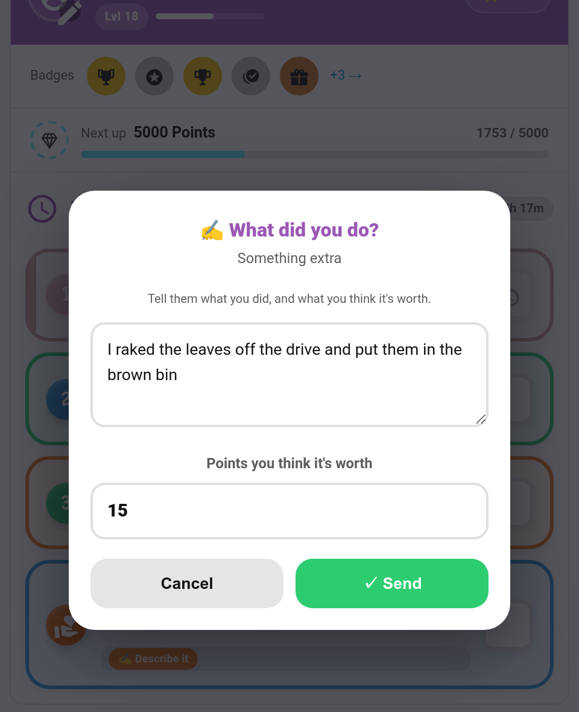
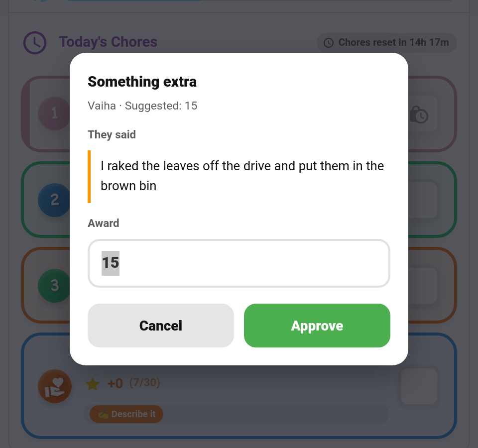

# Open Ended Chores

Children do helpful things that were never on the list — tidying up unprompted, carrying the shopping in, raking the drive. An **open-ended chore** is a standing placeholder for exactly that. The child taps it, describes what they did in their own words, suggests what they think it was worth, and it lands in your approvals queue for you to price.



---

## How It Works

```
Child taps the chore → describes it + suggests points → always pending → parent reviews and sets the real points → approve
```

It reuses the ordinary completion path, so streaks, badges, quests and challenges all behave exactly as they do for any other chore. Nothing about it is a special case.

---

## Setting One Up

Create a chore — "Something extra" works well as a name — and turn on **Open-ended (child describes it)** in the chore dialog in the [Admin Panel](Admin-Panel.md). It sits directly beneath *Require photo proof*.

Two settings worth getting right:

| Setting | Suggestion |
|---------|------------|
| **Points** | Leave it at **0**. The real number is the one you type when you approve. |
| **Daily limit** | Raise it (5–10). One open-ended chore covers every spontaneous job, so a limit of 1 means the second good deed of the day has nowhere to go. |

The chore shows a **✍️ Describe it** tag on the child's card so they know it behaves differently from a normal tick-box.

---

## What the Child Sees

Tapping DONE opens a sheet instead of completing straight away:

- **A description box.** This is required — it *is* the chore. Submitting with it empty is refused, in the card and in the service behind it.
- **A points box.** What they reckon the job was worth. It is only ever a suggestion; it awards nothing on its own.

The description is trimmed to 200 characters. Over-long text is shortened rather than rejected — losing the tail end of a sentence beats refusing a child's chore.

---

## Approval Is Always Required

An open-ended completion goes to a parent **even when the chore has *Requires approval* switched off**. The child is the one naming the price, so it can never pay itself.

This mirrors how [Photo Proof](Photo-Proof.md) behaves, and the two combine: with both switched on, the child is asked to describe the work first, then to take the photo, and the completion carries the description and the picture together.

---

## Reviewing and Pricing It

In the [Approvals Card](Approvals-Card.md) each pending completion has a second control beside Approve — **✍️** when the child left a note, **✎** otherwise. It opens a review sheet with their words, the evidence photo if there is one, and an editable award already filled in with their suggestion.



Change the number to whatever the job was actually worth and tap **Approve**.

> **The award replaces the chore's base points, not the final total.** Streak and level multipliers still apply on top, exactly as they would for any other approval — so an open-ended approval behaves like a normal one rather than becoming a special case.

Approving without opening the sheet still works as a single tap and awards the chore's own points.

---

## Doing It From an Automation

The same three fields are on the services, so a script or automation can submit and price work without touching the cards.

```yaml
service: taskmate.complete_chore
data:
  chore_id: 8a3b2c1d4e5f6789
  child_id: ef19c56175c14bd9
  note: "I raked the leaves off the drive"
  suggested_points: 15
```

```yaml
service: taskmate.approve_chore
data:
  completion_id: 4f21b8e0c7a94d13
  points: 12          # optional — omit to use the chore's own value
```

| Field | Service | Description |
|-------|---------|-------------|
| `note` | `complete_chore` | The child's description. Required when the chore is open-ended. Trimmed to 200 characters. |
| `suggested_points` | `complete_chore` | Their own estimate, clamped to 0–999. A hint for the parent; awards nothing by itself. |
| `points` | `approve_chore` | The award. Replaces the chore's base points; multipliers still apply. |

See [Services](Services.md) for the full reference.

---

## Notifications

The approval push quotes the child's estimate for an open-ended chore rather than the chore's own points, which for one of these is nearly always 0. See [Notifications](Notifications.md).

---

## Where It's Stored

The description and the estimate live on the completion record as `note` and `suggested_points`. Both are only published on the pending-approvals sensor when they actually hold something, so ordinary tap-to-complete chores add nothing to the sensor's payload.

---

## Related

- [Chores](Chores.md) — chore configuration and approvals
- [Photo Proof](Photo-Proof.md) — the other switch that forces approval, and combines with this one
- [Approvals Card](Approvals-Card.md) — where you review and price the submission
- [Points Economy](Points-Economy.md) — how the award interacts with multipliers
- [Services](Services.md) — full `complete_chore` and `approve_chore` reference
