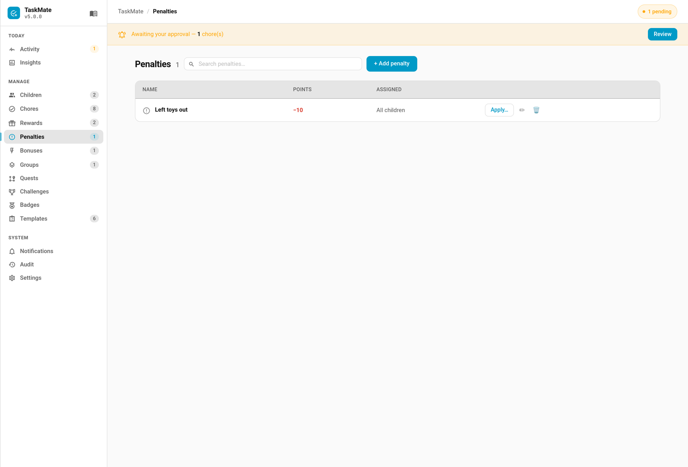

# Penalties

The Penalties card lets parents apply named point deductions to children for unwanted behaviour — consistently and in one tap.




Unlike the remove_points service which requires entering an amount each time, penalties are **named reusable definitions** (e.g. "Not going to bed — 10 Stars") that can be applied instantly without guessing an amount.

---

## Mandatory chore late penalties

A separate kind of penalty comes from **mandatory chores**. A chore marked mandatory can carry a late penalty that applies if it isn't completed in time. TaskMate **never deducts these points automatically** — the missed chore is raised as a review item on the [Approvals Card](Approvals-Card.md), and the parent applies the penalty manually (or postpones/dismisses it). See [Mandatory Chores](Mandatory-Chores.md) for the full workflow.

---

## Make it right (v7.0.0)

A penalty can name a **make-it-right** chore: when the penalty is applied, the child can do that chore within a set number of days and earn back some or all of the points. Losing points teaches less than putting right whatever went wrong ("tidy the mess you made").

Set it in the penalty editor in the admin panel, under **Make it right**:

| Field | Default | Description |
|-------|---------|-------------|
| **Chore to earn it back** | None — no way back | The chore that repairs things. It is open to the child even on days it isn't normally due, until the offer runs out |
| **Points back (%)** | `100` | How much of the deducted points comes back, 1–100 |
| **Days to do it** | `1` | 1 = today only; up to 7 |

The child card shows the offer ("Do “Tidy the playroom” by Friday to earn back 10"). The points come back when the chore is approved (or straight away if it needs no approval), and are taken back again if that chore is undone or rejected. These fields are set in the admin panel only; the `add_penalty` / `update_penalty` services don't take them. See [Make-It-Right Penalties](Make-It-Right-Penalties.md).

---

## Penalties Card

```yaml
type: custom:taskmate-penalties-card
entity: sensor.taskmate_overview
title: Penalties
```

**Config options:**

| Option | Default | Description |
|--------|---------|-------------|
| `entity` | required | `sensor.taskmate_overview` |
| `title` | `Penalties` | Card header title |

---

## Using the Card

### Applying a Penalty

1. If there are multiple children, tap the child's name tab at the top to select who to apply the penalty to
2. Each penalty row shows its icon, name, description, and point cost
3. Tap **Apply** — points are deducted immediately and a toast confirms the action
4. The bottom of the card shows which child is currently selected

> Penalties respect `assigned_to` — if a penalty is assigned to specific children, it only appears for those children's tabs.

> **Who can apply one.** Home Assistant admins and [TaskMate parents](Parent-Access.md) see **Apply**; only admins see the manage controls, and anyone else sees the list read-only. Parents could not apply penalties before v5.0.4.

### Managing Penalties (Edit Mode)

Tap the **pencil icon** (top right) to enter edit mode:

- **Add** — tap **New Penalty** to open an inline form with name, points, description, and icon fields
- **Edit** — tap the edit icon on any penalty row to edit it inline
- **Delete** — tap the trash icon to remove a penalty definition

Changes are saved to the integration immediately — no separate save step.

---

## Penalty Fields

| Field | Required | Default | Description |
|-------|----------|---------|-------------|
| `name` | Yes | — | Display name shown on the card |
| `points` | Yes | — | Points to deduct when applied |
| `description` | No | — | Optional explanation shown below the name |
| `icon` | No | `mdi:alert-circle-outline` | MDI icon slug |
| `assigned_to` | No | All children | List of child IDs — leave empty to show for all children |
| `redemption_chore_id` | No | none | (v7.0.0, panel only) The [make-it-right](#make-it-right-v700) chore |
| `redemption_percent` | No | `100` | (v7.0.0, panel only) Percent of the penalty given back, 1–100 |
| `redemption_days` | No | `1` | (v7.0.0, panel only) Days the child has to do it, 1–7 |

---

## Services

Penalties can also be managed and applied from automations, scripts, or Developer Tools.

### `taskmate.add_penalty`

Create a new penalty definition.

| Parameter | Required | Description |
|-----------|----------|-------------|
| `name` | Yes | Display name |
| `points` | Yes | Points to deduct when applied |
| `description` | No | Optional explanation |
| `icon` | No | MDI icon slug (e.g. `mdi:bed-clock`) |

```yaml
service: taskmate.add_penalty
data:
  name: "Not going to bed"
  points: 10
  description: "Refused bedtime after two warnings"
  icon: mdi:bed-clock
```

---

### `taskmate.update_penalty`

Update an existing penalty. Only provided fields are changed.

| Parameter | Required | Description |
|-----------|----------|-------------|
| `penalty_id` | Yes | ID of the penalty to update |
| `name` | No | New name |
| `points` | No | New point value |
| `description` | No | New description |
| `icon` | No | New MDI icon |

```yaml
service: taskmate.update_penalty
data:
  penalty_id: abc12345
  points: 15
```

---

### `taskmate.remove_penalty`

Delete a penalty definition.

| Parameter | Required | Description |
|-----------|----------|-------------|
| `penalty_id` | Yes | ID of the penalty to delete |

```yaml
service: taskmate.remove_penalty
data:
  penalty_id: abc12345
```

---

### `taskmate.apply_penalty`

Apply a penalty to a child. Points are deducted immediately and logged in the activity feed.

| Parameter | Required | Description |
|-----------|----------|-------------|
| `penalty_id` | Yes | ID of the penalty to apply |
| `child_id` | Yes | ID of the child to deduct from |

```yaml
service: taskmate.apply_penalty
data:
  penalty_id: abc12345
  child_id: a8c8376a
```

---

## Finding Penalty IDs

Penalty IDs are in `sensor.taskmate_overview` under the `penalties` attribute:

1. Go to **Developer Tools → States**
2. Find `sensor.taskmate_overview`
3. Expand the attributes and look for `penalties`
4. Each entry has an `id` field — 8-character alphanumeric string

---

## Activity Log

Every penalty application appears in the Activity Card with:
- **Icon:** red shield
- **Label:** Penalty name
- **Points:** shown as a negative value (e.g. `−10`)

---

## Automation Example

Apply a penalty automatically — for example when a motion sensor triggers after bedtime:

```yaml
automation:
  trigger:
    platform: state
    entity_id: binary_sensor.bedroom_door
    to: "on"
  condition:
    condition: time
    after: "21:00:00"
  action:
    service: taskmate.apply_penalty
    data:
      penalty_id: abc12345
      child_id: a8c8376a
```

---

## Tips

- **Keep penalties consistent** — named penalties mean the same behaviour always costs the same, which feels fairer to kids
- **Use descriptions** — add context like "After three warnings" so there's no ambiguity about when the penalty applies
- **Offer a way back** — a [make-it-right](Make-It-Right-Penalties.md) chore turns a penalty into something the child can fix
- **Use `assigned_to`** — if you have children of different ages, assign age-appropriate penalties to specific children rather than showing all penalties for all children
