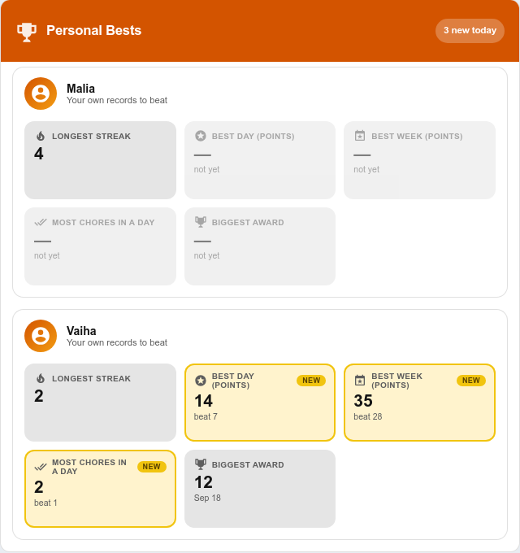

# Personal Bests

[Badges](Achievement-Badges.md) and [streak milestones](Bonus-Points.md) celebrate round numbers a parent chose. A **personal best** is the child's own bar: the most points they have ever earned in a day, their longest streak, their biggest single award. Beating one is celebrated whatever the number is, which is exactly what keeps a child who will never top the leaderboard trying.

> **New in v7.1.0**

Personal bests are always on. There is nothing to configure; the first chores set the baseline.

---

## The Records

| Record | Key | What counts |
|--------|-----|-------------|
| **Longest streak** | `longest_streak` | The child's longest run of consecutive days with a chore done. Seeded from the streak history TaskMate already kept, so nobody starts from zero |
| **Best day (points)** | `best_day_points` | Most points from approved chores in one day, bonus sub-tasks included |
| **Most chores in a day** | `best_day_chores` | Most approved chores in one day (bonus sub-tasks don't count as chores) |
| **Best week (points)** | `best_week_points` | Most points from approved chores in one Monday-to-Sunday week |
| **Biggest award** | `best_single_award` | The most points one approval ever paid, multipliers included |

Each record keeps the value and the day it was set.

---

## How Records Are Set

Records are checked after every approval. The **first** time a measure is seen it is stored quietly as the baseline — a child's first chore is not "five records at once". From then on, going past a stored value is a new personal best:

- the `taskmate_personal_best` event fires
- the **Personal best** notification goes out, if switched on
- a tier-2 [celebration](Celebrations.md) fires (`kind: personal_best`)
- the child's card shows **New personal best!** naming the record, with confetti the first time that device sees it
- the record glows as **New** on the Personal Bests card for the rest of the day

Ties never re-celebrate. A record only moves when the number is bigger.

### Undo and reject

When an approval is undone or rejected, the day (or week) it belonged to is recomputed. A record that no longer holds falls back to the best the kept completion history can show, and stops being "new today". Records older than the kept history are left alone. The longest-streak record never goes down, matching the rest of TaskMate's streak handling.

---

## The Personal Bests Card



```yaml
type: custom:taskmate-personal-bests-card
entity: sensor.taskmate_overview
child_id: a8c8376a            # optional — leave out to show every child
title: My records             # optional
header_color: "#d35400"
```

One tile per record with the value and the day it was set. A record beaten today is marked **New** and shows what it beat. A child with no records yet gets *No records yet — the first chores set the bar*. Available in every [design style](Card-Design-Styles.md).

| Option | Type | Default | Description |
| --- | --- | --- | --- |
| `entity` | string | **required** | The TaskMate overview sensor |
| `child_id` | string | _none_ | One child's board. Without it, every child gets a block |
| `title` | string | `"Personal Bests"` | Card title |
| `header_color` | string | `#d35400` | Header colour |
| `card_design` | string | global default | Design style |

### On the child card

The child card announces today's new records in a banner above the chores. Switch it off per card with `show_personal_bests: false`.

---

## Notification

| Type | Audience | Default |
|------|----------|---------|
| **Personal best** `personal_best` | Children and parents | Off |

> 🏆 New personal best! Malia: most Stars in a day — 35.

Turn it on under **TaskMate panel → Notifications**.

---

## Event

`taskmate_personal_best` fires with `child_id`, `child_name`, `record` (one of the keys above), `value`, `previous`, `date` and `timestamp`. It shows as **Personal best** on the child's [event entity](Event-Entities.md). The matching notification's bus event is `taskmate_personal_best_notification`.

---

## Sensors

Each child's entry in `sensor.taskmate_overview`'s `children` attribute carries `personal_bests` once there is a record: one object per record key with `value` and `date` (empty for a seeded streak), plus `previous` on a record beaten today and `new_today`, the list of record keys beaten today.

---

## Related

- [Celebrations](Celebrations.md)
- [Streak Freezes](Streak-Freezes.md) and [Bonus Points](Bonus-Points.md) — streak milestones
- [Achievement Badges](Achievement-Badges.md)
- [Insights](Insights.md)
