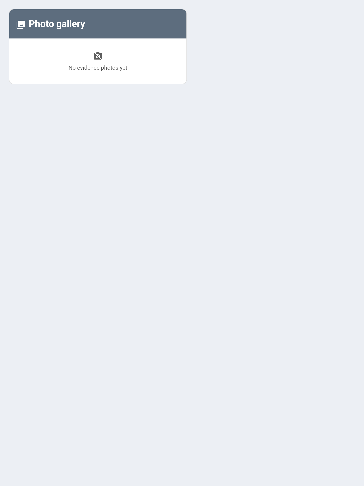

# Photo Proof

Photo proof lets a chore require evidence before it counts. When a chore has **Require photo proof** turned on, its completions always go through parent approval, and any photo attached to the completion is shown to the parent as a thumbnail in the approvals view.



---

## How It Works

```
Child completes chore (optionally with a photo) → Always pending → Parent reviews photo → Approve / Reject
```

- A chore with `require_photo` on **always** requires parent approval, even if **Requires Approval** is off. The evidence has to be reviewed before points are awarded.
- The exception is completing on behalf of a child — a parent using the `as_parent` flag (see [Chores](Chores.md#completing-on-behalf-of-a-child)) auto-approves as normal, since the parent is already the one acting.

---

## Turning It On

Enable **Require photo proof** in the chore dialog (add and edit) in the [Admin Panel](Admin-Panel.md). It is a simple on/off switch stored on the chore as `require_photo` (default off).

---

## Attaching a Photo

A photo is attached at completion time via the `photo_url` field on the `taskmate.complete_chore` service. The value is a URL or path to an image — for example a camera snapshot captured by a Home Assistant automation.

```yaml
service: taskmate.complete_chore
data:
  chore_id: b3f9a12c
  child_id: a8c8376a
  photo_url: /local/snapshots/dishwasher.jpg
```

| Field | Required | Description |
|-------|----------|-------------|
| `chore_id` | Yes | The chore being completed |
| `child_id` | Yes | The child completing it |
| `photo_url` | No | URL/path to an evidence image |

A common pattern is an automation that fires `camera.snapshot` to a file under `/config/www/` (served at `/local/...`), then calls `complete_chore` with that path as `photo_url`. The photo is optional even on a photo-required chore — the requirement forces *approval*, while the photo is the evidence the parent looks at when deciding.

---

## Where It's Stored

The photo path is saved on the completion record as `photo_url` and persists with the completion in storage. It is not copied or re-hosted — TaskMate stores the reference you pass in, so the underlying file must remain reachable for the thumbnail to load.

---

## Reviewing During Approval

A completion that carries a `photo_url` shows a small thumbnail next to the entry. Clicking it opens the full image in a new tab (a **View photo** link). Since v4.0.1 the thumbnail renders not only in the [Admin Panel](Admin-Panel.md) approvals list, but also on the [Approvals Card](Approvals-Card.md) and the [Parent Dashboard](Dashboard-Cards.md) card. The parent then approves or rejects as usual:

- **Approve** → points are awarded
- **Reject** → completion removed, no points

> **Note:** Browsers don't send the Home Assistant bearer token on a plain `` request, so the sensor **signs the photo URL** (appending an `authSig` token) before handing it to the cards. This lets the evidence image load directly in the Approvals and Parent Dashboard cards without any extra authentication.

---

## Browsing Past Photos — the Photo Gallery Card

To look back over evidence photos after they've been approved, add the **Photo Gallery Card** (`custom:taskmate-photo-gallery-card`). It shows a grid of thumbnails for every chore completion that carried a proof photo, each captioned with the child, the chore, and the date.

```yaml
type: custom:taskmate-photo-gallery-card
entity: sensor.taskmate_activity
title: Proof Photos          # optional — custom card title
max: 40                      # optional — limit the number of photos shown
header_color: "#5d6d7e"
```

- Tap a thumbnail to open the full image in a new tab.
- Completions still awaiting approval are marked **pending** in their caption.
- The grid is backed by the `photo_gallery` attribute on the activity sensor (`sensor.taskmate_activity`). As with the approvals views, each photo path is signed before display so the image loads without extra authentication.

See [Dashboard Cards](Dashboard-Cards.md) for the full list of TaskMate cards.

---

## The Photo Reaches the Approval Push

The submitted photo is attached to the approval notification, so a parent can see the work and approve from the lock screen.

**Only `mobile_app.*` notify services carry the image** — it rides in the companion app's push payload. A persistent notification or a third-party bridge gets the text message without the picture.

See [Notifications](Notifications.md#evidence-photos-in-the-approval-push).

## Related

- [Chores](Chores.md) — chore configuration, approvals, and completing on behalf
- [Approvals-Card](Approvals-Card.md) — where the thumbnail appears for review
- [Multi-Parent Approval Routing](Multi-Parent-Approval-Routing.md) — who receives the approval push
- [Services](Services.md) — full `complete_chore` reference
