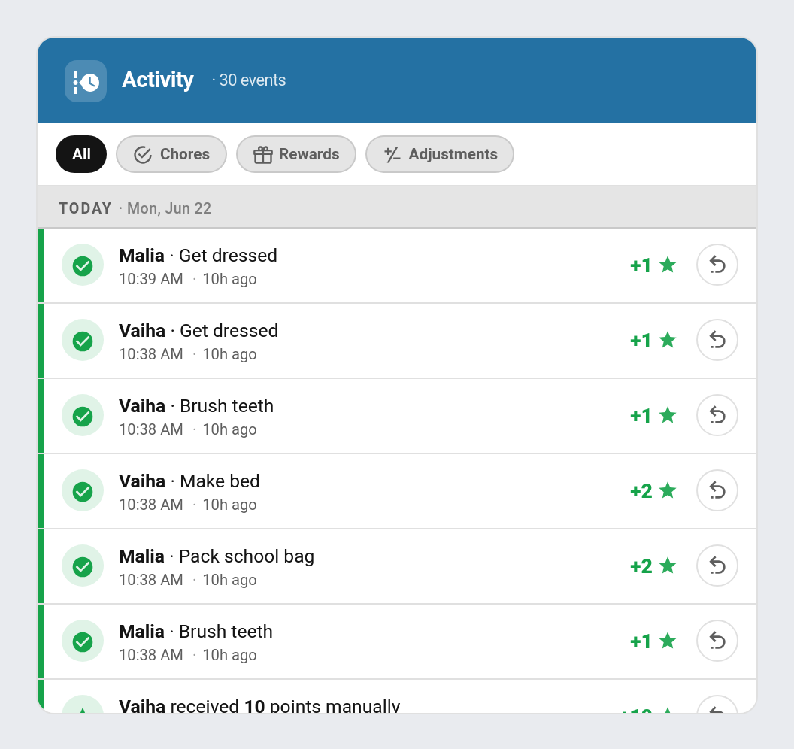

# Points Economy

TaskMate's points economy is more than chores in and rewards out. From v4.0.0 a set of **automatic point mechanics** run quietly in the background — paying interest on savings, optionally shrinking idle balances, and handing out the occasional surprise — plus a parent gate to reverse a mistake. This page is the hub for those mechanics.

All of these are **opt-in** and configured in the **TaskMate** panel → **Settings**, under the **History & streaks** section of the Admin Panel.

For the manual point-awarding systems (weekend multiplier, streaks, perfect week) see [Bonus Points](Bonus-Points.md). For child-to-child transfers see [Gifting Points](Gifting-Points.md).

---

## Savings Interest

Children earn interest on the points they have saved, rewarding patience over impulse spending. Interest is paid through the normal points path, so it also counts as earned points and feeds XP.

| Setting | Default | Range | Description |
|---------|---------|-------|-------------|
| **Savings interest** | `off` | on / off | Master toggle |
| **Interest rate** (`Interest %` field) | `5` | 0–100 | Percentage of the current balance paid as interest |
| **Period** (`Every`) | `weekly` | `weekly` / `monthly` | When interest is paid |

**How it works:**

- Paid on the period boundary — **weekly** pays every Monday, **monthly** pays on the 1st
- Each child earns `round(balance × rate ÷ 100)` points on their current spendable balance
- Children with a zero or negative balance, or whose interest rounds to 0, are skipped
- The credit is logged in the activity feed as `Savings interest (+N%)` and fires a `taskmate_interest_paid` event
- A guard stamp prevents paying twice on the same day

**Set the rate to `0` or leave the toggle off to disable.**

---

## Points Decay

The opposite lever to interest: idle balances slowly shrink, discouraging hoarding and keeping the economy moving. Decay only touches the **spendable balance** — it does **not** affect a child's career score or earned totals, so it is not a penalty.

| Setting | Default | Range | Description |
|---------|---------|-------|-------------|
| **Points decay** | `off` | on / off | Master toggle |
| **Decay %** | `10` | 0–100 | Percentage of the balance removed each period |
| **Every** | `monthly` | `weekly` / `monthly` | How often decay runs |

**How it works:**

- Runs on the period boundary — **weekly** on Mondays, **monthly** on the 1st
- Each child loses `round(balance × percent ÷ 100)` points; the balance never goes below 0
- Logged in the activity feed as `Points decay (-N%)` and fires a `taskmate_points_decay` event
- Children with a zero balance, or whose decay rounds to 0, are skipped
- A guard stamp prevents decaying twice on the same day

**Set the percentage to `0` or leave the toggle off to disable.**

---

## Surprise Bonus

A random daily chance for each child to receive a surprise points bonus — a small dose of unpredictability that keeps things fun.

| Setting | Default | Range | Description |
|---------|---------|-------|-------------|
| **Surprise bonuses** | `off` | on / off | Master toggle |
| **Chance %** | `15` | 0–100 | Per-child chance of a bonus each day |
| **Min pts** | `5` | ≥ 0 | Lower bound of the random award |
| **Max pts** | `20` | ≥ 0 | Upper bound of the random award |

**How it works:**

- Rolled once a day at **16:00**
- Each child is rolled independently against the chance percentage; on a hit they receive a random amount between Min and Max points
- If Min is greater than Max the two are swapped automatically
- Awarded through the normal points path, so it counts as earned and feeds XP
- Logged in the activity feed as a surprise bonus and fires a `taskmate_surprise_bonus` event

**Leave the toggle off to disable.** See also [Bonus Points](Bonus-Points.md).

---

## Negative Balances

By default a child's balance can never drop below zero: if a penalty or deduction is larger than what they hold, the balance simply floors at **0** and only the points they actually had are taken. This keeps things simple for younger children — you can't owe points.

| Setting | Default | Description |
|---------|---------|-------------|
| **Allow negative balance** | `off` | Let penalties take a child's balance below zero instead of stopping at zero |

Turn **Allow negative balance** (`allow_negative_balance`) on if you'd rather a deduction takes the **full** amount even when it pushes the balance into the negative — modelling a small "debt" the child has to earn back before they're spending again. With it on, a 30-point penalty on a child holding 20 points leaves them at **−10** rather than **0**.

This only changes how far a penalty can push the balance; everything else — career score, earned totals — is unaffected. The toggle lives alongside the other point mechanics in the Admin Panel settings.

---

## Per-Action Undo

Applied the wrong penalty, awarded a bonus to the wrong child, or approved a chore by mistake? From v4.1.0 the **Activity card** puts a per-row **Undo (↩)** button on every reversible event. Tapping it opens a confirm dialog before anything changes.



**What gets an Undo button:**

| Event | Undoable? |
|-------|-----------|
| Applied penalty (`Penalty: …`) | ✅ |
| Applied bonus (`Bonus: …`) | ✅ |
| Manual points add / remove | ✅ |
| Gift between children (both legs) | ✅ |
| Chore completion / approval | ✅ — undo returns it to **pending** |
| Weekend bonus | ❌ |
| Streak-milestone / perfect-week bonuses | ❌ |
| Pool allocations and refunds | ❌ |
| Points decay | ❌ |
| Savings interest | ❌ |
| Badge awards | ❌ |

Auto-derived events have no clean inverse, so undo is deliberately scoped to the discrete actions an admin (or child) took. The card's deny-list mirrors the backend, so the button simply never appears on a non-reversible row.

**Behind the button**, two services do the work:

- **Chore completions** call `taskmate.undo_chore_approval` with the `completion_id`. This removes the awarded points and returns the completion to **pending** so it can be approved again.
- **Point transactions** (penalties, bonuses, manual adjustments, gifts) call `taskmate.undo_transaction` with the `transaction_id`. This restores the child's balance by the exact amount, rolls back the matching counter — `total_penalties_received` for a penalty, `total_points_earned` for a bonus — recomputes the career score, and removes the original transaction from the activity log.

The action is **admin-gated** and recorded in the [Admin Audit Log](Admin-Audit-Log.md).

```yaml
# reverse a points transaction
service: taskmate.undo_transaction
data:
  transaction_id: <points-transaction id>

# revert a chore approval back to pending
service: taskmate.undo_chore_approval
data:
  completion_id: <chore-completion id>
```

See [Dashboard Cards](Dashboard-Cards.md) for the Activity card and [Services](Services.md) for full parameter details.

---

## Related

- [Bonus Points](Bonus-Points.md) — weekend multiplier, streak milestones, perfect week
- [Gifting Points](Gifting-Points.md) — child-to-child point transfers
- [Allowance](Allowance.md) — convert points into a real-money payout
- [Rewards](Rewards.md) — spending caps and reward stock
- [Settings](Settings.md) — full settings reference
- [Services](Services.md) — service-call reference
