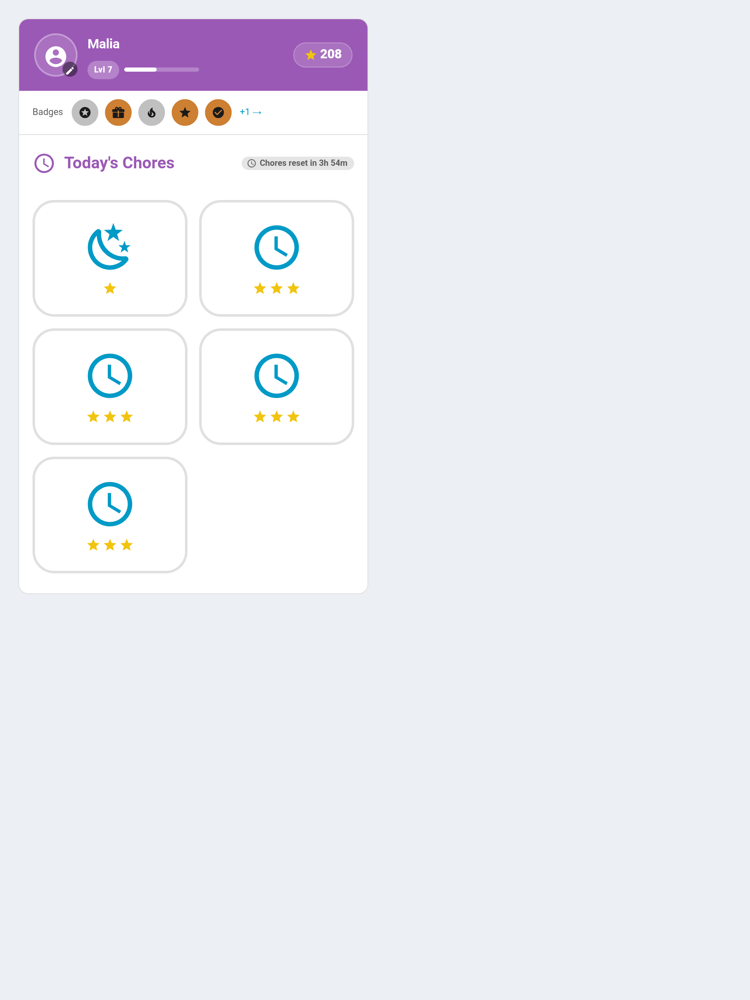

# Pre Reader Mode

A picture-only child card for children who can't read yet. No chore names, no numbers — a big icon, a row of stars for the points, and a huge tick when it's done.



---

## Turning It On

```yaml
type: custom:taskmate-child-card
entity: sensor.taskmate_overview
child_id: <child_id>
pre_reader: true
pre_reader_labels: false   # optional; adds the chore name back under each tile
pre_reader_points: false   # optional; shows the point value instead of the stars
```

It is a mode of the standard child card, not a separate card, so everything else about that card still applies.

---

## Key Points

- **Chores now have a picture.** Set one per chore in the panel, next to the description. Without one, a tile falls back to the time-of-day icon — fine for a single chore, useless for telling "brush teeth" from "get dressed". If you turn this mode on, set the pictures.
- **Points are shown as stars, not digits** — one to five, scaled from the chore's value. A four-year-old can count pictures long before they can read "15 points". Set `pre_reader_points: true` to show the number instead — see below.
- Tiles are at least **128 px** with a large tap target.
- **A done tile stays tappable**, so a mis-tap can be undone, exactly as on the standard card.
- **Opt-in.** An existing dashboard never turns itself into pictures, and names stay off unless you ask for them with `pre_reader_labels`.
- Works under **all six** [card design styles](Card-Design-Styles.md) — the tiles sit inside whichever design the card is using. Pairing it with **Accessible** is a sensible combination for a child who needs both.

---

## Showing the Point Value Instead

The star row is deliberately lossy: it rounds and clamps to one to five, so a
seven-point chore and an eight-point chore both draw four stars. That is the
point for a pre-reader, but it means the tile disagrees with the totals shown
everywhere else on the dashboard.

`pre_reader_points: true` replaces the stars with the value itself — `+7`,
drawn with your family's points icon:

```yaml
pre_reader: true
pre_reader_points: true
```

Use it for a child who has outgrown counting stars but still wants the big
pictures. It is off by default, so existing picture-mode dashboards keep their
stars.

---

## Adding Labels Back

`pre_reader_labels: true` puts the chore name back underneath each tile while keeping the big pictures and the reward row. This is the useful middle setting for a child who is *learning* to read — they get the picture to go on and the word to grow into.

---

## Related

- [Dashboard Cards](Dashboard-Cards.md) — every Lovelace card TaskMate ships
- [Routine Mode](Routine-Mode.md) — a guided one-task-at-a-time flow, which pairs well with this
- [Chores](Chores.md) — setting a chore's picture and icon
- [Card Design Styles](Card-Design-Styles.md) — including the Accessible style
