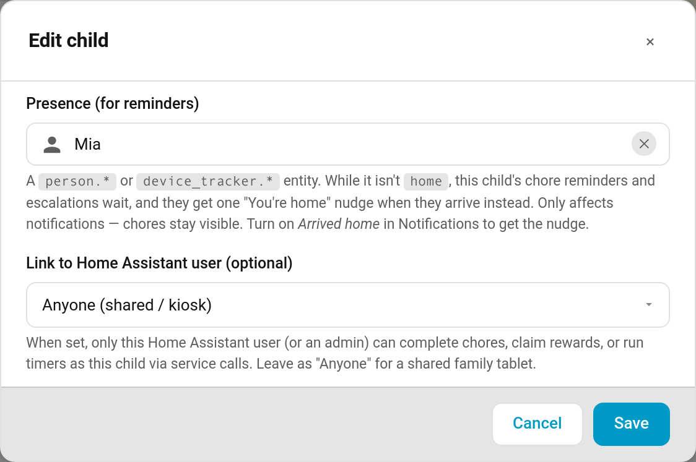

# Presence Aware Reminders

There's no point telling a child to tidy their room while they're at football practice. Link a child to their phone or person entity and TaskMate **holds their reminders while they're out**, then sends a single friendly nudge when they get home:

> 🏠 You're home, Mia — 3 chores left today.

> **New in v6.0.0**

---

## Setting It Up

### 1. Link the child to a presence entity

**TaskMate panel → Children → Edit → Presence (for reminders)**

Pick a `person.*` or `device_tracker.*` entity, usually the person entity for the child's phone. Leave it empty and nothing changes for that child.

### 2. Turn on the "Arrived home" notification

**TaskMate panel → Notifications → Arrived home**

This is the nudge a child gets when they arrive. It's off by default. Its row has an **Only after being away for** box (default **30** minutes), so popping to the shop next door doesn't trigger a message.

Holding reminders back works as soon as the presence entity is set. The Arrived home nudge is optional.

---

## While the Child Is Away

The child counts as away whenever the entity's state is anything other than `home`, for example `not_home` or the name of a zone like `School`.

| Notification | While away |
|--------------|------------|
| Bedtime reminder | Held |
| Streak at risk | Held |
| [Mandatory chore](Mandatory-Chores.md) reminders | Held |
| Custom reminders addressed to that child | Held |
| Good news (badges, level-ups, celebrations, all done) | **Always sent** |

Held reminders are **not** replayed later. They're folded into the one Arrived home message instead, so the child doesn't come home to a backlog of pings.

### Mandatory chore escalation

The child's reminder stages still move forward while they're out (and are held), but the **parent alert waits**. The escalation stops before the parent stage until the child is home, then carries on normally. You won't be told a chore was missed just because your child was out when it came due. See [Reminder Escalation](Reminder-Escalation.md).

---

## When the Child Gets Home

One Arrived home nudge is sent if **either** of these is true:

- They were away for at least the **Only after being away for** time (default 30 minutes), **or**
- At least one reminder was held while they were out, however short the trip.

No nudge is sent if they have no chores left to do. The count uses the same list the child card shows.

[Quiet hours](Quiet-Hours.md) still apply. An arrival during quiet hours sends nothing.

---

## A Broken Tracker Never Silences Reminders

If the presence entity is `unavailable` or `unknown`, TaskMate treats the child as **home**. A phone with a flat battery or a tracker that's dropped off the network never switches reminders off. GPS jitter while the child is at home can't send a second nudge either.

---

## Presence vs. Availability

Presence **only affects notifications**. The child's chores stay visible on their card while they're out, so they can still tick things off from wherever they are.

If you want chores themselves to disappear while a child is away (at their other parent's house, for example), use the **Availability sensor** on the child instead. See [Vacation Mode](Vacation-Mode.md) and [Children](Children.md).

---

## Related

- [Notifications](Notifications.md) — notification types and routing
- [Reminder Escalation](Reminder-Escalation.md) — the mandatory-chore reminder ladder
- [Quiet Hours](Quiet-Hours.md) — times when nothing is sent
- [Children](Children.md) — editing a child
