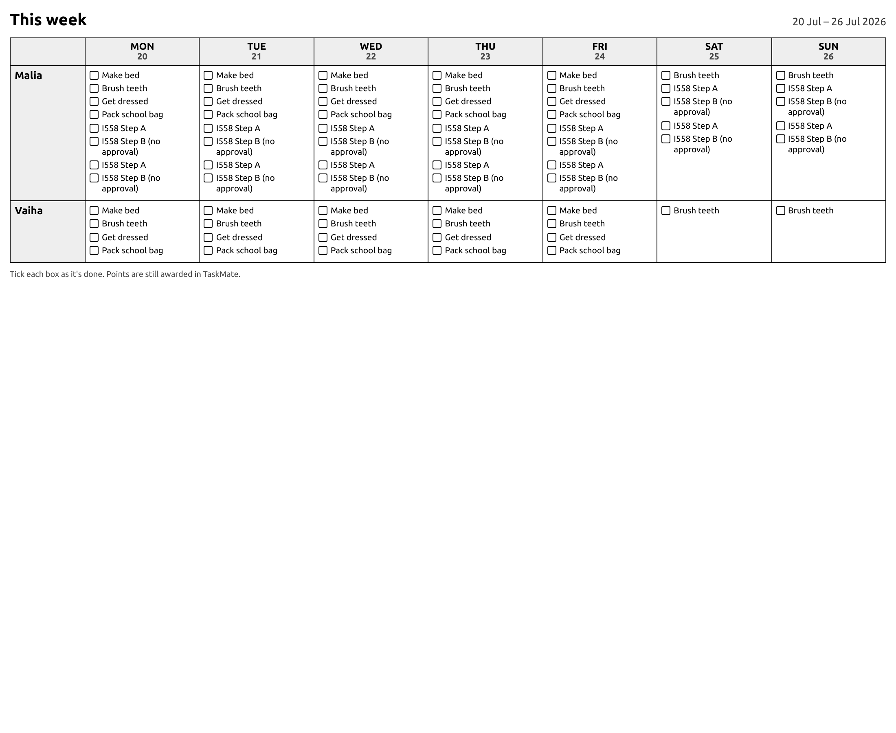

# Printable Weekly Chart

A fridge-ready A4 chore chart with a box to tick against every task. For the households where the paper chart on the fridge was never really the problem — the tracking was.

`taskmate/print/weekly_chart` returns a **standalone HTML page**. Open it in a tab and print. There are no external assets, so it prints identically offline.

---

## Options

| Option | Values |
|--------|--------|
| `orientation` | `portrait` *(default)* or `landscape` |
| `week_start` | An ISO date anywhere in the week you want. Defaults to this week. |
| `title` | Heading text. Defaults to "This week". |

Orientation is **your choice, not a guess**: two children with short names fit portrait comfortably, five need the width.

---

## Key Points

- **Schedule only.** A paper chart can't know next Thursday's weather, so entity-driven gates aren't applied. A chart that quietly omitted a chore would be worse than one that lists a chore you end up not needing.
- **Chores with no assignee appear for every child**; assigned ones only for theirs.
- **Children with nothing assigned are left off entirely** rather than printing an empty row.
- Chore names are HTML-escaped — they are user input landing in a document.

---

## Points Still Count in TaskMate

The chart is a paper mirror, not a replacement. Ticking a box on the fridge doesn't award points; the chore still gets completed in TaskMate as usual. The footer on the printout says so, so a child doesn't think the paper is the system.

---

## Related

- [Admin Panel](Admin-Panel.md) — where the chart is generated
- [Chore Scheduling](Chore-Scheduling.md) — what determines which chores land on which day
- [Weather-Aware Chores](Weather-Aware-Chores.md) — deliberately not applied to the printout
- [Pre-Reader Mode](Pre-Reader-Mode.md) — the on-screen equivalent for a child who can't read
