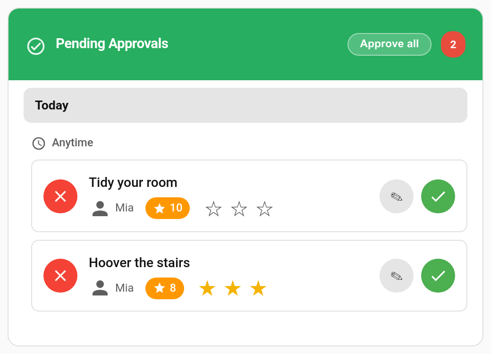

# Quality Ratings

Not every "done" is equal. A bedroom that's genuinely spotless deserves more than one where everything was shoved under the bed. With **quality ratings** on, you give each approved chore **1 to 3 stars**, and the points scale with the rating.



> **New in v6.0.0**

---

## How It Works

When you approve a chore, pick a rating first:

| Rating | Pays (default) |
|--------|----------------|
| ★ | 75% of the points |
| ★★ | 100% of the points |
| ★★★ | 125% of the points |
| *No rating* | 100%, the same as before |

Picking a star is only a selection. Tap **Approve** to pay it. Tap the same star again to clear it.

Because an unrated approval pays 100%, turning the feature on changes nothing until you actually pick a star.

---

## Turning It On

**TaskMate panel → Settings → History & streaks**

| Setting | Default | Description |
|---------|---------|-------------|
| **Quality ratings** | Off | Show the star picker when approving chores. |
| **Star multipliers** | `0.75` / `1.0` / `1.25` | What each rating pays, as a multiple of the chore's normal points. |

---

## Where You Can Rate

- **[Approvals card](Approvals-Card.md)**: a star picker on every pending chore, in every card design, and in the review sheet.
- **TaskMate panel**: the same picker in the approval queue.
- **Phone approval notification**: with ratings on, a chore approval push offers **★**, **★★**, **★★★** and **Reject** instead of Approve and Reject. Android shows three actions at most, so the ratings come first there.

Reward claims are never rated.

---

## How the Points Are Worked Out

The rating scales the chore's **base points**, the amount the child was promised when they submitted it. Streak and weekend bonuses are then added on top as usual. The result is rounded to the nearest whole point.

**Example:** a 10-point chore rated ★★★ with the default multipliers pays 12.5, rounded to **13** before any streak or weekend bonus.

### Changing the award by hand

If you type a different number of points in the approvals card's review sheet, that exact number is paid and the rating is only recorded. Picking a star in the review sheet updates the points box first, so the number you confirm is always the rated one.

### Undo and reject

Undoing or rejecting a rated chore takes back exactly what the rating paid. Undo also clears the rating, so a re-approval is rated fresh.

---

## Seeing the Ratings

- The **[Activity card](Dashboard-Cards.md)** shows the stars on rated completions.
- **TaskMate panel → Insights → Quality** shows the average rating overall, per child and per chore, with a breakdown of how many of each star were given. Unrated approvals are left out of the averages rather than counted as ★★. See [Insights](Insights.md).

---

## Services

`taskmate.approve_chore` and `taskmate.approve_all_chores` take an optional `rating` from `1` to `3`:

```yaml
action: taskmate.approve_chore
data:
  completion_id: f5548687
  rating: 3
```

With quality ratings switched off, the `rating` field is ignored.

The `taskmate_chore_approved` event includes `quality_rating` when a rating was given.

---

## Tips

- **Explain the stars to your children first.** "Three stars means I didn't have to check anything."
- **Keep ★ for "done, but not properly".** For "not done at all", reject it with a reason instead. See [Reject Reasons](Reject-Reasons.md).
- **Adjust the multipliers** if 75% feels too harsh. `0.9` / `1.0` / `1.25` keeps the incentive while softening the downside.

---

## Related

- [Approvals Card](Approvals-Card.md) — approving chores from a dashboard
- [Reject Reasons](Reject-Reasons.md) — telling a child why a chore was sent back
- [Insights](Insights.md) — the Quality view
- [Points Economy](Points-Economy.md) — how points are calculated
