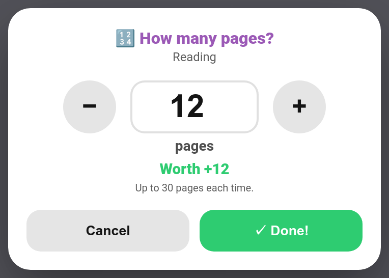
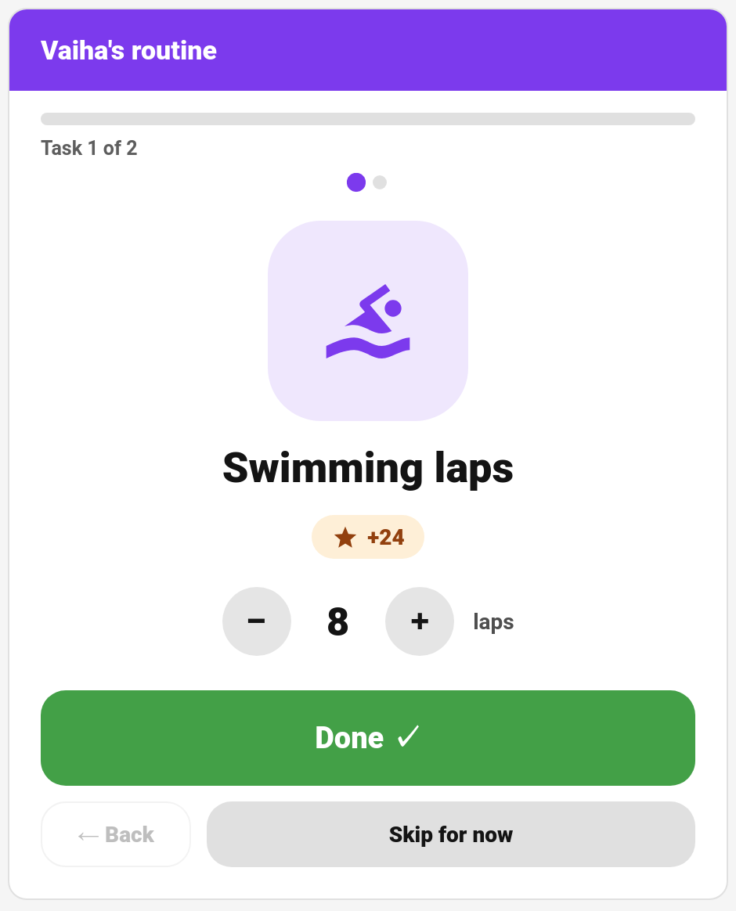

# Quantity Chores

Some jobs come in amounts, not just "done": read 20 pages, swim 10 lengths, practise for 15 minutes. A **quantity chore** asks the child how many they did, and pays the chore's points **per unit**. Reading 12 pages of a 1-point-per-page chore earns 12.



> **New in v7.0.0**

---

## Setting Up a Quantity Chore

**TaskMate panel → Chores → edit a chore**


| Field | Default | Description |
|-------|---------|-------------|
| **Count in (unit)** | empty | The unit, e.g. `pages`, `laps`, `minutes` (up to 30 characters). Setting it turns the chore into a quantity chore, and **Points** become points per unit. Leave it empty for an ordinary chore |
| **Most per go** | `0` | The most one completion can count (up to 10,000). 0 = no cap, and then every completion needs a parent's approval |

Quantity doesn't apply to [open-ended](Open-Ended-Chores.md) or [timed](Timed-Tasks.md) chores: those already have their own way of setting the points, so the unit is ignored on them.

These fields are set in the panel; the `add_chore` and `update_chore` services don't take them.

---

## How Points Are Worked Out

The chore's points are multiplied by the number of units, and the usual adjustments then apply as for any chore, such as the [difficulty](Difficulty-Tiers.md) multiplier and early or late timing.

| Chore | Points | Child says | Earns |
|-------|--------|-----------|-------|
| Reading (pages, max 30) | 1 | 12 pages | 12 |
| Swimming laps (laps, max 20) | 3 | 8 laps | 24 |
| Piano practice (minutes, no cap) | 1 | 25 minutes | 25, after a parent approves |

A number over **Most per go** is capped to it.

---

## Completing One

### On the child card

The chore shows a **🔢 pages: +1 each** tag. Tapping it opens the sheet above: a big number with **−** / **+** (or type it), the unit, what it's worth ("Worth +12") and the limit. **Done!** sends it.

### On the routine card

The [routine card](Routine-Mode.md) shows a **−** / **+** stepper with the unit under the chore, and the points update as the child counts. **Done** sends the number.



### Everywhere else

A tile or a single tap can't ask "how many?", so these leave quantity chores to the child card:

- the [kiosk card](Kiosk-Mode.md) marks them to be finished on the child's own card
- the [chore board](Dashboard-Cards.md) shows them but doesn't tick them off
- the [sticker chart](Sticker-Chart-Card.md) leaves them off
- [watch complications](Watch-Complications.md) and [voice commands](Voice-Assistants.md) point the child to their card

A child can't complete a quantity chore without saying how many: TaskMate refuses it ("Say how many pages you did."), however the completion arrives. A parent ticking it off without a number counts it as 1.

---

## Approval

A quantity chore follows the chore's normal approval setting, with one rule on top: **a chore with no cap (Most per go = 0) always goes to a parent for approval** when a child does it, because the child chose the number. Set a cap if you're happy for it to approve itself.

Approvers see the amount on every completion: **🔢 12 pages** on the [Approvals card](Approvals-Card.md) and the parent dashboard card, and the points shown are the total.

---

## Service

`taskmate.complete_chore` takes an optional `quantity` (0–10,000): how many units were done. It's required from a child on a quantity chore.

```yaml
action: taskmate.complete_chore
data:
  chore_id: 3648f6de211f44a7
  child_id: 8e16ad66b23f404e
  quantity: 12
```

In the chores sensor a quantity chore carries `quantity_unit` and, if set, `quantity_max`; completions carry `quantity`.

---

## Related

- [Chores](Chores.md) — every chore field
- [Open-Ended Chores](Open-Ended-Chores.md) — the child describes the job and suggests a price
- [Timed Tasks](Timed-Tasks.md) — points by the minute with a real timer
- [Estimated Minutes](Estimated-Minutes.md) — how long a chore takes
