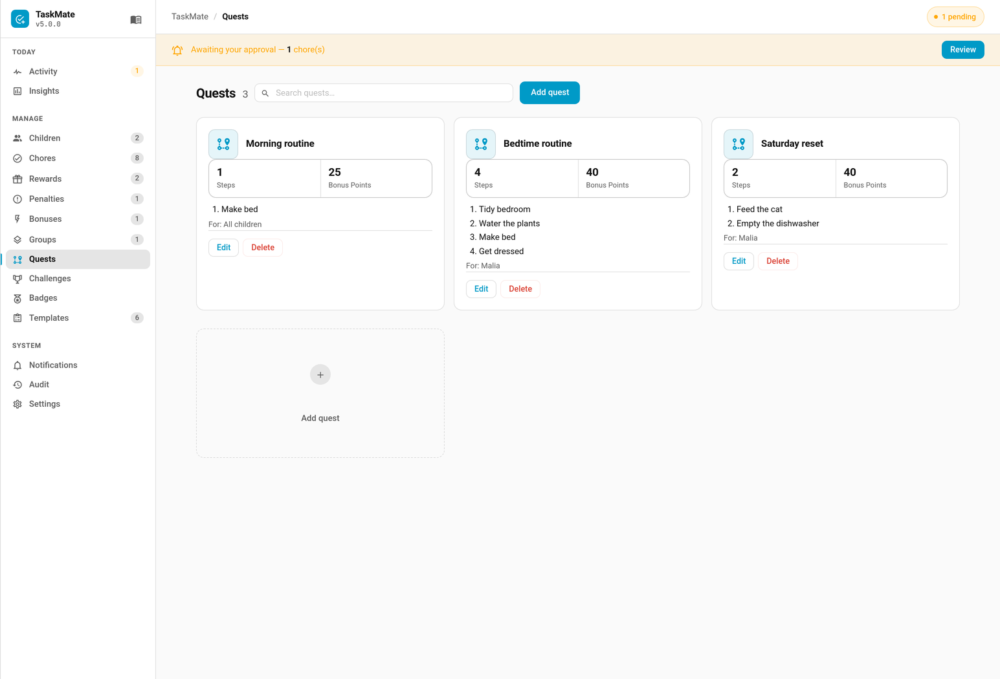

# Quests

A quest is a chore chain — an ordered sequence of existing chores that a child works through one step at a time. Finishing the whole chain awards a bonus. Quests are great for routines you want done in order, like a full bedtime or morning sequence.



---

## How It Works

A quest is built from chores you've already created. Each child has their own progress through the chain:

```
Step 1 chore approved → Step 2 unlocks → … → Final step approved → Bonus awarded
```

- A child advances **one step** each time the chore at their **current step** is completed and approved
- Only the chore matching the current step advances the quest — completing a later chore early does nothing for the quest
- Bonus sub-task completions don't count toward quest steps
- Finishing the final step awards the quest's **bonus points**, fires a `taskmate_quest_completed` event, and triggers an epic [celebration](Celebrations.md)

> Quests are built from existing chores, so create your chores first. See [Chores](Chores.md).

---

## Creating a Quest

Quests are managed in the **Admin Panel → Quests** tab (TaskMate's sidebar panel). There's no Settings config flow for quests — add, edit, and delete them from the panel.

| Field | Default | Description |
|-------|---------|-------------|
| **Name** | — | Display name of the quest (required) |
| **Description** | `""` | Optional description |
| **Icon** | `mdi:map-marker-path` | MDI icon |
| **Steps** | none | Ordered list of chore IDs — at least one required |
| **Bonus points** | `25` | Points awarded on completing the whole chain |
| **Assign to** | all children | Which children the quest applies to — leave empty for all |
| **Repeatable** | `false` | When finished, progress resets so the child can run it again |
| **Active** | `true` | Inactive quests don't track progress or award bonuses |

In the quest dialog you tap chores to add them as steps, then use the ▲▼ controls to put them in the order they should be done.

### Repeatable vs one-shot

- **Repeatable on** — when a child finishes the chain, their progress resets to step 0 and they can run it again (the `times_completed` count keeps climbing)
- **Repeatable off** — once finished, the quest stays complete for that child and won't re-trigger

---

## Sensor Attributes

Each child's entry in the `sensor.taskmate_overview` `children` attribute carries a `quests` array. Each item describes that child's progress through one active quest assigned to them:

| Field | Description |
|-------|-------------|
| `quest_id` | The quest's ID |
| `name` | Quest name |
| `icon` | Quest icon |
| `total_steps` | Number of steps in the chain |
| `step` | Steps completed so far (capped at `total_steps`) |
| `done` | `true` once the final step is complete (non-repeatable) |
| `times_completed` | How many times this child has finished the chain |
| `bonus_points` | The bonus awarded on completion |
| `next_chore_id` | The chore ID the child needs to do next (empty when done) |

Only **active** quests assigned to the child appear in the array.

---

## Completion & Rewards

When a child finishes the final step:

- The **bonus points** are credited to their balance and logged as a `Quest complete: <name>` transaction
- The bonus counts as earned points, so it also feeds the child's [XP and level](Levels-and-XP.md)
- A `taskmate_quest_completed` event fires with `child_id`, `child_name`, `quest_id`, `quest_name`, `bonus`, and `timestamp`
- An epic [celebration](Celebrations.md) is triggered

---

## Automation Example

### Announce a completed quest

```yaml
alias: Announce quest completed
triggers:
  - trigger: event
    event_type: taskmate_quest_completed
actions:
  - action: notify.family
    data:
      message: >
        {{ trigger.event.data.child_name }} completed the quest
        "{{ trigger.event.data.quest_name }}" (+{{ trigger.event.data.bonus }})!
```

---

## Related

- [Chores](Chores.md) — quests are chains of existing chores
- [Challenges](Challenges.md) — time-boxed targets that refresh each period
- [Levels and XP](Levels-and-XP.md) — quest bonuses feed XP
- [Celebrations](Celebrations.md) — the epic moment fired on quest completion
- [Admin Panel](Admin-Panel.md) — where quests are created and managed
