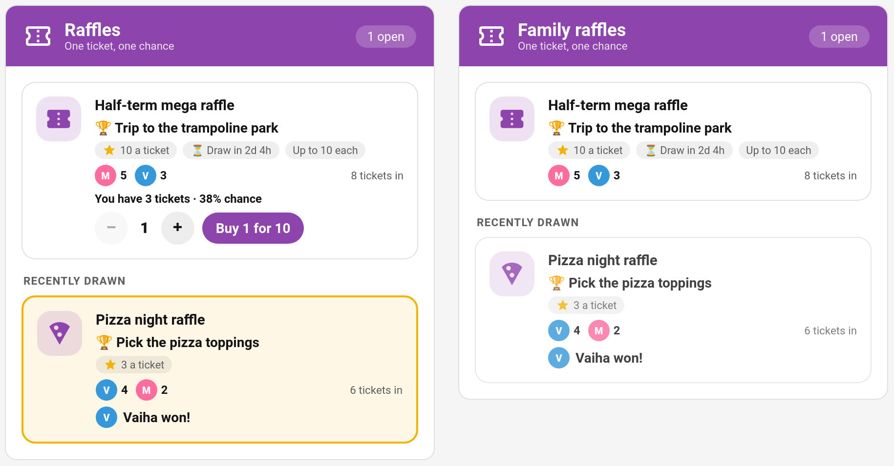
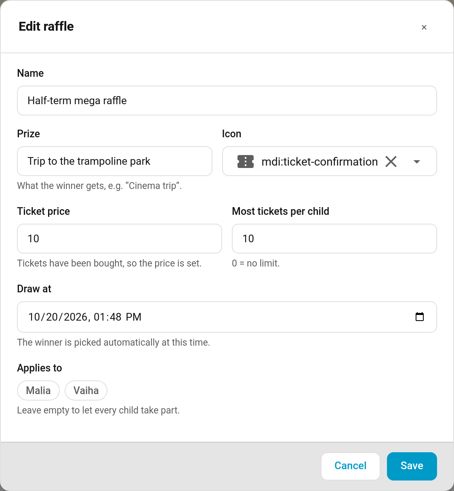
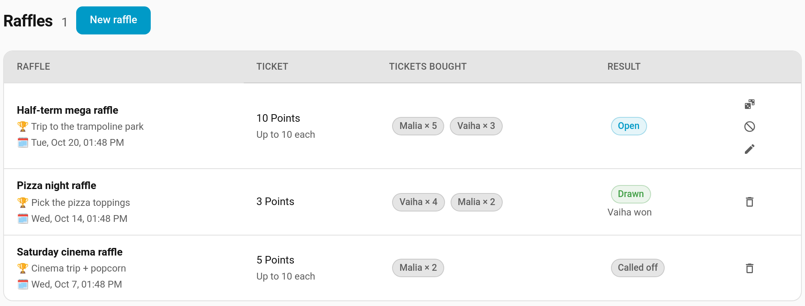
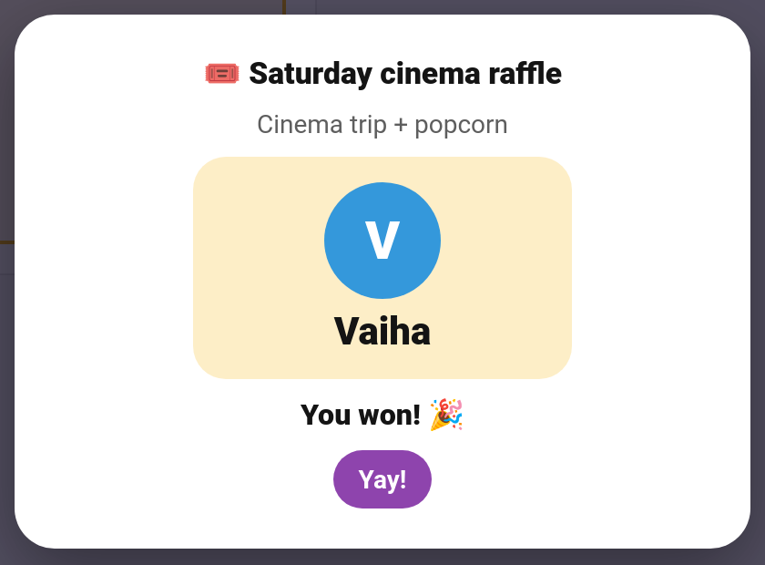
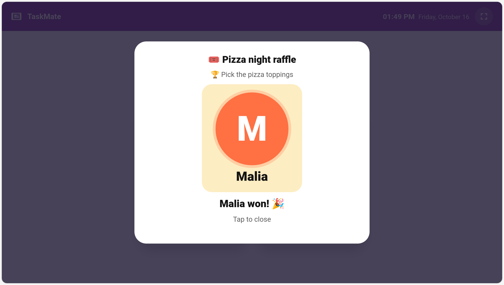

# Raffles

Some prizes are too big to price as a reward: a trip to the trampoline park, a new game, choosing the takeaway. Put one up as a **raffle** instead. Children spend points on tickets, each ticket is one chance, and at the draw time one ticket is picked at random. The more tickets a child holds, the better their odds, but anyone with a ticket can win.



> **New in v7.0.0**

---

## How It Works

1. **You set up a raffle** in the TaskMate panel: a prize, a fixed ticket price, an optional limit per child, and when it is drawn.
2. **Children buy tickets** with their points on the Raffles card, as many as they like up to the limit.
3. **At the draw time** TaskMate picks the winner. The chance of winning is weighted by tickets: a child holding 3 of 8 tickets has a 3 in 8 chance.
4. **The winner is revealed** with a spinning draw on the Raffles card and the [kiosk](Kiosk-Mode.md), and the *Raffle drawn* notification goes out.
5. **You hand over the prize.** The raffle doesn't pay any points; the prize is whatever you promised.

Ticket prices never change once a raffle is open. There's no dynamic pricing: a ticket costs the same for the last buyer as for the first.

---

## Setting Up a Raffle

**TaskMate panel → Raffles → New raffle**



| Field | Default | Description |
|-------|---------|-------------|
| **Name** | — | What the raffle is called, e.g. "Half-term mega raffle" |
| **Prize** | — | What the winner gets, e.g. "Cinema trip" |
| **Icon** | ticket | Any MDI icon |
| **Ticket price** | — | Points per ticket (1–100,000). Fixed for the whole raffle: once anyone has bought a ticket the price can't change |
| **Most tickets per child** | 0 | 0 = no limit. Otherwise up to 100 |
| **Draw at** | — | When the winner is picked. Must be in the future |
| **Applies to** | everyone | Which children can take part. Leave empty for every child |

A raffle can be edited while it is open (apart from the price once tickets are sold). Drawn and called-off raffles can't be changed.

---

## The Raffles Page



The **Raffles** page (under **Spend**) lists every raffle with its ticket price, who has bought how many tickets, and the result. Open raffles have three actions:

| Action | What it does |
|--------|--------------|
| **Draw now** | Picks the winner straight away instead of waiting for the draw time |
| **Call off** | Cancels the raffle and refunds every ticket in full |
| **Edit** | Opens the raffle editor |

Drawn and called-off raffles can be deleted. Deleting an open raffle that has tickets calls it off (and refunds everyone) first.

---

## Buying Tickets

On the Raffles card, a child picks how many tickets with **−** / **+** and taps **Buy 3 for 30**. The card shows how many tickets they hold and their chance of winning ("You have 3 tickets · 38% chance").

- Tickets can only be bought while the raffle is open and before its draw time.
- A child can't go over the raffle's ticket limit ("That's your lot").
- Points already promised to a reward waiting for approval can't be spent on tickets.
- Each purchase is a normal points transaction ("Raffle tickets ×3: Half-term mega raffle") in the child's history.

---

## The Draw

At the draw time (checked once a minute), or when you tap **Draw now**:

- One ticket is picked at random. Every ticket has the same chance, so a child's odds are their share of all the tickets sold.
- A raffle nobody entered closes with no winner ("Nobody entered").
- Called-off raffles refund every ticket: "Raffle called off: Half-term mega raffle" appears in each child's history.

Drawn and called-off raffles stay on the cards under **Recently drawn** for 24 hours, then leave the cards. They stay in the panel's list.

### The reveal

When a raffle has just been drawn, the Raffles card plays the draw: the names spin through, one for each ticket so the odds show, slow down and land on the winner. The winning child's own card says **You won! 🎉**.



Each device plays a draw once, and only in the first few minutes after it.

### On the wall tablet

The [kiosk card](Kiosk-Mode.md#raffle-draws) spins the draw full-screen too, so the whole family can watch. It's on by default; turn off **Show raffle draws** in the kiosk card editor (`show_raffle_draws: false`) to skip it. When the kiosk sits idle in ambient mode showing the family's day, open raffles are listed there too.



---

## The Raffles Card

**Edit dashboard → + Add Card → TaskMate Raffles**

```yaml
type: custom:taskmate-raffle-card
entity: sensor.taskmate_overview
child_id: 8e16ad66b23f404e   # leave out for the family view
```

| Option | Type | Default | Description |
|--------|------|---------|-------------|
| `entity` | string | **required** | The TaskMate overview sensor |
| `child_id` | string | everyone | The child who buys tickets on this card. Leave it out (**Everyone** in the editor) for a family view on a shared screen: everyone's tickets, no buying |
| `title` | string | `Raffles` | Card title |
| `show_reveal` | boolean | `true` | Play the spinning draw when a raffle is drawn |
| `card_design` | string | global default | `classic`, `playroom`, `console`, `cleanpro`, `accessible` or `graphite` |
| `header_color` | string | `#8e44ad` | Header banner colour |

A child's card only lists raffles open to that child.

---

## Notification and Events

The **Raffle drawn** notification (off by default; switch it on under **Notifications**) announces the result: "🎟️ Half-term mega raffle: Vaiha won! (8 tickets in the draw)".

| Event | When | Data |
|-------|------|------|
| `taskmate_raffle_drawn` | A raffle is drawn (fires even with the notification off) | `raffle_id`, `raffle_name`, `prize`, `winner_id`, `winner_name`, `tickets` (total sold) |
| `taskmate_raffle_won` | A child wins | `child_id`, `child_name`, `raffle_id`, `raffle_name`, `prize`, `tickets` (the winner's) |

On the [event entities](Event-Entities.md), the draw shows as **Raffle drawn** on the family entity and the win as **Raffle won** on the winner's entity.

---

## Services

| Service | Who | Description |
|---------|-----|-------------|
| `taskmate.buy_raffle_tickets` | Child | Spend points on tickets: `raffle_id`, `child_id`, `tickets` (1–100) |
| `taskmate.draw_raffle` | Parent | Draw a raffle now: `raffle_id` |

Raffles are created, edited and called off in the panel. Open raffles, and ones drawn in the last day, are published as the `raffles` attribute of `sensor.taskmate_rewards`.

---

## Ideas

| Raffle | Ticket price | Limit |
|--------|-------------|-------|
| Trip to the trampoline park | 10 | 10 each |
| Pick the takeaway on Friday | 3 | none |
| Stay up an hour late on Saturday | 5 | 5 each |
| A new book of their choice | 8 | none |

---

## Related

- [Rewards](Rewards.md) — fixed-price rewards children claim directly
- [Pool Mode (Savings Jars)](Pool-Mode-(Savings-Jars).md) — saving up together for something big
- [Kiosk Mode](Kiosk-Mode.md) — the draw on the shared wall tablet
- [Notifications](Notifications.md) — switching on Raffle drawn
- [Event Entities](Event-Entities.md) — automating on a draw
