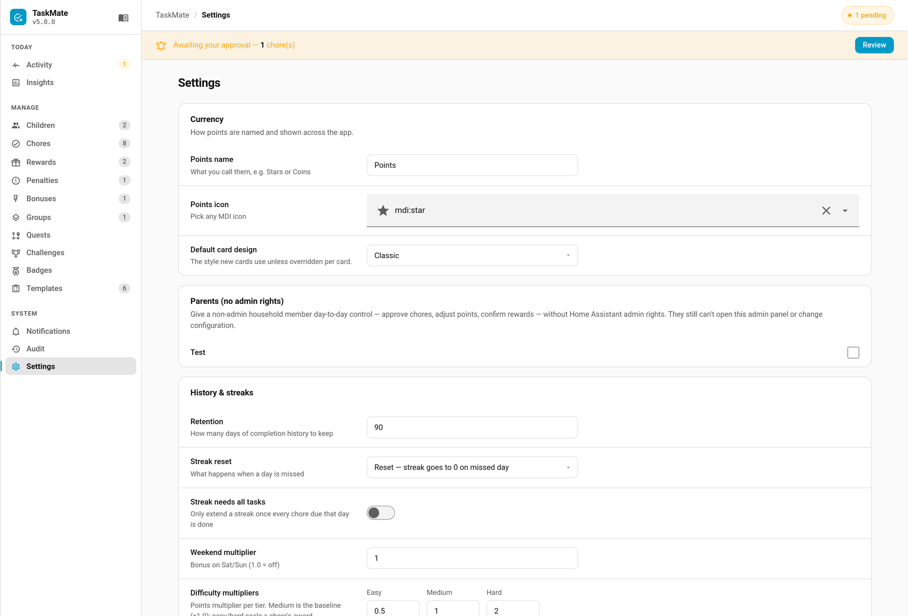

# Read Aloud

Speak a child's outstanding chores to a media player — *"Ella, you have three things left: make your bed, brush your teeth and pack your bag."*



Useful on a kitchen speaker at the point in the morning when nobody is looking at a screen.

---

## Calling It

```yaml
action: taskmate.read_aloud
data:
  child_id: <child_id>
  media_player: media_player.kitchen   # optional; falls back to the Settings default
  tts_entity: tts.piper                # optional; falls back to Settings, then the only one installed
  message: "Dinner is ready"           # optional; says this instead of the chore summary
```

| Field | Effect |
|-------|--------|
| `child_id` | Whose chores to read |
| `media_player` | Where to speak. Falls back to the default in Settings. |
| `tts_entity` | Which TTS engine. Falls back to Settings, then to the only one installed if there is just one. |
| `message` | Speak this instead of the generated summary. |

---

## Wording

The sentence comes from **parent-editable templates in Settings**, not from TaskMate's translations. The frontend locales don't reach the backend, and a family may well want phrasing that isn't one of the eight shipped languages — or simply their own turn of phrase.

| Setting | Default | Placeholders |
|---------|---------|--------------|
| `read_aloud_template` | `{name}, you have {count} things left: {chores}.` | `{name}` `{count}` `{chores}` |
| `read_aloud_one_template` | `{name}, you have one thing left: {chores}.` | same |
| `read_aloud_done_template` | `{name}, you're all done. Nice one!` | same |
| `read_aloud_joiner` | `and` | joins the last two chores |

A template with a bad placeholder **logs a warning and falls back to the built-in wording** rather than silencing the feature. A typo in a sentence should not mean the speaker goes quiet with no explanation.

---

## Events

Fires `taskmate_read_aloud` with `child_id`, `media_player`, `tts_entity` and `message`.

---

## Example Automation

Read the morning list at 07:45 on school days:

```yaml
triggers:
  - trigger: time
    at: "07:45:00"
conditions:
  - condition: time
    weekday: [mon, tue, wed, thu, fri]
actions:
  - action: taskmate.read_aloud
    data:
      child_id: <child_id>
      media_player: media_player.kitchen
```

---

## Related

- [Services](Services.md) — the full `taskmate.read_aloud` signature
- [Voice Assistants](Voice-Assistants.md) — asking Assist about chores and points
- [Settings](Settings.md) — the templates, default media player and TTS entity
- [Notifications](Notifications.md) — the push side of the same job
- [Localization](Localization.md) — why these templates are editable rather than translated
