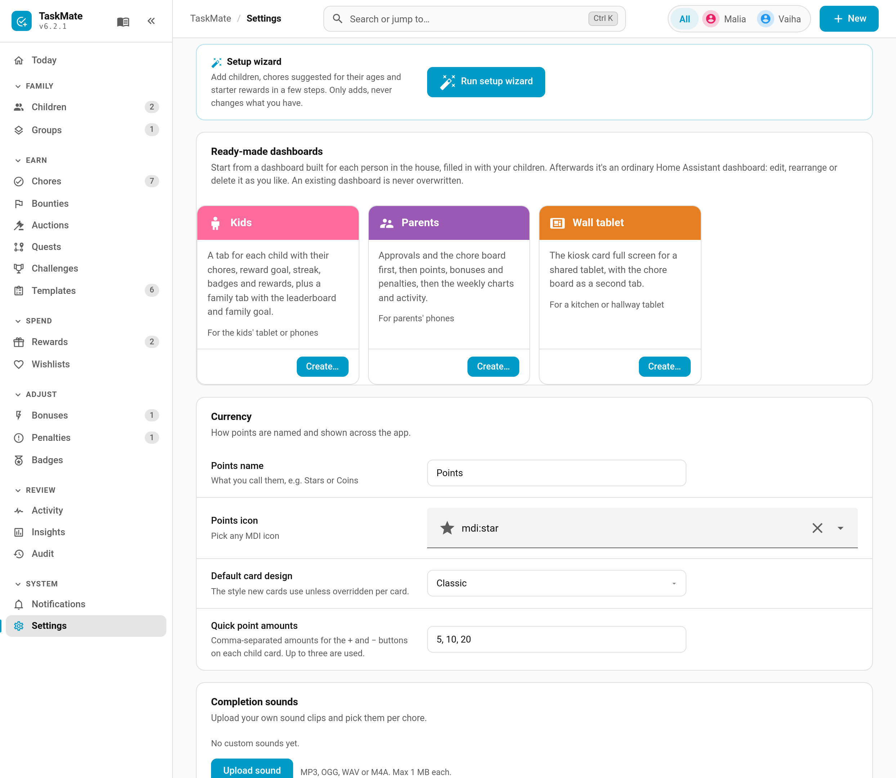
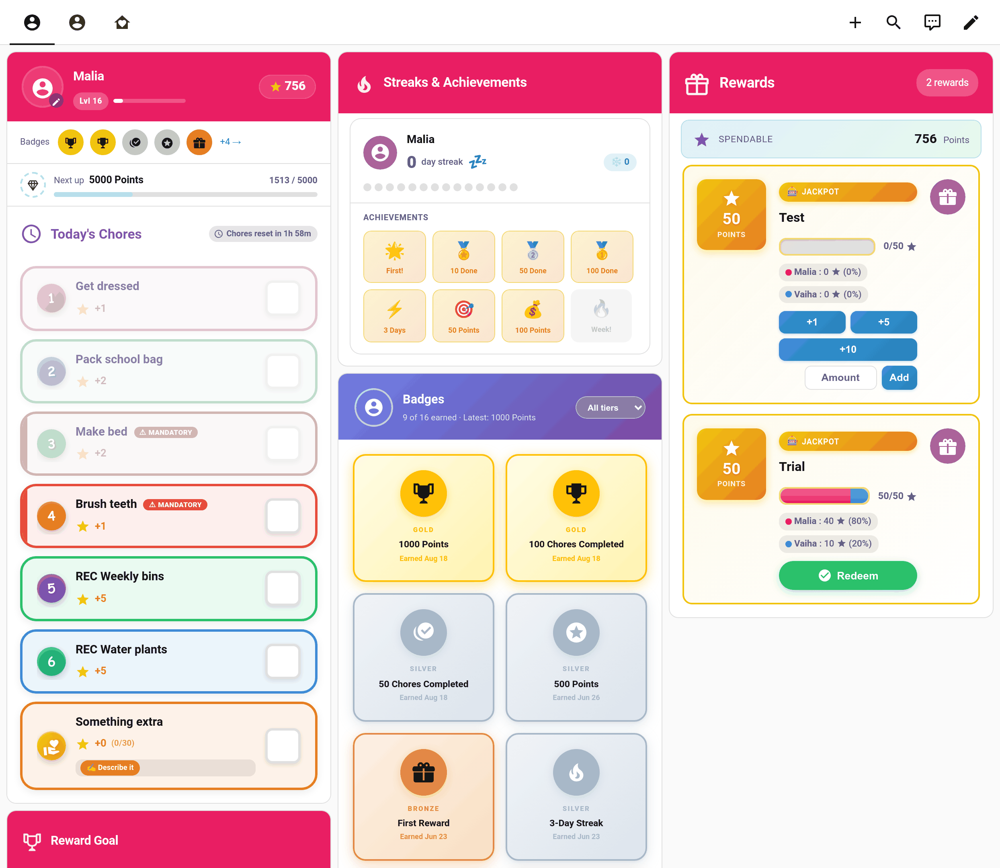
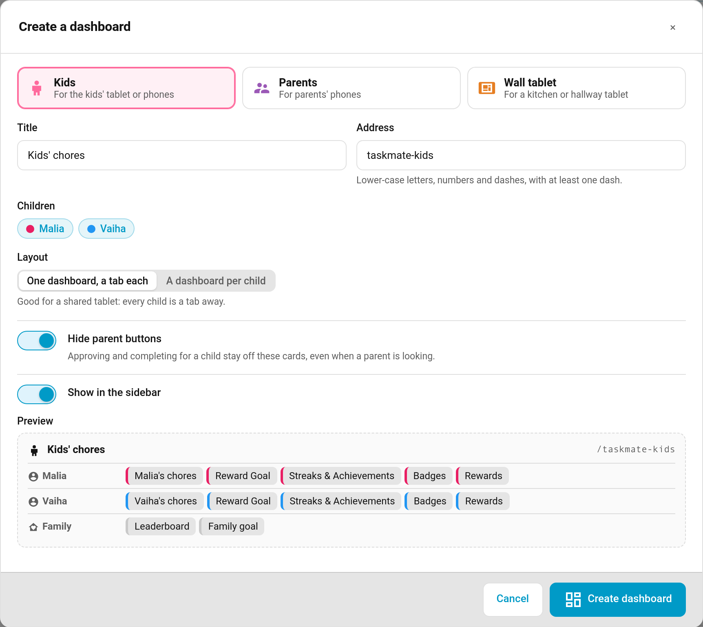

# Ready Made Dashboards

Don't want to build dashboards card by card? TaskMate can make a whole dashboard for each person in the house, filled in with your children, their colours and the right cards. It's saved once as an ordinary Home Assistant dashboard. After that it's yours: edit it, rearrange it, add your own cards, or delete it.

> **New in v6.3.0**

---

## Where to Find It

- **Settings.** **TaskMate panel → Settings → Ready-made dashboards.** Each preset has a tile with a **Create…** button.
- **Command search.** Press **Ctrl K** and type "Create a dashboard".
- **Setup wizard.** The [setup wizard](Setup-Wizard.md) has a **Dashboards** step with the same presets.

Once a preset exists, its tile shows **Created** with an **Open** button. **Create…** is still there if you want a second copy at another address.

---

## The Presets

| Preset | Address | What it creates |
|--------|---------|-----------------|
| **Kids** | `/taskmate-kids` | A tab for each child with their chores, reward goal, streak, badges and rewards, in the child's colour. A **Family** tab with the leaderboard and family goal |
| **Parents** | `/taskmate-parents` | **Today**: approvals, the chore board and the parent dashboard. **Points**: points display, bonuses, penalties and leaderboard. **Insights**: weekly, graph, activity and calendar |
| **Wall tablet** | `/taskmate-wall` | The [kiosk card](Kiosk-Mode.md) full screen, plus an optional chore board as a second tab |

---

## Creating One

**Create…** opens a dialog where you set the title and the address. A **Preview** at the bottom lists every tab and card the dashboard will have, and it updates as you change the options.

| Option | Presets | Default | What it does |
|--------|---------|---------|--------------|
| **Title** | all | Kids' chores / Parents / Chore wall | The name in the sidebar and the dashboard list |
| **Address** | all | see above | Lower-case letters, numbers and dashes, with at least one dash |
| **Children** | Kids | all children | Which children get a tab. Guest profiles are left out |
| **Layout** | Kids | One dashboard, a tab each | **One dashboard, a tab each** suits a shared tablet: every child is a tab away. **A dashboard per child** suits a child's own phone: each child gets their own dashboard at the address followed by their name, e.g. `/taskmate-kids-malia` |
| **Hide parent buttons** | Kids | on | Sets the cards' `show_parent_actions: false`, so nobody can approve, or complete a chore for a child, from these cards, even if a parent is signed in. See [Parent Access](Parent-Access.md) |
| **Admins only** | Parents | off | Hides the dashboard from users who aren't Home Assistant admins. Leave it off if a parent isn't an admin; the cards still check parent rights before any action |
| **Add a chore board tab** | Wall tablet | on | The whole family's day at a glance, one swipe away from the kiosk |
| **Show in the sidebar** | all | on (off for Wall tablet) | Whether the dashboard appears in Home Assistant's sidebar |

Tap **Create dashboard** and it's ready. The toast confirms it, and the tile changes to **Created / Open**.

### It Never Overwrites

Every address is checked before anything is written. If a dashboard or panel already uses one, the dialog says "Already in use: /taskmate-kids. Pick another address." and nothing is changed. With **A dashboard per child**, every child's address is checked first, so you never end up with half a set.

---

## Good to Know

- **It's a starting point.** TaskMate doesn't keep a dashboard in sync once it's made. Add a child later and either add their tab by hand, or delete the dashboard and create it again.
- **Badges cards point at each child's own badges sensor.** TaskMate looks the sensor up rather than guessing its name, so it keeps working with Home Assistant 2026.6+, which puts the device's area in front of new entity ids.
- **Wall tablet tips.** The kiosk card fills the screen in a panel view. Its full-screen button hides the browser chrome. To also hide Home Assistant's sidebar and header, pair it with the *kiosk-mode* plugin from HACS. Turn on **Bounty Board** in the kiosk card's editor if you use [bounties](Bounty-Board.md).
- **Card designs.** The cards follow your default [card design](Card-Design-Styles.md), and you can change any card's design afterwards in the dashboard editor.

---

## Related

- [Setup Wizard](Setup-Wizard.md) — the Dashboards step
- [Dashboard Cards](Dashboard-Cards.md) — every card and its options
- [Kiosk Mode](Kiosk-Mode.md) — the wall tablet card
- [Parent Access](Parent-Access.md) — what parents and children can do
- [Card Design Styles](Card-Design-Styles.md) — the six designs
